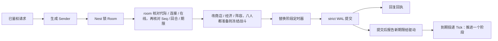
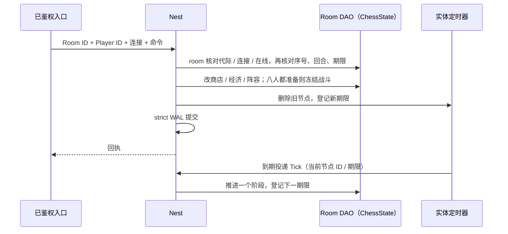

# 自走棋框架学习与验收

本手册把“八人一局、共享卡池、准备 / 战斗阶段轮转、按排名领奖”的自走棋业务路径映射到 core 的正式接口，分两部分：**第一部分“学习”**讲框架怎么用、为什么这样设计，给出阅读顺序与可编译的调用示例；**第二部分“验收”**说明脚本证明什么、不证明什么。棋子、羁绊、经济与战斗规则由游戏定义。下面的业务夹具（三种棋子各 32 张的共享卡池、三格商店、三格战场加六格备用席、一 / 三 / 九张对应一 / 二 / 三星、准备 10 秒 / 战斗 1 秒、至多 8 回合、最多 32 步的确定性战斗）只是学习和验收样例：框架与生成器不包含任何自走棋规则，生成器也不生成这些业务文件；完整的参考应用仍是 [game-demo](../../demo/README.md)。其他游戏类型的手册见 [SLG](SLG-INTEGRATION.md)、[MMORPG](MMORPG-INTEGRATION.md)、[MOBA](MOBA-INTEGRATION.md)、[卡牌 RPG](CARD-RPG-INTEGRATION.md)、[合成休闲](MERGE-CASUAL-INTEGRATION.md)、[放置模拟](IDLE-SIM-INTEGRATION.md)。

## 第一部分：学习

### 1. 适合谁、先读什么

适合准备用 core 做自走棋、多人回合竞技一类游戏后端的工程师。先读[入门](../GETTING-STARTED.md)、[Nest / Entity](guide/02-nest-entity.md)、[DataEngine](guide/03-dataengine.md)；第一次学建议先读完 [SLG 手册](SLG-INTEGRATION.md)的第一部分（Entity / DAO / Nest / 实体定时器的基本接法讲得最细），再读本篇；多实体领奖的写法与 [卡牌 RPG](CARD-RPG-INTEGRATION.md) 的开局 / 领奖相同。

本类型选择**一局一个权威实体**：八名玩家的商店、经济、阵容和共享卡池都放在同一个对局房间里，所有玩家的操作由它的 Nest 锁串行裁决；战斗由服务器在阶段切换时用冻结的阵容算出结果。不需要给每张卡建 Remote 实体，也不需要 Lockstep 的实时输入广播。

R9（2026-11-17）起本夹具按“装模块 + 只写模块没覆盖的部分”组装（[R9 方案 §3.9](../maintenance/PLAN-2026-11-17-r9-genre-modules.md#39-自走棋auto-chess)）：对局房间就是 **room** 模块的 `Room` 实体（容量 8；席位、代际与连接、在线、断线接管），排名奖励走 **wallet**，建档走 **enter**；共享卡池与商店、经济、合星、阶段推进、确定性战斗与排名仍是手写的玩法核心（shop 模块是“金币买道具”，不是共享卡池；turn 模块是顺序回合，不适合八人同时准备）。

### 2. 模块分工：自走棋里的状态归谁

| 业务状态 | 拥有者 | 框架接法 | 业务边界 |
| --- | --- | --- | --- |
| 共享卡池、八席的商店 / 经济 / 等级 / 阵容、阶段与回合、战斗快照、排名、领奖事实、每席命令回执 | `RoomDao` 末尾追加的 `ChessState`（业务 JSON）与 `ChessWakeTimer` | room 模块的 `Room` 已是 World 锁档 | 整局是一段业务 JSON，每席账本至多 128 条；席位的代际与连接不在 JSON 里（归 room） |
| 八个席位、代际与连接、在线、断线接管、名单准入 | **room** 模块的 `Room`（`RoomDao.Seats` / `Online`） | 开房在 `ChessInit` 里 `Room().Open(8)`；玩家经 `RoomJoin` 入座、`RoomReconnect` 接管；断线订阅自动 `RoomDisconnect`；名单准入是 `event.RoomJoining` 监听（`game/entities/room/chess.go`）；命令先过 `Room().Authorize` | 在线状态不落库，重启后全员断线；房间不广播 |
| 阶段期限（准备超时、战斗结算） | Room 的实体定时器（类型号 `TimerChessPhase`）+ `ChessWakeTimer` | `roost add timer --entity Room`；节点存 DAO，驱动到期投递 Tick | 每次到期只推进一个阶段；加载后到期节点只触发一次，框架不追帧 |
| 永久金币 | **wallet** 模块（`PlayerDao.Wallet`） | 领奖 `Wallet().Add(奖励)`；“领过没有”由房间上的 `Claimed` 保证，所以用不留回执的 `Add` | 只承接领奖；跨 sid 发奖另接 Remote / Saga |
| 建档 | **enter** 模块（`PlayerDao.Enter`） | 进入游戏时 `EnterInit`；领奖查 `Enter().Built()` | 只装 enter（Q6），不装 login / portal |
| 领奖 | Player + Room | 多实体 Sender `MultiSync_ChessClaim`：房间的 `Claimed` 与 wallet 金币同一 strict 事务 | 排名由服务器终态决定，客户端不能传胜者或奖励额 |
| 配置（棋子张数 / 价格 / 属性、阶段时长、回合上限） | configdata Store / Snapshot | 注册对象定义 → Load 时校验 → 成局时捕获并整份写进对局 | 已开始的对局沿用成局那一代 |
| 成局名单与随机种子 | 匹配 / 房间服务 | `Sync_ChessInit` 开房并首次固定八个完整 Player ID、服务器种子与配置 | 同一 Room ID 改名单被拒、不重掷种子；已有人入座的普通房不能改造成对局房 |
| 客户端看到的对局 | 业务视图 `View` | 锁内读取，按观察者裁剪 | 只有本人能看自己的经济、商店与备用席；不含种子、卡池余量和对手账本 |
| 登录与账号 | account / Player 静态 sid | 复用正式生命周期与登录鉴权 | 夹具直接用合成的已鉴权身份与固定连接串；账号链见 [玩家接入](PLAYER-ACCESS.md) 与 game-demo |



`strict` 保证回复前 WAL fsync，不保证回复时 Mongo 已投影（[DataEngine](guide/03-dataengine.md)）。

### 3. 共享卡池、阶段与领奖：如何使用

#### 3.1 生成工程从哪来

在仓库根目录使用 go.mod 声明的工具链运行：

```bash
ROOST_AUTO_CHESS_KEEP=1 bash scripts/test-auto-chess-generated.sh   # 保留生成工程以便阅读；不加 KEEP 时成功即删除
```

脚本打印临时目录，生成工程在其中的 `project/`。它做的事就是一个新工程的接入步骤：

1. `roost project new auto-chess-practice -module example.com/auto-chess-practice -template game`；
2. 装模块：`roost module add room wallet enter`（脚本经公用的 [`genre-common/modules.sh`](../../scripts/testdata/genre-common/modules.sh) `add`；Player / Room 的主 DAO 与玩家 TCP 接入由安装计划代办），再 `roost add timer --entity Room`；
3. 业务只改这几处：在 room 模块的 `db/def/room.go` 的 `RoomDao` 末尾加 ``ChessState string `store:"chess_state" dao:"nosync"` `` 与 ``ChessWakeTimer int64 `store:"chess_wake_timer" dao:"nosync"` ``；放入业务包 `game/modules/autochess/`、定时回调 `game/entities/room/timer_handlers.go`（覆盖 `add timer` 生成的示例）、名单监听 `game/entities/room/chess.go` 与 handler `game/handler/auto_chess.go`。Room 的实体注解已经是 `EntityCategoryWorld`（room 模块写的），领奖时 Room 与 Player 一起锁，锁序固定，不用再改；Player 不再加金币与建档字段（wallet / enter 的状态由安装器追加）；
4. 接入公共 Robot：在最终 `roost generate` 之前运行 `python3 scripts/testdata/robot-common/install.py <仓库根> <工程根> auto-chess`，安装业务 PB、已鉴权 TCP → Sender 接线、`loadtest.Commands`、`cmd/robot` 与网络用例 `game/handler/robot_network_test.go`（自定义 module 由安装器读 go.mod）；
5. `roost generate` 生成组件、访问器和 Sender，不手改生成文件。加字段时 generate 会打印 `WARN: … new stored key …`：这是 DAO 持久键变化的提示（加字段不需要迁移，老文档读成零值），见第 7 节。

生成的 `internal/bootstrap/generated.go` 已用 `wiring/entitytimer` 的 Mod 装配 Room 的定时器驱动（绑定 Nest、启动与停止投递循环；业务时间是驱动缺省的 `fctx.Now`），`internal/registry/nest_gen.go` 已登记 handler；业务不手写这两处接线。测试里看到的 `TimerDriver.SetClock` / `Bind` / `DeliverDue` / `Start` 是用例自己搭 Nest、控制投递时机的替身接线，不是生产装配要抄的步骤。

#### 3.2 阅读顺序

进入 `project/` 后按顺序读（括号里是仓库内的源文件）：

| 顺序 | 文件 | 先回答的问题 |
| --- | --- | --- |
| 1 | `game/modules/autochess/rules.go`（[rules.go.txt](../../scripts/testdata/auto-chess/rules.go.txt)） | 配置怎样经校验发布？对局为什么在成局时冻结一代？ |
| 2 | `game/modules/autochess/state.go`（[state.go.txt](../../scripts/testdata/auto-chess/state.go.txt)） | 一局里有什么？卡池张数守恒怎样校验？视图怎样按观察者裁剪？商店抽卡怎样由种子 + 序号决定？ |
| 3 | `game/modules/autochess/match.go`（[match.go.txt](../../scripts/testdata/auto-chess/match.go.txt)） | 命令怎样核对序号 / 回合 / 期限（代际与连接已由 handler 交给 room）？八人准备后怎样冻结战斗？战斗、淘汰、收入与终局怎样结算？ |
| 4 | `game/handler/auto_chess.go`（[handlers.go.txt](../../scripts/testdata/auto-chess/handlers.go.txt)） | 成局（开房）、命令身份（`chessMember` 交给 room）、查回执、领奖（wallet）分别在哪个锁与提交边界里生效？阶段定时器在哪里替换？ |
| 5 | `game/entities/room/timer_handlers.go`（[timer_handlers.go.txt](../../scripts/testdata/auto-chess/timer_handlers.go.txt)）、`game/entities/room/chess.go`（[room_roster.go.txt](../../scripts/testdata/auto-chess/room_roster.go.txt)） | 到期回调怎样核对身份？离线很久为什么只推进一个阶段？名单怎样拦在 room 的入座之前？ |
| 6 | `game/handler/syncsender/` | 生成的 Sender 怎样把 Match ID、Player ID 与业务参数交给 Nest；业务调用它，不手改 |
| 7 | [gameplay_test.go.txt](../../scripts/testdata/auto-chess/gameplay_test.go.txt)、[rules_test.go.txt](../../scripts/testdata/auto-chess/rules_test.go.txt) | 并发、拒绝、回滚、阶段推进与隐私怎样实际验证 |
| 8 | [persistence/recovery_test.go](../../scripts/testdata/auto-chess/persistence/recovery_test.go) | 已确认但未投影的记录在 SIGKILL 后怎样恢复？冷加载后驱动怎样续完整局？ |

身份要分开理解：Room 与 Player 用框架完整 EntityID；每席命令的 `Seq` 是该席在本局内永久递增的序号，`Epoch` 是 room 分配的席位代际（每次 `RoomReconnect` 接管加一、只增不减），连接标识是服务端 Session 给的这条物理连接，`Round` 是命令所属回合；商店抽卡用对局的 `Draw` 序号；定时器节点 ID 又是房间内的独立身份。配置内容 hash、业务 `State` 里的 `Schema`、DAO 的 `_schema` 与 core 版本是四个不同的概念。

#### 3.3 用 Sender 调用

下面的文件放进保留的生成工程（例如 `internal/chessflow/flow.go`）可直接编译。`client` 是当前服务的 Nest 客户端，`catalog` 是进程启动时 `autochess.OpenCatalog` 打开的配置；调用方不传业务时间：handler 的 `nowUnixMilli` 参数由生成的分发包装从本条消息冻结的业务时间（`fctx.NowMilli()`，见 [guide/10-time §1A](guide/10-time.md#1a-业务时间一律取自-ctxd22-1)）填，Sender 签名里没有它；EntityID 都是完整 ID：

```go
package chessflow

import (
	"context"
	"crypto/rand"
	"encoding/hex"

	roomentity "example.com/auto-chess-practice/game/entities/room"
	syncsender "example.com/auto-chess-practice/game/handler/syncsender"
	"example.com/auto-chess-practice/game/modules/autochess"
	roomlogic "example.com/auto-chess-practice/game/modules/room"
	"github.com/tjbdwanghaibo/roost-core/framework/app"
	"github.com/tjbdwanghaibo/roost-core/framework/configdata"
	"github.com/tjbdwanghaibo/roost-core/framework/nest"
	"github.com/tjbdwanghaibo/roost-core/infra/network/gateway"
)

// startMatch 是匹配服务成局后的调用：名单、种子、配置与时间都来自服务器。matchUnique 是服务端分配、不复用的房号；
// 开房与名单同一笔事务（ChessInit 里调 Room().Open(8)），同号重试不重掷种子；改名单被拒。
// 玩家建档走 enter 模块（进入游戏时的 EnterInit），领奖前必须建成。
func startMatch(ctx context.Context, registry *app.Registry, client nest.Client, catalog *configdata.Store,
	matchUnique int64, seats [autochess.Seats]int64) (int64, error) {
	rules, err := autochess.CaptureRules(catalog.Current())
	if err != nil {
		return 0, err
	}
	raw := make([]byte, 32)
	if _, err := rand.Read(raw); err != nil {
		return 0, err
	}
	matchID, err := roomlogic.EntityID(matchUnique)
	if err != nil {
		return 0, err
	}
	rooms, err := roomentity.LifecycleFromRegistry(registry) // 与 room.Open 相同：先经 lifecycle 取到或建出实体
	if err != nil {
		return 0, err
	}
	if _, _, err = rooms.GetOrCreate(ctx, matchUnique); err != nil {
		return 0, err
	}
	return matchID, syncsender.NewAutoChessSender(client).Sync_ChessInit(ctx, matchID, seats, rules, hex.EncodeToString(raw))
}

// buyAndReady 是已鉴权入口的调用顺序：玩家先经 room 的 RoomJoin（或换连接后的 RoomReconnect）入座，再读本人视图、
// 买商店第一格、宣布准备。每条命令带视图里的 Epoch / 下一个 Seq / 当前回合；Player ID 与连接标识都取自服务端 Session。
func buyAndReady(ctx context.Context, client nest.Client, session gateway.Session, matchID int64) error {
	playerID := session.Principal().PlayerID
	connection, err := roomlogic.ConnectionKey(session)
	if err != nil {
		return err
	}
	s := syncsender.NewAutoChessSender(client)
	for _, kind := range []string{"buy", "ready"} {
		v, err := s.Sync_ChessView(ctx, matchID, playerID, connection)
		if err != nil {
			return err
		}
		command := autochess.Command{Seq: v.Self.NextSeq, Epoch: v.Self.Epoch, Round: v.Round, Kind: kind}
		if _, err := s.Sync_ChessCommand(ctx, matchID, playerID, connection, command); err != nil {
			return err
		}
	}
	return nil
}

// claim 在终局后领奖：奖励由服务器排名推导，经 wallet 到账，重试返回同一额度、不重复发放。
func claim(ctx context.Context, client nest.Client, matchID, playerEntityID int64) (int64, error) {
	return syncsender.NewAutoChessSender(client).MultiSync_ChessClaim(ctx, playerEntityID, matchID)
}
```

`Kind` 支持 `buy`（`A` 是商店格）、`sell`（`A` 是 0～8 的单位格）、`move`（`A` / `B` 交换两格，0～2 是战场）、`refresh`、`xp`、`lock`（切换锁店）与 `ready`。公网入口只接收命令本身；Room ID 由房间路由给出，Player ID、连接标识、配置、种子、服务器时间、胜者与奖励都由服务器填。断线与接管是 room 模块的事：连接关了断线订阅自动 `RoomDisconnect`，换了连接的玩家带上次的代际发 `RoomReconnect`（客户端协议），旧连接的断线事件踢不掉新连接。每次调用的错误都要按业务逐次处理，示例只演示调用方式；接网络协议时把 `autochess.ErrRule` 映射成业务错误码，存储 / 内部故障按[回复错误判别](guide/02-nest-entity.md#6-回复错误判别是否可能已提交能否重试)处理。

`matchUnique` 要用 id-gen 发的新号，经生成的 lifecycle `GetOrCreate` 取到或建出实体（与 `room.Open` 相同）：直接 `Create` 不读存储，不能复用删过档或存了没加载的 ID（[删档后该 ID 不可再用，D10](guide/03-dataengine.md#4-冷加载与-schema)）。对局归档要与领奖防重一起设计，不能删掉房间再用同一 ID 重建（room 的已关闭房号也永不再开）；夹具在测试里直接建实体，没有演示 id-gen、lifecycle 与匹配接线。

#### 3.4 十三个场景各学什么

| 场景（测试名前缀 `TestAutoChess`） | 业务选择 | 学到的框架契约 |
| --- | --- | --- |
| `MergeSellAndPoolConservation` | 九张同种连锁合成三星、出售三星 | 合星与出售都按真实张数守恒，九张全部回池 |
| `CombatReplayOddByeAndElimination` | 七人存活（一人轮空）、三星对战 | 战斗是纯函数，能从冻结阵容重算出同一结果；奇数席一人轮空、淘汰定名次 |
| `StrictDecodeAndBoundedRecovery` | 状态被改、凭空多出卡、伪造战斗伤害、离线一小时 | 严格解码拒绝不守恒与伪造结果；一次推进只走一个阶段，不快进整局 |
| `CatalogReloadDoesNotRepriceFrozenMatch` | 合法与非法热更 | 合法热更不改已开始对局的配置；非法热更整次被拒、当前快照不变 |
| `SharedPoolConcurrentPurchaseAndRetry` | 八席同时买、每条命令四个并发 | 一局一个锁 + 每席序号：每席只买到一次、一份回执，卡池守恒 |
| `ReadyRaceFreezesOneBattle` | 八席各三个并发准备 | 只冻结一场战斗、只挂一个定时器，准备后不能再改；下一阶段只结算一次 |
| `DeadlineRejectsLateInputAndDisconnectCannotStall` | room 标断线、期限后到达的准备 | 掉线席位不能操作也不阻塞阶段；期限到了的命令被拒，驱动照常推进 |
| `ReconnectFencesAndPrivateView` | `RoomReconnect` 接管、旧代际断线事件、旧连接查回执、局外人查看与入座 | 接管后旧代际的命令被拒、旧代际的断线返回 changed=false，新连接可按原序号查旧回执、旧连接拿新代际查被拒；局外人查看与入座被拒，视图不含种子、不与存档共享内存 |
| `FormationLevelShopLockAndConfigFrozen` | 上阵数受等级限制、锁店、升级、成局重试带新配置 | 进入战斗时阵容被冻结；锁店跨回合保留；同 Match 重复成局不改配置、不重掷 |
| `UndoRestoresPoolRandomReceiptAndTimer` | 刷新商店后 handler 失败 | 卡池、费用、抽卡序号、回执与定时器节点一起回滚，重试照常生效 |
| `TerminalRanksAndConcurrentRewards` | 打到终局、同分按席序、领奖中途失败、八人各四个并发领奖 | 多实体领奖事务：失败时房间与 wallet 一起回滚；每人只得一份按排名的奖励；终局后不再挂定时器 |
| `LedgerFullKeepsOriginalReceipt` | 一席账本填满 128 条 | 满了拒绝新命令而不淘汰旧回执，旧命令重放仍得原回执 |
| `RobotBusiness` | 公共 Robot 经 loopback TCP / PB 发本玩法的业务命令：每条新连接先接管席位（`reconnect` → room 的 `RoomReconnect`），业务闭环、结算重试、TCP 重连与拒绝路径 | 网络接入、正式 Sender / Nest 与 DAO 是同一条链路；鉴权与提交器是替身（[Robot](ROBOT.md)） |

基础用例由用例调用驱动的 `DeliverDue` 推进阶段（实体一直在内存，不启动投递循环）。上述数值是样例，不是公共框架规则。这些场景实际证明到哪一步见第 10 节。

#### 3.5 模块化之后场景语义的变化（R9，2026-11-17）

场景名与条数（13）不变；下面几条的断言改成读模块状态，旧断言 → 新断言：

| 场景 | 旧断言 | 新断言 |
| --- | --- | --- |
| 全部 Nest 场景 | 建档 `Sync_ChessPlayerInit` 置 `Initialized`；成局后八席直接在线、代际 1 | enter 的 `Sync_EnterInit`，领奖查 `Enter().Built()`；成局后八席各经 room 的 `RoomJoin` 入座，代际由 room 分配（每席不同） |
| `ReadyRaceFreezesOneBattle` | 准备后用 `Epoch: 1` 的新命令被拒 | 用这一席当前的代际发新命令被拒（准备后不能再改） |
| `DeadlineRejectsLateInputAndDisconnectCannotStall` | 夹具自己的 `Sync_ChessConnect(ticket 1, false)` 标断开 | room 的 `RoomDisconnect` 标断线（changed=true，其他席的视图 `Connected=false`）；断线席位的新命令由 room 的 `Authorize` 拒绝（`room_stale_epoch`），被拒且状态、定时器不变，阶段照常推进 |
| `ReconnectFencesAndPrivateView` | `Sync_ChessConnect(ticket 2, true)` 接管；旧票的断开返回错误；按 Epoch 2 查回执 | `RoomReconnect(旧代际, 新连接)` 拿新代际；旧代际的断线返回 changed=false、不报错、新连接仍在线；按新代际、新连接查回执；另加“旧连接拿新代际查回执被拒（`room_stale_epoch`）”“局外人 `RoomJoin` 被名单监听拒绝（`room_not_member`）” |
| `TerminalRanksAndConcurrentRewards`、`RobotBusiness` | `Player.Gold == (9 - 名次) × 10` | wallet 的 `Wallet.Coins == (9 - 名次) × 10`（领奖改调 `Wallet().Add`；原夹具的 100 万上限换成 wallet 的溢出检查） |
| `RobotBusiness` | TCP 重连后原样重放第一条命令得到原回执 | 每条新连接先接管席位；TCP 重连并接管之后，旧代际的原样重放被拒（客户端改用 `ChessReceipt` 按新代际查旧回执）；跑完把席位交还夹具的连接 |
| `MergeSellAndPoolConservation` 等 4 条规则场景 | `Apply(玩家, 命令, 时刻)` | 多一个参数“room 报告的在线状态”，规则场景传 true；状态里不再有每席的 `Epoch` / `Connected` |
| `TestAutoChessRealCrashRecovery` | WAL 42 条未投影；命令都带 `Epoch: 1` | 50 条（多 8 次 `RoomJoin`）；命令带各席入座时 room 分配的代际；另断言冷加载后 room 席位与代际都在、全员断线，同一连接、同一代际的命令重放仍得原回执，全员断线不妨碍阶段推进到终局 |

变异证明（把模块调用去掉或改错，对应场景变红，恢复后变绿）记在 [R9 批 1D 证据](../maintenance/evidence/r9-1d-20261117/README.md)。

### 4. 配置与随机为什么在成局时冻结

`OpenCatalog` 用 `configdata.MustRegisterObject` 登记 `chess_rules`（`chess.json`），`Validate` 失败整次加载 / 重载被拒，旧快照继续服务（[业务表发布](guide/07-config.md#3-业务表发布)）。成局时捕获 `catalog.Current()` 再 `CaptureRules`，整份 `Rules` 写进对局：八名玩家在一局里看到同一代价格与属性，热更只影响新开的对局。商店抽卡由服务器种子与对局的 `Draw` 序号派生，所以 handler 失败回滚后重试仍是同一结果；种子由服务器安全随机源生成（测试固定种子便于复现），不进视图。公网请求**不携带** Rules 或种子。

### 5. 阶段、期限与断线

每次写对局时 handler 的 `saveChess` 替换阶段定时器（`RemoveTimer` 旧节点、`NewTimerAt` 新期限、ID 记进 `ChessWakeTimer`），终局后不再挂。准备阶段八名存活玩家都准备时，命令事务里直接冻结四场战斗；否则准备期限到了由定时器冻结，用玩家当时的阵容托管。战斗期限到了结算伤害、淘汰、收入与刷新，进入下一回合；达到回合上限或只剩一人时排名收口。



- 回调核对节点 ID 与原期限，旧计时事件不会推进新阶段。**框架不追帧**：实体不在内存期间到期的节点，加载后只触发一次（[按实体的持久定时器](guide/10-time.md#4-按实体的持久定时器)）；本例据此只推进一个阶段，下一期限从实际触发时间起算，不会因为离线一小时在一次加载里打完整局。
- 掉线（room 的 `RoomDisconnect`，连接关闭时由断线订阅自动调）的席位不能再发新命令（`Room().Authorize` 答 `room_stale_epoch`），但不阻塞阶段：期限到了照常推进。期限之后到达的命令被拒。
- 接管（room 的 `RoomReconnect(旧代际, 新连接)`，CAS 拿新代际）：旧代际的命令被拒、旧代际迟到的断线事件返回 `false` 不影响新连接，新连接可以用当前代际按原序号查旧回执（`Sync_ChessReceipt(match, player, connection, epoch, seq)`）。代际由 room 在 Nest 事务里分配，连接标识来自服务端 Session，不是客户端传一个数字就算接管。
- 已有回执的重放与查回执只经 `Room().Member` + 连接核对、不要求在线：进程重启后全员断线（room 的在线状态不落库），原连接、原代际的重试仍得原回执；新命令要先 `RoomReconnect`。
- 结果未知时保留原 Room ID、Player ID、Epoch、Seq 查询或原样重发，不换序号再买一次。

### 6. 领奖与幂等身份

`MultiSync_ChessClaim(player, match)` 同时锁 Player 与 Room：回查终态与该席排名，奖励 `(9 - 名次) × 10` 金币经 wallet 的 `Add` 到账，与房间的 `Claimed` 在同一 strict 事务里提交；并发重试和冷加载后的重试都只得一份（“领过没有”只看 `Claimed`，所以用不留回执的 `Add`）。领奖要求 Player 已经经 enter 的 `EnterInit` 正式建档（`Enter().Built()`）——只 `Create` 出内存实例不代表记录已持久化。领奖不要求在线，也不过 room 的身份围栏（玩家身份取自会话）。这是同一原服内的多实体原子提交；Player 在别的 sid 时应经 Remote / Saga 回原服发奖，本地 MultiSync 不提供跨 sid 原子性（Saga 原生步骤的单进程容量有限，见 [Saga 指南 §5](guide/06-saga.md#5-接入与运维)）。

每席账本是对局里的持久业务事实，与资产同事务；它不是服务的短期去重环。每席至多 128 条，满了拒绝该席的新命令而不淘汰旧回执；定时器仍会推进，终局后仍能领奖。

### 7. 重连视图与存储格式

重连时调用锁内的 `Sync_ChessView(ctx, match, player, connection)` 取当前视图（先经 room 的 `View` 核对成员与连接，断线也能读）：公开部分是各席的血量、名次、准备状态、room 报告的在线状态与战场三格；本人部分加上当前代际、经济、等级、商店、备用席与下一个序号；不含种子、卡池余量、对手的商店 / 备用席 / 账本。不要给 `State` 加 Sync 标记或直接下发整个实体；需要推送时按 [self_sync](PLAYER-ACCESS.md#7-玩家看自己的状态self_sync) 写业务视图。夹具没有联调公网协议、观战或客户端引擎。

存储格式要分两层看：

- **DAO 持久键**：`chess_state` / `chess_wake_timer`（以及模块的 `wallet` / `enter` / `seats` 等）这些 `store` 键就是 Mongo 里的键（DESIGN-TODO D13），`roost add timer` 加的节点与种子字段同理。以后改 Go 字段名要保留原 `store` 键；改了 `store` 键或删字段时，库里的旧键不再加载、下一次整文档写回即丢失，`roost generate` 与加载时只打 WARN。要改就先离线迁移（[schema 变更手册 §1](SCHEMA-MIGRATION.md#1-现行规则运行时只认当前-schema)）。
- **业务 JSON**：`ChessState` 里的 `Schema=1` 是业务格式版本，加载时拒绝未知字段、未知版本、卡池张数不守恒与重算不一致的战斗结果。改业务格式同样要离线迁移并配套代码，只改 DAO 字段的 `_schema` 不等于迁移了 JSON 内容。

### 8. 接入时容易踩的问题

- **每张卡一个实体**：共享卡池的一致性靠“一局一个锁”最简单；拆成许多实体后买卡要跨实体事务，锁序和死锁都要自己处理。
- **名单监听要放行普通房**：`OnChessJoining` 只拦 `ChessState` 非空的房；把普通房也拦住，room 模块自带的 34 条场景（用的就是普通房）在 `module verify` 里会失败。
- **连接标识必须来自服务端 Session**：`room.ConnectionKey(session)`；从客户端 PB 里取或用玩家号代替，旧连接就能操作新席位（room README“连接标识必须可信”）。
- **测试里的全局定时器时钟**：夹具调 `room.TimerDriver.SetClock`（Room 的定时器驱动是包级的），`SetClock(nil)` 撤不掉；同一测试进程里先跑本玩法再跑别的 Room 定时器场景（例如再装 turn）会读到这只时钟。脚本与 `module verify` 按 `-run` 分开跑，不受影响（[说明](../maintenance/evidence/room-authorize-20261117/README.md)）。
- **定时器回调只改本实体**：回调里只经组件 API 操作本房间的期限，不另建调度器、不直接改节点 map；需要 Player 一起变化的事交给多实体 handler（[SLG §6](SLG-INTEGRATION.md#6-定时器回调能做什么)）。
- **handler 里不发同步 Nest 请求**：已知参与者一次传给多实体 Sender；handler 内的同步请求被框架拒绝（`ErrSyncInHandler`）。
- **锁目标要能被识别**：不写 `target` / `targets` 时，Nest 生成器把类型名含 `Entity` 的参数推断为锁目标（本例 `IChessMatchEntity` / `IChessPlayerEntity`），找不到时 `roost generate` 报错并点名 handler（见 [Nest 生成器](../../codegen/docs/NEST_RUNTIME.zh-CN.md)）。

### 9. 练习

加“羁绊：同种三个上阵时攻击加成”或“选秀回合”。先写清拥有者、幂等身份（哪个序号域）、事务参与者、配置代际和阶段推进的恢复语义，再选 Nest / 定时器 / Saga，不另造一套与框架平行的持久或并发状态机。

## 第二部分：验收

### 10. 业务纵切证明什么

```bash
bash scripts/test-auto-chess-generated.sh
```

脚本按 3.1 的步骤生成工程，replace 指回当前仓库，必须实际通过 13 条顶层 race 场景（3.4，含 1 条业务 Robot）且无 skip，随后执行消费者 build / vet、`roost id check` 与 `roost generate --check`，再经 `genre-common/modules.sh verify` 跑已装模块自带的场景（`roost module verify --json`：room 34、wallet 17、enter 29，每个模块通过数等于本检出 `modules/<名>/module.yaml` 的 `verify.pass`、0 skip）；成功删除临时工程，失败或 `ROOST_AUTO_CHESS_KEEP=1` 时保留。缺省模式由 `scripts/pretag.sh` 每次发版跑（根包 `TestGeneratedScriptsAreInPretag` 防止漏掉），并把真实依赖用例复制进工程只编译（`go vet`），生成器签名变化在发版前就会暴露；真实依赖模式不挂在 `dataengine-env.sh test`，改 `game` 模板、`add dao` / `add entity` / `add timer`、多实体 Sender 或 Nest 生成时手动跑。

业务 Robot 用例 `TestAutoChessRobotBusiness` 由 `scripts/testdata/robot-common/install.py` 安装（3.1 的 Robot 一步）：真实 TCP / PB → 正式 Sender / Nest → DAO 的业务闭环、结算重试、TCP 重连及拒绝路径断言，同时生成 `cmd/robot` 与 `loadtest/README.md`。鉴权与持久化是替身，不能替代上线验收；十三类玩法的通过数与网络验收边界见 [Robot](ROBOT.md#当前验证结果2026-11-01)。

- **证明**：公共 CLI 与模块安装器生成的 Player / Room DAO（room、wallet、enter 的状态加上自走棋追加的字段）、Room 实体定时器、多实体 Sender 与 Nest 在 12 个业务组合下的事务、undo 回滚、锁顺序、业务幂等、room 身份围栏与期限核对；配置原子发布与对局冻结；视图按观察者裁剪。
- **不证明**：提交器是替身，不含文件 WAL fsync 与 Mongo；定时器由用例调用驱动的 `DeliverDue`，实体一直在内存，没有经过投递循环与加载后补触发；八个“玩家”是同进程里的并发调用，不是八个网络客户端；单进程，无 Redis / NATS；鉴权是合成的，连接标识是夹具给的固定串，断线由用例直接调 `RoomDisconnect`（不经断线订阅）。夹具里的数值是样例。

### 11. 真实 WAL / Mongo 崩溃恢复

先按[隔离环境说明](../../wiring/scripts/integration/README.md)准备独立 Mongo 副本集并设置地址变量（不要指向生产库或共享业务库；共享隔离环境下遵守那里的持锁与命名规则），再运行：

```bash
ROOST_AUTO_CHESS_REAL=1 bash scripts/test-auto-chess-generated.sh
```

它在第 10 节之后追加 `TestAutoChessRealCrashRecovery`（已登记根包 `integration_coverage_test.go`），用本次唯一的 DAO 库与 WAL 目录：

1. 子进程经 strict 文件 WAL 提交八名玩家建档（enter）、开房与名单，八人各经 room 入座，以及每人买卡、上阵、准备（第八人准备时冻结四场战斗）；后台投影关闭，断言 WAL 恰有 50 条已确认未投影的记录（9 个实体新建：Nest 之外 `Create` 新建持久实体时各补一条 strict 隔离事务；8 建档 + 1 开房与名单 + 8 入座 + 24 命令）后，父进程 SIGKILL 自己启动的子进程。
2. 父进程用同一 WAL 与 Mongo 冷加载（业务时间推进一小时），核对整局状态（卡池、冻结的战斗、回执）与定时器 ID，room 的席位与代际都在、在线状态为空（全员断线）；用原连接、原代际重放全部 24 条玩家命令得到原回执（重放不要求在线）；核对冷加载已把存量期限报告给驱动索引（`DueOf`）。
3. 启动驱动自己的投递循环（`Driver.Start`，用例不调用 `DeliverDue`、不手发 Tick）：循环对离线一小时的战斗阶段只补一次，进入第 2 回合准备、期限从当前业务时间起算（entitytimer `delivered_total` 增量 1）；之后用例每次把业务时间推到新期限，循环按时投递一次、推进一个阶段（计数逐次加 1），直到终局、不再挂定时器。终局时核对总数 = 1 + 2×(终局回合 − 1)（样例打满 8 回合，计数 15；第 1 回合的准备→战斗由写进程里第八人准备触发，不经定时器），全程 `redelivered_total` 增量 0。计数只有一个来源：Room 驱动只投递阶段节点，重放的玩家命令命中原回执、不重排定时器。停循环后八人各领奖三次，金币按名次各一份。
4. 正常关闭后再起第三个进程冷加载：核对整局状态与八人金币，再重放全部命令与领奖，结果不变。成功后删除本次库；失败保留生成工程、WAL 与库名供诊断。

用例确实依赖投递循环：把 `Start` 调用换掉再跑，用例在第 3 步等补触发处超时失败（`bounded wait expired`）。

- **证明**：strict 已确认的提交在 SIGKILL 后可从未投影 WAL 恢复（共享卡池、随机进度、冻结战斗、回执、room 席位与代际、阶段定时器），不会重新初始化整局；在线状态按 room 的契约清空，全员断线不妨碍阶段推进到终局；冷加载把存量期限报告进驱动索引；驱动投递循环在加载后只补一个阶段（投递一次）、之后每个期限投递一次并推进一个阶段到终局、无重投；跨进程重试不重复购买或发奖。
- **不证明**：提交在途 / 结果未知时的崩溃、磁盘断电、WAL 损坏或丢盘；循环在系统时钟下的长时间计时（用例冻结业务时钟、由循环按 MaxWait 重读）、准入失败重试与 Redeliver（由 entitytimer 包测试覆盖）；八个网络客户端、多进程 / 跨机、Redis / NATS；跨 sid 发奖；容量与长稳。

### 12. 结论怎样给

棋子、羁绊、经济与战斗缺少默认实现，不自动构成框架缺陷；合法接口调用下出现丢期限、卡池不守恒、重复扣费 / 发奖、状态越权或生成物编译失败，则应在公共实现中修复。本夹具接入时没有触发框架或生成器缺陷。当前存储是教学规模：每席账本 128 条、至多 8 回合、整局状态每次整体编码提交并在加载时重算战斗结果，没有生产吞吐或延迟承诺。

尚未实施或验收：真实匹配 / 取消 / 候补、入场扣费、经真实 TCP / Gate 的断线订阅、公网客户端与观战协议、装备 / 羁绊 / 选秀、自动奖励投递、赛季 MMR、长期归档、跨 sid 奖励（应经 Remote / Saga 回原服）、权威宿主 HA、容量与长稳（均不因此算框架缺陷）。

本机功能、跨机故障和长稳分别给结论；缺少实际证据的继续保留为未验收项。本部分是本游戏验收范围的完整说明；[KNOWN-LIMITS](../maintenance/KNOWN-LIMITS.md#游戏接入验收) 的游戏接入验收表只列一行摘要，不为每一轮另建报告。
