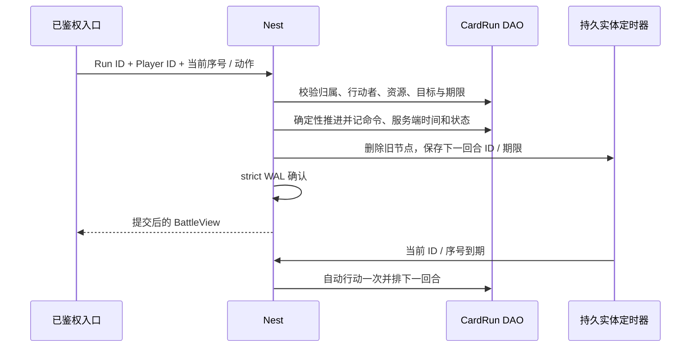

# 卡牌 RPG 场景到 Core 框架的学习与接入

本轮按“角色卡收集养成＋三人编队回合制 PvE”实践，主仓库是 core，ssr 仅作参考。业务数值用于教学：六种角色卡、三张上阵卡、三关、每关两波敌人、五抽保底、等级 / 星级 / 装备成长。它们不成为框架默认规则，也不代表正式商业游戏的内容和规模。

建议先读[入门手册](../GETTING-STARTED.md)、[Nest / Entity](guide/02-nest-entity.md)、[DataEngine](guide/03-dataengine.md)，再沿本文运行消费者。本类型选择服务端权威回合推进，客户端展示已提交状态；不需要以 Lockstep 的实时输入广播来驱动回合。

## 一、业务场景、拥有者与框架接法

| 场景 | 状态拥有者 | 框架与调用流程 | 业务边界 |
| --- | --- | --- | --- |
| 登录、角色与原服 | account / Player 静态 sid | 复用正式生命周期、登录鉴权与已绑定连接，入口给出完整 Player EntityID | 本消费者直接使用合成的已鉴权身份，未增加公网登录服务；账号链见 [MMORPG](MMORPG-INTEGRATION.md) / demo |
| 配置与热更 | configdata Store / Snapshot | 注册 Rules 对象 → Load / 校验 → 捕获一份 Snapshot → 内部 Sender | 字段、范围、卡池组成、关卡数值由业务校验；失败不发布，新请求捕获新配置 |
| 卡牌属性与战力 | 业务 HeroStats 声明 | `roost add attribute HeroStats` → 正式生成访问器和公式 → 更新 / 快照 | 生成 HP / Attack / Armor / Speed / Power；持久养成事实仍由 Player DAO 保存 |
| 首登资源与抽卡密钥 | Player DAO | 受信任首登初始化；crypto/rand 私有密钥由服务端产生 | 密钥存于服务端持久状态，客户端不能选择或读取；测试使用固定测试密钥 |
| 单抽 / 十连、保底 | Player DAO | `Sync_CardDraw`：钻石、HMAC 派生结果、保底计数、卡牌 / 碎片及完整回执一次提交 | 相同抽卡序号重放原结果；改变张数或跳序拒绝；测试概率 / 保底不是正式卡池运营规则 |
| 重复角色卡 | Player DAO | 已拥有模板转成该卡碎片和教学粉尘，不再增加同模板实例 | 当前一模板一张卡；正式唯一实例、多套装备与分解政策另建模 |
| 升级、升星、装备 | Player DAO | `Sync_CardManage`：校验目标级数 → 扣金币 / 粉尘 / 碎片 → 更新 → 留回执 | 缺卡、越级、材料不足、旧序号改内容均拒绝，重复成功操作不重复支付 |
| 编队、战斗属性冻结 | Player / CardRun | 上阵三张已拥有且不同的卡；开局经生成属性计算并拷贝为初始战斗属性 | 在局外养成 / 换队不追溯修改当前战斗 |
| 体力、关卡准入 | 同原服的 Player＋CardRun | `MultiSync_CardStart`：离线补算体力、关卡解锁、唯一开局序号、扣体力、Run / 定时器同事务 | 同一 Player 最多一局未结算；重试返回原 Run ID，不因新候选 ID 再扣一次 |
| 回合次序与权限 | CardRun DAO | 速度降序、相同速度按固定座位次序；正式 Sender 在锁内执行当前角色动作 | 客户端不指定行动者；只控制自己的当前角色，不能控制敌人或注入服务器超时命令 |
| 普攻 / 爆发 / 治疗 / 防御 | CardRun 参考模拟 | 业务动作校验 → `combat.ResolveDamage` → 血量 / 护盾 / 资源变化 | 复用框架定点伤害管线；治疗、目标、毒伤、法力和技能规则属于业务 |
| 敌方 AI、超时托管 | CardRun＋entitytimer | 服务器内部敌方入口；持久 TimerComponent 的当前 ID＋序号＋期限校验后推进 | 旧回调不会推进新回合；离线过期只补一次，从实际触发时间排下一回合 |
| 战斗重放与配置固定 | CardRun DAO | 保存完整 Rules / hash、初始编队、种子、命令与服务端时间、当前状态；加载时重算核对 | 未提交行为不参与回放；整段日志上限 120 次动作；不是通用 Skill Runtime checkpoint |
| 双波次、撤退与胜败 | CardRun DAO | 敌方清空进入下一波；全灭、动作上限或撤退形成终态 | 运行中不能领奖；客户端不能上报“我赢了” |
| 普通奖励 / 首通 / 星级 | Player＋CardRun | `MultiSync_CardClaim`：权威终态、所属 Player、开局身份、奖励、首通 / 星级、任务进度、领取事实同事务 | 同一原服本地多实体原子提交；不是跨 sid 十人即时原子奖励 |
| 扫荡、任务 | Player DAO | 已通关才可扫荡，顺序回执保证体力与奖励一次生效；获胜任务只领一次 | 当前扫荡复用关卡普通奖励，不再发首通；次数 / 条件 / 任务库为样例规则 |
| 断线查看与隐私 | 业务 ProfileView / BattleView | 已鉴权入口调用锁内的 `Sync_CardProfile` / `Sync_CardBattle` | 只返回允许字段，不同步原始 DAO State；后者含密钥与内部账本 |
| 真实崩溃与冷加载 | strict 文件 WAL / Mongo | 恢复原 WAL → 冷加载原 Player / Run / 定时器 → 重试原操作 → 续战 → 领奖后再进程冷加载 | strict 是 WAL durable，Mongo 可异步投影；未知结果查原身份，不能重建账号或清 WAL |

支付到账、邮件、活动、排行、跨服协作仍可按[服务篇](guide/09-services.md)、[Saga](guide/06-saga.md)与既有 demo 接入；本消费者没有把这些已有示例的历史通过记成卡牌钻石充值、卡牌邮件或正式跨服 PvP 的验收。

## 二、源码学习顺序与实际调用

| 顺序 | 业务源码 | 先回答的问题 |
| --- | --- | --- |
| 1 | [catalog.go.txt](../../scripts/testdata/card-rpg/catalog.go.txt) | 配置如何经校验发布？一个请求 / 一场战斗怎样固定一代？ |
| 2 | [attributes.go.txt](../../scripts/testdata/card-rpg/attributes.go.txt) | 哪些属性由业务声明？生成器如何管理脏位、派生 Power 和快照？ |
| 3 | [profile.go.txt](../../scripts/testdata/card-rpg/profile.go.txt) | 抽卡、成长、体力、准入和奖励身份分别存在哪？旧序号如何重放？ |
| 4 | [battle.go.txt](../../scripts/testdata/card-rpg/battle.go.txt) | 谁决定当前行动者 / 目标？同一配置、初始状态、种子和日志能否重放同一结果？ |
| 5 | [handlers.go.txt](../../scripts/testdata/card-rpg/handlers.go.txt) | Player、Run、定时器、扣款和领奖分别在哪个锁与提交边界一起生效？ |
| 6 | [timer_handlers.go.txt](../../scripts/testdata/card-rpg/timer_handlers.go.txt) | 回合结束怎样替换计时身份？离线很久为什么只补一次？ |
| 7 | [gameplay_test.go.txt](../../scripts/testdata/card-rpg/gameplay_test.go.txt)、[配置 / 投影测试](../../scripts/testdata/card-rpg/catalog_test.go.txt) | 并发、拒绝、回滚、旧请求与隐私如何实际验证？ |
| 8 | [真实恢复用例](../../scripts/testdata/card-rpg/persistence/recovery_test.go) | 已确认未投影的记录怎样在 SIGKILL 后恢复？领奖后再次进程重启还会不会发奖？ |

这些 `.go.txt` 是业务源文件夹具，脚本拷进正式 CLI 生成的新工程，再生成访问器、Sender、定时器接线。不是向项目生成器加入卡牌游戏内容，也不手改生成代码。

身份需要分开理解：Player / Run 使用框架完整 EntityID；样例 Card.ID 是玩家内模板卡标识，不能传给 Nest 当实体 ID。抽卡、管理、开局是三个独立单调序号域；回合序号只属于一个 Run，定时器节点 ID 又是该 Run 的独立生命周期身份。配置内容 hash、业务 Schema、DAO `_schema` 和 core 版本也不能混用。

### 1. 配置与抽卡

端点先把已鉴权玩家身份、服务器时间和业务配置取好，再调用内部 Sender。以下为消费者中的接入片段，省略账号生命周期和错误处理细节：

```go
rules, err := cardrpg.CaptureRules(catalog.Current()) // 只捕获一次快照
s := syncsender.NewCardRpgSender(nestClient)
receipt, err := s.Sync_CardDraw(ctx, playerEntityID, drawSequence, 10, rules)
```

公网请求只提供抽卡业务序号与张数，**不携带 Rules、私有密钥或随机结果**。端点也可使用框架绑定的请求配置快照，以保留排队准入代际；本消费者用显式 Snapshot→Rules 的值拷贝避免一次业务操作混读多代。新一代配置只影响新操作，重放已成功抽卡返回旧回执；不能拿新价格再次扣款或重新掷结果。

HMAC 用私有密钥按操作领域、序号和槽位派生可恢复的随机事实。卡池重试不会改变身份；测试密钥固定以便断言，正式服从 `crypto/rand` 初始化且不向客户端投影 / 打日志。开局的战斗种子另用 `battle` 领域派生，不向客户端暴露抽卡密钥。首登结果未知时应查询原 Player 状态，不能给同一个已有角色重发新的初始化密钥 / 初始资产。

本例只有一个卡池，重复模板转换为碎片 / 粉尘，五抽保底计数与扣款、结果、回执一起提交。正式多卡池、限定保底继承、付费货币账本、概率发布与审核等是产品规则，不能默认已由此教学流程实现。

### 2. 开局与养成

开局前用 id-gen 取得候选 Run 完整 ID，按正式生命周期创建新的 Run；不要直接 Create 已存储 / 删除过的 ID。此后调用：

```go
runID, err := s.MultiSync_CardStart(ctx, playerEntityID, candidateRunID,
    runSequence, stageID, rules, serverNowMillis)
// 无论首次或重放，此后查看、操作、领奖都使用返回的 runID。
```

Player 保存单调的开局序号→Run ID→关卡→配置 hash。同一序号即使传了另一个空候选 Run，也只返回原 Run ID，不再扣体力，不初始化新候选；未使用的候选号丢弃，永不复用。新序号需上一局已领奖 / 收口，且满足关卡解锁和体力条件。

开局把三张卡的养成事实映射到生成的 HeroStats，运行派生公式，再复制为 Run 初始属性。局外继续养成或改编队不会改变已开始的战斗。升级 / 升星 / 装备 / 编队 / 扫荡 / 任务共用一个操作序号账本；重复请求应重用序号和原内容，而不是为了“再试一次”分配新序号。

### 3. 权威回合、伤害与定时器



公网回合请求只带序号、动作和目标；内部 `TurnCommand.ActorID` 由端点填已鉴权 PlayerID，`now` 由服务端时钟提供，不应直接从客户端反序列化整个内部命令。客户端的角色动作只对自己的当前队员有效；敌方自动操作和 timer timeout 是服务端内部入口。回合序号从 1 单调递增，相同序号与相同命令重放不再消耗法力、掷随机数、造成伤害或重排期限；旧序号换内容拒绝。服务器时间不属于客户端命令身份，晚到的重试仍能取回已执行事实。

普通攻击、爆发伤害复用 [combat.ResolveDamage](../../gameplay/skill/combat/damage.go) 的定点护甲 / 暴击 / 护盾 / 血量管线；法力、治疗、毒伤与目标限制留在业务。这里没有把 Skill Runtime 放进 Nest 回滚域：[Skill 的事务边界](guide/08-skill.md#4-事务与战斗边界)明确说明 Runtime 自身的 cooldown / cast 等账本不随 DAO 自动回滚。

每次实际推进才替换 TurnTimer。回调核对节点 ID、下一命令序号与原期限，旧计时事件不会推进新回合。框架的离线策略是加载后只补触发一次，本例据此自动行动一次、从实际触发时间安排下一回合；不会因离线一小时在一次加载里补完所有回合。未加载实体不会被 timer 自动唤醒，服务装配需把 Driver 接到 Nest / 业务时钟并启动；测试手动投递正式生成 Tick Sender 以精确验证边界。

### 4. 奖励、重连与存储格式

```go
view, err := s.Sync_CardBattle(ctx, runID, authenticatedPlayerEntityID)
profile, err := s.MultiSync_CardClaim(ctx, playerEntityID, runID)
```

战斗和领奖都回查权威状态；客户端不能传胜者、星级或奖励数值。胜利发普通奖励，首次通关额外发首通奖励并更新最佳星级 / 获胜任务；撤退或失败只收口，不发胜利奖励。Claim 同时锁 Player 和 Run，把资产、任务、准入回执的 Claimed、Run 的 Claimed 以及清理 ActiveRun 一起提交。并发重试和冷加载后重试均沿用原 Run ID。

本例 Player.State / CardRun.State 为显式 `bson:"state" dao:"persist"` 字符串，通过生成 DAO 的 SetState 标脏；JSON 内的 Schema=1 是业务格式，和 DAO `_schema`、core 模块版本是不同概念。加载拒绝未知字段、格式版本或不一致的战斗日志 / 快照；改业务格式仍需离线迁移 / 匹配代码，不能只改 DAO 字符串字段的版本来冒充迁移。

ProfileView 裁掉私有密钥和内部账本，BattleView 裁掉初始种子、内部随机状态、整份配置与操作日志。重连走锁内读取当前视图；不要给原始 State 加 Sync 标记或直接序列化整个实体。本轮验证了字段裁剪与 handler 归属校验，未声称正式公网 TCP / 客户端引擎的卡牌协议已经联调。

## 三、可执行验收

### 基础生成消费者

在 core 根目录使用 go.mod 要求的工具链；当前云环境可先 `source /workspace/.cloud-setup/activate.sh`。

```bash
bash scripts/test-card-rpg-generated.sh
# 保留消费者和日志供教学：
ROOST_CARD_RPG_KEEP=1 bash scripts/test-card-rpg-generated.sh
```

脚本从 `game` 模板生成隔离工程，经 CLI 添加 Player DAO、CardRun Entity / DAO / Timer 和 HeroStats 属性声明；只修改业务源文件，正式 generate 后要求 **16 条顶层场景通过且无 skip**，再跑消费者 build / vet、ID 检查和 generate --check。默认提交器是替身，只证明调度 / 事务组合，不证明 WAL fsync。

| 实际场景 | 核验重点 |
| --- | --- |
| 配置、属性、投影、格式 | 非法热更不发布、旧快照保留；派生公式 / 独立快照；私有字段不进入视图；日志或配置被改动后拒绝恢复 |
| 抽卡并发与回滚 | 八个相同请求返回同一十连，保底、扣款一次；改张数 / 跳序拒绝；失败回滚恢复同一随机结果；不足资金无半次抽卡 |
| 养成与编队 | 碎片升星、升级 / 装备支付、重复重放、缺卡 / 重复上阵拒绝；当前战斗不被局外成长改写 |
| 开局与战斗 | 并发准入扣一次体力、候选 ID 重试仍指向原局；关卡解锁 / 活动局限制；敌我权限 / 序号 / 目标、护盾 / 法力 / 毒伤 / 治疗、两波次胜负 |
| 奖励与重复挑战 | 并发 Claim 一份奖励；首通一次、扫荡普通奖励、获胜任务一次；撤退无胜利奖、其他玩家不能领奖 |
| 时间与回滚 | 旧期限不推进新回合、离线只补一次；开局 / 动作 / 定时器 undo 一起回退；体力余数与上限、时钟回退拒绝 |
| 账本上限 | 抽卡、操作各满 64 条后拒绝新请求，旧回执仍可重放，不能静默淘汰资产幂等证据 |

### 真实 WAL / Mongo 崩溃恢复

```bash
# 依赖独立 Mongo 副本集；不能指向生产玩家资源。
export ROOST_DATAENGINE_IT_MONGO_URI='mongodb://127.0.0.1:27017/?replicaSet=rs0'
ROOST_CARD_RPG_REAL=1 bash scripts/test-card-rpg-generated.sh
```

`TestCardRPGRealCrashRecovery` 已登记根包覆盖表，使用本次唯一 DAO 库、WAL 与子进程，不停止共享 Mongo / NATS：

1. 子进程 strict 提交首登、抽卡、养成、开局和首回合；测试选项停止后台投影，确认 **5 条记录已确认但未投影**，父进程才 SIGKILL 自己启动的子进程。
2. 新进程重放同一 WAL、冷加载原 Player / Run / 回合定时器，先核对恢复资产 / 状态，再按新配置重放旧抽卡与养成，金额和原结果不变。
3. 把业务时间推进一小时，经正式生成 Tick Sender 补一次超时，继续用开局时的配置 / 编队完成战斗，重复领奖只得一份。
4. 干净关闭后再起独立验证进程，先核对领奖终态 / 资产 / 无待执行定时器，再重试抽卡与领奖，仍不重复扣款或发奖。

真实场景必须执行通过、无 skip；成功仅清理本次唯一库，失败保留生成工程、WAL、数据库命名空间与子进程日志。这里不模拟磁盘断电、WAL 盘丢失或 strict 回复未知；这些与已确认记录的进程恢复分开验收。

## 四、问题归属与当前边界

main `c939ec84` 合并基线沿用 v1.28 的显式 DAO 持久键、跨分区匹配与服务端口块契约。DAO / attribute 生成器、match、DataEngine，以及 configdata / entitytimer / attribute / combat 的定向 race 回归通过。与本消费者相关的生成、冷加载和持久计时实际运行通过，没有据此新增已确认的框架运行时缺陷。

本轮生成接入时曾把锁接口命名为 `ICardPlayer` / `ICardRun`，导致没有识别到实体参数、未生成 Sender，编译报 `undefined: RegisterCardRpgNestHandlers`。源码的现行推断约定是接口类型名含 `Entity`，已改为 `ICardPlayerEntity` / `ICardRunEntity`；这是接入理解问题，不改生成器规则。显式 targets 写法及约定见 [生成器参考](../../codegen/docs/CODEGEN_REFERENCE.zh-CN.md)。

当前完成的是可运行的卡牌 RPG 框架接入闭环。存储为教学规模：六模板、一模板一卡、至多 120 次战斗动作，抽卡 / 管理 / 开局账本各最多 64 条且满后拒绝新写。正式服需要长期账本、归档 / 分片、卡牌唯一实例、更多技能 / Buff / 英雄、内容与平衡、正式卡池和经济设计；不能靠清回执或换身份绕过上限。

真实客户端 / 公网协议、支付和卡牌货币到账、邮件 / 活动 / 排行的卡牌业务接线、PvP / 跨服玩法、目标容量和长稳尚未在此消费者实施 / 验收。状态字符串按操作整段提交、恢复重算至多 120 动作，没有生产吞吐或延迟承诺；需要时按实际负载设计分段日志和检查点。Skill Host 的完整施法运行时仍按其独立事务 / 持久化契约接入，不能把本例使用纯 combat 管线写成已经实现全部技能 Host。
