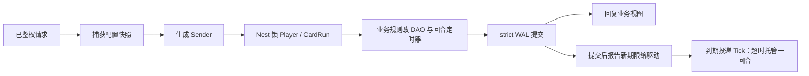
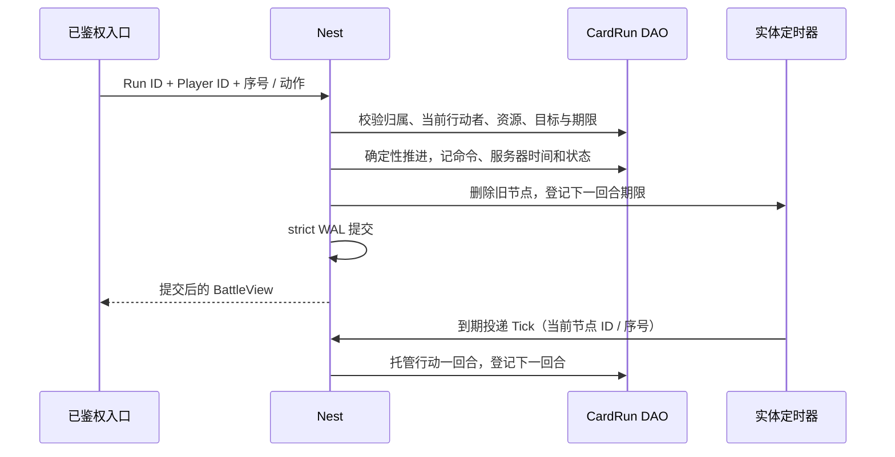

# 卡牌 RPG 框架学习与验收

本手册把“角色卡收集养成 + 三人编队回合制 PvE”的主要业务路径映射到 core 的正式接口，分两部分：**第一部分“学习”**讲框架怎么用、为什么这样设计，按配置、抽卡、养成、开局、回合、领奖的顺序给出阅读顺序与可编译的调用示例；**第二部分“验收”**说明脚本证明什么、不证明什么。卡池、概率、英雄数值、经济和关卡内容由游戏定义。下面的业务夹具（六种角色卡、三张上阵卡、三关、每关两波敌人、五抽保底、等级 / 星级 / 装备成长）只是学习和验收样例：框架与生成器不包含任何卡牌 RPG 规则，生成器也不生成这些业务文件；完整的参考应用仍是 [game-demo](../../demo/README.md)。其他游戏类型的手册见 [SLG](SLG-INTEGRATION.md)、[MMORPG](MMORPG-INTEGRATION.md)、[MOBA](MOBA-INTEGRATION.md)。

## 第一部分：学习

### 1. 适合谁、先读什么

适合准备用 core 做抽卡养成、回合制 PvE 一类游戏的后端工程师。先读[入门](../GETTING-STARTED.md)、[Nest / Entity](guide/02-nest-entity.md)、[DataEngine](guide/03-dataengine.md)；第一次学建议先读完 [SLG 手册](SLG-INTEGRATION.md)的第一部分（它把 Entity / DAO / Nest / 实体定时器的基本接法讲得最细），再读本篇。

本类型选择**服务器权威回合**：服务器决定当前行动者、结算伤害、推进回合，客户端只提交本方动作并展示已提交的状态。回合制不需要 Lockstep 的实时输入广播；需要帧同步的玩法看 [MOBA](MOBA-INTEGRATION.md)。

### 2. 模块分工：卡牌 RPG 里的状态归谁

| 业务状态 | 拥有者 | 框架接法 | 业务边界 |
| --- | --- | --- | --- |
| 资源、卡牌、编队、抽卡 / 养成 / 开局账本、关卡进度、任务 | Player DAO | 生成的 Player DAO 字段，只在 Nest 事务里经 mutator 修改 | 一模板一张卡；正式卡牌实例、多套装备、分解政策另建模 |
| 一场战斗：冻结的配置与编队、种子、动作日志、当前状态 | CardRun 实体的 DAO | `roost add entity CardRun` + `add dao`；与 Player 同一原服，开局 / 领奖用多实体 Sender | 战斗日志整段存在 DAO 里，每局至多 120 次动作 |
| 回合期限（超时托管） | CardRun 的实体定时器 | `roost add timer --entity CardRun`；节点存 DAO，驱动到期投递 Tick | 离线到期只在加载后补一次，框架不追帧 |
| 配置（英雄、卡池价格、保底、关卡数值） | configdata Store / Snapshot | 注册对象定义 → Load 时校验 → 请求开始时捕获一份快照，按值传给 Sender | 字段范围由业务 `Validate` 定义；失败不发布 |
| 战斗属性与战力 | 业务声明的 HeroStats | `roost add attribute HeroStats`，生成访问器、脏位、派生 `Power` 与快照 | 持久的养成事实仍在 Player DAO，属性只在开局时计算 |
| 伤害结算 | 纯函数 | [`combat.ResolveDamage`](../../gameplay/skill/combat/damage.go) 的定点护甲 / 暴击 / 护盾 / 血量管线 | 法力、治疗、毒伤、目标规则属于业务 |
| 客户端看到的资料与战斗 | 业务视图 `ProfileView` / `BattleView` | 已鉴权入口经 Nest 锁内读取，只返回允许的字段 | 原始 DAO State 含私有密钥与内部账本，不加 Sync 标记 |
| 登录与账号 | account / Player 静态 sid | 复用正式生命周期与登录鉴权 | 夹具直接用合成的已鉴权身份；账号链见 [玩家接入](PLAYER-ACCESS.md) 与 game-demo |



`strict` 保证回复前 WAL fsync，不保证回复时 Mongo 已投影（[DataEngine](guide/03-dataengine.md)）。

### 3. 抽卡、养成与回合制 PvE：如何使用

#### 3.1 生成工程从哪来

在仓库根目录使用 go.mod 声明的工具链运行：

```bash
ROOST_CARD_RPG_KEEP=1 bash scripts/test-card-rpg-generated.sh   # 保留生成工程以便阅读；不加 KEEP 时成功即删除
```

脚本打印临时目录，生成工程在其中的 `project/`。它做的事就是一个新工程的接入步骤：

1. `roost project new card-rpg-practice -module example.com/card-rpg-practice -template game`；
2. `roost add dao Player --entity Player`、`roost add entity CardRun`、`roost add dao CardRun --entity CardRun`、`roost add timer --entity CardRun`、`roost add attribute HeroStats`；
3. 业务只改这几处：在 `db/def/player.go` 加 ``State string `bson:"state" dao:"persist"` ``，在 `db/def/card_run.go` 加 `State` 与 ``TurnTimer int64 `bson:"turn_timer" dao:"persist"` ``；把 `game/entities/card_run/entity.go` 注解里的 `category=entity.EntityCategoryOther` 改为 `EntityCategoryWorld`（Run 与 Player 一起锁，放在更低的锁档，锁序固定）；放入业务包 `game/cardrpg/`、属性声明 `game/gameplay/attribute/hero_stats.go`、定时回调 `game/entities/card_run/timer_handlers.go` 与 handler `game/handler/card_rpg.go`；
4. `roost generate` 生成组件、访问器、属性代码和 Sender，不手改生成文件。加字段时 generate 会打印 `WARN: … new stored key "state" …`：这是 DAO 持久键变化的提示（加字段不需要迁移，老文档读成零值），见第 7 节。

生成的 `internal/bootstrap/generated.go` 已用 `wiring/entitytimer` 的 Mod 装配 CardRun 的定时器驱动，`internal/registry/nest_gen.go` 已登记 handler；业务不手写这两处接线。

#### 3.2 阅读顺序

进入 `project/` 后按顺序读（括号里是仓库内的源文件）：

| 顺序 | 文件 | 先回答的问题 |
| --- | --- | --- |
| 1 | `game/cardrpg/catalog.go`（[catalog.go.txt](../../scripts/testdata/card-rpg/catalog.go.txt)） | 配置怎样经校验发布？一次操作 / 一场战斗怎样固定一代？ |
| 2 | `game/gameplay/attribute/hero_stats.go`（[attributes.go.txt](../../scripts/testdata/card-rpg/attributes.go.txt)） | 属性声明里写什么？生成器管理哪些东西（访问器、脏位、派生 `Power`、快照）？ |
| 3 | `game/cardrpg/profile.go`（[profile.go.txt](../../scripts/testdata/card-rpg/profile.go.txt)） | 抽卡、养成、体力、开局准入的幂等身份各存在哪？旧序号怎样重放？ |
| 4 | `game/cardrpg/battle.go`（[battle.go.txt](../../scripts/testdata/card-rpg/battle.go.txt)） | 谁决定当前行动者和目标？同一配置、初始状态、种子和日志能否重算出同一结果？ |
| 5 | `game/handler/card_rpg.go`（[handlers.go.txt](../../scripts/testdata/card-rpg/handlers.go.txt)） | Player、Run、定时器、扣款和领奖分别在哪个锁与提交边界里一起生效？ |
| 6 | `game/entities/card_run/timer_handlers.go`（[timer_handlers.go.txt](../../scripts/testdata/card-rpg/timer_handlers.go.txt)） | 回合结束怎样替换定时器身份？离线很久为什么只补一回合？ |
| 7 | `game/handler/syncsender/` | 生成的 Sender 怎样把目标 ID 与业务参数交给 Nest；业务调用它，不手改 |
| 8 | [gameplay_test.go.txt](../../scripts/testdata/card-rpg/gameplay_test.go.txt)、[catalog_test.go.txt](../../scripts/testdata/card-rpg/catalog_test.go.txt) | 并发、拒绝、回滚、旧请求与隐私怎样实际验证 |
| 9 | [persistence/recovery_test.go](../../scripts/testdata/card-rpg/persistence/recovery_test.go) | 已确认但未投影的记录在 SIGKILL 后怎样恢复？领奖后再重启会不会再发奖？ |

身份要分开理解：Player / Run 用框架完整 EntityID；`Card.ID` 是玩家内的模板卡标识，不能当 Nest 目标。抽卡、管理（养成 / 编队 / 扫荡 / 任务）、开局是三个独立的单调序号域；回合序号只属于一个 Run；定时器节点 ID 又是 Run 内的独立身份。配置内容 hash、业务 State 里的 `Schema`、DAO 的 `_schema` 与 core 版本是四个不同的概念。

#### 3.3 用 Sender 调用

下面的文件放进保留的生成工程（例如 `internal/cardflow/flow.go`）可直接编译。`client` 是当前服务的 Nest 客户端，`catalog` 是进程启动时 `cardrpg.OpenCatalog` 打开的配置，`now` 是服务器业务时钟（毫秒），EntityID 都是完整 ID：

```go
package cardflow

import (
	"context"

	"example.com/card-rpg-practice/game/cardrpg"
	syncsender "example.com/card-rpg-practice/game/handler/syncsender"
	"github.com/tjbdwanghaibo/roost-core/framework/configdata"
	"github.com/tjbdwanghaibo/roost-core/framework/nest"
)

// drawTrainAndStart 是已鉴权入口的调用顺序：十连、升级一张卡、开第一关。
// 序号由客户端按自己的业务域递增并在重试时原样重发；Rules 由服务器捕获，不来自请求。
func drawTrainAndStart(ctx context.Context, client nest.Client, catalog *configdata.Store,
	playerEntityID, candidateRunID int64, drawSeq, manageSeq, runSeq uint64, now func() int64) (int64, error) {
	rules, err := cardrpg.CaptureRules(catalog.Current()) // 一次操作只捕获一份快照
	if err != nil {
		return 0, err
	}
	s := syncsender.NewCardRpgSender(client)
	if _, err := s.Sync_CardDraw(ctx, playerEntityID, drawSeq, 10, rules); err != nil {
		return 0, err
	}
	level := cardrpg.Manage{Seq: manageSeq, Kind: "level", CardID: 1, Target: 2}
	if _, err := s.Sync_CardManage(ctx, playerEntityID, level, rules, now()); err != nil {
		return 0, err
	}
	// 首次与重放都返回原 Run ID；此后查看、出手、领奖一律用返回值。
	return s.MultiSync_CardStart(ctx, playerEntityID, candidateRunID, runSeq, 1, rules, now())
}

// playAndClaim 让本方每回合自动出手、敌方回合走服务器内部入口，直到终态后领奖。
// 公网入口只接收本方的 Seq / Kind / Target；ActorID 由入口填已鉴权的 Player，敌方入口不暴露给客户端。
func playAndClaim(ctx context.Context, client nest.Client, playerEntityID, runID int64, now func() int64) (cardrpg.ProfileView, error) {
	s := syncsender.NewCardRpgSender(client)
	view, err := s.Sync_CardBattle(ctx, runID, playerEntityID)
	for err == nil && view.Status == "running" {
		if view.Actor < 3 {
			command := cardrpg.TurnCommand{Seq: view.NextSeq, ActorID: playerEntityID, Kind: "auto"}
			view, err = s.Sync_CardTurn(ctx, runID, playerEntityID, command, now())
		} else {
			view, err = s.Sync_CardEnemy(ctx, runID, view.NextSeq, now())
		}
	}
	if err != nil {
		return cardrpg.ProfileView{}, err
	}
	return s.MultiSync_CardClaim(ctx, playerEntityID, runID)
}
```

`candidateRunID` 要用 id-gen 发的新号并先创建实体：直接 `Create` 不读存储，不能复用删过档或存了没加载的 ID（[删档后该 ID 不可再用，D10](guide/03-dataengine.md#4-冷加载与-schema)）。夹具在测试里直接建实体，没有演示 id-gen 接线。未用上的候选号（重放时返回了原 Run）丢弃，不复用。每次调用的错误都要按业务逐次处理，示例只演示调用方式。

#### 3.4 十六个场景各学什么

| 场景（测试名前缀 `TestCardRPG`） | 业务选择 | 学到的框架契约 |
| --- | --- | --- |
| `CatalogReloadIsAtomicAndFrozenRulesRemainUsable` | 非法热更被拒，合法热更发布新一代 | configdata 校验失败不替换当前快照；已捕获的值和旧快照不被新发布改写 |
| `GeneratedAttributesDeriveAndSnapshotIsIndependent` | `Power = HP/10 + Attack*2 + Armor + Speed` | 生成器用业务的派生公式；属性快照与活对象独立 |
| `PrivateKeysNeverAppearInPublicProjection` | 视图裁掉密钥、账本、种子、RNG、配置与日志 | 客户端视图由业务显式投影，不序列化整个 DAO State |
| `MalformedStateAndFrozenBattleTamperingFailClosed` | 加载时严格 JSON、重算整段日志 | 状态被改、冻结配置被改时拒绝解码，不带病运行 |
| `DrawConcurrentReplayPityAndConfigIdentity` | 八个相同抽卡请求并发 | 单实体 Nest 串行 + 业务序号：一次扣款、一份十连结果，保底计数正确，改张数 / 跳序被拒 |
| `DrawRefusalAndUndoKeepFundsAndRandomStream` | 钻石不足、handler 失败 | undo 回滚后余额与随机流不变，重试得到同一结果，没有半次十连 |
| `GrowthFormationAndBattleLoadoutAreSeparateSnapshots` | 碎片升星、升级 / 装备扣费、换编队 | 开局把养成事实拷进战斗；局外再成长不改进行中的战斗 |
| `GrowthRejectsMissingCardsOldRequestsAndInvalidTeams` | 缺卡、越级、旧序号换内容、重复上阵 | 业务拒绝不写任何状态；相同旧请求只重放不再扣费 |
| `ConcurrentAdmissionHasOneRunAndOneEnergyCharge` | 同一开局序号八个并发、换候选 Run 重试、未领奖再开局、未解锁关卡 | 多实体 Sender：只建一局、只扣一次体力，重试返回原 Run ID、候选 Run 不被初始化 |
| `TurnAuthoritySequenceAndReplayDoNotRearmDeadline` | 只能控制本方当前角色，序号单调 | 客户端不能代敌方出手或注入超时；重放不重新掷随机、不重排期限 |
| `CombatUsesShieldsManaPoisonAndHealing` | 防御护盾、爆发耗法力并上毒、毒伤按回合结算、治疗 | 业务动作 + `combat.ResolveDamage` 的护盾 / 血量结算；推进后的日志能重算出同一状态 |
| `WinClaimSweepQuestAndConcurrentRewardReplay` | 打完两波获胜、八个并发领奖、获胜任务、扫荡 | 多实体领奖事务：一份奖励（含首通），任务只领一次，扫荡只发普通奖励 |
| `RetreatHasNoRewardAndFirstClearOnlyPaysOnce` | 撤退、其他玩家领奖、同关再通 | 终态由服务器判定；撤退只收口不发胜利奖，非本人领奖被拒，首通奖励只发一次 |
| `TurnTimersIgnoreOldDeadlineAndOnlyCatchUpOnce` | 旧期限的 Tick、迟到很久的 Tick | 定时器 ID + 下一序号 + 原期限三重核对，旧事件不推进新回合；迟到很久的一次 Tick 只推进一回合（实体一直在内存，不是离线重载，离线重载见第二部分） |
| `UndoRestoresAdmissionTurnAndTimerAsOneFact` | 开局 / 出手后 handler 失败 | 体力、准入账本、战斗状态、定时器节点一起回滚 |
| `LedgerBoundsAndOfflineEnergyKeepReplayEvidence` | 抽卡、管理账本各满 64 条；体力按时间补 | 满了拒绝新写，旧回执仍能重放；体力保留余数、封顶、拒绝时钟回退（开局账本上限在代码里同样强制，没有单独测满） |

上述数值是样例，不是公共框架规则。这些场景实际证明到哪一步见第 11 节。

### 4. 配置为什么要按值捕获

`OpenCatalog` 用 `configdata.MustRegisterObject` 登记 `card_rules`（`cards.json`），`Validate` 失败整次加载 / 重载被拒，旧快照继续服务（[业务表发布](guide/07-config.md#3-业务表发布)）。入口捕获 `catalog.Current()` 再 `CaptureRules` 得到 `Rules` 值，交给 Sender：`Rules` 的切片都是定长数组，按值复制，一次操作只看一代；开局时整份 `Rules` 与 hash 写进 Run，之后的出手、超时、领奖都用开局那一代，热更只影响新操作。

框架另有请求级的一致性：异步消息在准入时捕获当前运行期配置、同步调用继承请求代际（[请求内一致性](guide/07-config.md#4-请求内一致性)）。本夹具不依赖它，而是显式传值，并把 hash 记进回执，便于以后核对“这次扣款按哪一代价格”。公网请求**不携带** Rules。

### 5. 抽卡与养成的幂等身份

`Sync_CardDraw(player, seq, count, rules)`：钻石扣款、HMAC 派生的随机结果、保底计数、新卡 / 碎片和完整回执在一个事务里提交。相同 `seq` 与相同张数返回原回执（即使传了新价格的配置，也不重掷、不重扣）；改张数或跳序拒绝。随机数由 Player 的私有密钥按“领域:序号:槽位”派生，所以失败回滚后重试仍是同一结果；密钥由受信任的首登入口写入（`handlerCardInit`，正式服用 `crypto/rand`），不进视图、不打日志。首登结果未知时查原 Player 状态，不要给已有角色换一把新密钥。

`Sync_CardManage` 用一个永久顺序账本承载升级、升星、装备、编队、扫荡和任务：旧序号只能原样重放，换内容拒绝；重复请求应重发同一序号和内容，不要为了“再试一次”分配新序号。重复抽到已有模板转成该卡碎片和粉尘。

账本是 Player 上的持久业务事实，与扣款同事务，所以长期有效；它不是服务的短期去重环。账本各至多 64 条，满了拒绝新写而不淘汰旧回执（淘汰会让旧请求被当成新请求重复扣款）；正式服需要归档 / 分片方案，不能靠清回执或换身份绕过。

### 6. 开局、回合与持久回合定时器

`MultiSync_CardStart(player, run, seq, stage, rules, now)` 同时锁 Player 与 Run：补算体力、检查关卡解锁与“同一 Player 至多一局未领奖”、扣体力、用生成属性算出三张卡的初始战斗属性、建战斗、登记第一回合期限，全部一个事务。Player 上记“开局序号 → Run ID → 关卡 → 配置 hash”，同一序号重放直接返回原 Run ID。



行动顺序按速度降序、同速按座位。客户端的动作只对本方当前角色有效；敌方回合由服务器内部入口 `Sync_CardEnemy` 推进，超时由定时器推进，二者都不暴露给客户端。回合序号从 1 单调递增，相同序号与相同命令重放不再消耗法力、不再掷随机、不重排期限；服务器时间不属于命令身份，晚到的重试仍能取回已执行的结果。

每次实际推进才替换回合定时器（`saveCardBattle`：`RemoveTimer` 旧节点、`NewTimerAt` 新期限、ID 记进 `TurnTimer`）。回调核对节点 ID、下一命令序号与原期限，旧计时事件不会推进新回合。**框架不追帧**：实体不在内存期间到期的节点，加载后只触发一次（[按实体的持久定时器](guide/10-time.md#4-按实体的持久定时器)）；本例据此托管一回合，再从实际触发时间排下一回合，不会因为离线一小时在一次加载里补完所有回合。驱动不唤醒不在内存的实体，离线的战斗直到下次加载才处理。

普通攻击、爆发复用 `combat.ResolveDamage`；法力、治疗、毒伤和目标限制留在业务。这里**没有**用 Skill Runtime：它不在 Nest DAO 回滚域内，handler 失败不会回退它的冷却 / 施法账本（[Skill 的事务边界](guide/08-skill.md#4-事务与战斗边界)）。回合状态全部在 DAO 里，所以能随事务回滚和恢复。

### 7. 领奖、重连视图与存储格式

`MultiSync_CardClaim(player, run)` 回查权威终态，客户端不能传胜者、星级或奖励。胜利发普通奖励，首次通关额外发首通奖励并更新最佳星级；撤退或失败只收口。资产、准入记录与 Run 的 `Claimed`、清掉 `ActiveRun` 一起提交；并发重试和冷加载后的重试都只得一份。这是同一原服内的多实体原子提交，不是跨 sid 的多人原子奖励。

重连时调用锁内的 `Sync_CardProfile` / `Sync_CardBattle` 取当前视图。`ProfileView` 裁掉私有密钥和内部账本，`BattleView` 裁掉初始种子、内部随机状态、整份配置与操作日志。不要给 `State` 加 Sync 标记或直接下发整个实体；需要推送时按 [self_sync](PLAYER-ACCESS.md#7-玩家看自己的状态self_sync) 写业务视图。夹具只验证了字段裁剪与 handler 的归属校验，没有联调公网 TCP 协议或客户端引擎。

存储格式要分两层看：

- **DAO 持久键**：`State` / `TurnTimer` 的 `bson` 名就是 Mongo 里的键（DESIGN-TODO D13）。以后改 Go 字段名要保留原 `bson` 名；改了 `bson` 名或删字段时，库里的旧键不再加载、下一次整文档写回即丢失，`roost generate` 与加载时只打 WARN。要改就先离线迁移（[schema 变更手册 §1](SCHEMA-MIGRATION.md#1-现行规则运行时只认当前-schema)）。
- **业务 JSON**：`State` 里的 `Schema=1` 是业务格式版本，加载时拒绝未知字段、未知版本以及与日志不一致的战斗快照。改业务格式同样要离线迁移并配套代码，只改 DAO 字段的 `_schema` 不等于迁移了 JSON 内容。

### 8. 更多卡牌 RPG 路线：接法、源码与业务边界

| 方向 | 从哪个源码 / 文档学 | 框架接法 | 业务仍需定义 |
| --- | --- | --- | --- |
| 充值与钻石到账 | [GrantPurchase](../../demo/game/handler/grant_purchase.go.tmpl)、[platform](../../demo/internal/service/platform/) | 渠道订单身份与到账账本同事务 | 产品、支付签名、退款与审计 |
| 邮件与补偿 | [ClaimMail](../../demo/game/controllers/player/claim_mail.go.tmpl)、[ClaimMailReward](../../demo/game/handler/claim_mail_reward.go.tmpl) | 服务预留、玩家侧幂等奖励、服务提交多阶段 | 邮件有效期与补发规则 |
| 活动与排行 | [活动接线](../../demo/internal/service/game/activity.go.tmpl)、[服务篇](guide/09-services.md) | 活动贡献只在首次真实付款时提交；排行写累计快照、只增不减 | 活动窗口、奖励档位；尽力贡献失败不自动补报是已接受取舍 |
| 跨服协作 | [Saga](guide/06-saga.md)、[gift_item saga](../../demo/saga/gift_item/) | 原生步骤 / effect，失败补偿，结果未知按身份查询 | 原生步骤单进程容量有限（见 Saga 指南 §5），量大按 sid 分片 |
| 技能与 Buff | [技能 / 战斗](guide/08-skill.md) | 完整 Skill Host 按其独立事务 / 持久化契约接入 | 技能、Buff、英雄内容与平衡 |
| 推送与客户端 | [Sync](guide/04-sync.md)、[玩家接入](PLAYER-ACCESS.md) | 业务视图经 self_sync 推送 | 客户端协议与表现 |

本夹具没有实现这些路线；它们在 game-demo 里的历史通过不等于卡牌充值、卡牌邮件或跨服 PvP 已验收。

### 9. 接入时容易踩的问题

- **锁目标没被识别**：Nest 生成器在不写 `target` / `targets` 时，把类型名含 `Entity` 的参数推断为锁目标（`codegen/internal/nest/parse.go` 的 `isEntityCategory`）。本夹具起初把锁接口命名为 `ICardPlayer` / `ICardRun`，生成器静默跳过了这 9 个 handler、把此前生成的 Sender 当孤儿删掉，`generate` 仍成功退出，直到编译才报 `undefined: RegisterCardRpgNestHandlers`。这是生成器的诊断缺陷，已修复：现在 generate 直接报 `//roost:nest found no entity parameter` 并点名 handler。写法二选一：接口名含 `Entity`（本夹具用 `ICardPlayerEntity` / `ICardRunEntity`），或写 `targets=player,card_run`（[Nest 生成器](../../codegen/docs/NEST_RUNTIME.zh-CN.md)）。
- **定时器回调只改本实体**：回调里只经组件 API 操作本 Run 的期限，不另建调度器、不直接改节点 map；需要 Player 一起变化的事交给多实体 handler（[SLG §6](SLG-INTEGRATION.md#6-定时器回调能做什么)）。
- **handler 里不发同步 Nest 请求**：已知参与者一次传给多实体 Sender；handler 内的同步请求被框架拒绝（`ErrSyncInHandler`）。

### 10. 练习

加“限定卡池保底继承到下一期”或“扫荡券代替体力”。先写清拥有者、幂等身份（哪个序号域）、事务参与者、配置代际和恢复语义，再选 Nest / 定时器 / Saga，不另造一套与框架平行的持久或并发状态机。

## 第二部分：验收

### 11. 业务纵切证明什么

```bash
bash scripts/test-card-rpg-generated.sh
```

脚本按 3.1 的步骤生成工程，replace 指回当前仓库，必须实际通过 16 条顶层 race 场景（3.4）且无 skip，随后执行消费者 build / vet、`roost id check` 与 `roost generate --check`；成功删除临时工程，失败或 `ROOST_CARD_RPG_KEEP=1` 时保留。

- **证明**：公共 CLI 生成的 Player / CardRun DAO、实体定时器、属性代码、多实体 Sender 与 Nest 在 16 个业务组合下的事务、undo 回滚、锁顺序、业务幂等和期限核对；配置原子发布与按值冻结；视图字段裁剪。
- **不证明**：提交器是替身，不含文件 WAL fsync 与 Mongo；定时器由用例手动投递生成的 Tick Sender，实体一直在内存，没有经过加载后补触发；单进程，无 Redis / NATS；鉴权是合成身份。夹具里的数值是样例。

### 12. 真实 WAL / Mongo 崩溃恢复

先按[隔离环境说明](../../wiring/scripts/integration/README.md)准备独立 Mongo 副本集并设置地址变量（不要指向生产库或共享业务库；共享隔离环境下遵守那里的持锁与命名规则），再运行：

```bash
ROOST_CARD_RPG_REAL=1 bash scripts/test-card-rpg-generated.sh
```

它在第 11 节之后追加 `TestCardRPGRealCrashRecovery`（已登记根包 `integration_coverage_test.go`），用本次唯一的 DAO 库与 WAL 目录：

1. 子进程经 strict 文件 WAL 提交首登、十连、升级、开局和第一回合；后台投影关闭，断言 WAL 有 5 条已确认未投影的记录后，父进程 SIGKILL 自己启动的子进程。
2. 父进程用同一 WAL 与 Mongo 冷加载 Player / Run，核对资产、战斗摘要与定时器 ID；再用新价格的配置重放旧抽卡与升级，结果与扣费不变。
3. 业务时间推进一小时。断言冷加载已把存量回合期限报告给驱动索引（`DueOf`），调用驱动的 `DeliverDue` 投递一次补触发（不启动投递循环、不由用例手发 Tick）；托管一回合后下一回合从实际触发时间起算、新期限再次进入索引。继续用开局那一代配置打完、获胜，领奖三次只得一份。
4. 正常关闭后再起第三个进程冷加载：核对领奖终态、资产与无待执行定时器，再重试领奖与抽卡，结果不变。成功后删除本次库；失败保留生成工程、WAL 与库名供诊断。

- **证明**：strict 已确认的提交在 SIGKILL 后可从未投影 WAL 恢复；恢复后的定时器节点由驱动在加载后补触发一次，框架不追帧；跨进程重试不重复扣费或发奖。
- **不证明**：提交在途 / 结果未知时的崩溃、磁盘断电、WAL 损坏或丢盘；驱动投递循环本身（测试直接调用循环每轮所做的 `DeliverDue`）；多进程 / 跨机、Redis / NATS；容量与长稳。

### 13. 结论怎样给

卡池、数值和经济缺少默认实现，不自动构成框架缺陷；合法接口调用下出现丢期限、重复扣费 / 发奖、状态越权或生成物编译失败，则应在公共实现中修复（本轮的 handler 被静默跳过即按此修复）。当前存储是教学规模：每局至多 120 次动作、三个账本各 64 条；单场日志与状态整体提交、加载时重算，没有生产吞吐或延迟承诺，正式长局需要分段日志与检查点。

本机功能、跨机故障和长稳分别给结论；缺少实际证据的继续保留为未验收项。当前执行结果在 [KNOWN-LIMITS](../maintenance/KNOWN-LIMITS.md)“卡牌 RPG 接入验收的范围”维护，不为每一轮另建报告。
