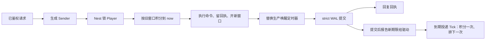

# 放置模拟框架学习与验收

本手册把“多工坊生产队列 + 离线收益箱 + 出售 / 订单 / 每日奖励”的放置经营业务路径映射到 core 的正式接口，分两部分：**第一部分“学习”**讲框架怎么用、为什么这样设计，给出阅读顺序与可编译的调用示例；**第二部分“验收”**说明脚本证明什么、不证明什么。配方、产能、离线窗口和经济数值由游戏定义。下面的业务夹具（三个工坊、三种配方、每个工坊四个在途任务与四格待领产物、30 秒离线收益窗口、收益倍率卡、UTC 日每日奖励）只是学习和验收样例：框架与生成器不包含任何放置经营规则，生成器也不生成这些业务文件；完整的参考应用仍是 [game-demo](../../demo/README.md)。其他游戏类型的手册见 [SLG](SLG-INTEGRATION.md)、[MMORPG](MMORPG-INTEGRATION.md)、[MOBA](MOBA-INTEGRATION.md)、[卡牌 RPG](CARD-RPG-INTEGRATION.md)、[合成休闲](MERGE-CASUAL-INTEGRATION.md)。

## 第一部分：学习

### 1. 适合谁、先读什么

适合准备用 core 做放置、模拟经营、挂机一类游戏后端的工程师。先读[入门](../GETTING-STARTED.md)、[Nest / Entity](guide/02-nest-entity.md)、[DataEngine](guide/03-dataengine.md)、[时间](guide/10-time.md)；第一次学建议先读完 [SLG 手册](SLG-INTEGRATION.md)的第一部分（建造队列、离线收益与实体定时器的基本接法讲得最细），再读本篇。

本类型的核心是**时间结算**：服务器只按自己的业务时钟、在有界窗口内把时间一次积分成产出和收益，客户端不能上报工时、产出、余额或离线时长。

### 2. 模块分工：放置模拟里的状态归谁

同一玩家的三个工坊、原料、仓库、金币、钻石、待领收益和操作回执都属于静态 sid 归属的 Player。“并行生产”指每个工坊各有自己的时间预算；修改这些状态仍由 Player 的 Nest 锁串行处理。本例不需要跨服实体或分布式交易。

| 业务状态 | 拥有者 | 框架接法 | 业务边界 |
| --- | --- | --- | --- |
| 工坊等级、生产队列（工时 / 投入 / 产出在入队时冻结）、待领产物 | Player DAO 的 `State` | 生成的 Player DAO 字段，只在 Nest 事务里经 mutator 修改 | 每工坊四个在途、四格待领；整个 `State` 是一段业务 JSON |
| 原料、仓库、金币、钻石、收益箱、收入等级、倍率期限 | Player DAO 的 `State` | 与队列同事务 | 收益箱 100 封顶、仓库 20 格、原料 100 上限 |
| 操作回执（永久命令序号） | Player DAO 的 `State` | 与资产同事务提交 | 账本至多 128 条，满了拒绝新写 |
| 离线收益窗口（`Horizon`） | 业务时间计算 | 最后一条有效新命令之后 30 秒；读视图与定时器都不延长 | 窗口之外的时间直接丢弃 |
| 在线时的生产唤醒 | Player 的实体定时器 + `WakeTimer` | `roost add timer --entity Player`；节点存 DAO，驱动到期投递 Tick | 窗口内每秒唤醒一次；加载后到期节点只触发一次，框架不追帧 |
| 配置（配方、窗口、周期、上限） | configdata Store / Snapshot | 注册对象定义 → Load 时校验 → 首次初始化时捕获并整份写进存档 | 已有存档沿用初始化那一代 |
| 客户端看到的存档 | 业务视图 `View` / `Receipt` | 锁内读取，队列深拷贝 | 回执账本另经查询取得 |
| 登录与账号 | account / Player 静态 sid | 复用正式生命周期与登录鉴权 | 夹具直接用合成的已鉴权身份；账号链见 [玩家接入](PLAYER-ACCESS.md) 与 game-demo |



`strict` 保证回复前 WAL fsync，不保证回复时 Mongo 已投影（[DataEngine](guide/03-dataengine.md)）。

### 3. 生产队列与离线收益：如何使用

#### 3.1 生成工程从哪来

在仓库根目录使用 go.mod 声明的工具链运行：

```bash
ROOST_IDLE_SIM_KEEP=1 bash scripts/test-idle-sim-generated.sh   # 保留生成工程以便阅读；不加 KEEP 时成功即删除
```

脚本打印临时目录，生成工程在其中的 `project/`。它做的事就是一个新工程的接入步骤：

1. `roost project new idle-sim-practice -module example.com/idle-sim-practice -template game`；
2. `roost add dao Player --entity Player`、`roost add timer --entity Player`；
3. 业务只改这几处：在 `db/def/player.go` 加 ``State string `bson:"state" dao:"persist"` `` 与 ``WakeTimer int64 `bson:"wake_timer" dao:"persist"` ``；放入业务包 `game/idlesim/`、定时回调 `game/entities/player/timer_handlers.go` 与 handler `game/handler/idle_sim.go`；
4. `roost generate` 生成组件、访问器和 Sender，不手改生成文件。加字段时 generate 会打印 `WARN: … new stored key "state" …`：这是 DAO 持久键变化的提示（加字段不需要迁移，老文档读成零值），见第 7 节。

生成的 `internal/bootstrap/generated.go` 已用 `wiring/entitytimer` 的 Mod 装配 Player 的定时器驱动（绑定 Nest、接业务时钟、启动与停止投递循环），`internal/registry/nest_gen.go` 已登记 handler；业务不手写这两处接线。测试里看到的 `TimerDriver.SetClock` / `Bind` / `DeliverDue` 是用例自己搭 Nest、控制投递时机的替身接线，不是生产装配要抄的步骤。

#### 3.2 阅读顺序

进入 `project/` 后按顺序读（括号里是仓库内的源文件）：

| 顺序 | 文件 | 先回答的问题 |
| --- | --- | --- |
| 1 | `game/idlesim/rules.go`（[rules.go.txt](../../scripts/testdata/idle-sim/rules.go.txt)） | 配置怎样经校验发布？存档为什么在初始化时冻结一代？ |
| 2 | `game/idlesim/state.go`（[state.go.txt](../../scripts/testdata/idle-sim/state.go.txt)） | 存档里有什么？`LastAt` 与 `Horizon` 各表示什么？视图为什么要深拷贝队列？ |
| 3 | `game/idlesim/production.go`（[production.go.txt](../../scripts/testdata/idle-sim/production.go.txt)） | `Advance` 怎样把一段时间一次积分（倍率分段、余数、封顶、缓冲满暂停）？`Apply` 怎样先结算再改？ |
| 4 | `game/handler/idle_sim.go`（[handlers.go.txt](../../scripts/testdata/idle-sim/handlers.go.txt)） | 命令、查回执分别在哪个锁与提交边界里生效？唤醒定时器在哪里替换？ |
| 5 | `game/entities/player/timer_handlers.go`（[timer_handlers.go.txt](../../scripts/testdata/idle-sim/timer_handlers.go.txt)） | 唤醒回调怎样核对身份？离线很久为什么只积分一次？ |
| 6 | `game/handler/syncsender/` | 生成的 Sender 怎样把 Player ID 与业务参数交给 Nest；业务调用它，不手改 |
| 7 | [gameplay_test.go.txt](../../scripts/testdata/idle-sim/gameplay_test.go.txt)、[rules_test.go.txt](../../scripts/testdata/idle-sim/rules_test.go.txt) | 并发、拒绝、回滚、时间跳跃与上限怎样实际验证 |
| 8 | [persistence/recovery_test.go](../../scripts/testdata/idle-sim/persistence/recovery_test.go) | 已确认但未投影的记录在 SIGKILL 后怎样恢复？离线一小时为什么只结算到原窗口？ |

身份要分开理解：Player 用框架完整 EntityID；命令的 `Seq` 是 Player 内永久递增的操作序号；生产任务的 `JobID` 就是它入队那条命令的 `Seq`；定时器节点 ID 又是 Player 内的独立身份。配置内容 hash、业务 `State` 里的 `Schema`、DAO 的 `_schema` 与 core 版本是四个不同的概念。

#### 3.3 用 Sender 调用

下面的文件放进保留的生成工程（例如 `internal/idleflow/flow.go`）可直接编译。`client` 是当前服务的 Nest 客户端，`catalog` 是进程启动时 `idlesim.OpenCatalog` 打开的配置，`now` 是服务器业务时钟（毫秒），Player ID 是完整 EntityID：

```go
package idleflow

import (
	"context"

	syncsender "example.com/idle-sim-practice/game/handler/syncsender"
	"example.com/idle-sim-practice/game/idlesim"
	"github.com/tjbdwanghaibo/roost-core/framework/configdata"
	"github.com/tjbdwanghaibo/roost-core/framework/nest"
)

// initAndQueue 是已鉴权入口的调用顺序：首次初始化（已有存档时原样返回）、在 1 号工坊排一个 1 号配方。
// Rules 由服务器捕获，不来自请求；已有存档会忽略它，沿用初始化那一代。
func initAndQueue(ctx context.Context, client nest.Client, catalog *configdata.Store,
	playerEntityID int64, now func() int64) (idlesim.Receipt, error) {
	rules, err := idlesim.CaptureRules(catalog.Current())
	if err != nil {
		return idlesim.Receipt{}, err
	}
	s := syncsender.NewIdleSimSender(client)
	view, err := s.Sync_IdleInit(ctx, playerEntityID, now(), rules)
	if err != nil {
		return idlesim.Receipt{}, err
	}
	queue := idlesim.Command{Seq: view.NextSeq, Kind: "queue", Station: 1, Recipe: 1}
	return s.Sync_IdleCommand(ctx, playerEntityID, queue, now())
}

// collectAndClaim 收取 0 号工坊的产物、再领取收益箱；每条命令用视图里的下一个序号。
func collectAndClaim(ctx context.Context, client nest.Client, playerEntityID int64, now func() int64) (idlesim.View, error) {
	s := syncsender.NewIdleSimSender(client)
	view, err := s.Sync_IdleView(ctx, playerEntityID)
	if err != nil {
		return idlesim.View{}, err
	}
	for _, kind := range []string{"collect", "claim"} {
		command := idlesim.Command{Seq: view.NextSeq, Kind: kind, Station: 0}
		if _, err := s.Sync_IdleCommand(ctx, playerEntityID, command, now()); err != nil {
			return idlesim.View{}, err
		}
		if view, err = s.Sync_IdleView(ctx, playerEntityID); err != nil {
			return idlesim.View{}, err
		}
	}
	return view, nil
}

// resolveUnknown 在一次提交结果未知后按原序号判断它是否已执行：已执行就拿原回执，没执行就原样重发。
func resolveUnknown(ctx context.Context, client nest.Client, playerEntityID int64,
	sent idlesim.Command, now func() int64) (idlesim.Receipt, error) {
	s := syncsender.NewIdleSimSender(client)
	view, err := s.Sync_IdleView(ctx, playerEntityID)
	if err != nil {
		return idlesim.Receipt{}, err
	}
	if sent.Seq < view.NextSeq {
		return s.Sync_IdleReceipt(ctx, playerEntityID, sent.Seq)
	}
	return s.Sync_IdleCommand(ctx, playerEntityID, sent, now())
}
```

`Station` / `Recipe` 从 0 开始。`Kind` 支持 `queue`、`cancel`（`JobID` 是原入队命令的 `Seq`）、`collect`、`sell`（`Recipe` / `Count`）、`buy`（`Count`）、`upgrade`、`income_upgrade`、`boost`、`claim`、`daily`、`order` 和 `settle`。取消只退尚未开工的任务；产物先进工坊的待领格，`collect` 才入仓；出售和订单消耗的是仓库里实际的物品。

`playerEntityID` 来自已鉴权会话，不来自请求体；公网入口只接收命令本身，Player ID、服务器时间、Rules 由服务器填，客户端不能指定工时、产出、余额或离线时长。每次调用的错误都要按业务逐次处理，示例只演示调用方式；接网络协议时把 `idlesim.ErrRule` 映射成业务错误码，存储 / 内部故障按[回复错误判别](guide/02-nest-entity.md#6-回复错误判别是否可能已提交能否重试)处理。

#### 3.4 十二个场景各学什么

| 场景（测试名前缀 `TestIdleSim`） | 业务选择 | 学到的框架契约 |
| --- | --- | --- |
| `CatalogRejectsBadReloadAndKeepsFrozenRecipe` | 非法热更被拒，合法热更发布新一代 | configdata 校验失败不替换当前快照；已捕获的值不被新发布改写 |
| `SegmentedTimeMatchesSingleIntegration` | 一次积分 25 秒与每秒积分一次 | 积分结果与唤醒频率无关（同一份摘要）；收益箱封顶时丢弃余数；视图不与存档共享队列 |
| `InvalidSnapshotsIdentitiesAndOverflowFailClosed` | 存档被改、序号为 0 / 跳号、越界工坊 / 配方、未知命令、金币溢出 | 拒绝解码或拒绝命令，状态不变；窗口期限溢出被拒 |
| `ParallelQueuesReserveAndFinishIndependently` | 三个工坊同时生产 | 入队即预扣原料；各工坊独立消耗时间预算；队列满（4 个）被拒、队列非空不能升级 |
| `CancellationRefundsOnlyUnstartedJobsOnce` | 取消已开工 / 未开工任务、重放取消 | 只退未开工任务，重放三次只退一次；已开工、错工坊、不存在的任务被拒 |
| `WarehouseCapacityOrdersAndSalesAreAtomic` | 仓库只有 3 格 | 仓库放不下时整次收取被拒、待领产物保留；订单与出售重放不重复结算 |
| `UpgradeAndBoostSettleOldRatesBeforeChangingThem` | 升级收入等级、买倍率卡、升级工坊 | 先按旧倍率结算再改倍率，倍率到期后不再生效；工坊升级只影响以后入队的任务；初始化重试带新配置不改已有存档 |
| `ConcurrentAdmissionAndClaimsRetainOriginalReceipt` | 同一入队 / 领取 / 每日奖励各八个并发 | 单实体 Nest 串行 + 业务序号：一次预扣、一份收益、一次每日奖励；重放不重排唤醒；按原序号查回执 |
| `DriverCatchupCannotExtendOfflineHorizon` | 业务时间跳过一年 | 驱动只投递一次（用例调用驱动的 `DeliverDue`，不启动投递循环，实体一直在内存）；积分截到原窗口，窗口过后不再排唤醒，反复结算拿不回被丢弃的时间 |
| `DailyBoundaryAndMissedDaysDoNotMultiplyRewards` | UTC 午夜前后、缺席十天 | 午夜前后是两天，缺席只领当天一份，原序号跨日重放仍是原回执；时钟回退被拒 |
| `UndoRestoresQueueEconomyAndWakeDeadline` | 入队 / 买倍率后 handler 失败 | 原料、队列、钻石与唤醒定时器节点一起回滚，重试照常生效 |
| `FullBufferPausesAndLedgerNeverEvicts` | 待领格满、命令账本填满 128 条 | 待领格满时后续任务暂停、那段时间不补；收取后继续；账本满了拒绝新命令、旧回执可重放 |

上述数值是样例，不是公共框架规则。这些场景实际证明到哪一步见第 10 节。

### 4. 时间为什么这样结算

`LastAt` 是已经处理到的服务器时刻；`Horizon` 是最后一条有效新命令之后允许累计收益的截止时刻（默认 30 秒）。定时器唤醒只积分、不续窗口；同序号重放也不续。玩家发出新命令时，先按旧窗口积分到当前时刻，再执行命令并为未来开新窗口。`LastAt` 即使超出窗口也推进到本次时刻，所以反复 `settle` 拿不回被丢弃的时间。

令 `a = LastAt`、`b = min(now, Horizon)`。`b > a` 时，本段有效工作量是普通时长 `b - a` 加上倍率覆盖的那一段 `max(0, min(b, BoostUntil) - a)`。每个工坊独立使用这份预算，从队首起依次消耗，一次积分里最多处理四个在途任务，离线一年也不会执行一年的逐秒循环。

收入按 `旧余数 + 工作量 × 收入等级` 除以 `IncomePeriod` 计算，商进收益箱、余数留给下一段；升级收入等级前先结算旧等级，所以不会把整段离线期都按新等级算。收益箱满时丢弃溢出和余数，领取后从下一段真实时间重新累计；金币会溢出时拒绝领取、保留收益箱。工坊升级让以后入队的任务工时缩短，已入队的任务保留自己的工时；倍率只改变时间预算，不改投入或产出。待领格满时后续任务暂停、那段时间不补，收取后也不会突然补出那段产品。

### 5. 唤醒定时器：准点走 Nest 消息，补算由业务做

每次写存档时 handler 的 `saveIdle` 替换唤醒定时器（`RemoveTimer` 旧节点、`NewTimerAt` 新期限、ID 记进 `WakeTimer`）；期限是 `min(Horizon, LastAt + 1 秒)`，窗口结束后不再挂。回调核对节点 ID 与原期限后调用一次 `Advance(now)`，再挂下一个期限。

**框架不追帧**：实体不在内存期间到期的节点，加载后只触发一次（[按实体的持久定时器](guide/10-time.md#4-按实体的持久定时器)）；离线多久都只投递这一次，补算多少由业务的 `Advance` 一次算完（本例截到窗口为止）。在线时“每秒看到收益涨”这种准点效果才需要走 Nest 消息；如果产品不需要，也可以完全不挂定时器，只在下一条命令到来时惰性积分：积分按区间计算，结果不依赖唤醒频率（`SegmentedTimeMatchesSingleIntegration` 用一组样例核对了“一次积分 25 秒”与“每秒积分一次”的摘要相同）。每秒一次唤醒意味着窗口内每个在线玩家每秒一次 strict 提交，这是教学选择，不代表产品应采用的周期；正式服按需要的刷新精度选周期，或改为只在最近一个任务完成的时刻唤醒。

驱动的索引在提交之后（AfterCommit）才更新，测试读到新状态后仍有界等待索引变化，不能把二者当成同步返回的一件事。

每日奖励用演示的 UTC 日界 `day = serverMillis / 86400000`：午夜前后是两天，长期缺席只领当天一份，原序号跨日重放仍返回原回执。其他时区或活动重置规则由业务定义，不能使用客户端日期或机器本地时区。

### 6. 幂等身份与结果未知

每个玩家有一个有序命令流：新 `Seq` 必须是上一个加 1；同 `Seq`、同完整命令重放返回原回执，同 `Seq` 换内容或跳号拒绝。回执里的余额是该操作当时的值，当前余额读 `View`。结果未知时用 `Sync_IdleReceipt(ctx, player, originalSeq)` 查询（见 3.3 的 `resolveUnknown`），不换序号再扣一次。

账本是 Player 上的持久业务事实，与资产同事务，所以长期有效；它不是服务的短期去重环。账本至多 128 条，满了拒绝新写而不淘汰旧回执（淘汰会让旧请求被当成新请求重复结算）；正式服需要归档 / 分片方案，不能靠删历史绕过。

### 7. 重连视图与存储格式

重连时调用锁内的 `Sync_IdleView` 取当前视图；它深拷贝队列，返回者改不到存档。读视图不推进时间。不要给 `State` 加 Sync 标记或直接下发整个实体；需要推送时按 [self_sync](PLAYER-ACCESS.md#7-玩家看自己的状态self_sync) 写业务视图。夹具没有联调公网 TCP 协议或客户端。

存储格式要分两层看：

- **DAO 持久键**：`State` / `WakeTimer` 的 `bson` 名就是 Mongo 里的键（DESIGN-TODO D13），`roost add timer` 加的节点与种子字段同理。以后改 Go 字段名要保留原 `bson` 名；改了 `bson` 名或删字段时，库里的旧键不再加载、下一次整文档写回即丢失，`roost generate` 与加载时只打 WARN。要改就先离线迁移（[schema 变更手册 §1](SCHEMA-MIGRATION.md#1-现行规则运行时只认当前-schema)）。
- **业务 JSON**：`State` 里的 `Schema=1` 是业务格式版本，加载时拒绝未知字段、未知版本、越界数值、配置 hash 不符与身份错乱的任务。改业务格式同样要离线迁移并配套代码，只改 DAO 字段的 `_schema` 不等于迁移了 JSON 内容。

### 8. 接入时容易踩的问题

- **按离线秒数循环追 tick**：离线一年就要循环三千万次。只在加载后的那一次触发里按区间积分。
- **让唤醒或读视图延长离线窗口**：那样玩家不上线也能一直累积收益。窗口只由有效新命令开启。
- **定时器回调只改本实体**：回调里只经组件 API 操作本 Player 的期限，不另建调度器、不直接改节点 map（[SLG §6](SLG-INTEGRATION.md#6-定时器回调能做什么)）。
- **handler 里不发同步 Nest 请求**：handler 内的同步请求被框架拒绝（`ErrSyncInHandler`）；需要别的实体一起变化时用多实体 Sender。

### 9. 练习

加“工序依赖：二号配方要一号配方的产物做原料”或“雇员加速某个工坊”。先写清拥有者、幂等身份（哪个序号域）、事务参与者、配置代际和时间积分的分段，再选 Nest / 定时器 / Saga，不另造一套与框架平行的持久或并发状态机。

## 第二部分：验收

### 10. 业务纵切证明什么

```bash
bash scripts/test-idle-sim-generated.sh
```

脚本按 3.1 的步骤生成工程，replace 指回当前仓库，必须实际通过 12 条顶层 race 场景（3.4）且无 skip，随后执行消费者 build / vet、`roost id check` 与 `roost generate --check`；成功删除临时工程，失败或 `ROOST_IDLE_SIM_KEEP=1` 时保留。

- **证明**：公共 CLI 生成的 Player DAO、实体定时器、Sender 与 Nest 在 12 个业务组合下的事务、undo 回滚、业务幂等与时间积分；配置原子发布与存档冻结；视图深拷贝。
- **不证明**：提交器是替身，不含文件 WAL fsync 与 Mongo；定时器由用例调用驱动的 `DeliverDue`，实体一直在内存，没有经过驱动投递循环与加载后补触发；单进程，无 Redis / NATS；鉴权是合成身份。代码里有上限但测试没有填满的：原料 100 上限、工坊与收入等级 5 级上限。夹具里的数值是样例。

### 11. 真实 WAL / Mongo 崩溃恢复

先按[隔离环境说明](../../wiring/scripts/integration/README.md)准备独立 Mongo 副本集并设置地址变量（不要指向生产库或共享业务库；共享隔离环境下遵守那里的持锁与命名规则），再运行：

```bash
ROOST_IDLE_SIM_REAL=1 bash scripts/test-idle-sim-generated.sh
```

它在第 10 节之后追加 `TestIdleSimRealCrashRecovery`（已登记根包 `integration_coverage_test.go`），用本次唯一的 DAO 库与 WAL 目录：

1. 子进程经 strict 文件 WAL 提交初始化、两个工坊各排一个任务、买倍率卡、5 秒后结算；后台投影关闭，断言 WAL 恰有 5 条已确认未投影的记录（此时一个任务已完成待领、一个做了一半）后，父进程 SIGKILL 自己启动的子进程。
2. 父进程用同一 WAL 与 Mongo 冷加载（业务时间推进一小时），核对完整存档摘要、视图与定时器 ID，重放全部命令得到原回执；核对冷加载已把存量唤醒期限报告给驱动索引（`DueOf`）。
3. 调用一次驱动的 `DeliverDue`（循环每轮做的就是它；不启动投递循环）：恰好投递一次，积分截到原窗口，窗口不延长、不再排唤醒；两个任务都完成，收益箱 4、余数 5000，原料与钻石不变。随后收取、领取收益、领每日奖励、交订单，领取与订单各重放三次不变；最终金币 129。
4. 正常关闭后再起第三个进程冷加载：核对存档摘要、视图与定时器，再重放全部命令，存档不变。成功后删除本次库；失败保留生成工程、WAL 与库名供诊断。

- **证明**：strict 已确认的提交在 SIGKILL 后可从未投影 WAL 恢复（队列、投入、倍率、窗口、收益与唤醒定时器）；冷加载把存量期限报告进驱动索引；离线一小时只投递一次、只积分到原窗口；跨进程重放不重复扣费或结算。
- **不证明**：提交在途 / 结果未知时的崩溃、磁盘断电、WAL 损坏或丢盘；驱动投递循环本身（本用例只调用一次 `DeliverDue`；循环在真实 Mongo 下的演练见卡牌 RPG 与自走棋的恢复用例）；多进程 / 跨机、Redis / NATS；容量与长稳。

### 12. 结论怎样给

配方、产能与经济缺少默认实现，不自动构成框架缺陷；合法接口调用下出现丢期限、重复扣费 / 结算、时间被重复计算或生成物编译失败，则应在公共实现中修复。本夹具接入时没有触发框架或生成器缺陷。当前存储是教学规模：账本 128 条、每工坊四个在途与四格待领；整份存档每次整体编码提交，窗口内每秒一次唤醒提交，没有生产吞吐或延迟承诺，不能从功能回归推算在线容量。

本机功能、跨机故障和长稳分别给结论；缺少实际证据的继续保留为未验收项。当前执行结果在 [KNOWN-LIMITS](../maintenance/KNOWN-LIMITS.md)“放置模拟接入验收的范围”维护，不为每一轮另建报告。
