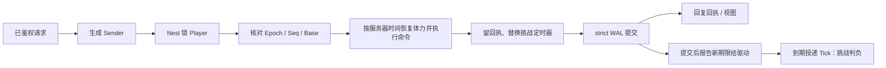
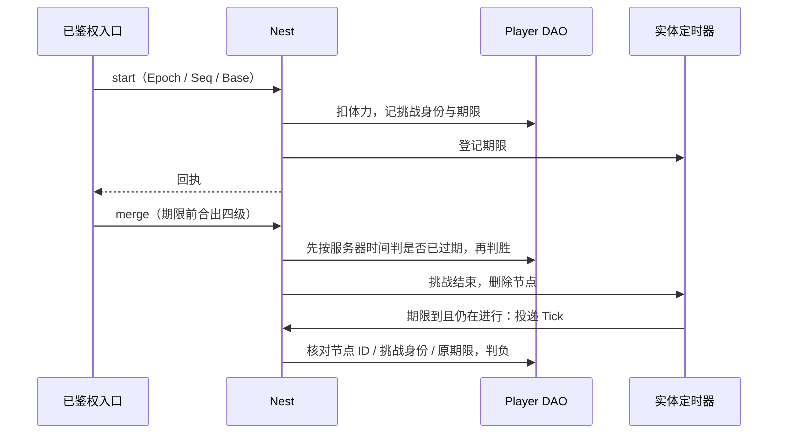

# 合成休闲框架学习与验收

本手册把“单人合成棋盘 + 生产器 + 订单 + 限时挑战 + 激励广告到账”的主要业务路径映射到 core 的正式接口，分两部分：**第一部分“学习”**讲框架怎么用、为什么这样设计，给出阅读顺序与可编译的调用示例；**第二部分“验收”**说明脚本证明什么、不证明什么。棋盘尺寸、物品链、数值和广告策略由游戏定义。下面的业务夹具（4×4 棋盘前 12 格开放、两条最高四级的物品链、四格仓库、一个生产器、一种订单配方、限时合出四级物品的挑战、模拟的签名广告回调）只是学习和验收样例：框架与生成器不包含任何合成玩法规则，生成器也不生成这些业务文件；完整的参考应用仍是 [game-demo](../../demo/README.md)。跑酷、物理闯关这类需要服务器判分的超休闲玩法不在本例范围。其他游戏类型的手册见 [SLG](SLG-INTEGRATION.md)、[MMORPG](MMORPG-INTEGRATION.md)、[MOBA](MOBA-INTEGRATION.md)、[卡牌 RPG](CARD-RPG-INTEGRATION.md)。

## 第一部分：学习

### 1. 适合谁、先读什么

适合准备用 core 做合成、消除、经营小游戏一类单人玩法后端的工程师。先读[入门](../GETTING-STARTED.md)、[Nest / Entity](guide/02-nest-entity.md)、[DataEngine](guide/03-dataengine.md)；第一次学建议先读完 [SLG 手册](SLG-INTEGRATION.md)的第一部分（Entity / DAO / Nest / 实体定时器的基本接法讲得最细），再读本篇。

本类型选择**服务器权威存档**：客户端可以离线先走、再按顺序上传命令，但每条命令都由服务器按自己的棋盘和时间重新执行；客户端不能上传整张棋盘覆盖服务器，也不能上报“挑战成功”或奖励额度。

### 2. 模块分工：合成休闲里的状态归谁

所有持久事实都属于静态 sid 归属的 Player：同一个 Player 锁下，棋盘、仓库、金币、体力、生产器次数、操作回执、广告回执和挑战一起变化。单人玩法不需要 Remote、Saga 或 Lockstep；跨服活动、多人竞争另行设计状态拥有者。

| 业务状态 | 拥有者 | 框架接法 | 业务边界 |
| --- | --- | --- | --- |
| 棋盘、仓库、金币、体力、生产器次数、订单计数 | Player DAO 的 `State` | 生成的 Player DAO 字段，只在 Nest 事务里经 mutator 修改 | 整个 `State` 是一段业务 JSON；正式服按实际大小拆分 |
| 操作回执、设备代际（Epoch）、存档版本（Revision） | Player DAO 的 `State` | 与资产同一事务提交 | 账本至多 128 条，满了拒绝新写 |
| 限时挑战期限 | Player 的实体定时器 + `WakeTimer` | `roost add timer --entity Player`；节点存 DAO，驱动到期投递 Tick | 加载后到期节点只触发一次，框架不追帧 |
| 体力、生产器次数恢复 | 业务时间计算 | 下一条命令到达时按服务器时间惰性恢复 | 不为每一点体力排定时器，不自动产出物品 |
| 配置（恢复周期、价格、挑战时长、广告体力） | configdata Store / Snapshot | 注册对象定义 → Load 时校验 → 首登时捕获并整份写进存档 | 已有存档沿用首登那一代，不随热更换表 |
| 广告奖励证明 | 业务验签 + Player 账本 | 服务器内部入口 `Sync_MergeAd`，验签与发奖同事务 | 本例的 HMAC 回调是模拟平台，不是真实广告 SDK |
| 客户端看到的存档 | 业务视图 `View` / `Receipt` | 锁内读取，只返回允许的字段 | 原始 `State` 含私有随机密钥与广告账本，不加 Sync 标记 |
| 登录、登录票与账号 | account / Player 静态 sid | 复用正式生命周期与登录鉴权 | 夹具直接用合成的已鉴权身份与登录票；账号链见 [玩家接入](PLAYER-ACCESS.md) 与 game-demo |



`strict` 保证回复前 WAL fsync，不保证回复时 Mongo 已投影（[DataEngine](guide/03-dataengine.md)）。

### 3. 合成、离线批次与挑战：如何使用

#### 3.1 生成工程从哪来

在仓库根目录使用 go.mod 声明的工具链运行：

```bash
ROOST_MERGE_CASUAL_KEEP=1 bash scripts/test-merge-casual-generated.sh   # 保留生成工程以便阅读；不加 KEEP 时成功即删除
```

脚本打印临时目录，生成工程在其中的 `project/`。它做的事就是一个新工程的接入步骤：

1. `roost project new merge-casual-practice -module example.com/merge-casual-practice -template game`；
2. `roost add dao Player --entity Player`、`roost add timer --entity Player`；
3. 业务只改这几处：在 `db/def/player.go` 加 ``State string `bson:"state" dao:"persist"` `` 与 ``WakeTimer int64 `bson:"wake_timer" dao:"persist"` ``；放入业务包 `game/mergecasual/`、定时回调 `game/entities/player/timer_handlers.go` 与 handler `game/handler/merge_casual.go`；
4. `roost generate` 生成组件、访问器和 Sender，不手改生成文件。加字段时 generate 会打印 `WARN: … new stored key "state" …`：这是 DAO 持久键变化的提示（加字段不需要迁移，老文档读成零值），见第 7 节。

生成的 `internal/bootstrap/generated.go` 已用 `wiring/entitytimer` 的 Mod 装配 Player 的定时器驱动（绑定 Nest、接业务时钟、启动与停止投递循环），`internal/registry/nest_gen.go` 已登记 handler；业务不手写这两处接线。测试里看到的 `TimerDriver.SetClock` / `Bind` / `Start` / `Stop` 是用例自己搭 Nest、控制投递时机的替身接线，不是生产装配要抄的步骤。

#### 3.2 阅读顺序

进入 `project/` 后按顺序读（括号里是仓库内的源文件）：

| 顺序 | 文件 | 先回答的问题 |
| --- | --- | --- |
| 1 | `game/mergecasual/rules.go`（[rules.go.txt](../../scripts/testdata/merge-casual/rules.go.txt)） | 配置怎样经校验发布？存档为什么在首登时整份冻结一代？ |
| 2 | `game/mergecasual/state.go`（[state.go.txt](../../scripts/testdata/merge-casual/state.go.txt)） | 存档里有什么？哪些字段是私有的（随机密钥、广告账本）？体力怎样按服务器时间惰性恢复、保留余数？ |
| 3 | `game/mergecasual/operations.go`（[operations.go.txt](../../scripts/testdata/merge-casual/operations.go.txt)） | 一条命令的处理顺序：查旧回执 → 核对代际 / 序号 / 版本 → 恢复时间 → 执行 → 留回执 |
| 4 | `game/mergecasual/reward.go`（[reward.go.txt](../../scripts/testdata/merge-casual/reward.go.txt)） | 外部平台的证明怎样验签、绑定玩家、去重和限次？ |
| 5 | `game/handler/merge_casual.go`（[handlers.go.txt](../../scripts/testdata/merge-casual/handlers.go.txt)） | 登录接管、离线批次、广告、查回执分别在哪个锁与提交边界里生效？挑战定时器在哪里替换？ |
| 6 | `game/entities/player/timer_handlers.go`（[timer_handlers.go.txt](../../scripts/testdata/merge-casual/timer_handlers.go.txt)） | 到期回调怎样核对定时器身份？为什么到期只判负、不追补？ |
| 7 | `game/handler/syncsender/` | 生成的 Sender 怎样把 Player ID 与业务参数交给 Nest；业务调用它，不手改 |
| 8 | [gameplay_test.go.txt](../../scripts/testdata/merge-casual/gameplay_test.go.txt)、[rules_test.go.txt](../../scripts/testdata/merge-casual/rules_test.go.txt) | 并发、拒绝、回滚、旧请求与隐私怎样实际验证 |
| 9 | [persistence/recovery_test.go](../../scripts/testdata/merge-casual/persistence/recovery_test.go) | 已确认但未投影的记录在 SIGKILL 后怎样恢复？领奖后再重启会不会再发奖？ |

身份要分开理解：Player 用框架完整 EntityID；命令的 `Seq` 是 Player 内永久递增的操作序号，`Epoch` 是设备代际（登录票），`Base` 是客户端预期的存档版本 `Revision`；广告证明用平台给的证明 ID；挑战身份是开局那条命令的 `Seq`；定时器节点 ID 又是 Player 内的独立身份。配置内容 hash、业务 `State` 里的 `Schema`、DAO 的 `_schema` 与 core 版本是四个不同的概念。

#### 3.3 用 Sender 调用

下面的文件放进保留的生成工程（例如 `internal/mergeflow/flow.go`）可直接编译。`client` 是当前服务的 Nest 客户端，`catalog` 是进程启动时 `mergecasual.OpenCatalog` 打开的配置，`now` 是服务器业务时钟（毫秒），Player ID 是完整 EntityID：

```go
package mergeflow

import (
	"context"

	syncsender "example.com/merge-casual-practice/game/handler/syncsender"
	"example.com/merge-casual-practice/game/mergecasual"
	"github.com/tjbdwanghaibo/roost-core/framework/configdata"
	"github.com/tjbdwanghaibo/roost-core/framework/nest"
)

// loginAndMerge 是已鉴权入口的调用顺序：登录（首登建档或新设备接管）、按返回的视图提交一条合成。
// key 是首登时服务器用 crypto/rand 生成的 32 字节十六进制密钥；ticket 是入口持久分配的登录票。
// Rules 由服务器捕获，不来自请求；已有存档会忽略它，沿用首登那一代。
func loginAndMerge(ctx context.Context, client nest.Client, catalog *configdata.Store,
	playerEntityID int64, key string, ticket uint64, now func() int64) ([]mergecasual.Receipt, error) {
	rules, err := mergecasual.CaptureRules(catalog.Current())
	if err != nil {
		return nil, err
	}
	s := syncsender.NewMergeCasualSender(client)
	view, err := s.Sync_MergeLogin(ctx, playerEntityID, key, ticket, now(), rules)
	if err != nil {
		return nil, err
	}
	command := mergecasual.Command{Epoch: view.Epoch, Seq: view.NextSeq, Base: view.Revision, Kind: "merge", A: 0, B: 1}
	return s.Sync_MergeBatch(ctx, playerEntityID, []mergecasual.Command{command}, now())
}

// resolveUnknown 在一次提交结果未知（超时、断线）后按原身份判断它是否已执行：
// 已执行就拿原回执；没执行就用同一条命令原样重发，不换 Seq。
func resolveUnknown(ctx context.Context, client nest.Client, playerEntityID int64,
	sent mergecasual.Command, now func() int64) (mergecasual.Receipt, error) {
	s := syncsender.NewMergeCasualSender(client)
	view, err := s.Sync_MergeView(ctx, playerEntityID)
	if err != nil {
		return mergecasual.Receipt{}, err
	}
	if sent.Seq < view.NextSeq {
		// 回执按当前 Epoch 查询；新设备也能查到旧设备已提交的操作。
		// 回执里的命令与 sent 不同，说明这个序号已被别的设备用掉，要先取新视图再决定。
		return s.Sync_MergeReceipt(ctx, playerEntityID, view.Epoch, sent.Seq)
	}
	receipts, err := s.Sync_MergeBatch(ctx, playerEntityID, []mergecasual.Command{sent}, now())
	if err != nil {
		return mergecasual.Receipt{}, err
	}
	return receipts[0], nil
}
```

`playerEntityID` 来自已鉴权会话，不来自请求体。公网入口只接收 `Kind`、格子坐标与 `Epoch` / `Seq` / `Base`；Player ID、服务器时间、Rules、私有密钥、广告验签密钥都由服务器填。`Sync_MergeAd(ctx, player, proof, verificationKey, epoch, now)` 是给广告平台回调适配器用的内部入口，验签密钥来自服务端依赖装配，不暴露给客户端。每次调用的错误都要按业务逐次处理，示例只演示调用方式；接网络协议时把 `mergecasual.ErrRule` 映射成业务错误码，存储 / 内部故障按[回复错误判别](guide/02-nest-entity.md#6-回复错误判别是否可能已提交能否重试)处理，不把内部错误文本直接返回客户端。

#### 3.4 十五个场景各学什么

| 场景（测试名前缀 `TestMergeCasual`） | 业务选择 | 学到的框架契约 |
| --- | --- | --- |
| `CatalogReloadIsAtomicAndExistingBoardFrozen` | 非法热更被拒，合法热更发布新一代 | configdata 校验失败不替换当前快照；已捕获的值和旧快照不被新发布改写；存档创建时冻结规则 |
| `MalformedStateFailsClosedAndPublicViewExcludesSecrets` | 加载时严格 JSON、范围与哈希校验 | 存档被改（未知字段、负金币、非法等级、错配置 hash）时拒绝解码；视图不含密钥、账本与配置，且不与存档共享内存 |
| `BoundedLedgerRetainsOldReceiptsAndRejectsOverflow` | 命令账本填满 128 条 | 满了拒绝新命令而不淘汰旧回执，旧命令一小时后重放仍得原回执；金币溢出拒绝 |
| `BoardAuthorityAndMergeRules` | 自合并、跨链、锁格、空格、越界 | 业务拒绝不写任何状态（存档与定时器字节不变）；移动交换不丢物品身份，合成精确消耗两格 |
| `WarehouseAndUnlockHaveAtomicCosts` | 仓库存取、解锁扣金币 | 资产与棋盘同事务：重复解锁、存进已占用的仓库格、取到未解锁的格子都被拒，不重复扣费 |
| `ProducerReplayDoesNotRerollOrChargeTwice` | 同一生产命令八个并发 | 单实体 Nest 串行 + 业务序号：一次扣体力与次数、一份掉落；同序号改目标被拒；次数用尽被拒且不扣体力 |
| `SellUndoCannotDuplicateItemsOrGold` | 出售后紧接着的一条命令内、十秒内可撤销 | 撤销与出售各留回执，重放撤销不再加物品；已撤销的出售再撤销、超过十秒再撤销都被拒 |
| `OrdersConsumeRecipeAndRewardOnce` | 订单精确消耗一级链的二级、三级物品 | 订单奖励只随命令回执发一次，重放四次不再加金币；配方不符被拒 |
| `OfflineBatchIsAtomicAndRejectsCloudConflicts` | 离线批次中途一步非法、过期 `Base`、跳号、上传整张存档 | 一个批次是一个 Nest 事务：任一步失败整批不落 DAO；整批重放得到原回执；版本冲突与未知命令被拒 |
| `DeviceTakeoverFencesOldWritesAndFreezesRules` | 新设备用下一张登录票接管 | 接管提高 Epoch，旧设备的命令被拒、新设备能查旧回执；同票重试不再推进、旧票被拒；接管时传入的新配置不改已有存档 |
| `ChallengeServerWinAndConcurrentClaim` | 挑战期内合出四级物品、八个并发领奖 | 胜负由服务器在合成那一刻判定并删除定时器；并发领奖只发一份 |
| `PersistentDeadlineExpiresOnceAndCancelsOldChallenge` | 迟到一小时的 Tick、重复 Tick、新挑战上的旧期限、期限时刻到达的合成 | 定时器 ID + 挑战身份 + 原期限三重核对，迟到的一次 Tick 只判负一次；重试开局不重排期限；命令先按服务器时间判负，不能靠调度延迟赢（实体一直在内存，用例手动投递 Tick，不是离线重载；离线重载见第二部分） |
| `UndoRestoresStateRandomResultAndTimer` | 生产 / 开局后 handler 失败 | 存档、随机结果与定时器节点一起回滚；重试得到与回滚前相同的掉落 |
| `OfflineRecoveryKeepsRemainderCapsAndRejectsBackwardClock` | 体力 / 次数离线恢复 | 保留未满一周期的余数、满了丢弃溢出时间、不自动产出物品；服务器时钟回退被拒 |
| `AdProofAuthorityBindingReplayAndDailyQuota` | 伪造签名、错绑玩家、过期、八个并发同一回调、同 UTC 日第四次 | 验签与到账同事务；同一证明并发只到账一次、过期后重试仍认原回执、同 ID 改内容被拒；每日三次上限 |

上述数值是样例，不是公共框架规则。这些场景实际证明到哪一步见第 11 节。

### 4. 配置为什么在首登时冻结

`OpenCatalog` 用 `configdata.MustRegisterObject` 登记 `merge_rules`（`merge.json`），`Validate` 失败整次加载 / 重载被拒，旧快照继续服务（[业务表发布](guide/07-config.md#3-业务表发布)）。入口捕获 `catalog.Current()` 再 `CaptureRules` 得到 `Rules` 值传给 `Sync_MergeLogin`：首登时整份 `Rules` 与 hash 写进存档，之后的恢复周期、价格、挑战时长都用这一代；接管登录传入的新配置被忽略。

这是本例的业务选择：合成棋盘的价格和恢复周期一旦改了会让玩家的离线预测全部失效，所以已有存档不静默换表。要让老玩家用新数值，需要业务写一次显式的存档迁移（按 hash 识别旧代、重算后写回），不是靠登录覆盖。回执里记了配置 hash，便于以后核对“这次扣款按哪一代价格”。公网请求**不携带** Rules。

### 5. 离线批次、设备代际与结果未知

`Sync_MergeBatch(player, commands, now)` 一次最多 16 条命令，在同一个 Player 事务里依次执行；任一步非法，整批不落 DAO（handler 只在全部成功后 `SetState`）。批次里的命令都用这一次请求的服务器时间，客户端的离线时间戳不作为收益依据，所以不能靠伪造离线时长连刷生产器。

- **原序号、原命令重发**：返回原回执，物品、金币、体力和定时器都不再变化。回执里的余额是原操作完成时的值，当前状态另读 `View`。
- **同序号换内容、跳号、过期 `Base`**：拒绝。客户端先取服务器 `View`，按自己的冲突策略重新预测，不能把整张客户端棋盘上传覆盖。
- **新设备接管**：已鉴权入口持久分配下一张登录票，调用 `Sync_MergeLogin` 提高 Epoch 并提高 Revision。同票重试只返回视图，旧票与跳票拒绝。登录票的分配与认证在业务接入层，不是客户端传一个数字就算登录。本例让 `Sync_MergeLogin` 同时承担首登与接管，接管时仍要传首登那把密钥（handler 核对相等，防止首登结果未知时给已有存档换一把新密钥）；正式服宜把“首登生成密钥”与“接管只提 Epoch”拆成两个入口。
- **结果未知**：保持原 Epoch / Seq 用 `Sync_MergeReceipt(ctx, player, currentEpoch, originalSeq)` 查询（见 3.3 的 `resolveUnknown`）；新设备也能查到旧设备已提交的回执。不要改 Seq 再发一次。框架层面的提交未知按[回复错误判别](guide/02-nest-entity.md#6-回复错误判别是否可能已提交能否重试)处理。
- **服务器侧事实会改变 Revision**：挑战到期、广告到账、接管都会提高 Revision，客户端的离线预测要重新取视图。旧批次不会静默覆盖这些已提交事实。

账本是 Player 上的持久业务事实，与资产同事务，所以长期有效；它不是服务的短期去重环。命令账本与广告账本各至多 128 条，满了拒绝新写而不淘汰旧回执（淘汰会让旧请求被当成新请求重复发放）；正式服需要归档 / 分片方案，不能靠删历史或只保留最近一个序号绕过。

### 6. 时间：惰性恢复、限时挑战与持久定时器

体力（每 3 秒 1 点、上限 10）和生产器次数（每 5 秒 1 次、上限 3）不排定时器，而是在下一条命令（或显式的 `recover` 命令）到达时按服务器时间一次算完：保留未满一周期的余数，满了丢弃溢出时间。读视图不推进时间，所以客户端要先发 `recover` 再按新版本继续离线预测。

限时挑战用持久定时器：`start` 扣两点体力、记下期限，handler 的 `saveMerge` 每次写存档时替换挑战定时器（`RemoveTimer` 旧节点、`NewTimerAt` 新期限、ID 记进 `WakeTimer`），挑战结束就不再挂。胜负只由服务器判定：



- 期限之前合出**新的**四级物品才算赢；已有的四级物品、客户端上报赢、延迟的 Tick 都不能判胜。命令到达时先按服务器时间判是否已过期，即使到期的 Tick 还没投递，过期后的合成也赢不了。
- 回调核对节点 ID、挑战身份与原期限，旧事件不会结束新挑战。**框架不追帧**：实体不在内存期间到期的节点，加载后只触发一次（[按实体的持久定时器](guide/10-time.md#4-按实体的持久定时器)）；本例据此只把当前挑战判负，不补开局、不补产出。
- 领奖用 `claim` 命令，参数是挑战身份；胜利发挑战金币，失败只收口。重试开局不延长原期限；新序号重试已领奖的挑战不再付奖。

### 7. 广告奖励与存储格式

广告样例模拟受信任平台的“已完成观看”回调：HMAC-SHA256 签名绑定证明 ID、Player ID、过期时间和奖励类别，验签密钥由服务端注入。验签通过后先查原回执，再判断新证明是否过期：同一已到账证明过期后重试仍认原回执、不重新发放；同 ID 换内容拒绝；体力放不下时拒绝而不吞证明；新证明同一 UTC 日至多三次（样例按 UTC 日界；正式业务的“同一天”按 `time.business_timezone` / `time.business_day_start` 算，即 `app.BusinessCalendar(registry).BusinessDay(now)`，见 [guide/10-time §2A](guide/10-time.md#2a-业务时区与业务日)）。真实平台的签名协议、订单查询、撤销与补偿、激励广告 SDK 都未接入，不能相信客户端的“观看成功”。

重连时调用锁内的 `Sync_MergeView` 取当前视图。`View` 裁掉私有随机密钥、命令与广告账本和整份配置。不要给 `State` 加 Sync 标记或直接下发整个实体；需要推送时按 [self_sync](PLAYER-ACCESS.md#7-玩家看自己的状态self_sync) 写业务视图。夹具只验证了字段裁剪，没有联调公网 TCP 协议或客户端引擎。

存储格式要分两层看：

- **DAO 持久键**：`State` / `WakeTimer` 的 `bson` 名就是 Mongo 里的键（DESIGN-TODO D13），`roost add timer` 加的节点与种子字段同理。以后改 Go 字段名要保留原 `bson` 名；改了 `bson` 名或删字段时，库里的旧键不再加载、下一次整文档写回即丢失，`roost generate` 与加载时只打 WARN。要改就先离线迁移（[schema 变更手册 §1](SCHEMA-MIGRATION.md#1-现行规则运行时只认当前-schema)）。
- **业务 JSON**：`State` 里的 `Schema=1` 是业务格式版本，加载时拒绝未知字段、未知版本、越界数值与配置 hash 不符。改业务格式同样要离线迁移并配套代码，只改 DAO 字段的 `_schema` 不等于迁移了 JSON 内容。

### 8. 更多合成休闲路线：接法、源码与业务边界

| 方向 | 从哪个源码 / 文档学 | 框架接法 | 业务仍需定义 |
| --- | --- | --- | --- |
| 内购与钻石到账 | [GrantPurchase](../../demo/game/handler/grant_purchase.go.tmpl)、[platform](../../demo/internal/service/platform/) | 渠道订单身份与到账账本同事务 | 产品、支付签名、退款与审计 |
| 邮件与补偿 | [ClaimMail](../../demo/game/controllers/player/claim_mail.go.tmpl)、[ClaimMailReward](../../demo/game/handler/claim_mail_reward.go.tmpl) | 服务预留、玩家侧幂等奖励、服务提交多阶段 | 邮件有效期与补发规则 |
| 活动与排行 | [活动接线](../../demo/internal/service/game/activity.go.tmpl)、[服务篇](guide/09-services.md) | 活动贡献只在首次真实付款时提交；排行写累计快照、只增不减 | 活动窗口、奖励档位 |
| 推送与客户端 | [Sync](guide/04-sync.md)、[玩家接入](PLAYER-ACCESS.md) | 业务视图经 self_sync 推送 | 客户端预测、冲突提示与表现 |

本夹具没有实现这些路线；它们在 game-demo 里的历史通过不等于合成游戏的内购、邮件或活动已验收。

### 9. 接入时容易踩的问题

- **把客户端存档当真相**：离线玩法最容易写成“客户端上传整张棋盘，服务器存下来”。这样客户端能任意改资产；本例只接受命令，服务器重新执行。
- **定时器回调只改本实体**：回调里只经组件 API 操作本 Player 的期限，不另建调度器、不直接改节点 map（[SLG §6](SLG-INTEGRATION.md#6-定时器回调能做什么)）。
- **handler 里不发同步 Nest 请求**：handler 内的同步请求被框架拒绝（`ErrSyncInHandler`）；需要别的实体一起变化时用多实体 Sender。
- **锁目标要能被识别**：不写 `target` / `targets` 时，Nest 生成器把类型名含 `Entity` 的参数推断为锁目标（本例 `IMergePlayerEntity`），找不到时 `roost generate` 报错并点名 handler（见 [Nest 生成器](../../codegen/docs/NEST_RUNTIME.zh-CN.md)）。

### 10. 练习

加“多个生产器各自冷却”或“限时活动棋盘”。先写清拥有者、幂等身份（哪个序号域）、事务参与者、配置代际和恢复语义，再选 Nest / 定时器 / Saga，不另造一套与框架平行的持久或并发状态机。

## 第二部分：验收

### 11. 业务纵切证明什么

```bash
bash scripts/test-merge-casual-generated.sh
```

脚本按 3.1 的步骤生成工程，replace 指回当前仓库，必须实际通过 15 条顶层 race 场景（3.4）且无 skip，随后执行消费者 build / vet、`roost id check` 与 `roost generate --check`；成功删除临时工程，失败或 `ROOST_MERGE_CASUAL_KEEP=1` 时保留。脚本不挂在 `dataengine-env.sh test`、不在根包门禁里，改 `game` 模板、`add dao` / `add timer` 或 Nest 生成时手动跑。

- **证明**：公共 CLI 生成的 Player DAO、实体定时器、Sender 与 Nest 在 15 个业务组合下的事务、undo 回滚、业务幂等和期限核对；配置原子发布与存档冻结；视图字段裁剪。
- **不证明**：提交器是替身，不含文件 WAL fsync 与 Mongo；定时器由用例手动投递生成的 Tick Sender，实体一直在内存，没有经过驱动投递循环与加载后补触发；单进程，无 Redis / NATS；鉴权与登录票是合成的。代码里有上限但测试没有填满的：单批 16 条（未测超限）、广告账本 128 条（只到每日三次）。夹具里的数值是样例。

### 12. 真实 WAL / Mongo 崩溃恢复

先按[隔离环境说明](../../wiring/scripts/integration/README.md)准备独立 Mongo 副本集并设置地址变量（不要指向生产库或共享业务库；共享隔离环境下遵守那里的持锁与命名规则），再运行：

```bash
ROOST_MERGE_CASUAL_REAL=1 bash scripts/test-merge-casual-generated.sh
```

它在第 11 节之后追加 `TestMergeCasualRealCrashRecovery`（已登记根包 `integration_coverage_test.go`），用本次唯一的 DAO 库与 WAL 目录：

1. 子进程经 strict 文件 WAL 提交首登、两次生产、一次广告到账和开挑战；后台投影关闭，断言 WAL 有 5 条已确认未投影的记录后，父进程 SIGKILL 自己启动的子进程。
2. 父进程用同一 WAL 与 Mongo 冷加载（业务时间推进一小时），核对完整存档摘要、公开视图与定时器 ID，并核对冷加载已把存量挑战期限报告给驱动索引（`DueOf`）；再重放第一次生产（同一掉落）与已过期的原广告证明（不再到账）。
3. 启动驱动自己的投递循环（`Driver.Start`，与进程装配同一入口；用例不手发 Tick、不调用 `DeliverDue`）：循环投递一次加载后的补触发，过期一小时的挑战只判负一次，体力与次数恢复到上限，挑战结束后不再挂期限；`entitytimer.delivered_total` 增量恰为 1。
4. 领取判负的挑战、重新开局，新期限进入索引（循环没有再投递）；业务时间直接推进到这个期限，循环（至多 `MaxWait` 后重读业务时钟）按时投递一次，挑战在期限时刻判负（`LastAt` 等于期限、修订号只加 1），投递计数到 2。业务时钟在两次推进之间冻结，期限之前条目不会到期。
5. 再领取、再开局、合出四级物品获胜，领奖后重放三次只得一份；其间循环不再投递（总计数 2、`redelivered_total` 增量 0）。先停循环再关 Nest（`close` 里与 `t.Cleanup` 还会再停一次）。
6. 正常关闭后再起第三个进程冷加载：核对存档摘要与视图，再重试第一次生产、领奖和原广告证明，存档不变。成功后删除本次库；失败保留生成工程、WAL 与库名供诊断。

去掉第 3 步的 `Start` 时，用例在补触发处等满 10 秒失败（`driver loop did not deliver the overdue challenge expiry …`），所以这一步的判负确实由循环完成。

- **证明**：strict 已确认的提交在 SIGKILL 后可从未投影 WAL 恢复（棋盘、资产、回执、广告账本与挑战定时器）；冷加载把存量期限报告进驱动索引；驱动投递循环在冷加载后自动补触发一次（迟到一小时的挑战只判负一次），并按时投递下一个期限；跨进程重试不重复生产、到账或发奖。
- **不证明**：提交在途 / 结果未知时的崩溃、磁盘断电、WAL 损坏或丢盘；循环在系统时钟下的长时间计时（用例用冻结的业务时钟，循环按 `MaxWait` 重读）、准入失败重试与 Redeliver（见 entitytimer 包测试与 `TestEntityTimerGeneratedProjectEndToEnd`）；多进程 / 跨机、Redis / NATS；容量与长稳。

### 13. 结论怎样给

物品链、数值和广告策略缺少默认实现，不自动构成框架缺陷；合法接口调用下出现丢期限、重复扣费 / 发奖、状态越权或生成物编译失败，则应在公共实现中修复。本夹具接入时没有触发框架或生成器缺陷。当前存储是教学规模：单批 16 条、两个账本各 128 条；整份存档每次整体编码提交，没有生产吞吐或延迟承诺，不能从 15 条功能回归推算容量。

尚未实施或验收：登录票的持久分配、真实广告平台（签名协议、订单查询、撤销）、内购、客户端预测与冲突提示、公网鉴权与限流、跑酷 / 物理关卡判分、容量与长稳（均不因此算框架缺陷）。

本机功能、跨机故障和长稳分别给结论；缺少实际证据的继续保留为未验收项。本部分是本游戏验收范围的完整说明；[KNOWN-LIMITS](../maintenance/KNOWN-LIMITS.md#游戏接入验收) 的游戏接入验收表只列一行摘要，不为每一轮另建报告。
