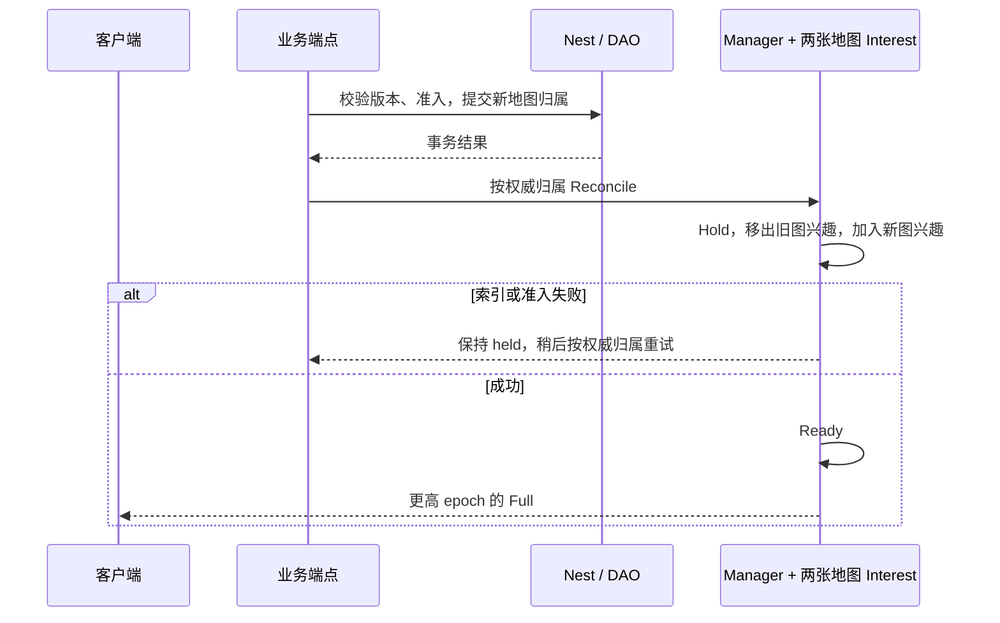

# MMORPG 框架学习与验收

本文面向准备用 core 开发 MMORPG 的服务端工程师，分两部分：**第一部分“学习”**从一条玩法追到它的状态归属、锁、持久化和客户端可见性，给出阅读顺序与可编译的调用示例；**第二部分“验收”**说明每个脚本证明什么、不证明什么，以及双 sid 演练的起栈步骤。登录、资产、持久化、Remote 和计时的共同接法见 [SLG 手册](SLG-INTEGRATION.md)，本篇重点是同屏交互、场景切换、队伍、交易、战斗计时与跨服协作。

业务玩法不放进公共框架，生成器也不生成这些业务文件：下面的夹具只在 [scripts/testdata/mmorpg](../../scripts/testdata/mmorpg/)，人数、伤害、期限和奖励都是样例数值，正式游戏自行定义；完整的参考应用仍是 [game-demo](../../demo/README.md)。本篇列明可执行的接法和尚未验证的边界，不代表完整 MMORPG 产品已完成。

## 第一部分：学习

### 专题优先级：跨服、视野、活动

MMORPG 后续优先围绕“跨服世界 Boss／限时副本”学习这三条线。先复用已有跨服赠礼和多地图消费者理解契约，再定义 Boss／副本权威和活动事实；不把本地切图等同于跨服，也不把基础交易通过等同于多人活动完成。

| 专题与 MMO 场景 | 框架接法 | 重点学习问题 |
| --- | --- | --- |
| 跨服组队／副本／世界 Boss | Player 静态归属，业务服务定义副本／Boss 权威；原服资产经 Saga／effect 协作，适合 Remote 的共享实体走 owner／lease／fence | 匹配成员、实际参战与领奖身份如何绑定；超时后查询哪个事实；旧服务进程能否继续写；部分玩家到账后怎样恢复 |
| 同屏／副本隔离／队伍与隐身 | 每张地图独立 Interest，同一连接由同一个 Sync Manager 管理；来源归并及 Profile 控制字段 | 同坐标不同副本不能互见；队伍退出或隐身变化如何撤权；切图失败如何按持久事实 Reconcile；重连 Full 是否清掉旧对象 |
| 世界 Boss／限时副本／节日活动 | 业务时间与持久 timer、本服通知、activity 协调聚合、贡献事实、结算投递、原服邮件／领取 | 参与和有效贡献由谁裁决；死亡／离线／重复命中是否计分；截止时已准入操作如何归窗；Boss 胜负和活动阶段是否一致；发奖与领奖的防重身份在哪里 |

**跨服**：先读 §6 与 §13，运行已有 `scripts/test-mmorpg-cross-sid.sh` 学错服拒绝、双向赠礼、失败补偿和重复邮件领取；它要求预先启动双 sid demo。Remote 与 Mirror 的测试另走 `scripts/test-remote-generated.sh`。跨服 Boss 的单写权威、成员快照、贡献记录和逐个原服兑奖是下一步业务接入，不能从赠礼结果推断已完成副本迁移或战场 HA。

**视野**：先读 §5 的 `mmoScenes.Reconcile`，运行 `bash scripts/test-mmorpg-scenes.sh` 观察两个地图、真实 TCP、切图重试和重连。接着用 [Block AOI](INTEREST-BLOCK-AOI.md) 与 [policy 测试](../../framework/sync/entitysync/policy/interest_test.go) 学提交屏障、来源撤销与视图白名单。下一步专题应补同坐标不同副本、队伍解散、隐身／反隐、观战权限和密集 Boss 扇出。`SetTeam` 只提供关系来源，AOI 可见不等于攻击授权；战斗 handler 仍须核对同图、存活、距离与技能条件。

**活动**：按 [SLG 活动学习顺序](SLG-INTEGRATION.md#专题优先级跨服视野活动) 追到 `OpenActivity → NotifyPhaseDue → Contribute → AttemptDispatch → settle → AckDispatch`。在 MMO 里把输入事实换成服务器确认的参战、伤害／治疗／任务贡献，先定义合格参与与奖励政策，再做持久账本；不能接受客户端伤害总数作为结算依据。确认活动实例与窗口、Boss／副本身份、参与者和原服 sid，重复消息用原身份；重启后恢复原窗口，不把旧贡献灌入新活动。

当前证据是分开的：§13 验证双 sid 赠礼，§12 的地图脚本验证同进程多地图 TCP；通用 activity 与 demo 覆盖协调、贡献、活动榜和投递接法。**跨服世界 Boss＋副本权限视野＋活动结算的联合消费者尚未验收**，包括中途掉线、窗口关闭与战斗完成竞争、原服派奖中断／补发。后续以这条联合链路深化学习，并把真实客户端、跨机故障和目标密度容量单独验收。


SLG 的 [联盟活动联合切片](SLG-INTEGRATION.md#联盟活动主线从准入到原服接收奖励义务)可作为跨服世界 Boss 的活动层学习前置：固定窗口、持久贡献意图、退组后的新命令拒绝、结算前冻结屏障、原服奖励义务回执与 ACK。其子进程协调器 / Redis / NATS，以及 Player 金币／永久回执的 WAL / Mongo SIGKILL 恢复、Remote 联盟显式 owner 交接与真实 TCP / Receiver 重连、NATS 权限代际重读与统一库名映射、持久位置与多块覆盖冷重建、固定视点权限交集及定期撤权重读、Player 持久视点与三目标权限冷恢复证据，都只属于 SLG 示例；MMO 仍需把真实 Boss 伤害权威、队伍 / 副本视野与 Player 永久资产接到同一条链路，不能将退盟规则直接当作退队分奖规则，也不能把奖励义务视为金币到账。

### 1. 适合谁、先读什么

基础阅读顺序：[入门](../GETTING-STARTED.md) → [Nest / Entity](guide/02-nest-entity.md) → [DataEngine](guide/03-dataengine.md) → [同步](guide/04-sync.md) → 本文对应场景。

Player 当前**静态绑定 game sid**：跨服玩法由 Remote / Saga 协作，不迁移 Player 的权威归属（§6）。同进程地图切换、跨服服务协作、按 sid 换机器是三个不同流程，不要混用。

### 2. 四种状态

| 状态 | 拥有者与框架能力 | 怎样使用 |
| --- | --- | --- |
| 角色资产、血量、任务、地图归属 | Player Entity 的 DAO；组件提供业务方法；Nest 串行修改 | 在 handler 内用生成的 mutator 写入，网络端点不能裸改 DAO |
| 交易托管、怪物归属、副本事实 | 独立 Trade / Monster / Scene Entity，必要时有自己的 DAO | 已知参与者一次传入多实体 Sender，由 Nest 排序取锁、同事务提交 |
| 谁能看到谁 | `policy.Interest` 的地图 AOI、关系来源与同步 Profile | 由权威位置更新索引；它是派生索引，不能反向覆盖 DAO |
| 客户端已经看到什么 | `entitysync.Manager` 的会话、epoch、基线与 ObjectRef；客户端 `frame.Receiver` | 收到 Full 先清旧视图，连续应用 Delta；旧 epoch 忽略，缺口重建全量 |

夹具里的 Scene 带人数 / 副本完成事实，所以持久化；game-demo 的地形 Scene 可从配置重建，标记 `noPersist=true lifetime=runtime_rebuild`（[模板](../../demo/game/entities/scene/entity.go.tmpl)）。两者是不同业务模型，不能照搬注解。

### 3. 业务与框架对照

| 业务场景 | 对应能力 | 接入方式与源码入口 | 业务负责什么 |
| --- | --- | --- | --- |
| 登录、建角与首登 | account、玩家接入、Entity lifecycle | [EnterGame 模板](../../demo/game/controllers/player/enter_game.go.tmpl)：先核对角色绑定 sid（错服答 `player_elsewhere` 与 owner sid），再经 lifecycle `GetOrCreate` 装载，不经 Sender | 渠道认证、区服和角色政策；PlayerID 取自已鉴权会话 |
| 移动、寻路与地图归属 | Scene runtime、Map 组件、Nest | [MovePlayer](../../demo/game/handler/move_player.go.tmpl)、[MapComponent](../../demo/game/entities/player/map_component.go.tmpl)：验证地形后写 DAO，再发布脏状态 | 移动速度、射程、视线与反作弊；AOI 距离不等于攻击授权 |
| 同进程切图 | 多实体 Nest + DAO undo | [持久切图](../../scripts/testdata/mmorpg/tasks.go.txt)：版本、原地图、新地图人数与归属一起修改 | 副本准入、容量、出生点、过期请求识别 |
| 切图后的视图切换 | 一个 Manager、每张地图一个 Interest、held / ready | [多地图接法](../../scripts/testdata/mmorpg/scene_runtime.go.txt)：按已提交归属重建索引，失败保持 held，成功 Ready 后发新 Full | 重试驱动与生命周期；持久提交与网络交付不是同一事务 |
| 同屏观察与隐私 | Interest `BandLayer` + Player 同步 Profile | 自己看完整视图，空间来源用 `near`；[TCP 客户端场景](../../scripts/testdata/mmorpg/scene_runtime_test.go.txt)核对金币 / 经验 / 背包不外泄 | 队伍、敌我、隐身、观战等权限及对应字段集合 |
| 组队、退出与解散 | 多 Player Sender；demo Scene `SetTeam` 关系来源 | `MMORPGParty`（[tasks](../../scripts/testdata/mmorpg/tasks.go.txt)）、`MMORPGDisband`（[gameplay](../../scripts/testdata/mmorpg/gameplay.go.txt)） | 邀请、队长、人数、跨地图信息权限；样例是两人队伍，解散带预期队伍 ID |
| 面对面交易 | 独立 Trade DAO + 三实体 Nest | `MMORPGOffer` 托管双方资产，`MMORPGResolveTrade` 处理确认 / 取消 / 到期；交易实体 ID 是幂等身份 | 物品唯一性、容量、报价、确认规则、掉线政策；样例掉线选择取消 |
| 权威战斗与冷却 | 多实体 Nest、端点注入的业务时间、单调输入序号 | `MMORPGStrike` 校验存活、同地图、顺序、冷却，再改怪物血量与击杀归属 | 战斗公式、命中、距离和预测；样例不是完整即时战斗系统 |
| Buff、死亡与复活 | 持久实体定时器（`roost add timer`，`entitytimer.Host` / `Driver`） | `MMORPGBuff` / `MMORPGRevive` 与[到期回调](../../scripts/testdata/mmorpg/timer_handlers.go.txt)；回调只改自己已锁的实体 | 叠加、驱散、刷新、死亡损失、复活点；离线到期在加载后补触发一次 |
| 掉落、任务与副本结算 | Player / Monster / Scene 同事务的业务事实 | `MMORPGLoot` / `MMORPGQuest` / `MMORPGCompleteInstance`：领奖与领取事实一起写，Boss 死亡才完成副本 | 掉落分配、任务条件、进度锁定、重置和奖励政策 |
| 背包、装备与属性 | Player 组件、嵌套 DAO、Nest rollback | [EquipItem](../../demo/game/handler/equip_item.go.tmpl)：背包扣新装备、换装、归还旧装备、刷新属性同事务 | 格数、绑定、强化与数值；派生属性不能成为另一份权威 |
| 技能与配置 | `gameplay/skill`、configdata、不可变 Program | [技能指南](guide/08-skill.md)、[配置指南](guide/07-config.md)；Parse → Compile → Host → Runtime | Host 的权威副作用、配置版本、跨 tick 状态与恢复；Skill Runtime 不自动进入 Nest undo |
| 匹配、聊天与战斗房间 | match / chat / session、Lockstep | game-demo 正式机器人执行聊天、组队匹配、房间战斗和状态同步（`cmd/loadtest`） | MMORPG 世界状态同步不必采用 Lockstep；按具体玩法选择 |
| 公会与跨服读取 | Remote Entity、lease / fence、Mirror | demo Guild 的 Remote Sender / Mirror 接法；[Remote 指南](guide/05-remote-mirror.md) | 公会权限、命名、成员与跨服观察政策；Mirror 是快照，不授予写权 |
| 跨 sid 赠礼与补偿 | Saga 原生步骤、事务性 effect、邮件 | `roost add saga -native` / `roost add effect`；[demo 赠礼 saga](../../demo/saga/gift_item/)；§13 的双 sid 脚本 | 收件人路由、补偿、人工收口与重试期限；Saga 不是跨服瞬时原子交易 |
| 邮件、支付、活动与排行 | mail / platform / activity / rank、持久业务账本 | demo 真实端点与 `scripts/test-demo-generated.sh` | 订单与领奖身份、赛季、补发政策；服务的有限去重环不替代长期资产账本 |
| 重启、搬服和观测 | 文件 WAL、Mongo、readiness、排空、schema、静态 sid 单实例 | [搬服](PLAYER-MIGRATION.md)、[schema](SCHEMA-MIGRATION.md)、[观测](OBSERVABILITY.md) | 部署容量、恢复目标、监控接收与运维；不删除 WAL 绕过恢复错误 |

### 4. 业务纵切：先跑，再读

#### 4.1 生成工程从哪来

在仓库根目录、使用 go.mod 声明的工具链运行：

```bash
ROOST_MMORPG_KEEP=1 bash scripts/test-mmorpg-generated.sh   # 保留生成工程以便阅读；不加 KEEP 时成功即删除
```

脚本打印临时目录，生成工程在其中的 `project/`。它的步骤就是一个新工程的接入方式：

1. `roost project new mmorpg-practice -module example.com/mmorpg-practice -template game`；
2. `roost add dao Player --entity Player`、`roost add timer --entity Player`，对 Scene / Trade / Monster 各执行 `roost add entity <名>` 与 `roost add dao <名> --entity <名>`；
3. 业务只改这几处：在 `db/def/*.go` 填 DAO 字段，并把 DAO 库名改成本次唯一的名字（真实依赖模式要用）；把 `game/entities/scene|trade|monster/entity.go` 注解里的 `category=entity.EntityCategoryOther` 改为 `category=entity.EntityCategoryWorld`（这些是被多名玩家争用的世界对象，锁序要低于 Player）；写到期回调 `game/entities/player/timer_handlers.go` 与 handler `game/handler/mmo_*.go`；
4. `roost generate` 生成组件、访问器和 Sender。

#### 4.2 阅读顺序

1. 脚本里的 DAO 字段：先画清玩家、交易和怪物分别拥有哪些事实。
2. `handlerMMORPGOffer`：扣除托管资产与记录交易身份在同一个 Nest 边界里。
3. `handlerMMORPGResolveTrade`：分别推演单方确认、双方确认、取消、到期和重复请求。
4. 对照竞争用例：确认与取消竞争的终态只能是交换完成或完整退款，要看终态与资产守恒，不能只看两个请求的返回值。
5. `handlerMMORPGStrike` → `Loot` → `Quest`：确认重放不能再次命中或领奖。
6. Buff 刷新 / 到期和死亡 / 复活用例：理解 DAO 里的期限与驱动索引的关系。

业务入口：[handler](../../scripts/testdata/mmorpg/gameplay.go.txt)、[行为测试](../../scripts/testdata/mmorpg/gameplay_test.go.txt)、[基础事务场景](../../scripts/testdata/mmorpg/tasks_test.go.txt)。

#### 4.3 用多实体 Sender 调用

下面的文件放进保留的生成工程（例如 `internal/mmoflow/trade.go`）可直接编译；`client` 是当前服务的 Nest 客户端，各 EntityID 是完整 ID：

```go
package mmoflow

import (
	"context"

	syncsender "example.com/mmorpg-practice/game/handler/syncsender"
	"github.com/tjbdwanghaibo/roost-core/framework/nest"
)

// openTrade 托管卖方 1 件物品与买方 10 金币。交易实体 ID 是幂等身份：同一参数重复开单不重复托管。
func openTrade(ctx context.Context, client nest.Client, tradeID, sellerID, buyerID, serverNowMillis int64) error {
	s := syncsender.NewMmoGameplaySender(client)
	return s.MultiSync_MMORPGOffer(ctx, tradeID, sellerID, buyerID, 10, 1, serverNowMillis)
}

// confirmTrade 记 actorID 一方确认一次（action 1）；卖家、买家各调用一次才成交。
// actorID 由已鉴权会话转换，不信任客户端自报；handler 持实体锁时不等待另一方，也不做远端 I/O。
func confirmTrade(ctx context.Context, client nest.Client, tradeID, sellerID, buyerID, actorID, serverNowMillis int64) error {
	s := syncsender.NewMmoGameplaySender(client)
	return s.MultiSync_MMORPGResolveTrade(ctx, tradeID, sellerID, buyerID, actorID, 1, serverNowMillis)
}
```

金币 / 道具上限、5 秒报价期限和转账的单调序号只是本例的业务选择，不要直接拿来代替正式经济协议。

#### 4.4 十三个场景各学什么

| 场景 | 业务建模 | 学到的框架契约 |
| --- | --- | --- |
| 两人组队、解散 | 两个 Player 同一 party ID；解散携带预期队伍 ID | 多实体 Sender 锁定两个玩家，重放不改成员事实；旧队伍的迟到解散不拆新队伍 |
| 并发转账重放 / 拒绝重试 | 单笔转账，发送方单调序号绑定收款人与金额 | 8 个并发同身份请求只转一次；注入拒绝后资产与幂等事实一起回滚，同序号可重试 |
| 托管交易 | Trade 实体托管卖方物品与买方金币，5 秒报价期限 | 单方确认不成交、双方确认只交换一次；取消与到期完整退款；确认与取消并发时终态只能是成交或全额退款 |
| 战斗、掉落、任务、副本 | 输入序号与冷却在 Player，血量与掉落归属在 Monster | 重放输入不重复伤害、冷却不可绕过、他人不能拾取、领奖重放不重复；跨图攻击与 Boss 未死的完成被拒且不改状态 |
| Buff | DAO 记录当前 Buff 节点 ID | 刷新撤销旧节点、旧期限不清新 Buff；事务拒绝时 Buff 与期限一起回滚；DAO 序列化重建后按 Tick 到期 |
| 死亡与复活 | 复活期限是一个定时器节点 | 重复复活请求不登记第二个节点，期限前不复活，到期后才能再战斗 |
| 切图、返回与旧请求 | Player 归属 / 版本与两个 Scene 人数同事务；示例容量 100 | 失败无半次切图，成功重放不重复计人数，返回后拒绝旧版本切图 |

表中 7 行展开为 13 条顶层测试；实际证明到哪一步见 §10。

### 5. 地图切换与断线重连怎样接

同进程切图的持久状态与 AOI 订阅是两个阶段：先由 Nest 提交业务归属，再更新旧 / 新场景订阅；订阅或准入失败时按持久归属重试或重建全量，不在事务尚可回滚时向客户端宣告切图成功。



关键接法在[多地图接法](../../scripts/testdata/mmorpg/scene_runtime.go.txt)的 `mmoScenes.Reconcile`：位置从 Nest 只读请求取得已提交的归属；一个连接的流与 epoch 由同一个 Manager 管理，每张地图各自一个 Interest。不要把两个独立 Manager 的默认流拼到同一个客户端 Receiver 上；应用 Full 时必须清除旧对象，不能只把新对象追加上去。

`SetTeam` 只是关系订阅来源，不是完整队伍服务；队伍解散后的关系来源更新、更多可见性策略要与正式的队伍服务联动。Block AOI 的其他装配与容量边界见 [Block AOI](INTEREST-BLOCK-AOI.md)。

### 6. 保持 Player 归属的跨服协作

每个角色从 account 取得 `ServerID`；[EnterGame](../../demo/game/controllers/player/enter_game.go.tmpl) 在装载前核对认证会话中的绑定，错服返回 `player_elsewhere` 与 owner sid。[搬服](PLAYER-MIGRATION.md)是按 sid 排空后换机器，绑定不变。Player 不随一次跨服交互搬到别的 game 进程：本服业务经 Saga 请求对方或邮件服务完成交互。玩家动态跨 sid 无缝迁移不是现有能力；需要先定义权威交接、旧连接准入、路由与恢复协议，不能只改 SceneID 或借 Remote Guild 的 lease 推断 Player 已支持。

```text
sid A 的玩家 → 本地 Nest 扣物品 / 记意图 → Saga / outbox
              → sid B 收件人的邮件步骤 → 完成
              → 失败时补偿原玩家；结果未知先查询 / 恢复，不盲目再扣
```

生成器入口：`roost add saga <name> -service <service> -steps <s1,s2,...> [-native <step,...> -entity <Entity> -component <Component>]` 与 `roost add effect <topic> -consumer <service>`，细节见 `roost help saga`、`roost help effect` 与 [Saga 指南](guide/06-saga.md)。步骤只执行本步骤声明的实体事务，持锁期间不同步访问另一个服务；原生步骤按 sid 分片时加 `WithAdmit` 准入（命令只在拥有该实体的进程执行，见 demo 赠礼 saga）。单进程容量见 [KNOWN-LIMITS](../maintenance/KNOWN-LIMITS.md)“Saga 原生步骤容量（单进程）”与[最新实测](../performance/SAGA-CHECKPOINT-20261018.md)（优化过程见 [SAGA-OPT](../performance/SAGA-OPT-20261018.md)）。

Remote / Mirror 用于公会等跨服实体：读镜像不代表拥有写权，写走正式 owner / lease / fence 路径。

#### 6.1 下一步方向：跨服世界 Boss / 限时副本

MMORPG 后续以“跨服世界 Boss / 限时副本”深化跨服、视野和活动三条线。先用已有的跨服赠礼（§13）和多地图消费者（§5、§12）理解契约，再定义 Boss / 副本的权威和活动事实；本地切图不等于跨服，基础交易通过也不等于多人活动完成。

| 方向 | 框架已有 | 业务要做 | 框架现在没有（不要假设） |
| --- | --- | --- | --- |
| 跨服组队 / 副本 / 世界 Boss | Player 静态归属与错服拒绝；Saga / effect 做原服资产协作；共享实体可用 Remote 的 owner / lease / fence（[Remote 指南](guide/05-remote-mirror.md)） | Boss / 副本权威放在哪个服务；匹配成员、实际参战与领奖身份如何绑定；超时后按哪个身份查询；部分玩家到账后怎样恢复 | Player 跨 sid 动态迁移；副本 / 战场的自动 HA |
| 同屏 / 副本隔离 / 队伍与隐身 | 每张地图一个 Interest、同一连接一个 Manager；来源归并（demo 的 `Scene.SetTeam` 只提供队伍关系来源）、Profile 字段白名单、Hold / Ready 与重连 Full | 同坐标不同副本不能互见；退队、隐身 / 反隐时撤哪个来源；切图失败按持久事实重试 `Reconcile`；AOI 可见不等于攻击授权，战斗 handler 仍核对同图、存活、距离与技能条件 | 跨服撤权传播协议；已下发信息的收回 |
| 世界 Boss / 限时副本 / 节日活动 | [activity 协调器](../../service/activity/) 与 demo `ActivityRunner` 的 `OpenActivity → NotifyPhaseDue → Contribute → AttemptDispatch → settle → AckDispatch` | 合格参与与有效贡献由服务器确认（伤害 / 治疗 / 任务），不接受客户端伤害总数；死亡、离线、重复命中是否计分；截止时已准入操作归哪个窗口；奖励与领奖的防重身份 | 贡献意图 / 补报的通用组件；义务账本与 Player DAO 之间的跨存储原子事务 |

SLG 的[跨服联盟活动链路](SLG-INTEGRATION.md#7-跨服联盟活动权限视野活动与原服奖励)是活动层的可运行参考：固定窗口、持久贡献意图、退盟后拒绝新命令、结算前冻结屏障、原服奖励义务回执与 ACK、Player 永久到账与 SIGKILL 恢复。它只证明 SLG 那条链路；MMO 仍要把 Boss 伤害权威、队伍 / 副本视野与 Player 资产接到自己的链路上，退盟规则不能直接当作退队分奖规则。**跨服世界 Boss + 副本权限视野 + 活动结算的联合消费者尚未验收**，包括中途掉线、窗口关闭与战斗完成竞争、原服派奖中断与补发。

### 7. 容易混淆的边界

| 常见误解 | 正确接法 |
| --- | --- |
| 改了 SceneID 就完成切图 | 持久事实、兴趣订阅、客户端基线都要更新；派生步骤失败后按权威重试 |
| AOI 看得见就能攻击 / 交易 | AOI 是交付策略，handler 仍要验证权限、距离、存活、同图与状态 |
| 收到一次确认就能交换资产 | 两个确认绑定同一报价身份，终态保留作去重依据；取消与确认竞争同一事务事实 |
| strict 成功等于 Mongo 已落库 | strict 的边界是 WAL fsync；需要 Mongo 可见时用 DataEngine 的 Flush / 投影等待契约 |
| 连接关闭或 ctx 超时就等于请求撤销 | 已准入的事务可能仍完成；先识别结果未知，再按业务身份查询或恢复 |
| Skill Runtime 放进组件就自动回滚 | Host 副作用与 Runtime 状态需要业务设计一致的持久边界；本例 DAO 战斗没有接持久技能 Host |
| 框架有 Lockstep，所以 MMO 必须帧同步 | 开放世界可做服务器权威状态同步；竞技副本可单独选 Lockstep |
| 真实 TCP 场景通过就说明容量合格 | 功能与容量分开；玩家密度、带宽、分位时延、跨机故障和长稳需要目标负载证据 |

SLG 手册的[通用接入原则](SLG-INTEGRATION.md#9-通用接入原则)（定时器只经组件 API、长期幂等靠实体上的持久事实、累计榜只增不减等）同样适用于 MMORPG。

### 8. 练习

依次增加：三人队伍与队长转让、修改报价使双方确认失效、物品实例与绑定交易、掉落分配、多个副本重置、权威射程与技能 Host。每次先写出业务规则与失败语义，再映射到现有框架接口；业务尚未定义的玩法不算框架缺陷。

## 第二部分：验收

### 9. 入口一览

| 入口 | 依赖 | 详见 |
| --- | --- | --- |
| `scripts/test-mmorpg-generated.sh` | 无外部依赖（提交器替身） | §10 |
| 同一脚本加 `ROOST_MMORPG_REAL=1`（正常停机两进程恢复 + SIGKILL 崩溃恢复） | 隔离 Mongo 副本集 | §11 |
| `scripts/test-mmorpg-scenes.sh` 与 demo 场景回归 | 无外部依赖 | §12 |
| `scripts/test-mmorpg-cross-sid.sh` | 已启动的双 sid game-demo 与隔离 Mongo / NATS / Redis / etcd | §13 |

这些脚本都不挂在 `dataengine-env.sh test`、不在根包门禁里，改相关生成器或 demo 场景接入时手动跑；本部分是 MMORPG 验收范围的完整说明，[KNOWN-LIMITS](../maintenance/KNOWN-LIMITS.md#游戏接入验收) 的游戏接入验收表只列一行摘要。

### 10. 业务纵切

```bash
bash scripts/test-mmorpg-generated.sh
```

按 §4.1 的步骤生成工程，replace 指回当前仓库；必须实际通过 13 条顶层 race 场景（§4.4）且无 skip，随后执行 `roost id check` 与 `roost generate --check`。成功删除临时工程；失败或 `ROOST_MMORPG_KEEP=1` 时保留。

- **证明**：生成代码、多实体取锁、DAO undo、定时器期限与业务幂等在 13 个业务组合下的交错行为。
- **不证明**：提交器是替身，不含文件 WAL 与 Mongo；Buff 的“离线到期”用 DAO 序列化 / 水合重建实体后手动投递 Tick，不是真实重载，也不是驱动在加载后自动投递（真实重载与驱动投递见 §11）；单进程。

### 11. 真实 WAL / Mongo 恢复：正常停机与 SIGKILL

```bash
# ROOST_DATAENGINE_IT_MONGO_URI 指向隔离 Mongo 副本集（见 wiring/scripts/integration/README.md）。
ROOST_MMORPG_REAL=1 bash scripts/test-mmorpg-generated.sh
```

追加的两个[恢复夹具](../../scripts/testdata/mmorpg/persistence/)共用本次唯一 DAO 库，各用自己的文件 WAL 根；定时器到期都由 Player 驱动自己的投递循环投递（`Driver.Start`，与进程装配同一入口），用例不手发 `Sync_TickPlayerTimer`、不调用 `DeliverDue`。业务时钟在两次推进之间冻结，循环按 MaxWait 重读时钟，所以投递次数是确定的，用例读 `entitytimer.delivered_total` / `redelivered_total` 的增量核对。关 Nest 前先停循环（`t.Cleanup` 里也会停）。

**正常停机两进程**（`TestMMORPGRealPersistenceAcrossProcesses`，[persistence_test.go](../../scripts/testdata/mmorpg/persistence/persistence_test.go)）：先后运行两个独立 `go test` 进程。第一个完成战斗、领奖、登记 Buff，停在交易单方确认后正常停机；第二个（业务时间 +1 小时）冷加载后核对单方确认已恢复，完成交易、重放击杀 / 掉落 / 任务领奖（不重复发放），核对冷加载已把 Buff 期限报告进驱动索引（`DueOf`），启动投递循环，由循环补触发一次离线到期的 Buff：Buff 清除，投递计数增量 1、重投 0，之后索引里不再有这个玩家。恢复来源是正常停机时已投影到 Mongo 的文档。

**SIGKILL 崩溃恢复**（`TestMMORPGRealCrashRecovery`，[recovery_test.go](../../scripts/testdata/mmorpg/persistence/recovery_test.go)）：崩溃点选野外战斗进行中——买家在交易窗口开着时被怪物击倒、复活在计时；卖家击杀怪物、拾取并领了任务奖、刚上 Buff（计时中）；双方的托管交易已挂单、卖家已确认（卖家 1 件物品、买家 10 金币托管在 Trade 实体里）。选它是因为这是 MMORPG 最典型的在途组合：两种 Player 定时器节点同时在计时，托管资产不在任何一方背包里，战斗奖励已发。

1. 子进程 strict 提交、关掉后台投影，断言恰有 12 条未投影记录（3 条种子 + 9 条业务命令）后写出屏障（四个实体的 DAO 持久字节与两个定时器节点 ID），被父进程 SIGKILL。
2. 父进程用同一 WAL 与本次唯一库冷加载（业务时间 +1 小时）：四个实体逐字节一致，Buff（T0 + 2 秒）与复活（T0 + 3 秒）两个期限都在驱动索引里；用原参数重试战斗、拾取、领奖、挂单、卖家确认与复活，状态不变。
3. 启动投递循环：两个过期玩家各补触发一次（Buff 清除、买家复活满血），计数增量 2。
4. 交易已过 5 秒期限：服务内部按到期清理（actorID 0）退还托管资产，重试两次不重复退，买家迟到的确认被拒。
5. 卖家重新上 Buff，新期限（当前业务时间 + 2 秒）入索引，期限之前不投递；业务时间推进到期限，循环按时投递一次（计数 3、重投 0）。
6. 先停循环再关 Nest；第三个进程冷加载，核对四个实体字节不变、两个玩家都没有期限，再重放战斗 / 领奖 / 到期清理（原卖家确认、复活被拒），仍然不变。

两个用例都必须实际通过且无 skip；成功后只删除本次唯一库，失败时保留并打印库名（`ROOST_MMORPG_KEEP=1` 时保留临时工程）。根包 `integration_coverage_test.go` 登记了这两个入口。去掉 `Start` 的对照运行两个用例都在补触发处超时失败。

- **证明**：交易、托管、领奖事实与 Buff / 复活定时器节点在正常停机后（从 Mongo）和 SIGKILL 后（从未投影 WAL）都不丢不重；冷加载把存量期限报告进驱动索引，驱动投递循环在冷加载后自动给每个过期实体补触发一次，并按时投递下一个期限；跨进程重试不重复发奖、不重复退款。
- **不证明**：提交在途 / 结果未知时的崩溃、断电、WAL 损坏；循环在系统时钟下的长时间计时（用例冻结业务时钟）、准入失败重试与 Redeliver（由 entitytimer 包测试与 `TestEntityTimerGeneratedProjectEndToEnd` 覆盖）；多进程 / 跨机与 Redis / NATS。

### 12. 多地图 TCP 纵切与单场景回归

```bash
bash scripts/test-mmorpg-scenes.sh
```

脚本用当前生成器生成新的 game-demo（`--skip-deps`，replace 指回当前仓库），放入[多地图接法](../../scripts/testdata/mmorpg/scene_runtime.go.txt)与[测试](../../scripts/testdata/mmorpg/scene_runtime_test.go.txt)，用 demo 的玩家 TCP 接入和框架 `frame.Receiver` 做客户端，检查：相同坐标的跨图隔离、旧图删除、目标图全量、业务准入失败后 held 重试、旧 epoch 帧不被应用、断线后按权威归属重连恢复、空间视图不泄露私有字段（`TestMMORPGTwoScenesTCPTransferRetryAndReconnect`）；之后对消费者 build / vet。

单场景的已有 demo 回归还覆盖：观察另一玩家变化、离场删除、停读连接被关闭而健康连接继续消费、重连全量恢复、旧 session 的迟到断开不删除重连后的新成员、卸载重载后观察者恢复。在新生成的 game-demo 中运行：

```bash
go test -race -count=1 ./internal/service/game ./game/scene/... ./cmd/loadtest
```

这些场景走真实 loopback TCP，但鉴权使用测试替身、单进程；不能据此声称真实渠道认证、客户端引擎（如 Unity 实机）或目标密度验收。

### 13. 双 sid 跨服赠礼

验收脚本 `scripts/test-mmorpg-cross-sid.sh` 对**已经启动**的 game-demo 运行，自己不起停服务、不改角色 sid。准备方式（隔离依赖、唯一工程名，端口按本机空闲情况选）：

1. 在本仓库根目录生成工程，并让 core 依赖指向本地仓库——game-demo 用到的 D12 API（`kitsaga.WithAdmit`、`Steps.RunHandedOver`）还在 CHANGELOG `[Unreleased]`，已发布版本里没有：

   ```bash
   GOWORK=off go run ./codegen/cmd/roost project new <唯一名> -module example.com/<唯一名> -out <目录> -template game-demo --skip-deps
   cd <目录>
   go mod edit -replace github.com/tjbdwanghaibo/roost-core=<本仓库路径>
   GOWORK=off go mod tidy
   ```

   然后把 `configs/service/config.*.yaml` 的 Mongo / NATS / Redis / etcd 地址改指隔离环境（见 [demo README](../../demo/README.md)“本地实跑”），按需改 ops 端口避免冲突。
2. `sh deploy/dev/run.sh start`：起 account 等九个托管服务和 sid 1000 的 game（共十个进程），并把 sid 1000 注册进 account。
3. 起第二个 game：优先用生成器提供的 `sh deploy/dev/second-game.sh start`。它从 `config.game.yaml` 派生 `config.game2.yaml`，改四处——sid 1001、ops 端口（`9200 + game 的端口块号`，game-demo 是 9200）、玩家 TCP 端口 7001、`etcd.advertise_addr` 的端口（`8900 + 端口块号`，game-demo 是 8900；端口块见[项目生成器](../../codegen/docs/PROJECT_GENERATOR.zh-CN.md)）——然后等它的 `/readyz`。WAL 目录不用改：生成的开发配置不写 `dataengine.wal.dir`，运行期按 sid 取 `data/wal/dataengine/1001`，与 sid 1000 的 `data/wal/dataengine/1000` 分开（配置里手写了 `…/wal/dataengine` 的，脚本把它改成 `…/wal/dataengine-1001`）；端口可用 `SECOND_OPS_PORT`、`SECOND_CLIENT_PORT`、`SECOND_ADVERTISE_PORT` 覆盖。`etcd.advertise_addr` 写进服务注册，同一台机器上的每个进程各用一个（维护者 2026-10-19 决定；生成的配置里 game、activity、match 已各不相同，`roost config check --all` 会拒绝两个服务写同一个）；服务间请求仍按 NATS 主题 `<prefix>.svc.<type>.<sid>` 寻址。second-game.sh **不会**把 sid 1001 注册进 account，要手动注册，Redis 参数与 run.sh 读 `config.account.yaml` 的方式一致（`redis.addr`、`redis.password`、`redis.db`、`account.key_prefix`；用 Redis Cluster 时改传 `-redis-cluster <cluster_addrs>`）：

   ```bash
   go run ./cmd/accountctl -redis <redis.addr> -redis-password <redis.password> -redis-db <redis.db> \
     -prefix <account.key_prefix> upsert-server -sid 1001
   ```

然后：

```bash
export ROOST_MMORPG_DEMO_ROOT=/path/to/generated/game-demo
export ROOST_MMORPG_PREFIX=<nats.prefix，缺省是工程名的 snake 形式>
export ROOST_MMORPG_DATABASE=<Player DAO 库，缺省是工程名的 snake 形式>
export ROOST_MMORPG_ENDPOINTS='1000=127.0.0.1:7000,1001=127.0.0.1:7001'   # 两个 game 的玩家 TCP 端口
# 另设隔离环境的 ROOST_DATAENGINE_IT_MONGO_URI、ROOST_DATAENGINE_IT_NATS_URL。
bash scripts/test-mmorpg-cross-sid.sh
```

工程名 `learn-demo` 的 snake 形式是 `learn_demo`：生成配置里 `nats.prefix: learn_demo`，`db/def/player.go` 的 DAO 标记 `db=learn_demo`。

脚本只创建本次的测试账号（[驱动](../../scripts/testdata/mmorpg/crosssid/main.go.txt)），经真实 account 登录 / 建角 / 选角和玩家 TCP 检查：

- **证明**：真实会话连到错误的 sid 在 EnterGame 被拒；sid 1000 → 1001 与 1001 → 1000 各 2 笔赠礼的 Saga 全部 completed；收件人领取邮件后，对已领的每封邮件再发一次 ClaimMail 不增加背包；发给不存在的收件人的 1 笔 Saga compensated；最后 Mongo 中四人背包为 `8 / 2 / 8 / 2`。Saga 库按 `<ROOST_MMORPG_DATABASE>_saga` 读取；工程改过命名时先改脚本参数，不对生产库运行。
- **不证明**：跨机网络与故障注入（同机两进程）；Remote fencing——Remote / Mirror 的真实入口是 `scripts/test-remote-generated.sh`，与本脚本分别执行，不能互相替代。原生步骤在真实 Nest 调度下的正向、补偿、重复投递等由 `wiring/saga` 的 integration 测试 `TestRealStepsRunNativeStepsUnderTheRealNestScheduler` 覆盖。

### 14. 验收范围小结

已提供：业务纵切（13 条，缺省替身提交器）、真实 WAL / Mongo 的两进程停机恢复与 SIGKILL 崩溃恢复（定时器经驱动投递循环）、多地图 TCP 纵切、对已启动双 sid demo 的跨服赠礼脚本；装备、聊天、邮件、支付、匹配、排行和 Lockstep 从 game-demo 学习。真实客户端引擎、目标密度长稳、跨机器故障仍需各自的实际证据；按静态归属路线，动态 Player 跨 sid 迁移不在本接入方案内。不能用 DAO 人数守恒代替 AOI 客户端视图验收。队伍邀请 / 队长、交易物品实例、掉落分配、战斗射程 / 预测、持久技能 Host 等没有默认实现（不因此算框架缺陷）；夹具里的队伍规模、交易期限与上限、伤害、冷却、奖励都是业务样例，不是框架规则。不以本文清单的长度代替验收。
