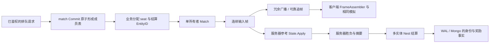

# MOBA 场景到 core 框架：学习与接入手册

本篇延续 [MMORPG](MMORPG-INTEGRATION.md) 的登录、持久化和服务接入经验，重点转向对局：输入由谁准入、怎样按帧排序、客户端如何恢复缺帧、谁判胜负，以及怎样避免重复结算。主仓库是 core；不需要安装 ssr。

当前消费者是**单路、每队一名英雄**的教学规则，用于验证框架接法。它不是现成的 5v5 产品，也没有预设目标帧率、玩家规模、延迟预算或部署拓扑。英雄、兵线、塔、基地、技能和局内商店属于业务，框架负责调度、同步、持久化和服务契约。

## 1. 场景与框架对照

| MOBA 场景 | 对应框架 | 如何接入 | 业务与保证边界 |
| --- | --- | --- | --- |
| 登录与选角 | account、玩家接入、静态 Player sid | 使用已鉴权会话绑定 Player，再由比赛成员表分配 seat | 不能信任客户端自报 seat；裸 PlayerID、EntityID、seat、传输 SessionID 是不同身份 |
| 排队、取消、匹配成功 | `service/match` Queue / Store / Grouping | Enqueue → Candidates → Grouping → Commit；票集合决定同一匹配身份 | 队伍角色、MMR、公平性、ban/pick、准备确认及目标 battle host 由业务定义 |
| 开房与输入准入 | `lockstep.Match`、`HandleCommand` | Match 单所有者串行运行，Attach 把经过鉴权的连接生命周期绑定到 seat | 不在 Nest worker / Entity 锁内驱动 Tick；房间队列、断线及关闭由宿主管理 |
| 移动、普攻与技能 | 业务输入 codec、服务器参考模拟 | 命令只带动作 / 目标类别 / 移动方向，语法与射程 / 冷却 / 消耗分别校验 | 框架看输入字节长度，不知道英雄是否能攻击；伤害与金币不能由客户端自报 |
| 兵线、塔与基地 | 业务 `State.Apply` | 整数状态、固定座位次序和逻辑帧，基地归零才产生胜者 | NPC、技能、装备和防御机制不搬进公共 Lockstep；本例同帧先后顺序不是平衡方案 |
| 实时广播与短暂丢包 | `Match.Tick`、冗余广播、`FrameAssembler` | Tick 返回权威输入帧，服务器与客户端按同一顺序模拟；冗余包去重、补齐连续缺口 | 客户端只能应用连续帧，不能跳过缺口自行向前模拟 |
| 断线、换连接与追帧 | Attach / Detach、可靠通道、StartCatchup | 新连接绑定后旧 SessionID 失去控制权；从客户端 `Next()` 请求历史页 | 每会话一页在途、有追帧预算；历史裁掉后明确失败，不自动快照重同步 |
| 观战与分歧检测 | AttachSpectator、ReportHash、DesyncVerdict | 旁观者可收帧 / 追帧，无英雄输入权限；关键帧报告用于检测状态分歧 | 多数 hash 不是反作弊证明；两席不一致会产生 NoMajority，处理策略归业务 |
| 逻辑检查点 | 业务 Snapshot / Restore | 保存整个参考模拟及版本，恢复后继续输入得到相同摘要 | 本例不持久化活动对局输入日志，不能声称进程崩溃后可继续本场比赛 |
| 胜负与无结果收口 | 服务器参考模拟 + 业务终态 | 运行中不能结算；摧毁基地产生胜者；到帧数上限无胜者 | 不能只接收客户端报胜；放弃、作弊、投降、重开政策需业务定义 |
| 奖励、战绩与重放 | 生成 DAO / Entity / Sender、Nest undo、DataEngine | 同一 MatchResult 实体内保留比赛身份 / 摘要 / 终态，双方战绩与奖励同事务 | 开局分配并保留该结算 EntityID；同一比赛换一个结算 ID 会绕开本记录的幂等边界 |
| 持久恢复 | 文件 WAL、Mongo、冷加载屏障 | 同一个结算 ID 在新进程冷加载后重试，不再付奖励或累计战绩 | strict 是 WAL durable，Mongo 可见另等投影；结果未知不能盲目重发新身份 |
| 真实传输与慢连接 | KCP / TCP Sender、nettransport | 本消费者使用真实 loopback KCP，框架 TCP 门禁另测停读与可靠追帧 | 同机网络通过不是跨机容量或客户端引擎验收；使用正确背压的可靠通道 |

先读[同步指南 §6](guide/04-sync.md#6-lockstep)，再读 [Match](../../framework/sync/lockstep/match.go) / [Sequencer](../../framework/sync/lockstep/sequencer.go) / [FrameAssembler](../../framework/sync/lockstep/assembler.go)，最后沿本消费者的业务文件学习。

## 2. 可执行入口与源码顺序

在 core 根目录使用 go.mod 声明的工具链：

```bash
bash scripts/test-moba-generated.sh
# 保留生成消费者以便阅读 / 修改：
ROOST_MOBA_KEEP=1 bash scripts/test-moba-generated.sh
```

脚本从正式 `game` 模板创建独立工程，经 CLI 添加 Player DAO 和 MatchResult Entity / DAO，填业务模拟与 handler，再生成访问器和 Sender。必须实际执行并通过 12 条顶层 race 场景，无 skip；随后消费者 build / vet、ID 检查与生成状态检查。不是在生成器中添加 MOBA 玩法。

| 学习顺序 | 文件 | 先回答的问题 |
| --- | --- | --- |
| 输入与模拟 | [simulation.go.txt](../../scripts/testdata/moba/simulation.go.txt) | 字节语法、存活、范围、冷却和资源分别在哪校验？无输入怎样推进？ |
| 匹配领域 | [matchmaking_test.go.txt](../../scripts/testdata/moba/matchmaking_test.go.txt) | 谁拥有票？取消怎样阻止入场？并发 Commit 怎样仍指向一场比赛？ |
| 帧与恢复 | [simulation_test.go.txt](../../scripts/testdata/moba/simulation_test.go.txt) | 冗余去重、可靠追帧、旧连接、观战、历史过期和 hash 分歧怎样处理？ |
| 真实 KCP 客户端 | [network_test.go.txt](../../scripts/testdata/moba/network_test.go.txt) | 相同输入经过真实网络后，两个客户端与服务器参考状态能否收敛？ |
| 奖励事实 | [settlement.go.txt](../../scripts/testdata/moba/settlement.go.txt) | 谁可调用结算？同一个比赛身份、胜者与摘要怎样约束重放？ |
| 并发与失败 | [settlement_test.go.txt](../../scripts/testdata/moba/settlement_test.go.txt) | 多个结算重试、换胜者、换摘要、失败回滚和无结果是否正确？ |

当前样例规则：两个固定 seat，各自拥有英雄、兵线、塔和基地；攻击 / 技能只选择敌方目标类别；死亡后等待逻辑帧复活；金币可购买一次治疗；塔未摧毁时基地不能受击。数值、输入迟到上限、地图长度、帧数上限均是样例业务选择，不能当作正式 MOBA 的要求。

## 3. 一场对局怎样连接这些模块



### 匹配成功的含义

`service/match` 把票从等待状态变成比赛成员，是原子操作。同一个完整票集合再次 Commit 返回原 Match，并发调用可以都成功回复；**应核对返回的 Match ID，不能按成功回复次数计算开局次数**。部分重叠、已取消、过期或被清理的票不属于这个幂等重放。

业务还要把成员表映射为稳定 seat，并保存 Match ID → 宿主 → 结算 EntityID 的路由。当前 demo 只为本 game 进程实际服务的玩家组局，避免房间在另一个进程而输入一直 `battle_not_found`；全服跨 sid 匹配与独立 battle host 路由是另一项架构工作，本例没有偷偷改变 Player 的静态 sid 归属。

### 输入与帧

本消费者固定 3 字节命令，且不包含 seat、伤害或奖励字段。服务先按会话确定控制权，再调用业务 `Submit` 校验字节语法与允许迟到窗口，最终经 `Match.HandleCommand` 进入排序器。未来帧仍受框架 SubmitWindow 限制。

框架会把首次迟到输入折入下一未切帧，并在有界 ReplayHorizon 内记住输入身份；它不是永久去重账本。本例只允许最多迟到 2 帧，超过直接拒绝，避免把很久以前的一次攻击当作新指令再次执行。输入重放与资产结算重放使用不同身份 / 窗口，不能混为一个机制。

`Match` 必须在一个所有者上串行调用。真实业务入口可将命令送入有界房间队列，再由对局 goroutine 调用 Submit / Tick / ReportHash；不要让网络回调与 Nest handler 并发访问同一个 Match，也不要持玩家锁等待对局循环。

### 服务器参考与客户端

`State.Apply` 先校验整帧的 seat 和语法，再修改状态，避免后一个坏输入让前半帧留下状态。英雄交互按已排序的 seat 顺序执行；整数、数组和逻辑 Tick 构成摘要，不读取墙上时钟或无序 map。客户端使用相同输入序列重算；State 的逻辑快照包含血量、金币、位置、兵线、塔、基地、复活与冷却期限。

KCP 用例通过真实本机 socket 发送输入 / 广播，随后在接收端刻意丢弃一段超过冗余深度的广播，再从 `FrameAssembler.Next()` 经可靠通道追帧，最后要求两端客户端与服务器摘要相同。KCP 会话采用固定测试绑定，不等同真实账号鉴权。

### 结算

生成消费者中的调用片段如下；client、完整 EntityID 和 matchKey 由服务端本场路由提供，digest 来自参考模拟，不能从客户端请求直接取值：

```go
seat, digest, err := reference.Result() // 未结束返回错误；0 表示没有胜者
// 先由业务把 seat 映射为匹配成员的 Player EntityID，并选定本场唯一结算 EntityID。
// seat 为 0 时，用本场固定成员次序传入两个玩家，只记录无胜者终态。
s := syncsender.NewMobaSettlementSender(client)
err = s.MultiSync_MOBASettle(ctx, resultEntityID, winnerEntityID, loserEntityID, matchKey, digest, seat == 0)
```

这是调用片段，不是独立 main。`handlerMOBASettle` 把结果身份 / 摘要 / 终态和双方奖励 / 战绩一起提交；重复同身份成功不再付钱，换胜者、比赛 ID 或摘要拒绝。无胜者终态保留但不发获胜奖励。样例获胜奖励是 10 金币，与局内击杀 / 推塔金币分开，正式经济、排位积分和赛季需要业务建模。

默认提交器替身验证业务原子性，真实持久化另开：

```bash
# ROOST_DATAENGINE_IT_MONGO_URI 指向独立 Mongo 副本集，按集成说明准备。
ROOST_MOBA_REAL=1 bash scripts/test-moba-generated.sh
```

两次独立 `go test` 进程共享本次唯一数据库和文件 WAL：第一进程提交结算，第二进程冷加载后重放并尝试换胜者；奖励和战绩只能出现一次。两阶段均须真实通过，无 skip；成功只删除本次唯一库，失败保留目录 / 库名供诊断。入口已登记根包覆盖表。

## 4. 网络、恢复和反作弊边界

- **历史窗口**：`HistoryRetainFrames` 按允许断线时长与逻辑帧率配置。低于历史 FirstID 的追帧返回 `ErrCatchupUnservable`；默认不做全量状态重同步。业务决定放弃、无结果或另行设计检查点 / 输入日志，不能把已有帧凭空补回来。
- **活动对局恢复**：本例有逻辑 Snapshot / Restore 的连续性验证，但没有把活动对局、输入日志与宿主所有权做持久成对提交。进程崩溃后继续比赛尚未实施；真实持久化模式只证明结算恢复。
- **分歧**：ReportHash 检测同帧分歧，NoMajority 明确无多数。相同 hash 不证明客户端没有作弊；参考模拟与服务器准入、权限、配置版本、随机种子及输入审计应按实际对局方案确定。
- **背压**：可靠追帧必须随实际链路放慢。框架 `TCPSender` 的可靠通道等写出，实时通道只准入；demo `battleSender` 和独立 Gate 的现有接法仍有背压限制，见 [KNOWN-LIMITS](../maintenance/KNOWN-LIMITS.md)“Lockstep 追帧链路背压”。不能把 demo 的两条 Push 通道当成完整可靠追帧承诺。
- **容量与平台**：本机 KCP、TCP 回归不代表 5v5 目标负载、Unity 真机、移动网络或跨数据中心验收。Tick 预算、分位延迟、密集技能、断线长稳及回放存储须另测。

已有框架网络门禁可在 core 根运行 `go test -race -count=1 ./framework/sync/lockstep ./framework/sync/nettransport`，包含真实 KCP 端到端、TCP 停读连接与可靠追帧测试。消费者的 12 条场景与这套框架门禁分别统计，不把替身、skip 或零测试算作真实网络通过。

## 5. 后续扩展的顺序

先按实际游戏补准备 / 选角、队伍组成与 MMR，再扩展多英雄多兵线、目标选择、技能与碰撞、战争迷雾和观战权限。需要继续一场崩溃比赛时，先设计宿主权威、版本固定的模拟快照与输入日志恢复边界；需要独立 battle host 时，先明确跨 sid 玩家如何路由和重连。

这些属于业务或架构能力，不因常见于 MOBA 就判成框架 bug。合法调用下发生输入身份越权、缺帧仍被错误应用、无界队列、重复结算或生成代码不可编译，才按实际复现修对应框架或 demo，并统一留在固定分支。
