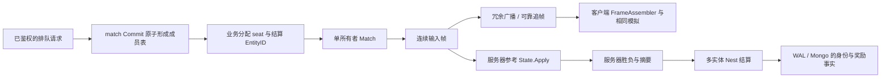

# MOBA 框架学习与验收

本文面向准备用 core 开发 MOBA 等对局类游戏的服务端工程师，分两部分：**第一部分“学习”**沿一场对局讲输入由谁准入、怎样按帧排序、客户端怎样补缺帧、谁判胜负、怎样不重复结算，给出阅读顺序与可编译的调用示例；**第二部分“验收”**说明每个入口证明什么、不证明什么。登录、资产、持久化和服务接入的共同接法见 [SLG](SLG-INTEGRATION.md) 与 [MMORPG](MMORPG-INTEGRATION.md) 手册，本篇重点是 Lockstep 对局、匹配和结算。

业务玩法不放进公共框架，生成器也不生成这些业务文件：下面的夹具只在 [scripts/testdata/moba](../../scripts/testdata/moba/)，是**单路、每队一名英雄**的教学规则——英雄、兵线、塔、基地、技能、局内商店、伤害与帧数上限都是样例，正式游戏自行定义；完整的参考应用仍是 [game-demo](../../demo/README.md)。它不是现成的 5v5 产品，没有预设目标帧率、玩家规模、延迟预算或部署拓扑。

## 第一部分：学习

### 1. 适合谁、先读什么

基础阅读顺序：[入门](../GETTING-STARTED.md) → [Nest / Entity](guide/02-nest-entity.md) → [DataEngine](guide/03-dataengine.md) → [同步指南 §6 Lockstep](guide/04-sync.md#6-lockstep) → 本文。Lockstep 源码先读 [Match](../../framework/sync/lockstep/match.go)、[Sequencer](../../framework/sync/lockstep/sequencer.go)、[FrameAssembler](../../framework/sync/lockstep/assembler.go)，再沿 §4.2 读业务夹具。

一场对局里有两类状态，接法完全不同：**局内状态**（英雄血量、位置、兵线、塔）由服务器参考模拟与客户端按同一输入序列各自计算，不经 Nest、不进 DAO；**局外事实**（奖励、战绩、本场结算身份）经 Nest 多实体事务写进 DAO、由 DataEngine 持久化。把两者混在一起——每帧写 DAO，或让客户端上报胜负直接发奖——是最常见的错误。

### 2. 模块分工：对局里的状态归谁

| 状态 | 拥有者与框架能力 | 怎样使用 |
| --- | --- | --- |
| 排队票、成局成员 | `service/match` 的 Store（Enqueue / Cancel / Candidates / Commit） | 已鉴权的主体排队；Commit 原子地把一组票变成一场比赛 |
| 谁控制哪个 seat | `lockstep.Match` 的 Attach / Detach / AttachSpectator | 鉴权层把连接的 SessionID 绑定到 seat；重新 Attach 后旧 SessionID 失去控制权 |
| 每帧的权威输入 | `lockstep.Sequencer`（Match 内部） | 按 seat 排序、窗口准入、有界重放去重；Tick 切出一帧 |
| 局内模拟状态 | 业务参考模拟（本例 `State.Apply`） | 只接受连续帧；整数、固定 seat 顺序、逻辑帧，不读墙上时钟或 map 遍历顺序 |
| 客户端已收到哪些帧 | 客户端 `FrameAssembler` | 冗余包去重、按帧号补齐缺口；缺口未补齐前不能向前模拟 |
| 本场结算事实、奖励与战绩 | 生成的 MatchResult / Player DAO + 多实体 Sender + Nest undo + DataEngine | 胜负与摘要只来自服务器参考模拟；结算身份、奖励、战绩同一事务 |

### 3. 场景与框架对照

| MOBA 场景 | 对应框架 | 如何接入 | 业务与保证边界 |
| --- | --- | --- | --- |
| 登录与选角 | account、玩家接入、静态 Player sid | 已鉴权会话绑定 Player，再由比赛成员表分配 seat | 不能信任客户端自报 seat；账号 ID、裸 PlayerID、完整 EntityID、seat、传输 SessionID 是不同身份 |
| 排队、取消、成局 | [service/match](../../service/match/store.go) Store + `FirstComeGrouping` | Enqueue → Candidates → Grouping → Commit；票集合就是成局的提交身份（§5.1） | 队伍角色、MMR、公平性、ban/pick、准备确认与目标 battle host 由业务定义 |
| 开房与输入准入 | `lockstep.NewMatch`、`Match.HandleCommand` | Match 只在一个所有者 goroutine 上串行调用；`HandleCommand` 按 SessionID 找 seat，旁观者只能追帧 | 不在 Nest worker / Entity 锁内驱动 Tick；房间队列、断线与关闭由宿主管理 |
| 移动、普攻与技能 | 业务输入 codec + 参考模拟 | 命令只带动作、目标类别、移动方向；语法在 `Submit` 校验，射程 / 冷却 / 消耗在 `Apply` 校验 | 框架只看输入字节长度（`MaxInputBytes`），不知道英雄能否攻击；伤害与金币不能由客户端上报 |
| 兵线、塔与基地 | 业务 `State.Apply` | 整数状态、固定 seat 次序和逻辑帧；塔未摧毁时基地不受击，基地归零才产生胜者 | NPC、技能、装备和防御机制不搬进公共 Lockstep；本例同帧先后顺序不是平衡方案 |
| 实时广播与短暂丢包 | `Match.Tick`、冗余广播（`RedundancyDepth`）、`FrameAssembler` | Tick 返回本帧输入，服务器与客户端按同一顺序模拟；冗余深度 N 能补上至多 N-1 个连续丢包 | 客户端只能应用连续帧，不能跳过缺口自行向前模拟 |
| 断线、换连接与追帧 | Attach、可靠通道（`Reliable`）、`StartCatchup` / `OpCatchup` | 新连接 Attach 后，从客户端 `FrameAssembler.Next()` 请求历史；每会话一页在途，追帧期间不收实时帧 | 历史已被裁掉时以 `ErrCatchupUnservable` 明确失败，不自动快照重同步（§6） |
| 观战与分歧检测 | `AttachSpectator`、`ReportHash`、`OnDesync` | 旁观者可收帧 / 追帧，没有输入权；关键帧 hash 报告用于发现状态分歧 | 多数 hash 不是反作弊证明；两席不一致判为 `NoMajority`，处理策略归业务 |
| 逻辑检查点 | 业务 `Snapshot` / `Restore` | 保存整个参考模拟及版本，恢复后继续推进得到相同摘要 | 本例不持久化活动对局与输入日志，不能声称进程崩溃后可继续本场比赛 |
| 胜负与无结果收口 | 服务器参考模拟 + 业务终态 | 运行中 `Result` 返回错误；摧毁基地产生胜者；到帧数上限无胜者 | 不能只接收客户端报胜；放弃、投降、作弊、重开政策由业务定义 |
| 奖励、战绩与重放 | 生成 DAO / Entity / Sender、Nest undo、DataEngine | MatchResult 实体保存本场身份 / 摘要 / 终态，与双方奖励、战绩同一事务 | 开局时分配并保留本场结算 EntityID；同一比赛换一个结算 ID 会绕开这条记录的幂等边界 |
| 持久恢复 | 文件 WAL、Mongo、冷加载 | 同一结算 ID 在新进程冷加载后重试，不再发奖励、不再累计战绩 | `strict` 的边界是 WAL fsync，Mongo 可见另等投影；结果未知时按原身份重试，不换新身份 |
| 传输选择 | `nettransport` 的 KCP / QUIC / UDP，`lockstep.TCPSender` | 本例用真实 loopback KCP；嵌入 TCP 用 `TCPSender`（§6） | 玩家接入层（player TCP、独立 Gate）只提供 TCP；KCP 的监听、握手鉴权与 Session 绑定由宿主自己写 |

### 4. 业务纵切：先跑，再读

#### 4.1 生成工程从哪来

在仓库根目录、使用 go.mod 声明的工具链运行：

```bash
ROOST_MOBA_KEEP=1 bash scripts/test-moba-generated.sh   # 保留生成工程以便阅读；不加 KEEP 时成功即删除
```

脚本打印临时目录，生成工程在其中的 `project/`。它的步骤就是一个新工程的接入方式（`roost` 是脚本从当前仓库编出的 CLI）：

1. `roost project new moba-practice -module example.com/moba-practice -template game --skip-deps`，然后 `go mod edit -replace github.com/tjbdwanghaibo/roost-core=<本仓库路径>` 让依赖指向本地仓库（脚本随后以 `-mod=mod` 运行，自己动手时执行一次 `GOWORK=off go mod tidy`）；
2. `roost add dao Player --entity Player`、`roost add entity MatchResult`、`roost add dao MatchResult --entity MatchResult`；
3. 业务只改这几处：在 `db/def/player.go`（`Gold` / `Wins` / `Losses`）与 `db/def/match_result.go`（`MatchKey` / `Digest` / `WinnerID` / `LoserID` / `Status`）填 DAO 字段，并把 DAO 库名改成本次唯一的名字（真实依赖模式要用）；把 `game/entities/match_result/entity.go` 注解里的 `category=entity.EntityCategoryOther` 改为 `category=entity.EntityCategoryWorld`（结算记录被两名玩家共同引用，锁序低于 Player）；放入局内模拟包 `game/moba/` 与结算 handler `game/handler/moba_settlement.go`；
4. `roost generate` 生成组件、访问器和 `MobaSettlementSender`。

#### 4.2 阅读顺序

| 顺序 | 文件 | 先回答的问题 |
| --- | --- | --- |
| 1. 输入与模拟 | [simulation.go.txt](../../scripts/testdata/moba/simulation.go.txt) | 字节语法、存活、射程、冷却和资源分别在哪里校验？无输入的帧怎样推进？为什么整帧先校验再修改？ |
| 2. 匹配领域 | [matchmaking_test.go.txt](../../scripts/testdata/moba/matchmaking_test.go.txt) | 谁拥有票？取消怎样阻止入场？并发 Commit 为什么都成功却只有一场比赛？ |
| 3. 帧与恢复 | [simulation_test.go.txt](../../scripts/testdata/moba/simulation_test.go.txt) | 冗余去重、可靠追帧、旧连接、旁观者、历史过期和 hash 分歧怎样处理？ |
| 4. 真实 KCP | [network_test.go.txt](../../scripts/testdata/moba/network_test.go.txt) | 同一输入经过真实 socket 后，两个客户端与服务器参考状态能否收敛？ |
| 5. 结算事实 | [settlement.go.txt](../../scripts/testdata/moba/settlement.go.txt) | 谁能调用结算？本场身份、胜者与摘要怎样约束重放？ |
| 6. 并发与失败 | [settlement_test.go.txt](../../scripts/testdata/moba/settlement_test.go.txt) | 并发重试、换胜者、换摘要、事务拒绝回滚和无结果是否正确？ |

样例规则：两个固定 seat 各有英雄、兵线、塔和基地；攻击 / 技能只选敌方目标类别；死亡后等 5 个逻辑帧复活；5 金币可买一次治疗；塔未摧毁时基地不能受击；600 帧无胜者即无结果收口；输入最多迟到 2 帧。这些都是样例业务选择。

#### 4.3 房间所有者与结算：怎样调用

下面的文件放进保留的生成工程（例如 `internal/mobaflow/flow.go`）可直接编译。三个函数都只在房间所有者 goroutine 上调用；`client` 是当前服务的 Nest 客户端，EntityID 是完整 ID：

```go
package mobaflow

import (
	"context"
	"errors"

	syncsender "example.com/moba-practice/game/handler/syncsender"
	moba "example.com/moba-practice/game/moba"
	"github.com/tjbdwanghaibo/roost-core/framework/nest"
	"github.com/tjbdwanghaibo/roost-core/framework/sync/lockstep"
	"github.com/tjbdwanghaibo/roost-core/framework/sync/nettransport"
)

// onCommand 处理一条已解码的客户端命令。session 是鉴权层绑定的传输会话，Match 据此找到 seat；
// 输入先过业务语法与迟到上限，追帧和 hash 报告直接交给 Match。
func onCommand(room *lockstep.Match, session nettransport.SessionID, c lockstep.Command) error {
	if c.Operation == lockstep.OpInput {
		return moba.Submit(room, uint64(session), c.Frame, c.Payload)
	}
	return room.HandleCommand(session, c)
}

// tick 切一帧并推进服务器参考模拟。Tick 的错误只说明部分接收者的发送或追帧失败：
// 这一帧已经切出并写进历史，参考模拟必须照样应用，否则服务器从这一帧起与客户端分歧。
func tick(ctx context.Context, room *lockstep.Match, reference *moba.State) error {
	frame, sendErr := room.Tick(ctx)
	if errors.Is(sendErr, lockstep.ErrMatchClosed) {
		return sendErr
	}
	if err := reference.Apply(frame); err != nil {
		return err
	}
	return sendErr // 交给宿主记录 / 告警
}

// settle 在参考模拟结束后结算。seatPlayers 是成局时按 seat 固定的两名玩家，resultID 是开局时分配的
// 本场结算 EntityID，matchKey 是成局的 Match ID；三者都来自服务端路由，不取客户端请求里的值。
func settle(ctx context.Context, client nest.Client, reference *moba.State, resultID int64, seatPlayers [2]int64, matchKey string) error {
	winner, digest, err := reference.Result() // 未结束返回错误；winner 为 0 表示无胜者
	if err != nil {
		return err
	}
	s := syncsender.NewMobaSettlementSender(client)
	if winner == 0 {
		// 无胜者也按固定 seat 次序传入两名玩家，只记录终态、不发获胜奖励。
		return s.MultiSync_MOBASettle(ctx, resultID, seatPlayers[0], seatPlayers[1], matchKey, digest, true)
	}
	return s.MultiSync_MOBASettle(ctx, resultID, seatPlayers[winner-1], seatPlayers[2-winner], matchKey, digest, false)
}
```

`Match` 不加锁：网络回调把命令投进有界房间队列，由所有者 goroutine 依次调用 `onCommand` / `tick`；不要让网络回调与 Nest handler 并发访问同一个 Match，也不要持玩家锁等待对局循环。`settle` 是同步 Nest 请求，不能在 handler 内调用（框架返回 `ErrSyncInHandler`）。获胜奖励 10 金币与局内金币无关，正式经济、排位积分和赛季要业务建模。

#### 4.4 十二个场景各学什么

| 场景 | 业务建模 | 学到的框架契约 |
| --- | --- | --- |
| 匹配排队、取消与成局（`TestMOBAMatchmakingAdmissionCancellationAndCommit`） | 排队请求 ID 幂等；只有票主能取消；票 1 秒过期 | 重复排队不出第二张票；已取消 / 已过期的票不能入局；两个并发 Commit 都成功但指向同一 Match ID，成局后队列清空 |
| 输入身份、重放与窗口（`TestMOBAInputIdentityReplayAndWindow`） | 3 字节命令；最多迟到 2 帧 | 未绑定会话、超前帧（`ErrFrameTooEarly`）、坏字节被拒；同一输入重传不重复执行；重新 Attach 后旧会话失去控制权 |
| 冗余修复丢包（`TestMOBADeterministicDuelHealsLostBroadcasts`） | 两名英雄对打 80 帧，含死亡复活 | 丢掉 2 个广播、每包收两次，客户端靠冗余去重补齐，摘要与服务器一致；输入逆序到达仍按 seat 排序 |
| 断线追帧与旁观者（`TestMOBACatchupAndSpectatorCannotControlHeroes`） | 玩家在第 4 帧后断开，换连接重连 | 从 `Next()` 追帧后回到实时并与服务器同摘要；旁观者提交输入被拒 |
| 历史过期与分歧（`TestMOBAHistoryExpiryAndDesyncAreExplicit`） | 历史只保留 `MinHistoryRetainFrames` | 起点已被裁掉的追帧返回 `ErrCatchupUnservable`；两席 hash 不同判为 `NoMajority` |
| 推塔、基地与服务器结果（`TestMOBALaneTowersBaseAndServerResult`） | 单英雄推塔、拆基地 | 未结束不能结算；基地归零产生胜者与 64 位十六进制摘要；结束后不再接受帧 |
| 技能、商店与检查点（`TestMOBASkillCooldownShopAndCheckpoint`） | 技能冷却 3 帧、5 金币治疗 | 冷却内的第二次施法无效；快照恢复后继续推进与原状态同摘要；后一个坏输入不让前半帧生效；未知版本的快照被拒 |
| 真实 KCP 收敛（`TestMOBAKCPClientsAndReferenceConvergeAfterCatchup`） | 两个客户端经 loopback KCP，客户端 1 刻意丢掉一段超过冗余深度的广播 | 输入经可靠通道、广播经 datagram、追帧经可靠通道；一次追帧后两个客户端与服务器参考摘要相同 |
| 并发结算重放与身份冲突（`TestMOBASettlementConcurrentReplayAndIdentity`） | 8 个并发同身份结算 | 只发一次奖励、只记一次战绩；换胜者、换比赛 ID、换摘要都被拒 |
| 结算拒绝回滚（`TestMOBASettlementRollbackAndRetry`） | handler 改完状态后返回错误 | 结算身份、奖励与战绩全部回滚；同一身份随后可重试成功 |
| 无胜者终态（`TestMOBANoWinnerSettlementNeverPays`） | 对局取消 | 终态保留（`Status=2`），重放不变，不发获胜奖励 |
| 完整服务器结果链（`TestMOBAServerReferenceSettlesTheFinishedRound`） | 排队成局 → 会话输入 → Match → 参考胜负 → 结算 | 结算用成局的 Match ID 作本场身份，重复结算只付一次 |

实际证明到哪一步见 §10。

### 5. 一场对局怎样连接这些模块



#### 5.1 成局的含义

`Commit` 把一组等待中的票原子地变成一场比赛：检查与写入是同一次比较并设置，失败不留副作用。**票集合就是提交身份**：同一个完整票集合再次 Commit（票序可不同）返回原 Match，不创建第二局；与已匹配的票只部分重叠、或含已取消 / 过期 / 不存在的票时拒绝。所以并发的两个匹配器可以都收到成功回复——**要核对返回的 Match ID，不能按成功回复次数计开局数**。这个重放只在保留期内有效（`match.retention`，缺省 10 分钟，维护者 2026-10-19 方案 A）：比赛与它的票从成局起至少保留这么久，之后一起移除；超期后同一票集合的 Commit 报 `ErrTicketMissing`——仍不会成第二局，只是拿不回原 Match。所以匹配器要在保留期内完成重试，开局后自己保存 Match ID 路由，不要指望事后再从匹配服务读成员表（[store.go](../../service/match/store.go) 的 `Commit` 注释，`TestCommitReplayReturnsOriginalMatchForSameTicketSet`、`TestCommitReplayInsideRetentionReturnsTheOriginalMatch`、`TestCommitReplayAfterRetentionReportsTheTicketsMissing`、`TestConcurrentCommitsProduceExactlyOneMatch`）。

业务还要把成员表映射为稳定 seat，并保存 Match ID → 房间宿主 → 结算 EntityID 的路由。game-demo 的匹配只为本 game 进程实际服务的玩家组局（[matchmaker](../../demo/internal/service/game/matchmaker.go.tmpl) 的 `ownedCandidates`），避免房间在另一个进程而输入一直 `battle_not_found`；全服跨 sid 匹配需要独立 battle host 与跨 sid 输入路由，是另一项架构工作，Player 的静态 sid 归属不变。

#### 5.2 输入与帧

本例命令固定 3 字节，不含 seat、伤害或奖励字段。服务先按会话确定控制权，再由业务 `Submit` 校验字节语法与迟到上限，最终经 `Match.HandleCommand` 进入排序器；超前超过 `SubmitWindow` 的帧由框架拒绝。

框架把首次迟到的输入折进下一个未切的帧，并在有界的 `ReplayHorizon`（64 帧）内记住“哪名玩家的哪个原始帧号已处理”，窗口内的重传不再执行；更早的重传与首次到达无法区分（[sequencer.go](../../framework/sync/lockstep/sequencer.go) 的 `ReplayHorizon` 注释）。所以它不是永久去重账本：本例只允许迟到 2 帧，超过直接拒绝，避免很久以前的一次攻击被当作新指令。输入重放与结算重放是不同的身份和窗口，不能混为一个机制。

#### 5.3 服务器参考与客户端

`State.Apply` 先校验整帧的 seat 顺序和语法，再修改状态，避免后一个坏输入让前半帧留下状态。英雄交互按已排序的 seat 顺序执行；整数、数组和逻辑 Tick 构成摘要，不读墙上时钟、不遍历无序 map、不用外部随机源。客户端用相同的输入序列重算；逻辑快照包含血量、金币、位置、兵线、塔、基地、复活与冷却期限。

#### 5.4 结算

`handlerMOBASettle`（`rollback=undo durability=strict`）把本场身份 / 摘要 / 终态与双方奖励 / 战绩一起提交：MatchResult 已有终态时，完全相同的重放直接成功，换胜者、比赛 ID 或摘要都被拒；无胜者终态保留但不发获胜奖励。结算 EntityID 要在开局时分配并随本场路由保存，重试与恢复都路由到同一个 ID。调用方式见 §4.3。

### 6. 网络、恢复和反作弊边界

- **历史窗口**：`HistoryRetainFrames` 缺省自动保留 3600 帧（60Hz 下 60 秒），按“允许断线秒数 × 逻辑帧率”自行配置（[指南：历史保留窗口](guide/04-sync.md#长局如何控制内存历史保留窗口)）。起点早于窗口的追帧返回 `ErrCatchupUnservable`，并经可靠通道通知客户端终止本场；框架不做全量状态重同步（[指南：追帧越界](guide/04-sync.md#追帧越界明确失败不自动重同步)）。本例 600 帧小于缺省窗口，所以客户端能从帧 1 追帧；更长的对局要么调大窗口，要么由业务设计检查点 / 输入日志，不能把已裁掉的帧补回来。
- **活动对局恢复**：本例只验证逻辑快照与恢复后的连续性，没有把活动对局、输入日志与房间所有权做持久成对提交。进程崩溃后继续比赛尚未实施；真实持久化模式只证明结算恢复。
- **分歧**：`ReportHash` 发现同帧分歧，`NoMajority` 明确表示没有多数。相同的 hash 不证明客户端没有作弊；参考模拟、服务器准入、权限、配置版本、随机种子与输入审计要按实际对局方案确定。
- **传输与追帧背压**：追帧的限速依赖可靠通道在链路慢时让发送变慢——KCP / QUIC 窗口满了就阻塞；嵌入 TCP 用 `lockstep.TCPSender`，可靠通道等写出、实时通道只准入（[指南：经嵌入 TCP 追帧](guide/04-sync.md#经嵌入-tcp-追帧随链路放慢)）。独立 Gate 与生成 demo 的 `battleSender` 两条通道都只做准入，追帧不随链路放慢，见 [KNOWN-LIMITS](../maintenance/KNOWN-LIMITS.md)“Lockstep 追帧链路背压（独立 Gate / demo）”。
- **KCP 的支持范围**：`nettransport` 提供 KCP 传输（`ListenKCP` / `DialKCP` / `KCPTransport`），`roost project new ... -features nettransport-kcp` 只生成装配函数（`roost help replication`）；监听、握手鉴权、密钥与 Session 绑定由宿主自己写。玩家接入层（player TCP、独立 Gate）只走 TCP，Gate 不提供 UDP / KCP 承诺（[GATEWAY §4](GATEWAY.md#4-synclockstep-与广播)）。本例 KCP 会话用固定测试密钥与固定绑定，不是真实账号鉴权。
- **容量与平台**：本机 KCP / TCP 回归不代表 5v5 目标负载、真实客户端引擎、移动网络或跨数据中心。Tick 预算、分位延迟、密集技能、断线长稳及回放存储要另测。

### 7. 容易混淆的边界

| 常见误解 | 正确接法 |
| --- | --- |
| 两个匹配器都收到 Commit 成功，就开了两局 | 同一票集合幂等返回同一 Match；按 Match ID 去重，不按回复次数计数。重放只在 `match.retention` 内返回原 Match，超期报 `ErrTicketMissing`（不会成第二局） |
| 客户端报的胜负 / hash 一致就能发奖 | 胜负与摘要只取服务器参考模拟；hash 只用于发现分歧 |
| Lockstep 的输入去重能防长期重放 | 只在 `ReplayHorizon` 内有效；业务自己限制迟到帧数，资产重放靠结算实体上的持久事实 |
| `Tick` 报错就是这一帧没切出 | 只有 `ErrMatchClosed` 不切帧；其他错误是发送 / 追帧失败，帧已在历史里，参考模拟照样应用 |
| 断线多久都能追帧 | 只能追保留窗口内的帧，越界明确失败，不自动重同步 |
| 每帧把局内状态写进 DAO 才安全 | 局内状态由输入序列确定；持久的是结算事实。需要崩溃续赛时另行设计快照与输入日志 |
| 结算每次重试都可以换一个新的结算 ID | 结算 ID 开局时分配并保留；换 ID 就绕开了幂等记录 |
| 用了 KCP 就有了玩家接入与鉴权 | KCP 只是传输；监听、握手鉴权和 Session 绑定由宿主实现，接入层只提供 TCP |

### 8. 练习与后续扩展

依次增加：准备确认与选角、队伍组成与 MMR、多英雄多兵线、目标选择与碰撞、战争迷雾与观战权限。需要继续一场崩溃的比赛时，先设计宿主权威、版本固定的模拟快照与输入日志恢复边界；需要独立 battle host 时，先明确跨 sid 玩家怎样路由和重连。每次先写清业务规则与失败语义，再映射到现有接口；业务尚未定义的玩法不算框架缺陷。合法调用下出现输入越权、缺帧仍被应用、无界队列、重复结算或生成代码不可编译，才按实际复现修对应的框架或 demo。

## 第二部分：验收

### 9. 入口一览

| 入口 | 依赖 | 详见 |
| --- | --- | --- |
| `scripts/test-moba-generated.sh` | 无外部依赖（提交器替身，loopback KCP） | §10 |
| 同一脚本加 `ROOST_MOBA_REAL=1` | 隔离 Mongo 副本集 | §11 |
| `go test -race -count=1 ./framework/sync/lockstep ./framework/sync/nettransport` | 无外部依赖 | §12 |

前两项不挂在 `dataengine-env.sh test`、不在根包门禁里，改 `game` 模板、`add dao` / `add entity`、多实体 Sender 生成或 Lockstep 时手动跑；当前范围维护在 [KNOWN-LIMITS](../maintenance/KNOWN-LIMITS.md)“MOBA 接入验收的范围”。

### 10. 业务纵切

```bash
bash scripts/test-moba-generated.sh
```

按 §4.1 的步骤生成工程，replace 指回当前仓库；必须实际通过 12 条顶层 race 场景（§4.4）且无 skip，随后对消费者 build / vet，执行 `roost id check` 与 `roost generate --check`。成功删除临时工程；失败或 `ROOST_MOBA_KEEP=1` 时保留。

- **证明**：生成的 DAO / Entity / 多实体 Sender 与 Nest 在结算并发重放、身份冲突、拒绝回滚、无胜者终态下的事务行为；框架 `Match` / `Sequencer` / `FrameAssembler` 在会话身份、输入重放与窗口、冗余去重、断线追帧、旁观者、历史过期、`NoMajority` 下的行为；`service/match` 内存存储的排队、取消、过期与并发 Commit 幂等；一条真实 loopback KCP 链路上的丢包、追帧与三方摘要收敛。
- **不证明**：提交器是替身，不含文件 WAL 与 Mongo；除 KCP 一条外，网络由记录器代替；匹配不经服务 RPC、Redis 存储与认证；KCP 会话是固定测试绑定，不是真实账号鉴权；单进程，不含跨机网络与目标负载。

### 11. 真实 WAL / Mongo 两进程结算恢复

```bash
# ROOST_DATAENGINE_IT_MONGO_URI 指向隔离 Mongo 副本集（见 wiring/scripts/integration/README.md）。
ROOST_MOBA_REAL=1 bash scripts/test-moba-generated.sh
```

追加的[恢复夹具](../../scripts/testdata/moba/persistence/persistence_test.go) `TestMOBARealSettlementAcrossProcesses` 用本次唯一 DAO 库，先后运行两个独立 `go test` 进程，共用同一文件 WAL 与真实 Mongo：第一个进程经多实体 Sender 结算一局（并重放一次）后正常停机；第二个冷加载，在任何结算请求之前先核对结算身份、摘要、终态、奖励与战绩都已恢复，再重放同一结算两次、尝试换胜者，核对奖励与战绩仍只有一次、换胜者被拒。两阶段必须实际通过且无 skip；成功后只删除本次唯一库，失败时保留并打印库名。根包 `integration_coverage_test.go` 登记了这个入口。

- **证明**：结算身份与奖励 / 战绩经文件 WAL / Mongo 两进程往返后不丢不重，恢复后的结算记录继续约束重放。
- **不证明**：崩溃 / 断电 / 结果未知注入——这是正常停机后的恢复；进行中的对局恢复（本例没有持久化输入日志）。

### 12. 框架自带的网络门禁

```bash
GOWORK=off go test -race -count=1 ./framework/sync/lockstep ./framework/sync/nettransport
```

其中 `TestLockstepEndToEndGate` 让两个真实客户端（`FrameAssembler` + hash）与一个 `robot.LockstepBot` 经 loopback KCP 连同一个 Match，覆盖满载输入、超过冗余深度的连续丢包后追帧、错误 hash 判罚与追帧阻塞不拖住 Tick；`TestKCPTransportOOBAndReliableLoopback` 覆盖 KCP 的 datagram 与可靠两条通道；[tcp_test.go](../../framework/sync/lockstep/tcp_test.go) 的 `TestACatchUpOverEmbeddedTCPFollowsTheLinkInsteadOfOverflowingIt` 等覆盖嵌入 TCP 的追帧随链路放慢与停读连接。它们与 §10 的 12 条场景分别统计，不把替身、skip 或零测试算作真实网络通过。

### 13. 验收范围小结

已提供：业务纵切（12 条，缺省替身提交器，含一条真实 loopback KCP）、真实 WAL / Mongo 两进程的结算停机恢复、框架 Lockstep / KCP / TCP 网络门禁。ban/pick、队伍与 MMR、技能 Host、战争迷雾、独立 battle host 跨 sid 路由、活动对局的输入日志 / 检查点恢复没有默认实现；真实客户端引擎、5v5 目标负载与跨机长稳尚未验收。不以本文清单的长度代替验收。
