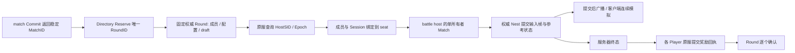

# MOBA 场景到 Core 框架的学习与接入

本文把一场 MOBA 从匹配、准备、对战到恢复与结算串起来，供准备使用 core 的游戏服开发者学习。主仓库是 core，ssr 仅供参考，不需要安装。按“学习接法”和“实际验收”阅读，避免把功能消费者当作完整商业游戏。

当前有两个层次：单路双英雄例子解释 Lockstep 和本地原子结算；5v5 三路例子继续覆盖准备 / 选角、固定权威对局、独立 battle host、活动帧恢复和跨 sid 奖励。数值、队伍规则与存储上限是明确的教学选择，没有预设生产帧率、吞吐或延迟 SLO。

## 一、学习：业务由谁拥有，框架怎样接

### 1. 场景与框架对照

| MOBA 场景 | 状态拥有者 | 对应框架与调用流程 | 边界 |
| --- | --- | --- | --- |
| 登录、原服归属 | account / Player 原服 | 复用账号登录和静态 Player sid，由已鉴权连接上下文提供 PlayerID / SessionID | 公网不能自报玩家身份；本消费者采用合成的已鉴权上下文，真实账号链见 MMORPG / demo 入口 |
| 排队与成局 | match Store | Enqueue → Candidates / Grouping → Commit，按返回 Match ID 开局 | 完整同一票集合重放仍返回原比赛，不能按成功回复次数计算开局数；MMR / 队伍角色属业务 |
| 开局身份与路由 | 固定权威 BattleDirectory / BattleRound | 正式 DAO / Entity / Sender；先 Reserve MatchID→RoundEntityID，再初始化这个 ID | 同一匹配命名空间使用同一 Directory；重试、恢复不能另分配比赛 ID |
| 准备、ban / pick | BattleRound | `Change` 经 `Sync_MOBARound` 在 Nest 锁内校验并提交 | 每队五名、队内英雄不重名、对方可镜像、每队队长可 ban 一名；准备与截止策略属业务 |
| 开房与连接绑定 | battle host 的 Actor / HostEndpoint | 有界邮箱 → 单所有者 Match，原服核对成员和静态 sid 后绑定 seat / session | Match 单 goroutine；不能在 Nest handler / Entity 锁内 Tick；总线为受信任服务间入口 |
| 移动、目标与技能 | 服务器参考 Arena | 4 字节动作编码 → 语法 / seat 校验 → 连续帧 → 确定性模拟 | 射程、资源、技能冷却、路线与目标校验在业务；客户端不传伤害、金币、胜负 |
| 三路兵线 / 塔 / 基地 | Arena | 固定 seat / lane 顺序和整数状态，所有随机来自保存的种子 | 换路只在基地 / 河道；每路塔保护该路进攻基地；规则不加入公共 Lockstep |
| 击杀、成长、装备、野区 | Arena | 击杀 / 补刀得局内金币及 XP，限量购买、死亡复活、技能 / 野区 Buff | 样例装备为三次属性购买，选角记录身份但英雄共享教学技能；不等同正式英雄 / 装备库 |
| 视野与观战 | 业务可见性 / 观战入口 | `Visible` 计算展示；ACL 后调用延迟、分页的 `ObserverFrames` | 全输入帧同步不能对修改客户端保密；旁观者无英雄输入或 Tick 权限 |
| 实时广播 | Match / nettransport | 连续帧、冗余广播、FrameAssembler 去重补缺；KCP 真实客户端验证 | 缺帧不得越过；参考状态与客户端用相同模拟，hash 一致不是反作弊证明 |
| 持久帧与发布 | 固定权威 BattleRound，宿主暂存广播 | Match 切帧 → 正式 Sender 提交帧与参考状态 → strict 确认 → 广播 | strict 是 WAL durable；暂存区只容纳十个玩家广播；结果未知即停房间，发送失败不回滚已提交帧 |
| 断线、重连、旧连接关闭 | 原服连接生命周期 / 宿主绑定槽 | 新 SessionID 重绑，旧输入拒绝；迟到 disconnect 不拆新绑定 | 十个固定槽有界；没有输入的 seat 按框架空输入推进，是否托管属于业务策略 |
| 活动对局恢复 | 权威 WAL / Mongo + 新宿主 | 恢复同一个 Round → 增加业务 Epoch → 公开 SubmitInput / Tick 重建 Match → 新连接分页追已提交帧 | 每场完整日志上限 600 帧；未提交输入可重发，不能把排队成功当执行确认 |
| 跨 sid 宿主交接 | 固定权威 Round | Nest 锁内 `handoff` 更新 HostSID / Epoch；新宿主查询原局恢复；旧宿主提交被拒绝 | Player sid 不动；这是业务代际隔离，不是 Remote lease，也不是权威进程自动 HA |
| 胜负与无结果 | 服务器参考 Arena / draft 状态机 | 推基地 / 同队四票投降 / 帧数上限，准备超时取消 | 只能对服务器终态结算；投降窗口、超时处理与无结果政策是教学规则 |
| 原服奖励与重试 | 终态 Round + 各原服 Player | 终态生成 Award → 原服核对权威结果 → `Sync_MOBAAward` → Round ack | 逐玩家提交、可重试；不承诺十名跨服玩家瞬时原子；每个玩家的回执与资产同一 Nest 事务 |
| 排空与资源释放 | Actor / Bus / Runtime | 关准入 → 等在途执行 / 清理排队请求 → 停总线 → Nest / WAL 关闭 | 超时不是完成；邮箱固定 32 条，停止后不释放仍被使用的 Room |

### 2. 推荐源码阅读顺序

先读[同步指南 §6](guide/04-sync.md#6-lockstep)，了解 [Match](../../framework/sync/lockstep/match.go)、[Sequencer](../../framework/sync/lockstep/sequencer.go)、[FrameAssembler](../../framework/sync/lockstep/assembler.go)。再看业务消费者：

| 顺序 | 业务源码 | 学习问题 |
| --- | --- | --- |
| 1 | [单路模拟](../../scripts/testdata/moba/simulation.go.txt)、[原子结算](../../scripts/testdata/moba/settlement.go.txt) | 最小输入、模拟、胜负和同进程多实体结算怎样连接？ |
| 2 | [5v5 三路模拟](../../scripts/testdata/moba/arena.go.txt)、[玩法回归](../../scripts/testdata/moba/arena_test.go.txt) | 哪些是业务规则？如何保证固定次序、种子和整帧先验？ |
| 3 | [比赛目录](../../scripts/testdata/moba/directory.go.txt)、[持久对局](../../scripts/testdata/moba/round.go.txt) | Match / Round / Player / seat / Session 的身份分别是什么？开局重试怎样仍指向同一局？ |
| 4 | [事务 handler](../../scripts/testdata/moba/round_handlers.go.txt)、[正式 Sender 回归](../../scripts/testdata/moba/round_handlers_test.go.txt) | 帧、检查点、业务 Epoch、奖励回执在哪个锁与提交门内成为事实？ |
| 5 | [Room / Actor / HostEndpoint](../../scripts/testdata/moba/room.go.txt) | 单所有者、有界准入、提交后发布、重连身份与排空怎样实现？ |
| 6 | [双英雄 KCP](../../scripts/testdata/moba/network_test.go.txt)、[10 客户端 KCP](../../scripts/testdata/moba/arena_network_test.go.txt) | 超过冗余深度的丢包如何经可靠追帧恢复到同一状态？ |
| 7 | [真实崩溃恢复](../../scripts/testdata/moba/active/crash_test.go)、[五进程路由](../../scripts/testdata/moba/active/routing_test.go) | 未投影 WAL、旧宿主、错服、部分奖励与重启怎样收口？ |

这些 `.go.txt` 是业务源文件夹具，脚本复制进正式 CLI 新生成的独立工程，之后正常生成 DAO 访问器与 Sender。没有手改生成文件，也没有让项目生成器内置 MOBA 游戏。

### 3. 开局与身份



`service/match.Commit` 对完整的同一票集合幂等，可以有多个成功回复，但 Match ID 相同；取消、过期、部分重叠不属于这个重放。之后还需要持久映射，避免两个开局回调各自申请不同的 Round EntityID。业务先用 id-gen 申请候选完整 ID，再调用：

```go
s := syncsender.NewMobaRoundSender(nestClient)
roundID, err := s.Sync_MOBAReserveRound(ctx, directoryID, matched.ID, candidateRoundID, moba.RoundBinding(initial))
// 首次使用时按正式生命周期创建这个返回的 Round ID；恢复时冷加载，不直接 Create 已存 ID。
record, err := s.Sync_MOBARound(ctx, roundID, initial)
```

这是接入片段；`initial` 为 `Op:"init"`，包含服务端匹配成员的完整 Player EntityID、各自静态 sid、初始 HostSID、非零种子和服务端准备期限。候选号未被选中就丢弃，永不复用。初始化若中断，按 Directory 返回的原 ID 补做；不能清掉映射后另建一局。成员、种子、配置版本与期限的绑定不一致会拒绝重放。

5v5 准备阶段需全部选角并 ready 后才可 start；修改选角会清 ready。过期不能 start，服务端期限驱动者调用 `expire` 持久化取消，并按无奖励终态处理。状态机没有自己读取墙上时间，`Now` 必须由受信任的服务端注入；生产定时器 / 调度器需主动投递期限事件。

### 4. 输入、确定性与发布次序

基础双英雄例子保留最多两帧迟到输入的教学规则。新的持久 5v5 宿主选择更严格的规则：只接受当前尚未切出的帧，不保存未来输入、不把已提交旧帧折进新帧。这样重建后不需要猜测旧输入的折叠身份。每 seat 同帧首次输入由 Sequencer 保留；重发不能替换已接纳动作。原服成功转入邮箱仅表示暂存，执行确认以权威已提交帧为准。

`Arena.Apply` 先验整帧的 seat / 输入格式，再改状态。整数、数组、固定次序、逻辑帧和保存的 xorshift 种子决定结果；不读墙上时间或外部随机源。`Round` 保存规则版本、初始种子、完整连续帧与参考快照。加载时重新执行日志并核对摘要，版本、种子或快照被改动会拒绝继续。

Match 原生 Tick 已切帧就可能广播，它本身不提供“战斗帧持久提交”的保证。Room 用有界发送器暂存该 Tick 的广播，随后在 Entity 锁外等待权威 Sender：

1. 权威 handler 校验 HostSID / Epoch、连续帧、完整语法与服务器模拟，将帧和参考状态一起提交。
2. strict 成功后，Room 才开放暂存广播。网络失败不撤销已提交帧，客户端从原比赛追帧。
3. 任意提交错误，包括结果未知，Room 停止并丢弃尚未开放的广播。恢复时查询原 Round，不继续切帧或发一份新身份。

每帧都提交整个有界日志并重算参考模拟，优先展示正确边界，开销随局长增长。它**没有生产 tick 预算保证**。正式高频长局要另设计分段日志、检查点、投影 / 批量提交和恢复上限，并测量；不能直接把 600 帧教学方案当成生产存储架构。

### 5. 重连、宿主交接与续赛

原服持有静态 Player sid。`HostEndpoint` 验证来自该原服的成员身份与当前 SessionID，新的绑定替换固定槽；旧输入拒绝，旧连接迟到的 disconnect 不拆新连接。已提交日志用每页最多 64 帧补齐，客户端仍经 FrameAssembler 连续应用。该业务恢复路径完整保留至多 600 帧，能够从帧 1 重建；它没有修改框架的历史裁剪策略或自动快照重同步协议。

跨宿主使用同一权威 Round：管理入口以当前 HostSID / Epoch 提交 `handoff`，新宿主查询后按原帧重建，新的绑定使用新 Epoch。原宿主提交下一帧会在权威实体锁内拒绝，未提交广播不会发出。同 sid 重启用 `resume` 增加 Epoch，不能把宿主 SID 相同当作同一次进程生命周期。未知交接结果应查询原记录再处理，不假设没有发生。

固定权威进程使用自己的单写 WAL，所有 battle host 经 RPC 请求它。**不能在多个权威进程各自打开同一个 Round ID 的本地 WAL**。本例的业务 Epoch 隔离比赛宿主，不实现权威协调器的自动主备选举 / 分布式 lease。需要协调器 HA 时应明确采用 Remote 或其他权威方案后另行设计。

`ObserverFrames` 只给通过业务 ACL 的调用者返回延迟历史，不提供输入 / Tick。`Visible` 只定义展示可见性；完整输入和可重算状态仍在客户端，因此不声称能防地图透视。若要求真正隐藏敌方信息，需要选择服务端状态同步 / 分区可见数据等适合该要求的方案，不能简单过滤 Lockstep 必需输入。

### 6. 服务器结果、原服奖励与永久身份

基本双英雄消费者用同一 MatchResult ID 把双方战绩和奖励一起提交。新的跨 sid 5v5 路径以 Round ID 为结算身份：权威终态生成每名成员的 Award，原服**回查权威终态**，核对本服成员后调用 `Sync_MOBAAward`。Player 的资产、战绩和完整回执在同一事务，重复证书返回成功但不再计奖；同一局更换胜者、摘要或玩家拒绝。客户端不能直接调用这个内部 handler。

原服提交后，向 Round 确认对应 seat。进程可能在到账后、ack 前崩溃，恢复后重投同一 Award；因此跨服奖励逐人完成，不能声称十名玩家同时原子到账。业务调度者扫描未确认的十个固定槽并继续投递，直到全部确认；本地演练实际执行中断和补发，没有把一个永久驻留后台服务伪装成已部署。

样例 Directory 最多保留 64 个比赛映射，每名 Player 最多保留 64 场奖励回执，满后明确拒绝新记录，既有重放继续可用；不会静默淘汰证据。生产需要按赛季、回放期限和审计要求设计归档 / 分片，不能靠清账本、换 Round ID 或删除 WAL 继续发奖。局内金币与局外获胜奖励分开，排位分、逃跑处罚和正式赛季政策归业务。

### 运维观察与异常收口

沿用框架 `lockstep.frame.total`、`lockstep.input.rejected.total{reason}`、`lockstep.catchup.frames.total`、`lockstep.catchup.unservable.total` 与 `lockstep.desync.total` 观察输入 / 网络异常。`frame.total` 在 Match 切帧时增加，**不等于业务持久帧数**；持久 head、HostSID / Epoch、未确认奖励槽必须从权威 Round 核对。记录稳定 Match / Round 身份可串起宿主、原服、WAL 与奖励诊断，不能只看一次 RPC 成败。

排空先停准入再等待真正执行结束，超时保留底层资源；WAL / Mongo 投影未知时停止相关房间，查原记录并恢复。正式告警阈值、tick 预算及目标吞吐须实测制定，本消费者没有提供生产监控服务或凭空给出阈值。

## 二、验收：可运行入口与完成范围

### 7. 从正式生成工程运行

在 core 根目录，使用 go.mod 声明的 Go 工具链；云环境可先 `source /workspace/.cloud-setup/activate.sh`。

```bash
bash scripts/test-moba-generated.sh
# 保留生成工程和测试日志供教学：
ROOST_MOBA_KEEP=1 bash scripts/test-moba-generated.sh
```

CLI 从 `game` 模板创建隔离工程，添加 Player DAO、MatchResult / BattleDirectory / BattleRound Entity 与 DAO，写入业务源文件后正式 generate。必须有 **25 条顶层场景实际通过且无 skip**，随后 build / vet、ID 检查和 generate --check。默认提交器替身只证明事务 / 回滚组合，真实持久与进程故障在下一入口执行。

| 覆盖项 | 默认场景的实际判据 |
| --- | --- |
| 匹配与准备 | 原子成局、取消 / 过期、同票集合身份重放、十名成员、ban / pick / ready / 期限、开局后配置不可变 |
| 5v5 三路玩法 | 目标 / 路线 / 基地保护、补刀 / 击杀、金币 / XP / 装备、野区团队 Buff、死亡 / 复活、投降 / 到时无胜者 |
| 确定性与网络 | 规则版本 / 种子 / 检查点验证、坏帧不半应用；双英雄与十名真实 KCP 客户端可靠追帧后摘要收敛 |
| 身份与重连 | 错 sid、非成员 / 观战者、借用别人的 session、旧连接输入与迟到关闭；超过 64 帧断线从持久日志分页恢复 |
| 权威与恢复 | 提交前不广播、未知结果停房间、同 sid 新代际、跨宿主旧 Epoch 拒绝、同帧冲突、帧与快照 undo 一起回滚 |
| 奖励与边界 | 并发结算、部分发奖重试、身份冲突、无结果不发获胜奖、Directory 并发只分配一局、回执满后拒绝新奖且保留旧证据 |
| 观战与运维 | ACL 拒绝与延迟页、固定邮箱满拒绝、排空等待在途事务，关闭后不接受新请求 |

已有 Lockstep / 网络包门禁另跑 `go test -race -count=1 ./framework/sync/lockstep ./framework/sync/nettransport`，含 TCP 停读和可靠追帧。它与消费者分别统计。

### 8. 真实 WAL / Mongo 崩溃与跨服进程

依赖独立 Mongo 副本集；跨服再提供 NATS。隔离资源准备说明见[外部验证](../maintenance/EXTERNAL-VERIFICATION.md)。变量指向你自己的开发依赖，不能用生产玩家库做故障注入。

```bash
export ROOST_DATAENGINE_IT_MONGO_URI='mongodb://127.0.0.1:27017/?replicaSet=rs0'
ROOST_MOBA_REAL=1 bash scripts/test-moba-generated.sh

export ROOST_DATAENGINE_IT_NATS_URL='nats://127.0.0.1:15222'
ROOST_MOBA_REAL=1 ROOST_MOBA_ROUTING=1 bash scripts/test-moba-generated.sh
```

脚本为本次工程生成唯一 DAO 库和 WAL 目录，成功清理自己的库；失败保留生成工程、进程日志与数据库命名空间供诊断。只启动 / 停止本次子进程，不停共享 Mongo / NATS，不删除坏 WAL。真实用例已登记根包覆盖表，不把没开启的入口记成通过。

| 真实入口 | 本机实际验证 |
| --- | --- |
| `TestMOBARealSettlementAcrossProcesses` | 两次独立 go test 进程共享文件 WAL / Mongo，干净重启后同一 MatchResult 重放不重复奖励 / 战绩，换胜者拒绝 |
| `TestMOBARealActiveRoundCrashRecovery` | 子进程 strict 提交活动对局，测试选项停后台投影，确认 43 条 WAL 未投影后由父进程 SIGKILL；新进程恢复目录 / 第 20 帧状态、拒绝旧代际，重建 Match 并续至第 40 帧，十名成员 sid 不变 |
| `TestMOBARealCrossSIDHostRouting` | 一个固定权威父进程 + 两个原服子进程 + 两个宿主子进程，经真实 NATS / Mongo / WAL；十名玩家从宿主 2000 交接到 2001，旧宿主 / 旧 session / 错来源拒绝；一个原服发两笔奖励未 ack 后 SIGKILL，重启重投，十个回执各一份、全部确认 |

此处“五进程”是真正独立 OS 进程，仍是同机功能演练。账号上下文为测试合成；NATS 的 FromSID 依赖受信任服务和部署 ACL，不是公网身份认证。多进程路由用例的广播发送器为替身，实际客户端传输由 KCP 用例单独验证，未把两者声称为同一个完整公网端到端系统。

### 9. 完成判定与保留边界

本手册的 **MOBA 框架接入关键纵切已实施并执行**：匹配 / 准备 → 5v5 三路参考对战 → 输入与真实网络追帧 → 持久身份 / 活动帧崩溃恢复 → 跨 sid 宿主 → 原服幂等奖励 → 排空。main 的现行契约得到沿用，业务规则留在消费者，本轮没有据此确认新的框架运行时缺陷。

以下继续作为生产 / 产品验收，不记成框架 bug 或已完成项目：正式英雄 / 装备配置与技能 Host、排位 MMR / 组排公平性、反作弊与隐蔽信息方案、真实客户端引擎和公网网关接线、自动权威 HA / 奖励调度、长局分段日志与归档、目标帧率 / 延迟 / 并发 / 长稳 / 跨机器故障。当前 5v5 功能测试不证明生产规模或平衡性。

框架已接受的边界保持：历史裁剪后 `ErrCatchupUnservable`，不自动快照重同步；demo battleSender 与独立 Gate 的追帧背压仍见 [KNOWN-LIMITS](../maintenance/KNOWN-LIMITS.md)“Lockstep 追帧链路背压”。本业务持久重放路径没有修掉或覆盖这些公共链路限制。
