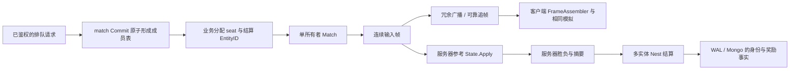
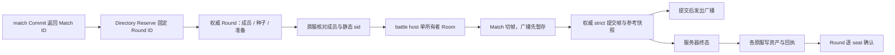

# MOBA 框架学习与验收

本文面向准备用 core 开发 MOBA 等对局类游戏的服务端工程师，分两部分：**第一部分“学习”**沿一场对局讲输入由谁准入、怎样按帧排序、客户端怎样补缺帧、谁判胜负、怎样不重复结算，给出阅读顺序与可编译的调用示例；**第二部分“验收”**说明每个入口证明什么、不证明什么。登录、资产、持久化和服务接入的共同接法见 [SLG](SLG-INTEGRATION.md) 与 [MMORPG](MMORPG-INTEGRATION.md) 手册，本篇重点是 Lockstep 对局、匹配和结算。

业务玩法不放进公共框架，生成器也不生成这些业务文件：下面的夹具只在 [scripts/testdata/moba](../../scripts/testdata/moba/)，分两层——**单路双英雄入门**讲 Lockstep 输入、追帧与同进程多实体结算；**5v5 三路**在此之上加准备 / ban-pick、比赛目录与持久对局、提交后广播、battle host 代际与交接、Player 原服奖励回执。英雄、兵线、塔、基地、技能、装备、野区、投降规则、伤害、帧数与账本上限都是样例，正式游戏自行定义；完整的参考应用仍是 [game-demo](../../demo/README.md)。它不是现成的 5v5 产品，没有预设目标帧率、玩家规模、延迟预算或部署拓扑。

## 第一部分：学习

### 1. 适合谁、先读什么

基础阅读顺序：[入门](../GETTING-STARTED.md) → [Nest / Entity](guide/02-nest-entity.md) → [DataEngine](guide/03-dataengine.md) → [同步指南 §6 Lockstep](guide/04-sync.md#6-lockstep) → 本文。Lockstep 源码先读 [Match](../../framework/sync/lockstep/match.go)、[Sequencer](../../framework/sync/lockstep/sequencer.go)、[FrameAssembler](../../framework/sync/lockstep/assembler.go)，再沿 §4.2 读业务夹具。

一场对局里有两类状态，接法完全不同：**局内状态**（英雄血量、位置、兵线、塔）由服务器参考模拟与客户端按同一输入序列各自计算；**局外事实**（奖励、战绩、本场结算身份）经 Nest 多实体事务写进 DAO、由 DataEngine 持久化。把两者混在一起——每帧把局内状态当资产写 DAO，或让客户端上报胜负直接发奖——是最常见的错误。双英雄入门里局内状态完全不落盘；5v5 例子为了崩溃后续赛，把**输入帧日志**（连同可由它重算的参考快照）作为一条对局事实提交到固定权威的 BattleRound 实体（§5.6），持久的仍是输入，不是客户端上报的状态。

### 2. 模块分工：对局里的状态归谁

| 状态 | 拥有者与框架能力 | 怎样使用 |
| --- | --- | --- |
| 排队票、成局成员 | `service/match` 的 Store（Enqueue / Cancel / Candidates / Commit / CommitAcross） | 已鉴权的主体排队；Commit 原子地把一个分区里的一组票变成一场比赛，放宽匹配时 CommitAcross 原子地跨同一逻辑队列的几个分区成局（§5.1） |
| 谁控制哪个 seat | `lockstep.Match` 的 Attach / Detach / AttachSpectator | 鉴权层把连接的 SessionID 绑定到 seat；重新 Attach 后旧 SessionID 失去控制权 |
| 每帧的权威输入 | `lockstep.Sequencer`（Match 内部） | 按 seat 排序、窗口准入、有界重放去重；Tick 切出一帧 |
| 局内模拟状态 | 业务参考模拟（本例 `State.Apply`） | 只接受连续帧；整数、固定 seat 顺序、逻辑帧，不读墙上时钟或 map 遍历顺序 |
| 客户端已收到哪些帧 | 客户端 `FrameAssembler` | 冗余包去重、按帧号补齐缺口；缺口未补齐前不能向前模拟 |
| 本场结算事实、奖励与战绩 | 生成的 MatchResult / Player DAO + 多实体 Sender + Nest undo + DataEngine | 胜负与摘要只来自服务器参考模拟；结算身份、奖励、战绩同一事务 |
| 5v5：Match ID → 对局实体 | 业务 BattleDirectory 实体（生成 DAO / Sender） | 开局先 Reserve 固定映射，重试与恢复都拿回原 Round ID（§5.5） |
| 5v5：成员、选角、宿主、已提交帧 | 业务 BattleRound 实体，只在固定权威进程加载 | 每个变化经 `Sync_MOBARound` 在实体锁内校验 HostSID / Epoch 后 strict 提交（§5.6、§5.7） |
| 5v5：房间与连接绑定 | battle host 上的业务 Room / Actor / HostEndpoint，内含一个 `lockstep.Match` | 单 goroutine、固定 32 条邮箱；Match 切帧后等权威提交再广播 |
| 5v5：每名玩家的奖励回执 | 各自原服的 Player 实体（`MobaRewards` 字段） | 原服回查权威终态后 `Sync_MOBAAward`，资产与回执同一事务，再向权威确认 seat（§5.8） |

### 3. 场景与框架对照

| MOBA 场景 | 对应框架 | 如何接入 | 业务与保证边界 |
| --- | --- | --- | --- |
| 登录与选角 | account、玩家接入、静态 Player sid | 已鉴权会话绑定 Player，再由比赛成员表分配 seat | 不能信任客户端自报 seat；账号 ID、裸 PlayerID、完整 EntityID、seat、传输 SessionID 是不同身份 |
| 排队、取消、成局 | [service/match](../../service/match/store.go) Store + `FirstComeGrouping` | Enqueue → Candidates → Grouping → Commit；大队列按段位档 / 地区分区，放宽匹配用 CommitAcross；票集合就是成局的提交身份（§5.1） | 队伍角色、MMR、公平性、分区维度、何时放宽与目标 battle host 由业务定义；匹配记录只保留 `match.retention`，长期路由由业务保存 |
| 准备、ban / pick（5v5） | 业务 BattleRound 状态机 | `pick` / `ready` / `ban` / `start` / `expire` 都是 `Sync_MOBARound` 的 Change；`Now` 由服务端注入 | 每队五人、队内英雄不重复、每队一名队长 ban 一个、改选角清 ready、过期取消——都是样例政策 |
| 开房与输入准入 | `lockstep.NewMatch`、`Match.HandleCommand` | Match 只在一个所有者 goroutine 上串行调用；`HandleCommand` 按 SessionID 找 seat，旁观者只能追帧 | 不在 Nest worker / Entity 锁内驱动 Tick；房间队列、断线与关闭由宿主管理 |
| 移动、普攻与技能 | 业务输入 codec + 参考模拟 | 命令只带动作、目标类别、移动方向；语法在 `Submit` 校验，射程 / 冷却 / 消耗在 `Apply` 校验 | 框架只看输入字节长度（`MaxInputBytes`），不知道英雄能否攻击；伤害与金币不能由客户端上报 |
| 兵线、塔与基地 | 业务 `State.Apply` | 整数状态、固定 seat 次序和逻辑帧；塔未摧毁时基地不受击，基地归零才产生胜者 | NPC、技能、装备和防御机制不搬进公共 Lockstep；本例同帧先后顺序不是平衡方案 |
| 实时广播与短暂丢包 | `Match.Tick`、冗余广播（`RedundancyDepth`）、`FrameAssembler` | Tick 返回本帧输入，服务器与客户端按同一顺序模拟；冗余深度 N 能补上至多 N-1 个连续丢包 | 客户端只能应用连续帧，不能跳过缺口自行向前模拟 |
| 断线、换连接与追帧 | Attach、可靠通道（`Reliable`）、`StartCatchup` / `OpCatchup` | 新连接 Attach 后，从客户端 `FrameAssembler.Next()` 请求历史；每会话一页在途，追帧期间不收实时帧 | 历史已被裁掉时以 `ErrCatchupUnservable` 明确失败，不自动快照重同步（§6） |
| 观战与分歧检测 | `AttachSpectator`、`ReportHash`、`OnDesync` | 旁观者可收帧 / 追帧，没有输入权；关键帧 hash 报告用于发现状态分歧 | 多数 hash 不是反作弊证明；两席不一致判为 `NoMajority`，处理策略归业务 |
| 逻辑检查点 | 业务 `Snapshot` / `Restore` | 保存整个参考模拟及版本，恢复后继续推进得到相同摘要 | 双英雄入门不持久化活动对局；只能说明快照可恢复，不能声称崩溃后续赛 |
| 活动对局持久与续赛（5v5） | BattleRound 的输入帧日志 + strict WAL；`RecoverRoom` 用公开 API 重放 | 每帧提交成功才广播；恢复时加载同一 Round，`resume` / `handoff` 推进 Epoch，按已提交帧重建 Match | 每帧重写整段日志并重算，无 tick 预算保证；只恢复 strict 已确认的帧（§5.6、§11） |
| 跨 sid battle host（5v5） | 业务 Epoch + 服务总线 RPC；Player 静态 sid 不动 | 原服核对成员与 sid 后转发到当前 HostSID；交接由管理入口提交 `handoff` | 业务代际隔离，不是 Remote lease，也不是权威进程自动 HA；FromSID 依赖受信任总线 |
| 胜负与无结果收口 | 服务器参考模拟 + 业务终态 | 运行中 `Result` 返回错误；摧毁基地产生胜者；到帧数上限无胜者 | 不能只接收客户端报胜；放弃、投降、作弊、重开政策由业务定义 |
| 奖励、战绩与重放 | 生成 DAO / Entity / Sender、Nest undo、DataEngine | 双英雄：MatchResult 实体保存本场身份 / 摘要 / 终态，与双方奖励、战绩同一事务；5v5：以 Round ID 为身份，各原服逐人写回执 | 开局时分配并保留本场身份；换一个 ID 会绕开幂等记录。5v5 跨服奖励逐人完成，不是十人瞬时原子 |
| 持久恢复 | 文件 WAL、Mongo、冷加载 | 同一结算 ID 在新进程冷加载后重试，不再发奖励、不再累计战绩 | `strict` 的边界是 WAL fsync，Mongo 可见另等投影；结果未知时按原身份重试，不换新身份 |
| 传输选择 | `nettransport` 的 KCP / QUIC / UDP，`lockstep.TCPSender` | 本例用真实 loopback KCP；嵌入 TCP 用 `TCPSender`（§6） | 玩家接入层（player TCP、独立 Gate）只提供 TCP；KCP 的监听、握手鉴权与 Session 绑定由宿主自己写 |

### 4. 业务纵切：先跑，再读

#### 4.1 生成工程从哪来

在仓库根目录、使用 go.mod 声明的工具链运行：

```bash
ROOST_MOBA_KEEP=1 bash scripts/test-moba-generated.sh   # 保留生成工程以便阅读；不加 KEEP 时成功即删除
```

脚本打印临时目录，生成工程在其中的 `project/`。它的步骤就是一个新工程的接入方式（`roost` 是脚本从当前仓库编出的 CLI）：

1. `roost project new moba-practice -module example.com/moba-practice -template game --skip-deps`，然后 `go mod edit -replace github.com/tjbdwanghaibo/roost-core=<本仓库路径>` 让依赖指向本地仓库（脚本随后以 `-mod=mod` 运行，自己动手时执行一次 `GOWORK=off go mod tidy`）；
2. `roost add dao Player --entity Player`、`roost add entity MatchResult`、`roost add dao MatchResult --entity MatchResult`；5v5 再加 `roost add entity BattleRound`、`roost add dao BattleRound --entity BattleRound`、`roost add entity BattleDirectory`、`roost add dao BattleDirectory --entity BattleDirectory`；
3. 业务只改这几处：在 `db/def/player.go`（`Gold` / `Wins` / `Losses`，5v5 的奖励回执 `MobaRewards`）、`db/def/match_result.go`（`MatchKey` / `Digest` / `WinnerID` / `LoserID` / `Status`）、`db/def/battle_round.go` 与 `db/def/battle_directory.go`（各一个 `Payload`）填 DAO 字段，并把 DAO 库名改成本次唯一的名字（真实依赖模式要用）；把 `game/entities/{match_result,battle_round,battle_directory}/entity.go` 注解里的 `category=entity.EntityCategoryOther` 改为 `category=entity.EntityCategoryWorld`（这些记录被多名玩家共同引用，锁序低于 Player）；放入局内模拟与房间包 `game/moba/`、结算 handler `game/handler/moba_settlement.go` 与 5v5 handler `game/handler/moba_round.go`；
4. `roost generate` 生成组件、访问器和 `MobaSettlementSender` / `MobaRoundSender`。

#### 4.2 阅读顺序

| 顺序 | 文件 | 先回答的问题 |
| --- | --- | --- |
| 1. 输入与模拟 | [simulation.go.txt](../../scripts/testdata/moba/simulation.go.txt) | 字节语法、存活、射程、冷却和资源分别在哪里校验？无输入的帧怎样推进？为什么整帧先校验再修改？ |
| 2. 匹配领域 | [matchmaking_test.go.txt](../../scripts/testdata/moba/matchmaking_test.go.txt) | 谁拥有票？取消怎样阻止入场？并发 Commit 为什么都成功却只有一场比赛？ |
| 3. 帧与恢复 | [simulation_test.go.txt](../../scripts/testdata/moba/simulation_test.go.txt) | 冗余去重、可靠追帧、旧连接、旁观者、历史过期和 hash 分歧怎样处理？ |
| 4. 真实 KCP | [network_test.go.txt](../../scripts/testdata/moba/network_test.go.txt) | 同一输入经过真实 socket 后，两个客户端与服务器参考状态能否收敛？ |
| 5. 结算事实 | [settlement.go.txt](../../scripts/testdata/moba/settlement.go.txt) | 谁能调用结算？本场身份、胜者与摘要怎样约束重放？ |
| 6. 并发与失败 | [settlement_test.go.txt](../../scripts/testdata/moba/settlement_test.go.txt) | 并发重试、换胜者、换摘要、事务拒绝回滚和无结果是否正确？ |

5v5 三路在双英雄之后读：

| 顺序 | 文件 | 先回答的问题 |
| --- | --- | --- |
| 7. 三路规则 | [arena.go.txt](../../scripts/testdata/moba/arena.go.txt)、[arena_test.go.txt](../../scripts/testdata/moba/arena_test.go.txt) | 十个 seat 的固定次序、种子随帧推进、整帧先验在哪里？哪些是业务规则（换路、塔保护、野区、投降）？ |
| 8. 身份与路由 | [directory.go.txt](../../scripts/testdata/moba/directory.go.txt)、[round.go.txt](../../scripts/testdata/moba/round.go.txt) | Match ID、Round ID、PlayerID、静态 sid、seat、SessionID、HostSID / Epoch 各是什么？开局重试为什么仍指向同一局？加载时怎样重算日志核对快照？ |
| 9. 事务边界 | [round_handlers.go.txt](../../scripts/testdata/moba/round_handlers.go.txt)、[round_handlers_test.go.txt](../../scripts/testdata/moba/round_handlers_test.go.txt) | 帧、宿主代际与奖励回执在哪个实体锁、哪次 strict 提交里成为事实？ |
| 10. 宿主 | [room.go.txt](../../scripts/testdata/moba/room.go.txt) | 单所有者、有界邮箱、提交后广播、重连身份、排空怎样实现？恢复时怎样用公开 API 重建 Match？ |
| 11. 十个 KCP 客户端 | [arena_network_test.go.txt](../../scripts/testdata/moba/arena_network_test.go.txt) | 超过冗余深度的丢包怎样经可靠追帧回到同一摘要？ |
| 12. 真实进程 | [active/crash_test.go](../../scripts/testdata/moba/active/crash_test.go)、[active/routing_test.go](../../scripts/testdata/moba/active/routing_test.go) | SIGKILL 后从未投影 WAL 恢复、旧宿主隔离、原服奖励半途崩溃怎样收口？ |

样例规则：双英雄是两个固定 seat 各有英雄、兵线、塔和基地；攻击 / 技能只选敌方目标类别；死亡后等 5 个逻辑帧复活；5 金币可买一次治疗；塔未摧毁时基地不能受击；600 帧无胜者即无结果收口；输入最多迟到 2 帧。5v5 是每队五人三路，换路只在基地或河道，每路塔保护该路进攻基地，击杀 / 补刀 / 推塔得局内金币与经验，最多三次装备购买，中路野怪给全队金币与限时增益，同队四人 30 帧内投降即判负，600 帧无胜者收口；宿主只接受当前未切的帧，不收迟到输入。这些都是样例业务选择。

#### 4.3 房间所有者与结算：怎样调用

下面的文件放进保留的生成工程（例如 `internal/mobaflow/flow.go`）可直接编译。三个函数都只在房间所有者 goroutine 上调用；`client` 是当前服务的 Nest 客户端，EntityID 是完整 ID：

```go
package mobaflow

import (
	"context"
	"errors"

	syncsender "example.com/moba-practice/game/handler/syncsender"
	moba "example.com/moba-practice/game/moba"
	"github.com/tjbdwanghaibo/roost-core/framework/nest"
	"github.com/tjbdwanghaibo/roost-core/framework/sync/lockstep"
	"github.com/tjbdwanghaibo/roost-core/framework/sync/nettransport"
)

// onCommand 处理一条已解码的客户端命令。session 是鉴权层绑定的传输会话，Match 据此找到 seat；
// 输入先过业务语法与迟到上限，追帧和 hash 报告直接交给 Match。
func onCommand(room *lockstep.Match, session nettransport.SessionID, c lockstep.Command) error {
	if c.Operation == lockstep.OpInput {
		return moba.Submit(room, uint64(session), c.Frame, c.Payload)
	}
	return room.HandleCommand(session, c)
}

// tick 切一帧并推进服务器参考模拟。Tick 的错误只说明部分接收者的发送或追帧失败：
// 这一帧已经切出并写进历史，参考模拟必须照样应用，否则服务器从这一帧起与客户端分歧。
func tick(ctx context.Context, room *lockstep.Match, reference *moba.State) error {
	frame, sendErr := room.Tick(ctx)
	if errors.Is(sendErr, lockstep.ErrMatchClosed) {
		return sendErr
	}
	if err := reference.Apply(frame); err != nil {
		return err
	}
	return sendErr // 交给宿主记录 / 告警
}

// settle 在参考模拟结束后结算。seatPlayers 是成局时按 seat 固定的两名玩家，resultID 是开局时分配的
// 本场结算 EntityID，matchKey 是成局的 Match ID；三者都来自服务端路由，不取客户端请求里的值。
func settle(ctx context.Context, client nest.Client, reference *moba.State, resultID int64, seatPlayers [2]int64, matchKey string) error {
	winner, digest, err := reference.Result() // 未结束返回错误；winner 为 0 表示无胜者
	if err != nil {
		return err
	}
	s := syncsender.NewMobaSettlementSender(client)
	if winner == 0 {
		// 无胜者也按固定 seat 次序传入两名玩家，只记录终态、不发获胜奖励。
		return s.MultiSync_MOBASettle(ctx, resultID, seatPlayers[0], seatPlayers[1], matchKey, digest, true)
	}
	return s.MultiSync_MOBASettle(ctx, resultID, seatPlayers[winner-1], seatPlayers[2-winner], matchKey, digest, false)
}
```

`Match` 不加锁：网络回调把命令投进有界房间队列，由所有者 goroutine 依次调用 `onCommand` / `tick`；不要让网络回调与 Nest handler 并发访问同一个 Match，也不要持玩家锁等待对局循环。`settle` 是同步 Nest 请求，不能在 handler 内调用（框架返回 `ErrSyncInHandler`）。获胜奖励 10 金币与局内金币无关，正式经济、排位积分和赛季要业务建模。

#### 4.4 二十五个场景各学什么

| 场景 | 业务建模 | 学到的框架契约 |
| --- | --- | --- |
| 匹配排队、取消与成局（`TestMOBAMatchmakingAdmissionCancellationAndCommit`） | 排队请求 ID 幂等；只有票主能取消；票 1 秒过期 | 重复排队不出第二张票；已取消 / 已过期的票不能入局；两个并发 Commit 都成功但指向同一 Match ID，成局后队列清空 |
| 输入身份、重放与窗口（`TestMOBAInputIdentityReplayAndWindow`） | 3 字节命令；最多迟到 2 帧 | 未绑定会话、超前帧（`ErrFrameTooEarly`）、坏字节被拒；同一输入重传不重复执行；重新 Attach 后旧会话失去控制权 |
| 冗余修复丢包（`TestMOBADeterministicDuelHealsLostBroadcasts`） | 两名英雄对打 80 帧，含死亡复活 | 丢掉 2 个广播、每包收两次，客户端靠冗余去重补齐，摘要与服务器一致；输入逆序到达仍按 seat 排序 |
| 断线追帧与旁观者（`TestMOBACatchupAndSpectatorCannotControlHeroes`） | 玩家在第 4 帧后断开，换连接重连 | 从 `Next()` 追帧后回到实时并与服务器同摘要；旁观者提交输入被拒 |
| 历史过期与分歧（`TestMOBAHistoryExpiryAndDesyncAreExplicit`） | 历史只保留 `MinHistoryRetainFrames` | 起点已被裁掉的追帧返回 `ErrCatchupUnservable`；两席 hash 不同判为 `NoMajority` |
| 推塔、基地与服务器结果（`TestMOBALaneTowersBaseAndServerResult`） | 单英雄推塔、拆基地 | 未结束不能结算；基地归零产生胜者与 64 位十六进制摘要；结束后不再接受帧 |
| 技能、商店与检查点（`TestMOBASkillCooldownShopAndCheckpoint`） | 技能冷却 3 帧、5 金币治疗 | 冷却内的第二次施法无效；快照恢复后继续推进与原状态同摘要；后一个坏输入不让前半帧生效；未知版本的快照被拒 |
| 真实 KCP 收敛（`TestMOBAKCPClientsAndReferenceConvergeAfterCatchup`） | 两个客户端经 loopback KCP，客户端 1 刻意丢掉一段超过冗余深度的广播 | 输入经可靠通道、广播经 datagram、追帧经可靠通道；一次追帧后两个客户端与服务器参考摘要相同 |
| 并发结算重放与身份冲突（`TestMOBASettlementConcurrentReplayAndIdentity`） | 8 个并发同身份结算 | 只发一次奖励、只记一次战绩；换胜者、换比赛 ID、换摘要都被拒 |
| 结算拒绝回滚（`TestMOBASettlementRollbackAndRetry`） | handler 改完状态后返回错误 | 结算身份、奖励与战绩全部回滚；同一身份随后可重试成功 |
| 无胜者终态（`TestMOBANoWinnerSettlementNeverPays`） | 对局取消 | 终态保留（`Status=2`），重放不变，不发获胜奖励 |
| 完整服务器结果链（`TestMOBAServerReferenceSettlesTheFinishedRound`） | 排队成局 → 会话输入 → Match → 参考胜负 → 结算 | 结算用成局的 Match ID 作本场身份，重复结算只付一次 |

以上十二条是双英雄入门，下面十三条是 5v5 三路：

| 场景 | 业务建模 | 学到的框架契约 |
| --- | --- | --- |
| 十人成局与准备（`TestMOBAFivePlayerTeamsDraftAndMatchIdentity`） | 十张票成局；ban / pick / ready / 准备期限 | 同一票集合立即重放返回同一 Match ID；未全员 ready 不能开局、非队长不能 ban、禁用英雄不能选、队内不重复、对方可镜像；到期 `expire` 取消且可生成无奖励终态；开局后选角不可改 |
| 三路目标、经济与复活（`TestMOBAArenaTargetingThreeLanesEconomyAndRespawn`） | 塔保护基地、跨路无效、野区团队增益、装备、击杀与复活 | 无效技能不消耗资源；一路塔倒不解除另两路保护；推基地产生胜者——全是业务规则，框架只排序输入 |
| 日志重算与配置固定（`TestMOBAArenaReplayVersionSeedAndFogBoundary`） | 80 帧十人输入写进 Round | `DecodeRound` 重算日志：改快照、改规则版本、改种子都被拒；坏输入不半帧生效；`Visible` 只是展示规则 |
| 投降与到时（`TestMOBAArenaSurrenderAndTimeLimit`） | 同队四票投降；600 帧无胜者 | 终态后不再接受帧；到时 `Winner=0` |
| 十个 KCP 客户端（`TestMOBAFiveVFiveKCPClientsConvergeAfterCatchup`） | 十个客户端经 loopback KCP 打 120 帧，客户端 1 丢掉第 3～8 帧的广播 | 在第 9 帧发一次 `OpCatchup`，从 Match 历史（缺省保留窗口）经可靠通道补齐，十个客户端与服务器参考同摘要 |
| 提交后广播、结果未知停房间（`TestMOBAActiveRoundCommitBeforeBroadcastAndUnknownStopsRoom`） | 权威提交成功后回复丢失 | 广播只在权威提交后发出；提交结果未知时房间停止、不发这一帧、之后的 Tick 被拒；`resume` 后旧会话与已提交帧的输入被拒，`replay` 从帧 1 补齐，帧号接着走 |
| 交接隔离旧宿主（`TestMOBARoundHandoffFencesOldHostAndKeepsPlayerSID`） | 2000 → 2001 交接 | 旧宿主下一次提交在权威实体锁内被拒、不广播；过期的交接请求被拒；错 sid 不能绑定；同一已提交帧重放不重复追加，改过内容的同号帧被拒；成员与 sid 不变 |
| 原服奖励部分投递（`TestMOBAFiveVFiveAwardPartialDeliveryReplayAndIdentity`） | 先发三人，再整队重发两遍并确认 | 资产与回执只计一次；换胜者、发给别的 Player 都被拒 |
| 帧与快照一起回滚（`TestMOBARoundUndoRollsBackFrameAndCheckpoint`） | handler 写完帧后返回错误 | Nest undo 把整个 Round 载荷还原，随后同一帧可重新提交 |
| 有界邮箱与排空（`TestMOBARoomMailboxBoundAndDrain`） | 一次提交卡住时涌入 40 个请求 | 超过 32 条立即 `ErrBusy`；`Stop` 等不到在途提交时返回 ctx 错误而不释放房间；排空后排队请求全部拒绝 |
| 比赛目录只分配一局（`TestMOBAMatchDirectoryConcurrentReservationKeepsOneRound`） | 8 个并发开局回调各带候选 ID | 只登记一个 Round ID，其余拿回同一个；同一比赛换绑定、同一 Round 用于另一场、Player ID 冒充 Round 都被拒 |
| 超过 64 帧的断线补齐与延迟观战（`TestMOBADurableReplayAndDelayedObserverBeyond64Frames`） | 100 帧后换连接；迟到的旧连接关闭 | 新绑定替换旧绑定，旧连接的迟到断开不拆新绑定；`replay` 从持久日志每页至多 64 帧补齐到同摘要；观战需 ACL、按延迟分页 |
| 奖励账本满后拒绝（`TestMOBARewardLedgerRefusesOverflowWithoutEvictingReceipts`） | 一名玩家已有 64 场回执 | 第 65 场被拒且资产不变，旧回执仍可重放，不静默淘汰 |

实际证明到哪一步见 §10。

#### 4.5 5v5 持久对局：怎样调用

下面的文件放进保留的生成工程（例如 `internal/mobaround/round.go`）可直接编译。`openRound` 在固定权威进程调用，`hostRound` / `tick` 在 battle host 调用，`deliverAward` 在 Player 原服调用；跨进程时 `persist` 与 `ackSeat` 由宿主 / 原服经服务 RPC 转给权威进程（真实进程演练见 [active/routing_test.go](../../scripts/testdata/moba/active/routing_test.go)）：

```go
package mobaround

import (
	"context"

	syncsender "example.com/moba-practice/game/handler/syncsender"
	moba "example.com/moba-practice/game/moba"
	"github.com/tjbdwanghaibo/roost-core/framework/nest"
	"github.com/tjbdwanghaibo/roost-core/framework/sync/nettransport"
)

// openRound 在成局后调用（固定权威进程的 Nest 客户端）。directoryID 是本匹配命名空间固定的 BattleDirectory，
// matchID 是 Commit 返回的 Match ID，candidate 是 id-gen 新发的 BattleRound EntityID，initial 的 Op 为 "init"，
// 带服务端成员表（完整 Player EntityID 与静态 sid）、初始 HostSID、非零种子和准备期限。
// 返回的 roundID 是这场比赛永久的身份：别的回调先登记过时返回旧 ID，candidate 作废、不再复用。
// roundID 对应的实体要按工程的实体生命周期先创建（或冷加载）；init 对同一份成员 / 种子 / 期限重放返回原记录。
func openRound(ctx context.Context, authority nest.Client, directoryID int64, matchID string, candidate int64, initial moba.Change) (int64, moba.Round, error) {
	s := syncsender.NewMobaRoundSender(authority)
	roundID, err := s.Sync_MOBAReserveRound(ctx, directoryID, matchID, candidate, moba.RoundBinding(initial))
	if err != nil {
		return 0, moba.Round{}, err
	}
	record, err := s.Sync_MOBARound(ctx, roundID, initial)
	return roundID, record, err
}

// hostRound 在 battle host 上开房或恢复：record 是向权威查询到的 Round（HostSID 是本宿主，Epoch 已由
// handoff / resume 推进），persist 把 Change 交给权威进程的 Sync_MOBARound（跨进程时经服务 RPC），
// wire 是发往客户端的 datagram 通道。Room 用公开 API 重放已提交帧重建 Match，重建期间不对外广播。
func hostRound(record moba.Round, persist moba.PersistRound, wire nettransport.DatagramSender) (*moba.Actor, error) {
	room, err := moba.RecoverRoom(record, persist, wire)
	if err != nil {
		return nil, err
	}
	return moba.NewActor(room), nil
}

// tick 由宿主的帧定时器调用：Match 切帧、权威 strict 提交成功后才发出暂存的广播。
// 错误分两类：广播发送失败时帧已提交、房间继续，客户端用 "replay" 从持久日志补齐；提交失败或结果未知时
// 房间已关闭（之后的调用都被拒绝），宿主回查权威 Round，再 resume / handoff 后重建，不另开一局。
func tick(ctx context.Context, actor *moba.Actor, epoch uint64) (moba.RoomReply, error) {
	return actor.Call(ctx, moba.RoomRequest{Op: "tick", Epoch: epoch})
}

// deliverAward 在 Player 原服执行。award 必须来自回查权威终态（Round.Awards），不取客户端带来的值。
// 先在本服 Player 的 strict 事务里同时写资产与回执，再向权威确认 seat；两步之间崩溃时用同一个 award 重投，
// 回执保证只计一次。十名玩家逐人完成，不是一次跨服原子提交。
func deliverAward(ctx context.Context, origin nest.Client, seat int, award moba.Award, ackSeat func(ctx context.Context, seat int, digest string) error) error {
	if err := syncsender.NewMobaRoundSender(origin).Sync_MOBAAward(ctx, award.Member.PlayerID, award); err != nil {
		return err
	}
	return ackSeat(ctx, seat, award.Digest)
}
```

三个 Sender 调用都是同步 Nest 请求，不能在 handler 内调用；`Actor.Call` 也不能在 Nest handler 或实体锁内等待（房间提交时要回到权威的 Nest）。`ackSeat` 对应权威上的 `Change{Op: "ack", HostSID, Epoch, Seat, Digest}`，要带当前 HostSID / Epoch。Round 只在一个权威进程加载，所有宿主经 RPC 调它，**不要在多个进程各自打开同一个 Round ID 的本地 WAL**。

### 5. 一场对局怎样连接这些模块



#### 5.1 成局的含义

`Commit` 把一组等待中的票原子地变成一场比赛：检查与写入是同一次比较并设置，失败不留副作用。**票集合就是提交身份**：同一个完整票集合再次 Commit（票序可不同）返回原 Match，不创建第二局；与已匹配的票只部分重叠、或含已取消 / 过期 / 不存在的票时拒绝。所以并发的两个匹配器可以都收到成功回复——**要核对返回的 Match ID，不能按成功回复次数计开局数**。这个重放只在保留期内有效（`match.retention`，缺省 10 分钟，维护者 2026-10-19 方案 A）：比赛与它的票从成局起至少保留这么久，之后一起移除；超期后同一票集合的 Commit 报 `ErrTicketMissing`——仍不会成第二局，只是拿不回原 Match。所以匹配器要在保留期内完成重试，开局后自己保存 Match ID 路由，不要指望事后再从匹配服务读成员表（[store.go](../../service/match/store.go) 的 `Commit` 注释，`TestCommitReplayReturnsOriginalMatchForSameTicketSet`、`TestCommitReplayInsideRetentionReturnsTheOriginalMatch`、`TestCommitReplayAfterRetentionReportsTheTicketsMissing`、`TestConcurrentCommitsProduceExactlyOneMatch`）。

**大队列先分区，放宽匹配用跨分区 Commit**。一个分区（`Queue.Partition`）的全部状态是一个整体读写的值，所以排位这种大队列按段位档（或地区、sid 组）拆成多个分区：每个分区一个 Redis 键，Enqueue / Cancel / Commit / Sweep 只碰自己的分区，常规成局在分区内完成。主分区凑不齐一局、最老的票又等得够久时，业务从相邻段位档补人——这一局的票来自同一逻辑队列（Mode + GroupSize 相同）的两个分区，要用 `CommitAcross` 一次提交：它在一个多键比较并设置里校验所有票仍在各自的分区等待，在每个涉及的分区写入同一场比赛，所有分区同时生效或都不生效；重放规则与 Commit 相同。不要对两个分区各 Commit 一半，那样任何一边失败都会留下半局。比赛在每个涉及的分区各存一份（`Match.TicketPartitions` 记每张票的分区），用任一涉及分区的 Queue 都能 `Match` 读到。何时放宽、补哪个分区是业务政策（[store.go](../../service/match/store.go) 的 `CommitAcross` 注释，`TestCommitAcrossIsAllOrNothing`、`TestCommitAcrossReplayFollowsRetention`）。下面的文件放进生成工程（例如 `internal/mobamatch/relax.go`）可直接编译：

```go
package mobamatch

import (
	"context"
	"errors"

	svcmatch "github.com/tjbdwanghaibo/roost-core/service/match"
)

// Gold 与 Platinum 是同一逻辑队列（5v5 排位，10 人一局）按段位档拆出的两个分区。
var (
	Gold     = svcmatch.Queue{Mode: "ranked5v5", GroupSize: 10, Partition: "gold"}
	Platinum = svcmatch.Queue{Mode: "ranked5v5", GroupSize: 10, Partition: "platinum"}
)

// FormRelaxed 从主分区取票成局；主分区不够一局且 relax 为真（业务按最老票的等待时间决定）时，
// 从相邻分区补齐，一次 CommitAcross 原子地跨两个分区成局。formed 为假表示这一轮没有成局：
// 人不够，或某张票刚被取消 / 被别的匹配器拿走（整组没生效，下一轮重新读候选）。
func FormRelaxed(ctx context.Context, matcher svcmatch.Matchmaker, home, neighbour svcmatch.Queue, relax bool) (svcmatch.Match, bool, error) {
	own, err := matcher.Candidates(ctx, home, home.GroupSize)
	if err != nil {
		return svcmatch.Match{}, false, err
	}
	if len(own) == home.GroupSize {
		ids := make([]string, 0, len(own))
		for _, ticket := range own {
			ids = append(ids, ticket.ID)
		}
		return settled(matcher.Commit(ctx, home, ids))
	}
	if !relax {
		return svcmatch.Match{}, false, nil
	}
	extra, err := matcher.Candidates(ctx, neighbour, home.GroupSize-len(own))
	if err != nil {
		return svcmatch.Match{}, false, err
	}
	if len(own)+len(extra) < home.GroupSize {
		return svcmatch.Match{}, false, nil
	}
	refs := make(svcmatch.TicketRefs, 0, home.GroupSize)
	for _, ticket := range append(own, extra...) {
		refs = append(refs, svcmatch.TicketRef{Queue: ticket.Queue, TicketID: ticket.ID})
	}
	return settled(matcher.CommitAcross(ctx, refs))
}

// settled 把“这组票已经不能成局”的拒绝变成本轮未成局；其余错误交给调用方记录。
func settled(formed svcmatch.Match, err error) (svcmatch.Match, bool, error) {
	if errors.Is(err, svcmatch.ErrConflict) || errors.Is(err, svcmatch.ErrTicketMissing) {
		return svcmatch.Match{}, false, nil
	}
	return formed, err == nil, err
}
```

业务还要把成员表映射为稳定 seat，并保存 Match ID → 房间宿主 → 结算 EntityID 的路由。game-demo 的匹配只为本 game 进程实际服务的玩家组局（[matchmaker](../../demo/internal/service/game/matchmaker.go.tmpl) 的 `ownedCandidates`），避免房间在另一个进程而输入一直 `battle_not_found`；全服跨 sid 匹配需要独立 battle host 与跨 sid 输入路由，框架没有默认实现；5v5 夹具给出一种业务做法（§5.5～§5.8），Player 的静态 sid 归属不变。

#### 5.2 输入与帧

本例命令固定 3 字节，不含 seat、伤害或奖励字段。服务先按会话确定控制权，再由业务 `Submit` 校验字节语法与迟到上限，最终经 `Match.HandleCommand` 进入排序器；超前超过 `SubmitWindow` 的帧由框架拒绝。

框架把首次迟到的输入折进下一个未切的帧，并在有界的 `ReplayHorizon`（64 帧）内记住“哪名玩家的哪个原始帧号已处理”，窗口内的重传不再执行；更早的重传与首次到达无法区分（[sequencer.go](../../framework/sync/lockstep/sequencer.go) 的 `ReplayHorizon` 注释）。所以它不是永久去重账本：本例只允许迟到 2 帧，超过直接拒绝，避免很久以前的一次攻击被当作新指令。输入重放与结算重放是不同的身份和窗口，不能混为一个机制。

#### 5.3 服务器参考与客户端

`State.Apply` 先校验整帧的 seat 顺序和语法，再修改状态，避免后一个坏输入让前半帧留下状态。英雄交互按已排序的 seat 顺序执行；整数、数组和逻辑 Tick 构成摘要，不读墙上时钟、不遍历无序 map、不用外部随机源。客户端用相同的输入序列重算；逻辑快照包含血量、金币、位置、兵线、塔、基地、复活与冷却期限。

#### 5.4 结算

`handlerMOBASettle`（`rollback=undo durability=strict`）把本场身份 / 摘要 / 终态与双方奖励 / 战绩一起提交：MatchResult 已有终态时，完全相同的重放直接成功，换胜者、比赛 ID 或摘要都被拒；无胜者终态保留但不发获胜奖励。结算 EntityID 要在开局时分配并随本场路由保存，重试与恢复都路由到同一个 ID。调用方式见 §4.3。

下面四节是 5v5 夹具在双英雄之上的接法：



#### 5.5 开局身份：比赛目录

`Commit` 的重放只在 `match.retention` 内有效（§5.1），而对局要活得比这更久，所以开局后要有一份业务自己保存的路由。夹具用一个固定的 BattleDirectory 实体：开局回调先用 id-gen 申请候选 Round ID，再 `Sync_MOBAReserveRound(directoryID, matchID, candidate, binding)`。同一 Match ID 已登记时返回旧 Round ID，候选号作废、永不复用；`binding` 是成员表、种子、准备期限与规则版本的摘要，同一比赛换了其中任何一项都被拒，一个 Round ID 也不能挂到另一场比赛上。然后对返回的 ID 做 `init`；初始化中断时按目录返回的原 ID 补做，不清映射另开一局。样例目录最多 64 局、满了拒绝新登记，不静默淘汰；正式游戏按赛季 / 分片设计归档。

#### 5.6 持久对局：先提交、再广播

`Match.Tick` 切帧时就会调用 datagram 发送，它本身不提供“这一帧已持久”的保证。Room 给 Match 的 datagram 通道是一个有界暂存区（只容纳十名玩家的一份广播），Tick 之后在实体锁外调用权威的 `Sync_MOBARound(Op: "frame")`：

1. 权威 handler（`rollback=undo durability=strict`）在 Round 实体锁内核对 HostSID / Epoch、帧号连续、输入语法，按服务器参考重算后把帧与参考快照一起提交；同号同内容的帧重放直接成功，同号不同内容被拒。
2. strict 成功（WAL 落盘）后，Room 才发出暂存的广播。发送失败不撤销已提交帧，客户端按同一局补齐。
3. 提交返回任何错误，包括结果未知，Room 关闭并丢弃暂存广播；宿主回查 Round，再 `resume` / `handoff` 后重建，不继续切帧、不换身份。

宿主只接受当前未切的帧（`frame == NextFrame()`），不保存未来输入、不把迟到输入折进新帧，所以重建时只需按已提交帧原样重放。原服把输入转进邮箱只表示“已暂存”，执行与否以权威已提交帧为准。Round 加载时用初始种子重算整段日志、核对快照摘要，规则版本、种子或快照被改都会拒绝加载。

每帧都重写整段日志并从第 1 帧重算，开销随局长增长；样例上限 600 帧（`MaxFrames`），场景里经 handler 跑到的最长是 100 帧。它**没有 tick 预算保证**，正式长局要另行设计分段日志、检查点、批量提交和恢复上限并测量。

#### 5.7 重连、宿主代际与交接

Room 里的 Match 把 `HistoryRetainFrames` 设为 `lockstep.MinHistoryRetainFrames`（64），框架追帧只覆盖最近 64 帧；更早的帧由业务的 `replay` 从持久日志分页补（每页至多 `lockstep.MaxBroadcastFrames` = 64 帧），客户端仍经 `FrameAssembler` 连续应用。这是夹具的选择——框架缺省窗口仍是 3600 帧（§6），历史裁剪后仍不自动快照重同步。`HostEndpoint` 用十个固定绑定槽：新 SessionID 绑定替换旧的，旧连接的输入被拒，旧连接迟到的 disconnect 不拆新绑定。

宿主代际是业务 Epoch：管理入口以当前 HostSID / Epoch 提交 `handoff`（换宿主）或 `resume`（同宿主重启），Epoch 加 1；之后旧宿主的提交在权威实体锁内被拒，它暂存的广播不会发出。新宿主查询 Round 后用 `RecoverRoom` 按已提交帧重建 Match、按新 Epoch 重新绑定。宿主 SID 相同不代表同一次进程生命周期，重启必须 `resume`。交接结果未知时查询原记录再处理。

权威进程用自己的单写 WAL，所有宿主经 RPC 请求它。业务 Epoch 只隔离 battle host，不实现权威进程的选主 / lease / 自动 HA；需要权威 HA 时采用 Remote 或其他权威方案另行设计。`ObserverFrames` 只给通过业务 ACL 的调用者返回延迟历史；`Visible` 只是展示规则，全输入帧同步不能对修改过的客户端隐藏敌方信息。

#### 5.8 原服奖励：逐人回执

5v5 以 Round ID 为结算身份。权威终态生成每名成员的 `Award`；Player 原服**回查权威终态**取得 Award、核对是本服成员后调用 `Sync_MOBAAward`，在 Player 事务里同时写资产、战绩和回执，然后向权威确认这个 seat。同一回执重放返回成功但不再计奖，同一局换胜者、摘要或玩家被拒。原服可能在到账后、确认前崩溃，恢复后用同一 Award 重投，所以跨服奖励逐人完成，**不承诺十名玩家同时到账**；要有业务调度者扫描未确认的 seat 继续投递（夹具由测试驱动投递，没有常驻调度服务）。每名 Player 样例最多 64 场回执，满了拒绝新奖、保留旧证据。局内金币与局外奖励分开。

### 6. 网络、恢复和反作弊边界

- **历史窗口**：`HistoryRetainFrames` 缺省自动保留 3600 帧（60Hz 下 60 秒），按“允许断线秒数 × 逻辑帧率”自行配置（[指南：历史保留窗口](guide/04-sync.md#长局如何控制内存历史保留窗口)）。起点早于窗口的追帧返回 `ErrCatchupUnservable`，并经可靠通道通知客户端终止本场；框架不做全量状态重同步（[指南：追帧越界](guide/04-sync.md#追帧越界明确失败不自动重同步)）。双英雄与十客户端 KCP 场景都用缺省窗口，600 帧小于它，客户端能从帧 1 追帧；5v5 的 Room 把窗口设为 64 帧，更早的帧由业务持久日志补（§5.7）。更长的对局要么调大窗口，要么由业务设计检查点 / 输入日志，不能把已裁掉的帧补回来。
- **活动对局恢复**：双英雄入门只验证逻辑快照与恢复后的连续性。5v5 夹具把输入帧日志与参考快照 strict 提交到固定权威的 Round，再广播；恢复的是 strict 已确认的帧（真实进程 SIGKILL 演练见 §11），宿主没提交成功的输入要由客户端重发。框架本身没有活动对局持久化的默认实现。
- **分歧**：`ReportHash` 发现同帧分歧，`NoMajority` 明确表示没有多数。相同的 hash 不证明客户端没有作弊；参考模拟、服务器准入、权限、配置版本、随机种子与输入审计要按实际对局方案确定。
- **传输与追帧背压**：追帧的限速依赖可靠通道在链路慢时让发送变慢——KCP / QUIC 窗口满了就阻塞；嵌入 TCP 用 `lockstep.TCPSender`，可靠通道等写出、实时通道只准入（[指南：经嵌入 TCP 追帧](guide/04-sync.md#经嵌入-tcp-追帧随链路放慢)）。生成 game-demo 的战斗房间同样经 `TCPSender`（2026-10-20）。独立 Gate 两条通道都只做准入，追帧不随链路放慢（维护者 2026-10-20 决定暂不做，需 Gate 写出回执），见 [KNOWN-LIMITS](../maintenance/KNOWN-LIMITS.md)“Lockstep 追帧链路背压（独立 Gate）”。
- **KCP 的支持范围**：`nettransport` 提供 KCP 传输（`ListenKCP` / `DialKCP` / `KCPTransport`），`roost project new ... -features nettransport-kcp` 只生成装配函数（`roost help replication`）；监听、握手鉴权、密钥与 Session 绑定由宿主自己写。玩家接入层（player TCP、独立 Gate）只走 TCP，Gate 不提供 UDP / KCP 承诺（[GATEWAY §4](GATEWAY.md#4-synclockstep-与广播)）。本例 KCP 会话用固定测试密钥与固定绑定，不是真实账号鉴权。
- **容量与平台**：本机 KCP / TCP 回归不代表 5v5 目标负载、真实客户端引擎、移动网络或跨数据中心。Tick 预算、分位延迟、密集技能、断线长稳及回放存储要另测。

### 7. 容易混淆的边界

| 常见误解 | 正确接法 |
| --- | --- |
| 两个匹配器都收到 Commit 成功，就开了两局 | 同一票集合幂等返回同一 Match；按 Match ID 去重，不按回复次数计数。重放只在 `match.retention` 内返回原 Match，超期报 `ErrTicketMissing`（不会成第二局） |
| 放宽匹配就是对两个分区各 Commit 一半 | 两次 Commit 之间任何一边失败都会留下半局；一局票来自几个分区时用一次 `CommitAcross`，所有分区同时生效或都不生效（§5.1） |
| 客户端报的胜负 / hash 一致就能发奖 | 胜负与摘要只取服务器参考模拟；hash 只用于发现分歧 |
| Lockstep 的输入去重能防长期重放 | 只在 `ReplayHorizon` 内有效；业务自己限制迟到帧数，资产重放靠结算实体上的持久事实 |
| `Tick` 报错就是这一帧没切出 | 只有 `ErrMatchClosed` 不切帧；其他错误是发送 / 追帧失败，帧已在历史里，参考模拟照样应用 |
| 断线多久都能追帧 | 只能追保留窗口内的帧，越界明确失败，不自动重同步 |
| 每帧把局内状态写进 DAO 才安全 | 局内状态由输入序列确定；持久的是结算事实。需要崩溃续赛时另行设计快照与输入日志 |
| 结算每次重试都可以换一个新的结算 ID | 结算 ID 开局时分配并保留；换 ID 就绕开了幂等记录 |
| 用了 KCP 就有了玩家接入与鉴权 | KCP 只是传输；监听、握手鉴权和 Session 绑定由宿主实现，接入层只提供 TCP |
| `Match.Tick` 切出帧就可以广播，帧已经持久 | Tick 只切帧；需要崩溃续赛时先提交到权威、成功后再发（§5.6），提交结果未知就停房间 |
| 匹配服务里能一直查到这场比赛 | 匹配记录只保留 `match.retention`；开局后的 Match ID → Round ID 路由由业务目录保存（§5.5） |
| 宿主 SID 相同就是同一个宿主 | 重启要 `resume` 推进 Epoch，旧代际的提交才会被拒；交接用 `handoff` |
| 业务 Epoch 等于权威高可用 | Epoch 只隔离 battle host；权威 Round 是单写 WAL，不做选主或自动接管 |
| 跨服奖励能十人一起原子到账 | 各原服逐人提交资产与回执、再确认 seat；崩溃后用同一 Award 重投 |

### 8. 练习与后续扩展

从双英雄到 5v5 夹具已经走过准备 / 选角、多英雄三路、持久对局、宿主交接与原服奖励。继续可做：队伍组成与 MMR、正式英雄 / 装备配置与技能 Host、目标选择与碰撞、真正需要隐藏信息时改用服务端状态同步、长局的分段日志与检查点、常驻的奖励投递调度、权威进程的 HA 方案。每次先写清业务规则与失败语义，再映射到现有接口；业务尚未定义的玩法不算框架缺陷。合法调用下出现输入越权、缺帧仍被应用、无界队列、重复结算或生成代码不可编译，才按实际复现修对应的框架或 demo。

## 第二部分：验收

### 9. 入口一览

| 入口 | 依赖 | 详见 |
| --- | --- | --- |
| `scripts/test-moba-generated.sh` | 无外部依赖（提交器替身，loopback KCP） | §10 |
| 同一脚本加 `ROOST_MOBA_REAL=1` | 隔离 Mongo 副本集 | §11 |
| 再加 `ROOST_MOBA_ROUTING=1`（必须与 `ROOST_MOBA_REAL=1` 同用） | 隔离 Mongo 副本集 + 隔离 NATS | §11 |
| `go test -race -count=1 ./framework/sync/lockstep ./framework/sync/nettransport` | 无外部依赖 | §12 |

前三项不挂在 `dataengine-env.sh test`、不在根包门禁里，改 `game` 模板、`add dao` / `add entity`、多实体 Sender 生成或 Lockstep 时手动跑；三条真实入口都登记在根包 `integration_coverage_test.go`。本部分是 MOBA 验收范围的完整说明，[KNOWN-LIMITS](../maintenance/KNOWN-LIMITS.md#游戏接入验收) 的游戏接入验收表只列一行摘要。

### 10. 业务纵切

```bash
bash scripts/test-moba-generated.sh
```

按 §4.1 的步骤生成工程，replace 指回当前仓库；必须实际通过 25 条顶层 race 场景（§4.4）且无 skip，随后对消费者 build / vet，执行 `roost id check` 与 `roost generate --check`。成功删除临时工程；失败或 `ROOST_MOBA_KEEP=1` 时保留。

- **证明（双英雄 12 条）**：生成的 DAO / Entity / 多实体 Sender 与 Nest 在结算并发重放、身份冲突、拒绝回滚、无胜者终态下的事务行为；框架 `Match` / `Sequencer` / `FrameAssembler` 在会话身份、输入重放与窗口、冗余去重、断线追帧、旁观者、历史过期、`NoMajority` 下的行为；`service/match` 内存存储的排队、取消、过期与并发 Commit 幂等；一条真实 loopback KCP 链路上的丢包、追帧与三方摘要收敛。
- **证明（5v5 13 条）**：十人成局与准备状态机；三路规则、日志重算拒绝被改的快照 / 规则版本 / 种子；十个 KCP 客户端在一次可靠追帧（缺口第 3～8 帧，Match 缺省历史窗口）后与服务器参考同摘要（`TestMOBAFiveVFiveKCPClientsConvergeAfterCatchup`）；生成的 BattleRound / BattleDirectory / Player Sender 与 Nest 在提交后广播、提交结果未知停房间、`resume` / `handoff` 代际隔离、帧与快照 undo、目录并发只分配一局、奖励部分投递重放、回执账本满后拒绝上的行为；Room 的有界邮箱与排空；超过 64 帧后从持久日志分页补齐（in-process，到第 100 帧）。
- **不证明**：提交器是替身，不含文件 WAL 与 Mongo；除两条 KCP 场景外，网络由记录器代替，宿主与权威在同一进程直接调用 Sender、不经 RPC；匹配不经服务 RPC、Redis 存储与认证；KCP 会话是固定测试绑定，不是真实账号鉴权；没有经 handler 跑满 600 帧，也不测每帧提交的耗时；单进程，不含跨机网络与目标负载。

### 11. 真实 WAL / Mongo / NATS 进程演练

```bash
# ROOST_DATAENGINE_IT_MONGO_URI 指向隔离 Mongo 副本集，ROOST_DATAENGINE_IT_NATS_URL 指向隔离 NATS
# （见 wiring/scripts/integration/README.md）；不要指向生产库或共享业务库。
ROOST_MOBA_REAL=1 bash scripts/test-moba-generated.sh
ROOST_MOBA_REAL=1 ROOST_MOBA_ROUTING=1 bash scripts/test-moba-generated.sh
```

三个夹具用本次唯一的 DAO 库（`roost_moba_it_<pid>`）与本次临时目录下的 WAL，每个阶段必须实际通过且无 skip；各阶段成功后删除这个库，失败时保留工程、子进程日志与库名供排查。路由演练的 NATS subject 以本次库名为前缀。只启停本次自己的子进程，不停共享 Mongo / NATS。在共享隔离环境上运行时遵守 [集成环境说明](../../wiring/scripts/integration/README.md) 的锁规则：`remote-acceptance.lock` 存在时不跑。

**`TestMOBARealSettlementAcrossProcesses`**（[persistence_test.go](../../scripts/testdata/moba/persistence/persistence_test.go)）：先后两个独立 `go test` 进程共用同一文件 WAL 与真实 Mongo。第一个经多实体 Sender 结算一局（并重放一次）后正常停机；第二个冷加载，在任何结算请求之前先核对结算身份、摘要、终态、奖励与战绩都已恢复，再重放同一结算两次、尝试换胜者。

- 证明：双英雄结算身份与奖励 / 战绩经文件 WAL / Mongo 两进程往返后不丢不重，恢复后的结算记录继续约束重放。
- 不证明：崩溃 / 断电 / 结果未知注入（这是正常停机后的恢复）；进行中的对局恢复。

**`TestMOBARealActiveRoundCrashRecovery`**（[active/crash_test.go](../../scripts/testdata/moba/active/crash_test.go)）：测试进程以子进程方式重新运行自己。子进程用 strict 文件 WAL 与真实 Mongo，后台投影关闭（`ManualReplay`），依次提交目录登记、`init`、十人选角与 ready、`start` 和 20 帧十人输入；断言 WAL 有未投影记录、已投影为 0 后写出就绪标记并阻塞，父进程 SIGKILL 它（不执行任何 cleanup / Shutdown，不删改 WAL）。父进程用同一 WAL 与 Mongo 冷加载：

- 证明：strict 已确认的对局记录在 SIGKILL 后、未投影进 Mongo 的情况下仍能恢复——20 帧与参考摘要与崩溃前一致；比赛目录对新的候选 ID 返回原 Round（不另开一局）；`resume` 把 Epoch 从 1 推到 2，旧代际的帧被拒；`RecoverRoom` 按已提交帧重建 Match，十个新会话续打第 21～40 帧，广播 200 个、客户端摘要逐帧与服务器一致；成员与静态 sid 不变。
- 不证明：提交在途或结果未知时的崩溃（SIGKILL 发生在所有提交都已回复之后）；断电、fsync 失效或 WAL 损坏；宿主与权威分属不同进程时的崩溃（这里 Room 与权威同进程）；重启后 Mongo 投影内容（只经 Nest 读取核对）。

**`TestMOBARealCrossSIDHostRouting`**（[active/routing_test.go](../../scripts/testdata/moba/active/routing_test.go)，需 `ROOST_MOBA_ROUTING=1`）：同机五个 OS 进程经真实 NATS 服务总线互调——父进程是固定权威（加载 Round，用自己的 WAL）兼管理端，子进程是两个 Player 原服（sid 1000 / 1001，各用自己的 WAL）和两个 battle host（sid 2000 / 2001，不持久化，只经 RPC 请求权威）；权威与两个原服共用本次唯一 Mongo 库。

- 证明：原服回查权威、核对成员与静态 sid 后把绑定与输入转给当前宿主，宿主 2000 经 RPC 提交第 1 帧；管理端 `handoff` 到 2001 后，旧宿主的下一次提交被拒；新宿主加载后十人重新绑定，旧 session 的输入、来源 sid 不符的请求被拒；同队四人投降，第 2 帧由服务器参考判出终态；原服 1000 提交两笔奖励、不确认即被 SIGKILL，重启后（从自己的 WAL / Mongo 冷加载）与原服 1001 各整队重投两遍：十名玩家各一份回执，胜方 10 金币 1 胜、负方 1 负，十个 seat 全部确认。
- 不证明：对客户端的广播（宿主的发送器是空操作，客户端传输只由 §10 的 KCP 场景验证，两者没有拼成一条端到端链路）；真实账号鉴权（连接上下文是合成的，FromSID 依赖受信任总线与部署 ACL）；宿主或权威进程崩溃（宿主是正常停止，交接由管理端提交，不是自动故障转移）；NATS / Mongo 故障；常驻奖励调度（由测试驱动投递）；跨机网络。

### 12. 框架自带的网络门禁

```bash
GOWORK=off go test -race -count=1 ./framework/sync/lockstep ./framework/sync/nettransport
```

其中 `TestLockstepEndToEndGate` 让两个真实客户端（`FrameAssembler` + hash）与一个 `robot.LockstepBot` 经 loopback KCP 连同一个 Match，覆盖满载输入、超过冗余深度的连续丢包后追帧、错误 hash 判罚与追帧阻塞不拖住 Tick；`TestKCPTransportOOBAndReliableLoopback` 覆盖 KCP 的 datagram 与可靠两条通道；[tcp_test.go](../../framework/sync/lockstep/tcp_test.go) 的 `TestACatchUpOverEmbeddedTCPFollowsTheLinkInsteadOfOverflowingIt` 等覆盖嵌入 TCP 的追帧随链路放慢与停读连接。它们与 §10 的 25 条场景分别统计，不把替身、skip 或零测试算作真实网络通过。

### 13. 验收范围小结

已提供：业务纵切（25 条，缺省替身提交器，含双英雄与十客户端两条真实 loopback KCP）；真实 WAL / Mongo 两进程结算停机恢复；活动对局 strict 已确认帧在 SIGKILL 后从未投影 WAL 恢复并续赛；同机五进程真实 NATS 的宿主交接与原服奖励崩溃重投；框架 Lockstep / KCP / TCP 网络门禁。框架没有默认实现、夹具也只做了教学版的：ban/pick 与准备政策、队伍与 MMR、正式英雄 / 装备与技能 Host、战争迷雾的信息隐藏、长局分段日志 / 归档、常驻奖励调度、权威进程 HA。真实客户端引擎、公网网关接线、5v5 目标负载与 tick 预算、跨机故障与长稳尚未验收。不以本文清单的长度代替验收。
