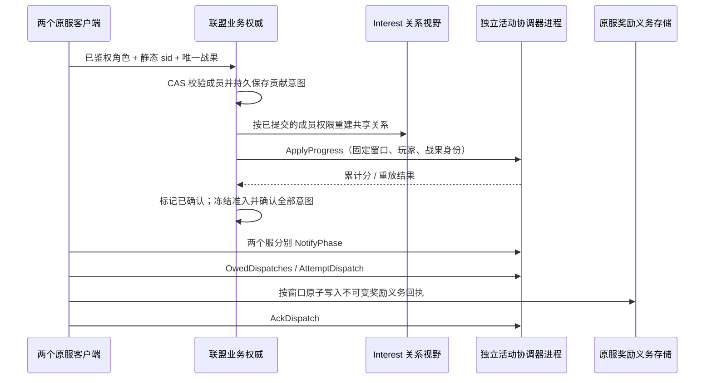
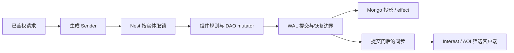
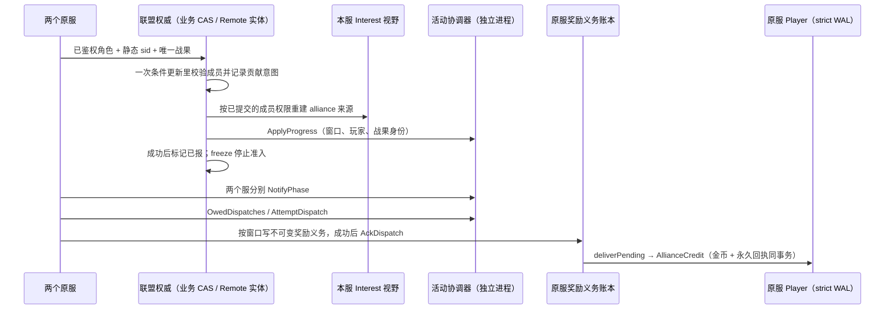

# SLG 框架学习与验收

本手册把 SLG 的主要业务路径映射到 core 的正式接口，分两部分：**第一部分“学习”**讲框架怎么用、为什么这样设计，按建造、行军、抢地等场景给出阅读顺序与可编译的调用示例；**第二部分“验收”**说明每个脚本证明什么、不证明什么。建筑数值、兵种、战斗规则、赛季政策和部署容量由游戏定义。下面的业务夹具只是学习和验收样例：框架与生成器不包含任何 SLG 规则，生成器也不生成这些业务文件；完整的参考应用仍是 [game-demo](../../demo/README.md)。另一种游戏的独立手册见 [MMORPG](MMORPG-INTEGRATION.md)。

学习主线分两段：建造、行军和抢地是事务入门（§3～§6）；跨服联盟活动把联盟权威、视野和活动奖励串成一条链路（§7），先分清框架已有、业务要做和框架没有的部分，不把框架模块存在当作玩法已经完成。

## 第一部分：学习

### 专题优先级：跨服、视野、活动

SLG 的重点学习路线固定为这三条线。基础建造、行军和抢地提供事务入门，后续应向“跨服联盟活动／国战”串联，业务规则未定义的部分先作为待实现示例，不把框架模块存在当作玩法已经完成。

| 专题与 SLG 场景 | 首先追到的权威和正式接口 | 必须解释与验证 |
| --- | --- | --- |
| 跨服联盟／国战 | Player 留在原 sid；联盟等跨服实体走 [Remote／Mirror](guide/05-remote-mirror.md)；原服扣费与奖励协作用 [Saga](guide/06-saga.md) | 哪个进程能写、旧 owner 如何被 fence 拒绝；失败补偿与结果未知查询；Mirror 陈旧时不能据快照越权写；重复消息不重复扣兵／发奖 |
| 战争迷雾／侦察／联盟视野 | 权威位置／权限在业务 DAO；[SpatialComponent／Interest](INTEREST-BLOCK-AOI.md) 管空间事实和来源；Sync Profile 控制字段 | 空间候选不等于侦察权限；联盟退出撤销关系来源；一处观察撤销而其他来源仍命中时保留对象；最后来源消失才退订；不可见单位的敏感字段不能先下发再由客户端隐藏 |
| 赛季／联盟活动／跨服积分 | 本服 World 持久 timer → [ActivityRunner](../../demo/internal/service/game/activity.go.tmpl) → [activity 协调器](../../service/activity/) → 原服结算 | 窗口身份、参与服集合、阶段推进、贡献身份、累计榜乱序、结算确认、邮件与最终领奖分别何时完成；服离线、重启和人工补发怎样收口 |

**跨服学习顺序**：先标明每个状态的 owner sid，再读 Remote 正式写与 Mirror 读取；之后从 [gift_item](../../demo/saga/gift_item/) 学原服事务与跨服 Saga。`scripts/test-remote-generated.sh` 验证 Remote 路径，[MMO 双 sid 赠礼](MMORPG-INTEGRATION.md#13-双-sid-跨服赠礼)验证另一条实际多进程协作路径，两者不能互相代替。下一步 SLG 专题是把联盟权限、战场参与身份和原服奖励接到同一个业务流程；当前赠礼证据不证明国战权威或跨机故障已完成。

**视野学习顺序**：权威位置／权限 → 空间候选 → spatial／block／team 等来源归并 → Profile 字段白名单 → 提交后发布 → 客户端 Full／增量。`SpatialComponent.MoveWithObservedBlocks` 可表达“位置唯一、额外多块被观察”，本身不实现战争迷雾。重点读 [interest_test](../../framework/sync/entitysync/policy/interest_test.go) 的来源交接、回滚和发布屏障测试，再运行 `ROOST_NEST_GAME_RACE=1 bash scripts/perf/nest-game.sh --check-spatial` 学正式生成 DAO 接法。联盟情报共享的授权、撤销和额外扇出仍需 SLG 业务纵切，不能拿普通 AOI 半径测试替代。

**活动学习顺序**：

1. 从配置活动组与业务时钟确定窗口，用 `ActivityRunner.openWindow` 调用 `OpenActivity`；expected 集合根据该组与 App singleton 的存活查询取得。不能把路由分组当作每个服此刻在线的证明。
2. 本服 World 的持久期限经 `NotifyPhaseDue` 通知协调器。协调器不靠自身时钟启动业务阶段；某服通知后才启动聚合／宽限流程，具体见 [activity/types.go](../../service/activity/types.go)。
3. 业务成功事实形成稳定贡献身份，经 `Contribute` 上报；核对活动窗口，榜单保留较大累计值。demo 的尽力贡献失败不自动补报是既有取舍，正式赛季若要求不漏计，需要业务持久意图和重试，不能用重新执行领奖来补贡献。
4. `AttemptDispatch` 取得结算投递，`settle` 按原身份发送奖励邮件，再 `AckDispatch`。投递确认不等于玩家已领取；永久到账还需邮件／Player 的幂等事实，有限服务去重窗口不能代替永久账本。
5. 故障练习至少包括重复与跨窗贡献、晚到累计值、一个服未通知、结算投递中断、发邮件成功但确认丢失、玩家重复领取。重开投递、排除失联目标或补发应有明确业务授权和审计，不能默认删除账本重跑。

现有证据分层：通用 AOI／Remote／activity 模块有对应测试，demo 有活动榜及结算接法；§11 列真实资源入口。下面的联盟活动切片已把权限、关系视野、跨进程活动协调与原服奖励义务串在同一条测试中；**Player 实际到账与 Remote 联盟 owner 交接已有下面的生成消费者扩展；跨服国战、空间迷雾和跨机自动 HA 仍未在这条联合链路验收**。


### 联盟活动主线：从准入到原服接收奖励义务

可运行入口：[scripts/test-slg-alliance.sh](../../scripts/test-slg-alliance.sh)。业务实现集中在 [alliance.go](../../scripts/testdata/slg-alliance/alliance.go)，接线与视野在 [runtime_test.go](../../scripts/testdata/slg-alliance/runtime_test.go)，完整顺序与断言在 [alliance_test.go](../../scripts/testdata/slg-alliance/alliance_test.go)。这是正式服务接口的消费者，直接使用仓库已生成的 Activity RPC，没有手改生成文件，也未修改框架运行时。

**教学规则**：Alice 静态归属 sid 1000，Bob 静态归属 sid 1001；一个联盟、一个固定赛季窗口、一个公开据点。可信战斗权威每确认一个唯一战果贡献 10 分。退盟拒绝新贡献，已经获准的贡献和奖励保留。每个窗口最多 128 个战果，原服最多保留 128 个窗口回执；满后拒绝，不删除旧身份。客户端不能提供 sid、得分、战果成功或奖励清单。这个例子没有实现战斗判胜负，战果入口必须由真实游戏的可信战斗服务调用。



| 业务状态 / 输入 | 拥有者与框架接法 | 如何调用与失败处理 |
| --- | --- | --- |
| 成员、静态原服、待报战果 | 联盟业务记录；`versionstore.NewRedisStore`，无 TTL | `contribute` 在同一个 `Update` 中校验成员并记录意图；`revoke` 与贡献通过同一个 CAS 串行裁决。回调只计算状态，不执行 RPC；同身份重试可查旧事实，换玩家复用身份被拒 |
| 联盟共享据点、独立侦察来源 | 本服 `entitysync.Manager` + `policy.Interest` | `reconcile` 先 HoldSession，再由**已提交**的成员快照更新 `alliance` 来源；Apply 成功后 ReadySession。撤盟保留 `scout`，最后来源撤销才消失；应用失败保持 held。这里只发送公开据点 ID，没有敏感成员或账本字段 |
| 可靠贡献、丢失应用确认 | 联盟业务意图 + `activity.Coordinator` | `drain` 在 CAS 外调用 `ApplyProgress`，成功才标记 Sent；重启按原 `Key + participant + battleID` 重试。协调器的保留期为一小时，未确认意图达到该期限即停止自动补报，转人工对账，不生成新身份 |
| 活动阶段 | 本服业务时间线 + 协调器 expected 集合 | `freeze` 停止新准入；`phase` 要求所有意图 Sent 后才能 NotifyPhase。一个服通知时保持 collecting，两个服通知后 complete。教学 expected 固定为 1000/1001；生产从活动组与 singleton 存活事实取得 |
| 原服奖励义务、丢失 ACK | 静态 sid 分隔的业务 `versionstore` 存储 | `receive` 校验窗口、目标 sid、完整结算结果和冻结贡献，按窗口写不可变奖励清单与回执；写成功才 ACK。重投返回原回执，不提升存储版本；同窗口变更奖励清单被拒 |

**奖励义务不是金币到账**：这个切片的 ACK 表示原服已持久接收“谁应获得多少积分奖励”的义务。基础入口停在义务回执；下面的 Player 扩展继续把同一义务写入金币与永久到账身份。两个回执分属不同存储，不存在 Redis 与 Player 之间的分布式原子事务：先持久接收义务，再通过可重试的 Player 事务到账。协调器 ACK 不因此变成玩家领取的证明。邮件附件领取与 Saga 资产协作仍未接入本切片。

**视野如何继续扩展**：当前联合场景验证的是联盟与侦察两种授权来源归并，没有把“附近”自动等同可见。空间迷雾应由服务端侦察规则产生授权，再结合 `SpatialComponent` 的提交门、观察块与 Profile 白名单。跨服撤权通知仍存在传播窗口，正式产品需要定义可接受延迟和会话暂停策略；不能声称本例已验证撤权瞬间全服无泄漏。

运行方式（现有隔离测试 Redis / NATS；不启动或停止共享服务）：

```bash
ROOST_DATAENGINE_IT_REDIS_ADDR=127.0.0.1:6379 \
ROOST_DATAENGINE_IT_NATS_URL=nats://127.0.0.1:4222 \
bash scripts/test-slg-alliance.sh
```

实跑证据：`TestSLGAllianceActivity` 经 race 通过、无 skip，随后消费者 vet 通过。一个测试覆盖以下连续流程：八个并发重复战果只留一个意图；错服与身份盗用拒绝；退盟、独立侦察保留及最后来源撤销；已提交贡献丢失应用确认；冻结但仍有未确认意图时禁止结算；真正重启协调器后补报只计一次；超出重放期限拒绝自动补报；两服阶段屏障；原服义务已写未 ACK，再次重启协调器后通过 OwedDispatches 找回旧窗口、原 token 重投、不重写回执、错误 token 拒绝、重复 ACK 幂等。唯一 Redis 命名空间和 NATS subject 隔离，结束只清理本次资源。

**证据边界**：协调器是实际子进程，两个 sid 客户端使用不同 NATS 连接但位于同一父进程；服务发现为固定列表，未验收 etcd、singleton 或自动 HA。协调器执行正常排空重启；丢失的是测试注入的应用确认，协调器未注入网络分区、SIGKILL 或 Redis 故障。Redis 数据跨进程读取成功不证明节点断电持久性。视野已经真实回环 TCP 与正式帧 Receiver 重建对象表，NATS 失效提示验证重复／乱序后的权威重读；不证明跨机即时撤权、正式账号鉴权或消息不丢。基础入口的联盟权威用业务 Redis CAS；Remote 扩展改用正式生成实体并验证 owner 交接，见下文；基础入口的原服对象重建只验证持久义务回执；Player 扩展启动独立原服测试子进程做实际发奖和 SIGKILL，但不是带登录网关的完整 game 服务。

**问题归属与下一步**：可靠贡献意图、退盟政策、冻结屏障和永久奖励回执属于业务设计，本轮没有据此认定框架缺陷。Player 金币与永久到账回执已由下一节扩展验证。Remote 联盟权威与原服有界待发扫描也已由扩展接入。下一步加入持久空间事实、多块迷雾与权限定期重读驱动；邮件附件、常驻投递调度和长期归档另行接入。MMO 跨服世界 Boss 可复用窗口 / 意图 / 回执思路，但需要自己的队伍与副本权限规则，不能复用本次结果声称 MMO 联合主线已完成。

### Player 到账扩展：义务已 ACK，金币仍能恢复补发

入口：[test-slg-alliance-player.sh](../../scripts/test-slg-alliance-player.sh)。它用 CLI 生成独立 game 工程的 Player DAO 和 Sender，复用上面的**同一条**联盟活动测试，并在原服奖励义务已经 ACK 后继续到账；不是把两个独立测试的通过当作串通。业务 handler 见 [handlers.go.txt](../../scripts/testdata/slg-alliance/player/handlers.go.txt)，真实 Runtime / WAL 接线见 [runtime_test.go](../../scripts/testdata/slg-alliance/player/runtime_test.go)，进程恢复与断言见 [delivery_test.go](../../scripts/testdata/slg-alliance/player/delivery_test.go)。

| 阶段 | 拥有者 / 正式接口 | 提交与失败顺序 |
| --- | --- | --- |
| 玩家建档 | 每个原服自己的 Player，生成 `AllianceHomeInit` Sender | 首次把静态 `HomeSID` 与空回执持久化；实体 Create 不是持久建档。已有角色不能改 sid |
| 读取待兑现义务 | 原服业务 `home.deliverPending` → `home.store.Get("rewards")` | 读取原活动窗口、玩家与金额，固定 Alice→1000 / Bob→1001 的教学映射；不从当前活动窗口推算，不信任客户端金额。ACK 后 OwedDispatches 已为空，仍须从原服义务记录恢复工作 |
| 实际到账 | `Sync_AllianceCredit` → Player Nest strict → 生成 DAO setter | 在同一事务中写 `Gold += amount` 与 `Receipts[activity.Key.String()] = amount`，无事务内 RPC。示例一贡献积分兑换一金币，这个数值属于业务 |
| 重复 / 冲突 | 同一个 Player 永久账本 | 同窗口同金额返回现有余额；错服、改金额拒绝且资产不变。最多 128 个窗口满后拒新身份，不删除旧回执；新赛季使用不同窗口身份 |
| 原服重启 | `engine.Runtime` + 文件 `nestwal` + Mongo projector | 每个 sid 独立 WAL、固定实体 ID。恢复先冷加载原事实，再读义务重试；不能先重试补出缺失事实，再声称恢复正确 |

```bash
ROOST_DATAENGINE_IT_REDIS_ADDR=127.0.0.1:6379 \
ROOST_DATAENGINE_IT_NATS_URL=nats://127.0.0.1:4222 \
ROOST_DATAENGINE_IT_MONGO_URI='mongodb://127.0.0.1:27017/?replicaSet=rs0' \
bash scripts/test-slg-alliance-player.sh
```

实跑：`TestSLGAlliancePlayerDelivery` race 通过、无 skip，生成消费者 build / vet / ID / generate --check 通过。两个原服**分别**执行“建档＋到账”的两条已确认 strict WAL，断点确认投影数为 0、未投影数为 2，且原服 Delivered 尚未写入，再由父进程 SIGKILL 自己启动的子进程。恢复进程先比较完整钱包字符串并解出 HomeSID、10 金币和唯一永久回执；八路重放与重新读取同一 Redis 义务不增币；错服、改归属、同身份改金额被拒。正常关闭后第三个进程再次冷加载与重放，最终两人各 10 金币、各一个到账身份。成功清理本次唯一数据库，失败保留 WAL、数据库与子进程日志；`ROOST_SLG_REWARD_KEEP=1` 可保留成功工程。

本例不改变 ACK 的含义。`home.deliverPending` 已实现一次有界扫描与补发：按窗口／玩家排序，最多处理调用方指定的 1～128 个窗口，先调用 Player，再持久记录 Delivered。Player 调用失败不标完成；Player 已到账而 Delivered 未写时，重启仍能发现并重投。测试在这个间隙 SIGKILL，恢复时发现一条工作，第三进程发现零条；独立重放 Player 身份仍返回原余额。尚未接常驻后台循环、最终义务归档或无限期账本。固定两个角色的映射需由生产账号／角色注册表替换；这是内部受信任调用，未开放公网领奖 API。原服子进程按 sid 依次验收，不证明两服网络并发、进程自动拉起、Redis 故障、磁盘断电或 strict 结果未知。Gold 与永久回执经真实 WAL / Mongo 恢复，**Remote owner/fence 要看下一节的专门扩展；邮件附件与 Saga 未因本项通过而自动获得验收**。

生成器学习点：锁目标能力接口应命名为 `I...Entity`，或显式声明 `target`；不能用普通接口名让生成器猜锁目标。本夹具使用 `IAllianceRewardPlayerEntity`，失败时修业务声明，不手改生成 Sender。

### Remote 扩展：联盟换 owner，活动与奖励继续执行

运行入口沿用 Player 脚本，加 `ROOST_SLG_REMOTE=1`。它把**同一条**业务流程的联盟存储换为 Managed Remote `AllianceAuthority`，原服奖励义务仍在 Redis，Player 金币仍在原服 DAO；Player sid 从未迁移。相关文件：[生成 handler](../../scripts/testdata/slg-alliance/remote/handlers.go.txt)、[Remote Runtime 装配](../../scripts/testdata/slg-alliance/remote/runtime_test.go)、[业务 CAS 适配器](../../scripts/testdata/slg-alliance/remote/store_test.go)、[owner 交接验收](../../scripts/testdata/slg-alliance/remote/remote_test.go)。

```bash
ROOST_SLG_REMOTE=1 \
ROOST_DATAENGINE_IT_REDIS_ADDR=127.0.0.1:6379 \
ROOST_DATAENGINE_IT_NATS_URL=nats://127.0.0.1:4222 \
ROOST_DATAENGINE_IT_MONGO_URI='mongodb://127.0.0.1:27017/?replicaSet=rs0' \
bash scripts/test-slg-alliance-player.sh
```

| 步骤 | 框架与业务接法 | 要核对的事实 |
| --- | --- | --- |
| 正式生成 | `roost add mod remote_entity -service game`；生成 AllianceAuthority / DAO，再把业务实体声明改成 Remote category、`remote=managed`、`RemoteEntityBase` | 三处一起改，重新 generate；不手改生成 DAO 或 Sender。Remote 托管实体不挂本地实体定时器 |
| Runtime 装配 | `NewMongoCommitter` → `NewBackend` → `Assemble`；`MongoStore.SetRemoteProjection`；`Runtime` / Nest 注入同一个 Remote Manager | Mongo 为权威，Redis 锁和 L2 使用本次唯一前缀，两个 Runtime 各有独立 WAL。提交后能否写由 Remote 准入与 fence 决定 |
| 联盟事实读写 | 生成 `AllianceRemoteRead` / `AllianceRemoteCAS` Sender；整个成员与待报意图存为一个 DAO 字段 | 业务 Version 只控制条件更新，不代替 Remote marker / route / lock fence；明确版本冲突才重新读取计算，其他错误直接返回，不盲重试未知结果 |
| 首次拥有 | `ClaimRemoteOwnership`，未共享时 `EnterRemoteSharedMode` | 先读 Claim 返回的 Shared。接管可能继承 shared=true，此时再次 EnterShared 会被拒，不能把接入误用记为框架故障 |
| 交接 | owner 2000 调 `TransferRemoteOwnership(...,2001)` | marker 与 route epoch 均上升；旧 Runtime 仍活着时尝试撤销 Alice，被 writer fenced 拒绝 |
| 冷加载继续 | 新 Runtime sid 2001 使用新的内存管理器与自己的 WAL，从共同 Mongo 加载 | **先**比较完整业务事实与交接前一致，**再**补报；已有成员权限、冻结状态、待报战果均不被重新初始化 |
| 后续链路 | 原活动身份补报 → 两服阶段 → 原服义务 ACK → 有界扫描 → Player strict 资产与永久回执 | 继续运行两服的未投影 SIGKILL 恢复，不能只停在“Remote 改个字段成功” |

`TestSLGAllianceRemoteDelivery` 已在真实 Redis / Mongo / NATS 上 race 通过、无 skip；消费者 build / vet / ID / generate --check 通过。基础入口和不启用 Remote 的 Player 入口也分别复测。原服扫描先注入 Player 不可用，确认义务版本不变；再在资产已提交、完成标记未写时杀进程，恢复发现待发义务，第三进程不再发现待发项。

**范围**：两个联盟 owner 是同一父进程里的独立 Runtime，证明真实共享存储上的显式交接与旧写者拒绝；不证明跨机网络分区、自动选主、lease 中途过期或并发在途提交时的交接。此处 Remote 使用普通 NATS，快照推送按框架契约关闭，未验证 JetStream / Mirror 订阅；业务读通过权威 Nest 路径，不用陈旧 Mirror 作权限。原服 Player 与活动协调器仍有真实子进程。本例的 128 KiB 联盟状态与 128 条账本是教学限制，不是生产容量结论。

### 视野扩展：真实 TCP、权限代际与重连

[视野接线](../../scripts/testdata/slg-alliance/runtime_test.go) 经 [TCP 接线](../../scripts/testdata/slg-alliance/tcp_test.go) 的 `gateway.TCPServer / TCPRuntime` 和 `selfsync.PushPlayerFrame` 发送，两个实际回环 socket 用 `wire.Read` 收包；[fog_test.go](../../scripts/testdata/slg-alliance/fog_test.go) 再以正式 `frame.Receiver` 维护客户端对象表。所有三个联盟入口执行同一条链，包含真实断开／重新握手，不能把 Manager 的会话 id 与 TCP 连接生命周期混为一谈。

| 业务步骤 | 正式接法与提交顺序 | 实际断言 |
| --- | --- | --- |
| 退盟 | 持久 CAS 同时修改 Active 与 PermissionGeneration；重复退盟不增加代际 | alliance 来源消失，scout 仍命中时保留对象；最后来源撤销后 Bob 无据点 |
| 失效提示 | [permission_test.go](../../scripts/testdata/slg-alliance/permission_test.go) 用独立 NATS 连接发送权限代际；消息只表示重读下限，不携带成员授权 | 新提示、重复提示、延迟旧提示均拉当前持久权威；旧消息不能恢复旧权限 |
| 暂停与重建 | `HoldSession → 读取权威 → 校验代际 → Interest.Apply → ReadySession → Flush`；通知下限保留，失败重试不能降低 | 读失败、低于已知代际或通知下限、同代成员内容冲突均保持 held，不发送新帧 |
| TCP 重连 | 关闭旧 socket，等待接入注销；重新握手注册后 OpenHeldSession / Resubscribe，再读取最新权威 | 客户端收到新 Full；退盟者仍无据点；旧 epoch 帧不能进入应用回调 |
| 公开字段 | Sync 通道 envelope 和对象载荷逐包校验 | 仅 `{"objective":99}`；没有成员名单、贡献意图和永久奖励回执 |

这是一套业务撤权接法，不是框架自动提供的分布式权限系统。普通 NATS Pub/Sub 可以丢通知；测试中的提示队列有界，满时丢提示而不能无界积压。生产需要定期权威重读、可信 subject 权限以及串行视野协调循环，定义最大缓存年龄和故障时是否断线；本例只直接调用重读入口，没有常驻定时驱动或跨机延迟验收。held 只停止后续发布，不能收回已经发给客户端的信息。两个固定测试票不代表真实账号服务验签。

位置 DAO / SpatialComponent 提交门、多块观察、战争迷雾和敌军隐身 Profile 仍未接入这条联合链；`MoveWithObservedBlocks` 的额外被观察覆盖不等于玩家侦察授权。不要把 TCP 据点视图通过解释成完整空间迷雾已完成。

### main 新契约接入：逻辑库与物理库分开

DAO 定义保持 `db=main`，生成 `db.DatabaseMain`；脚本不再替换定义里的库名。每次运行把 `main` 经 `coredata.NewDatabaseMap` 映射到唯一的 `roost_slg_reward_it_*` 物理库，传给 `engine.MongoStoreConfig.Databases`。Remote 的 `MongoCommitter.BindDatabaseMap` 必须绑定同一张表，确保权威 DAO 写入与 DataEngine 冷加载／投影一致；Remote 控制库和 DataEngine 默认控制库仍直接使用物理库名。

这个改动使业务代码与部署库名解耦，且 WAL 仍记录逻辑名；带未投影记录时不得更换映射，否则 Runtime 拒绝启动。当前消费者沿用相同映射完成两服 strict WAL SIGKILL／冷恢复与 Remote owner 交接。映射不是数据迁移，跨进程配置一致性仍由部署保证。主分支契约与接法见 [DataEngine 指南](guide/03-dataengine.md)，不要直接用 DAO.DbName() 打开 Mongo 物理库。

### 1. 适合谁、先读什么

适合准备用 core 做 SLG 的后端工程师。先读[入门](../GETTING-STARTED.md)，再按“一个玩家建造 / 行军 → 两名玩家抢地 → 联盟 / 跨服 → 战斗与结算 → 恢复”的顺序实践：前两步有可运行的生成工程（§3～§5），联盟 / 跨服 / 活动结算有可运行的联合链路（§7，真实依赖模式），战斗与其余路线从 game-demo 的现成接法学（§8）。

### 2. 模块分工：先分清状态归谁

先明确哪些状态属于谁，再选框架模块：

| 概念 | 在 SLG 中表示什么 | 正确用法 |
| --- | --- | --- |
| Entity | 玩家、地块、联盟等有身份和生命周期的业务对象 | 存权威状态，是 Nest 取锁与事务的参与者 |
| DAO | 资源、队列、等级、归属、领奖事实和期限的持久字段 | 只在事务内用生成的 mutator 修改，不暴露可写的底层 map 绕过脏跟踪 |
| Component | 对 DAO 的业务操作，如背包、城建、地图、计时 | 封装规则，不另存一份会与 DAO 分叉的权威状态 |
| Nest + Sender | 按实体调度，取锁、undo、提交与回复 | 端点鉴权后调用生成的 Sender；多实体一次传入全部已知参与者 |
| DataEngine + WAL | 持久提交、异步投影、恢复与屏障 | 分清内存完成、WAL durable 与 Mongo 可见，不用删 WAL 解决失败 |
| EntitySync + Interest | 把已可见状态发给有权观察的客户端 | AOI 是派生索引；客户端应用全量 / 增量，不能反向决定服务器权威 |
| 实体定时器（Entity timer） | DAO 里保存的期限，加一个只索引已加载实体的 Driver | 资源与期限在同一事务提交；离线补算由业务按 `Fire` 信息计算 |
| Service / Remote / Mirror / Saga | 邮件排行等独立服务、跨服实体读写、镜像与多步补偿 | 先选状态拥有者；Mirror 不授予写权，持实体锁期间不做远端 I/O |



图中的提交门随 durability、watermark 与持久化装配工作，不能理解成所有路径都“等 Mongo 落库后才回复”：`strict` 保证 WAL fsync，不保证回复时 Mongo 已投影（[DataEngine](guide/03-dataengine.md)）。

### 3. 建造、行军与抢地：如何使用

#### 3.1 生成工程从哪来

在仓库根目录使用 go.mod 声明的工具链运行：

```bash
ROOST_SLG_KEEP=1 bash scripts/test-slg-generated.sh   # 保留生成工程以便阅读；不加 KEEP 时成功即删除
```

脚本打印临时目录，生成工程在其中的 `project/`。它做的事就是一个新工程的接入步骤：

1. `roost project new slg-practice -module example.com/slg-practice -template game`；
2. `roost add dao Player --entity Player`、`roost add timer --entity Player`、`roost add entity Tile`、`roost add dao Tile --entity Tile`；联盟活动（§7）再加 `roost add mod remote_entity -service game`、`roost add entity AllianceAuthority`、`roost add dao AllianceAuthority --entity AllianceAuthority`；
3. 业务只改这几处：在 `db/def/player.go`、`db/def/tile.go`、`db/def/alliance_authority.go` 填 DAO 字段（骨架的逻辑库 `db=main` 不改，联盟权威加 `dbscope=global`）；把 `game/entities/tile/entity.go` 注解里的 `category=entity.EntityCategoryOther` 改为 `category=entity.EntityCategoryWorld`（地块是被许多玩家争用的世界对象，锁序要低于 Player），把 `game/entities/alliance_authority/entity.go` 改为 Remote 托管（§7.4）；写定时器回调 `game/entities/player/timer_handlers.go`、handler `game/handler/slg_tasks.go`、`alliance_rewards.go`、`alliance_authority.go` 与联盟业务包 `game/alliance/alliance.go`；
4. `roost generate` 生成组件、访问器和 Sender，不手改生成文件。

#### 3.2 阅读顺序

进入 `project/` 后按顺序读：

1. `db/def/player.go`、`db/def/tile.go`：玩家资源 / 等级 / 期限与地块拥有者分别存放，地块权威不放进 AOI。
2. `game/handler/slg_tasks.go`：业务 handler 的窄接口（只声明要用的 `Dao()` / `TimerComp()`）、`rollback=undo durability=strict` 标记与多实体参数。
3. `game/entities/player/timer_handlers.go`：建造完成怎样登记下一段行军、研究怎样独立到期、离线收益怎样封顶。
4. `game/handler/syncsender/`：生成的 Sender 怎样把目标 ID 与业务参数交给 Nest；业务调用它，不手改。
5. `game/handler/slg_tasks_test.go`：并发抢同一地块、取消重放、失败回滚、DAO 水合后的补触发。

[实际业务源码](../../scripts/testdata/slg/tasks.go.txt)和[定时回调](../../scripts/testdata/slg/timer_handlers.go.txt)是学习主线。

#### 3.3 用 Sender 调用

下面的文件放进保留的生成工程（例如 `internal/slgflow/flow.go`）可直接编译；`client` 是当前服务的 Nest 客户端，EntityID 是完整 ID：

```go
package slgflow

import (
	"context"

	syncsender "example.com/slg-practice/game/handler/syncsender"
	"github.com/tjbdwanghaibo/roost-core/framework/nest"
)

func buildResearchAndClaim(ctx context.Context, client nest.Client, playerEntityID, tileEntityID int64) (bool, error) {
	s := syncsender.NewSlgTasksSender(client)
	// 建造到 1 级，完工后向示例目的地 501 行军；返回实体内的定时器节点 ID。
	timerID, err := s.Sync_SLGStart(ctx, playerEntityID, 1, 501)
	if err != nil {
		return false, err
	}
	// 独立的研究队列，可与建造同时推进。
	if _, err := s.Sync_SLGResearch(ctx, playerEntityID, 1); err != nil {
		return false, err
	}
	// 取消建造；重复取消不重复退款。
	if _, err := s.Sync_SLGCancel(ctx, playerEntityID, timerID); err != nil {
		return false, err
	}
	// 玩家与 Tile 同一事务：只有拿到归属的一方支付，重放不再支付。
	return s.MultiSync_SLGClaimTile(ctx, playerEntityID, tileEntityID)
}
```

`timerID` 是实体内的定时器节点 ID，不是玩家 ID；路由用 `entity.BuildEntityID` 构造的完整 EntityID，不要把账号 ID、裸 PlayerID 与完整 EntityID 混用。每次调用的错误都要按业务逐次处理，示例只演示调用方式。

#### 3.4 六个场景各学什么

| 场景 | 业务选择 | 学到的框架契约 |
| --- | --- | --- |
| 建造 → 行军 → 抵达 | 一个建造队列，建造扣 10 金，2 秒完成后登记 5 秒行军；目标坐标限定在示例范围内 | 生成 Sender → Nest → DAO 与期限同事务；回调创建的下一阶段仍进入驱动索引 |
| 重放、取消与退款 | 目标建筑等级单调递增；已完成等级的重放不扣款；取消未完成节点只退款一次 | 重复调用不重复改变业务事实，取消的节点不再触发 |
| 独立研究队列 | 研究扣 5 金、3 秒完成，可与建造同时推进；目标等级重放不扣款 | 同一实体多个期限独立到期，不相互覆盖或提前触发 |
| 建造事务失败 | 业务返回错误，整次建造不成立 | 资源、待建节点、节点种子和提交后的驱动索引都回滚，不存在独立的内存期限 |
| 离线资源产出 | 一次回调按 Deadline / Now / Interval 补算，最多补 10 期，库存上限 1000 | DAO 序列化重建后只补触发一次，之后从当前业务时间恢复周期；补算公式和上限由业务提供 |
| 两名玩家抢占同一地块 | Tile 在 World 锁档，Player 在更高锁档；地块只能有一个拥有者，获胜者支付 1 金 | 多实体 Sender 和锁顺序；并发竞争只有一人获胜，归属与扣款一起提交，拥有者重放不再支付 |

上述数值是样例，不是公共框架规则。这些场景实际证明到哪一步见 §11。

### 4. 建造完成为什么能接行军

`handlerSLGStart` 在一个事务里检查等级 / 金币、扣款、用 `NewTimer` 创建建造期限、把节点 ID 记为 pending。扣款、pending 和期限节点都是 Player DAO 的字段，所以要么一起提交，要么一起回滚——不存在“钱扣了、期限没登记”的中间态。

到期后，驱动给这个 Player 投递生成的 Tick 消息；Tick handler 在同一实体的 Nest 锁和 undo 边界里执行 Host 回调。建造回调升级、清 pending、再经 `NewTimer` 登记行军。这些回调内操作共享当前 Tick 的调度视图：内层操作不各自报告，最外层 Tick 收尾后才报告一次新的最早期限，驱动据此继续投递，所以行军这一阶段不会被外层的旧报告覆盖。回调里 `Timer` / `Timers` 读的也是这份视图，刚登记的节点立即可见，“没有就建一个”不会在一次 Tick 内重复登记；回调之外读 DAO（[业务时间与实体定时器](guide/10-time.md#4-按实体的持久定时器)，实现契约见 [impl/10-time §2A](impl/10-time.md#2a-按实体的持久定时器驱动)）。

多队列不是多个后台 goroutine：建造、研究和行军是同一 Player DAO 里的不同节点，各自有独立期限。离线实体不会被准点唤醒，重新加载后到期节点只触发一次；`Fire.Now` / `Deadline` / `Interval` / `Overdue` 给业务做补算，本例最多补 10 期。重复触发、加速 / 取消的退款政策要由业务状态机约束（本例用目标等级和 pending 节点 ID 做幂等事实）。

### 5. 抢地为什么必须是多实体事务

`handlerSLGClaimTile(player, tile)` 先检查地块是否空闲与玩家资源，然后同时改归属与扣款；竞争者看到已被占领时不扣款，已是拥有者的重放直接返回成功。归属和扣款必须同一事务：分两次请求时，任何一次失败或重放都会留下“地占了钱没扣”或“钱扣了地没占”。

锁顺序由 Nest 按参与者的分类决定，分类的取值就是锁序等级，取锁从低到高（[分类常量](../../framework/entity/category_order.go)）。Tile 改为 World，Player 保持模板的 Other，即 Player 在更高锁档；两个玩家同时抢同一块地时，两者都先取地块锁，不会交叉死锁。

不要在持有玩家锁的 handler 里再发一个会倒序取地块锁的同步 Nest 请求——框架直接拒绝 handler 内的同步 Nest 请求，返回 `ErrSyncInHandler`（异步投递返回 `ErrAsyncInHandler`，见 `framework/nest/client.go` 的 `validateClientDispatch`）。已知的参与者一次传给多实体 Sender；涉及其他服务的流程拆成 Saga。

### 6. 定时器回调能做什么

定时器回调只改自己已锁实体的 DAO、操作本实体的定时器或记录 effect。需要交易、战斗结算等其他实体一起变化时，交给多实体 Nest handler；需要其他服务时，通过事务性 effect 或 Saga，不能在回调持锁期间同步做 I/O。

### 7. 跨服联盟活动：权限、视野、活动与原服奖励

SLG 后续学习以“跨服联盟活动 / 国战”为主线，串起三件事：谁能写联盟（跨服）、谁能看到什么（视野）、活动贡献怎样变成原服玩家的奖励（活动）。本节先分清框架已有什么、业务要做什么、框架现在没有什么，再用一条可运行的联合链路（`ROOST_SLG_REAL=1`，§12）讲接法。

#### 7.1 方向：框架已有、业务要做、框架没有

| 方向 | 框架已有（正式接口） | 业务要做 | 框架现在没有（不要假设） |
| --- | --- | --- | --- |
| 跨服联盟 / 国战权威 | Remote 托管实体的 owner / lease / fence：`ClaimRemoteOwnership`、`EnterRemoteSharedMode`、`TransferRemoteOwnership`，旧 owner 写入被拒（[Remote 指南](guide/05-remote-mirror.md)）；Mirror 只读快照；跨服务多步协作用 [Saga](guide/06-saga.md) / effect | 联盟成员、权限、贡献意图这些业务事实与它们的条件更新；名称唯一、成员上限等唯一性规则 | 自动选主后的业务续跑策略、玩家（Player）随联盟跨 sid 迁移；本例只演练显式交接，不覆盖 lease 中途过期、跨机分区 |
| 战争迷雾 / 侦察 / 联盟视野 | Interest 的关系来源归并（`Relation(name).Set/Clear`，最后一个来源撤销才退订）、Block AOI 与 `SpatialComponent.MoveWithObservedBlocks`、Profile 字段白名单、Manager 的 `HoldSession` / `ReadySession`、`frame.Receiver` 拒绝旧 epoch 帧（[Block AOI](INTEREST-BLOCK-AOI.md)、[Sync](guide/04-sync.md)） | 侦察 / 迷雾规则产生“谁对什么有权”的授权；权限读取失败时先停发布；不可见对象的敏感字段不下发 | 跨服撤权传播协议（每服 Interest 只管本服会话，权限变化怎样通知各服、允许多大延迟由业务定义）；已经下发给客户端的信息无法收回，held 只停止后续发布 |
| 赛季 / 联盟活动 / 跨服积分 | [activity 协调器](../../service/activity/)：`OpenActivity`、`NotifyPhase`、`ApplyProgress`（按请求身份去重，去重只在 `ReservationTTL` 内有效）、`OwedDispatches` / `AttemptDispatch` / `AckDispatch`；demo 的 [ActivityRunner](../../demo/internal/service/game/activity.go.tmpl) 是接线参考 | 窗口身份、参与服集合（从活动组与存活事实取得）、持久贡献意图与补报、结算前冻结、原服奖励义务账本与 Player 永久到账回执、补发与人工对账政策 | 贡献意图 / 补报的通用组件（要业务自己持久化）；Redis 义务账本与 Player DAO 之间的分布式原子事务（只能“先持久接收义务、再可重试到账”）；常驻的原服补发调度 |

**活动学习顺序**（demo 的 `ActivityRunner`）：`openWindow` 调 `OpenActivity`，expected 集合按活动组与存活查询取得，路由分组不等于每个服此刻在线；本服 World 的持久期限到点后 `NotifyPhaseDue` 通知协调器，协调器不靠自己的时钟启动阶段，第一个服通知后才开始宽限窗口（[types.go](../../service/activity/types.go)）；业务成功事实形成稳定贡献身份经 `Contribute` 上报；`AttemptDispatch` 取得结算投递，`settle` 发奖后 `AckDispatch`。投递确认不等于玩家已领取。demo 的尽力贡献失败不补报是已接受取舍；赛季若要求不漏计，按下面的联合链路做持久意图与补报。

#### 7.2 生成与阅读顺序

`ROOST_SLG_KEEP=1 bash scripts/test-slg-generated.sh` 生成的工程里已有这条链路的全部业务文件（§3.1 第 2 步的 `add mod remote_entity` 与 `AllianceAuthority`）；`ROOST_SLG_REAL=1` 时脚本再把真实依赖测试复制进 `game/alliance/`。按顺序读：

1. `game/alliance/alliance.go`（源 [alliance.go](../../scripts/testdata/slg/alliance/alliance.go)）：联盟成员与贡献意图（`contribute` / `revoke` / `freeze`）、补报（`drain`）、阶段屏障（`phase`）、原服奖励义务（`home.receive`）与有界补发（`home.deliverPending`）。
2. `game/handler/alliance_rewards.go`（源 [alliance_rewards.go.txt](../../scripts/testdata/slg/alliance_rewards.go.txt)）：Player 建档 `AllianceHomeInit` 与到账 `AllianceCredit`，金币与永久到账回执同一 strict 事务。
3. `game/handler/alliance_authority.go`（源 [alliance_authority.go.txt](../../scripts/testdata/slg/alliance_authority.go.txt)）：Remote 托管的联盟权威，读与条件写 `AllianceRemoteRead` / `AllianceRemoteCAS`。
4. 测试（源 [alliance/](../../scripts/testdata/slg/alliance/)）：`runtime_test.go` 是协调器子进程、NATS 总线与视野接线；`alliance_test.go` 是连续流程与断言；`fog_test.go` 用 Receiver 解码视野帧；`player_*_test.go` 是 Player 的 WAL / Mongo 接线与 SIGKILL 恢复；`remote_*_test.go` 是 Remote 装配、业务 CAS 适配器与 owner 交接。

**教学规则**：Alice 静态归属 sid 1000，Bob 静态归属 sid 1001；一个联盟、一个固定赛季窗口、一个公开据点。可信战斗权威每确认一个唯一战果贡献 10 分（本例不实现战斗判胜负）。退盟拒绝新贡献，已获准的贡献保留。每个窗口最多 128 个战果，原服最多 128 个窗口回执，Player 最多 128 个到账身份；满后拒绝，不删除旧身份。客户端不能提供 sid、得分、战果成功或奖励金额。这些数值都是样例。

#### 7.3 状态归谁、怎样调用



| 业务状态 | 拥有者与框架接法 | 调用与失败处理 |
| --- | --- | --- |
| 成员、静态原服、贡献意图 | 联盟权威：基础入口用 `versionstore.NewRedisStore`，Remote 入口用生成的 Remote 托管实体 | `contribute` 在同一次条件更新里校验成员并记录意图，`revoke` 与它经同一版本串行裁决；回调只算状态、不做 RPC。同身份重试查回旧事实，换玩家复用身份被拒 |
| 贡献补报 | 联盟意图 + `activity.Coordinator.ApplyProgress` | `drain` 在条件更新之外调用 RPC，成功才标记已报；回复丢失时用原 `Key + 玩家 + 战果身份` 重试，协调器按请求身份去重。意图存在超过协调器的 `ReservationTTL`（本例 1 小时）即停止自动补报、转人工对账，不换身份重加 |
| 活动阶段 | 本服业务时间线 + 协调器 expected 集合 | `freeze` 后 `phase` 要求全部意图已报才 `NotifyPhase`，否则结算会截断未报的战果；一个服通知时活动仍是 collecting，两个服都通知后完成。本例 expected 固定为 1000 / 1001 |
| 原服奖励义务 | 按 sid 分开的业务 `versionstore` 记录 | `receive` 核对投递的目标 sid、窗口、完成原因与冻结状态，从冻结的意图算出本服玩家积分，按窗口写不可变清单；写成功才 ACK。重投返回原记录、不提升版本；同窗口清单变化被拒 |
| Player 金币与永久回执 | 原服 Player DAO，生成 Sender `Sync_AllianceCredit` → Nest strict | 金币与 `Receipts[窗口]` 同一事务；同窗口同金额返回原余额，错服、改金额被拒。义务账本与 Player 是两个存储，没有跨存储原子事务：`deliverPending` 先到账、再标记完成，中间崩溃时恢复会重投同一身份，由 Player 回执去重 |

**奖励义务不是金币到账**：协调器 ACK 只表示原服已持久接收“谁应得多少”的义务；ACK 之后 `OwedDispatches` 为空，恢复必须从原服义务账本找工作（`deliverPending` 按窗口 / 玩家排序，一次最多 1～128 个窗口），不能靠协调器的索引或内存待发列表。本例是受信任的内部调用，不是公网领奖接口；常驻补发调度、义务归档、邮件附件与 Saga 资产协作仍要业务接入。

#### 7.4 联盟权威放进 Remote 托管实体

| 步骤 | 接法 | 要核对的事实 |
| --- | --- | --- |
| 生成 | `roost add mod remote_entity -service game`、`roost add entity AllianceAuthority`、`roost add dao AllianceAuthority --entity AllianceAuthority`；实体注解改为 `category=entity.EntityCategoryRemote remote=managed`、嵌入 `*entity.RemoteEntityBase`，DAO 写 `db=main dbscope=global` | 三处一起改再 `roost generate`；`dbscope=sid` 会被生成器拒绝。Remote 托管实体不挂本地实体定时器 |
| 装配 | `NewMongoCommitter` → `NewBackend` → `BindDatabaseMap` → `Assemble`；`MongoStore.SetRemoteProjection`；Runtime 与 Nest 注入同一个 Remote Manager | 自建装配必须把 DataEngine 的库名映射绑给 Remote 存储：直接构造的提交器未绑定时按逻辑名 `main` 写 DAO 文档（wiring 装配总会绑定，未绑定时拒绝写） |
| 读写 | 生成 Sender `Sync_AllianceRemoteRead` / `Sync_AllianceRemoteCAS`；联盟全部事实存为一个 DAO 字段 | 业务版本只管条件更新，不代替 Remote 的 marker / route / lock fence；只有明确的版本冲突才重读重算，其他错误直接返回，结果未知不盲目重执行 |
| 首次拥有 | `ClaimRemoteOwnership`，返回的 lease 未共享时再 `EnterRemoteSharedMode` | 先看 Claim 返回的 `Shared`：接管可能继承共享状态，再进一次会被拒，这是接入用法不是框架故障 |
| 交接 | owner 2000 调 `TransferRemoteOwnership(..., 2001)` | marker 与 route epoch 都上升；旧 Runtime 仍在运行时尝试写（撤销成员）被拒 |
| 冷加载继续 | 新 Runtime（sid 2001）用自己的 WAL 从 Mongo 加载 | 先比较完整联盟事实与交接前一致，再继续补报、阶段与 Player 到账 |

#### 7.5 视野：先停发布，再读权限

`fog.reconcileFrom` 的顺序是：两个会话先 `HoldSession` → 读联盟权限 → 按成员是否有效 `Relation("alliance").Set/Clear` → `Interest.Apply` → `ReadySession` → `Flush`。权限读取失败时会话保持 held，Flush 不发新帧；不能拿旧缓存继续 Ready。`scout` 是独立来源：退出联盟只撤 `alliance`，仍有侦察时据点保留，最后一个来源撤销才产生删除。重连时 `CloseSession` → `OpenHeldSession` → `Resubscribe` → 重新 reconcile，客户端收到新的 Full；旧 epoch 的帧交给 Receiver 不会进入应用回调。每个对象载荷只有公开据点 `{"objective":99}`，没有成员名单、贡献意图或奖励账本。

held 只停止后续发布，不收回客户端已经收到的信息；传输是内存捕获，不是 TCP 客户端。

#### 7.6 示例：原服到账与联盟条件写

下面的文件放进保留的生成工程（例如 `internal/slgalliance/flow.go`）可直接编译：

```go
package slgalliance

import (
	"context"

	syncsender "example.com/slg-practice/game/handler/syncsender"
	"github.com/tjbdwanghaibo/roost-core/framework/nest"
	"github.com/tjbdwanghaibo/roost-core/service/activity"
)

// reportContribution 补报一条已持久记录的贡献意图：重试时窗口、玩家和战果身份都不变，协调器按身份去重。
func reportContribution(ctx context.Context, c activity.Coordinator, key activity.Key, player, battleID string) error {
	_, err := c.ApplyProgress(ctx, key, player, battleID, activity.ProgressDelta{Score: 10, Progress: 1})
	return err
}

// creditObligation 由原服的受信任补发循环调用：key 与 amount 读自原服持久义务，homeSID 来自本进程配置，
// 都不来自客户端。重复调用返回原余额，不重复加金币。
func creditObligation(ctx context.Context, client nest.Client, playerEntityID int64, homeSID int32, key activity.Key, amount int64) (int64, error) {
	return syncsender.NewAllianceRewardsSender(client).Sync_AllianceCredit(ctx, playerEntityID, homeSID, key, amount)
}

// casAlliance 在 Remote 写准入之后做业务条件写；expected 是业务版本，不代替 Remote 的 fence。
func casAlliance(ctx context.Context, client nest.Client, allianceEntityID int64, expected uint64, next string) (string, error) {
	return syncsender.NewAllianceAuthoritySender(client).Sync_AllianceRemoteCAS(ctx, allianceEntityID, expected, next)
}
```

锁目标的能力接口按 `I...Entity` 命名（本例 `IAllianceRewardPlayerEntity`、`IAllianceAuthorityEntity`）或显式写 `target=`；两者都没有时 `roost generate` 报错，改业务声明，不手改生成的 Sender。

可靠贡献意图、退盟政策、冻结屏障和永久奖励回执都是业务设计；这条链路没有据此发现框架缺陷。MMORPG 的跨服世界 Boss 可以复用“窗口 / 意图 / 回执”的思路，但队伍、副本权限和退队分奖规则要自己定义（[MMORPG §6](MMORPG-INTEGRATION.md#6-保持-player-归属的跨服协作)）。

### 8. 更多 SLG 路线：接法、源码与业务边界

| SLG 方向 | 从哪个源码 / 文档学 | 框架接法与证据入口 | 业务仍需定义 |
| --- | --- | --- | --- |
| 登录、角色、断线与归属 | [玩家接入](PLAYER-ACCESS.md)，game-demo 的 account / EnterGame | 真实凭据机器人与重连回归 | 渠道认证、区服开放与角色政策 |
| 城建、研究、行军与离线收益 | 上面的纵切；[业务时间与实体定时器](guide/10-time.md#4-按实体的持久定时器) | `roost add timer --entity Player`；期限与资源同事务 | 队列、速度、消耗、加速、离线补算与库存上限 |
| 地图、寻路与行军可见性 | [Map 组件](../../demo/game/entities/player/map_component.go.tmpl)、[地图 runtime](../../demo/game/scene/runtime/)、[Block AOI](INTEREST-BLOCK-AOI.md)、[Sync](guide/04-sync.md) | 位置 / 行军事实存 DAO；地形验证与兴趣索引分开；Tile 竞争纵切 | 地块所有权、寻路限制、战争迷雾、侦察与联盟视野；空间索引不充当持久权威 |
| 联盟、公会与跨服观察 | [Guild 组件](../../demo/game/entities/guild/)、[Remote 指南](guide/05-remote-mirror.md) | 联盟写走正式 owner / lease / fence；Mirror 只读快照，不能先看镜像再直接本地写；联合链路见 §7.4 | 联盟权限、名称唯一、成员上限 |
| 多人协作、交易与跨服赠礼 | [gift_item saga](../../demo/saga/gift_item/)、[Saga 指南](guide/06-saga.md) | 同进程已知实体用多实体 Nest；跨服务用原生步骤 / effect，失败补偿，结果未知按身份查询 | 收件人路由与人工补偿政策 |
| 联盟活动与世界事件 | [World 定时组件](../../demo/game/entities/world/timer_component.go.tmpl)、[活动接线](../../demo/internal/service/game/activity.go.tmpl) | World 是手写接入 `entitytimer.Host` / `Driver` 的参考实现；基础 `game` 工程用 `roost add timer`；生成器不搬入 demo 业务 | 活动窗口与阶段规则；跨服联盟活动的贡献意图、阶段屏障与原服奖励见 §7 |
| 副本、赛季奖励与排行 | [ClaimDungeon](../../demo/game/handler/claim_dungeon.go.tmpl)、[FinishDungeon](../../demo/game/controllers/player/finish_dungeon.go.tmpl) | 通关账本、奖励与每赛季累计次数同事务；排行提交累计快照（`UpdateMax`），不依赖短期去重环做增量 | 奖励额度、赛季切换、补发政策 |
| 活动贡献与结算榜 | [活动接线](../../demo/internal/service/game/activity.go.tmpl) | 只在首次真实付款时贡献；结算榜保留较大的累计值 | 活动尽力贡献失败不自动补报是已接受取舍，不能借重放把旧奖励贡献到新窗口 |
| 邮件与补偿资产 | [ClaimMail](../../demo/game/controllers/player/claim_mail.go.tmpl)、[ClaimMailReward](../../demo/game/handler/claim_mail_reward.go.tmpl) | 服务预留、玩家侧幂等奖励、服务提交是多阶段；玩家侧长期领取事实覆盖重放窗口 | 邮件有效期与补发规则 |
| 商城、充值与支付重试 | [GrantPurchase](../../demo/game/handler/grant_purchase.go.tmpl)、[platform](../../demo/internal/service/platform/) | 渠道订单身份与到账账本同事务；platform → 玩家 grant → 账本有真实 Redis 交付回归 | 产品、支付签名、退款、审计与重复订单语义 |
| 装备、成长与配置 | [EquipItem](../../demo/game/handler/equip_item.go.tmpl)、[配置热更](guide/07-config.md) | 装备从背包移入槽位、旧件归还与属性刷新同事务 | 长周期任务如何钉住配置版本、数值平衡 |
| 战斗、技能与回放 | [技能 / 战斗](guide/08-skill.md)、[Lockstep 与客户端](guide/04-sync.md) | demo Lockstep 机器人、技能目录编译；按需求选状态同步、独立战斗计算或帧同步 | 兵种、战斗算法与技能 Host 不由框架预设 |
| 聊天、匹配与 session | [服务指南](guide/09-services.md)、[demo 机器人场景](../../demo/loadtest/scenarios/demo.yaml.tmpl) | 服务声明和正式客户端 | 世界 / 联盟频道与战斗匹配；不为“用全所有模块”强行拼装互斥模式 |
| 持久化、恢复、搬服和运维 | [DataEngine](guide/03-dataengine.md)、[schema](SCHEMA-MIGRATION.md)、[按 sid 搬服](PLAYER-MIGRATION.md) | 先排空并核对 WAL / 投影，再切机器或 schema；§12 的真实依赖脚本；readiness / metrics / admin | 恢复目标、部署容量、监控接收、跨机与生产操作流程 |

技能模块可以单独入门：进入 `gameplay/skill/examples`（独立模块）运行 `go run ./fireball`，沿 Parse → Compile → Host → Runtime → Activate / Advance 阅读。该例用 MemoryHost，证明的是技能计算流程，不代表持久化的 SLG 战斗 Host 已接进 Nest 回滚。

### 9. 通用接入原则

| 原则 | 为什么 | 现行文档 / 回归 |
| --- | --- | --- |
| 定时器回调里只用组件 API（`NewTimer` / `RemoveTimer` / `ChangeTimer` / `Timer` / `Timers`）操作本实体期限，不另建调度器、不直接改 DAO 节点 map；验收时同时看 DAO 与驱动索引两端 | Host 在一次 Tick 内共享调度视图、最外层收尾后才报告期限；绕开组件会让 DAO 有节点而驱动没有期限，只看一端发现不了 | [impl/10-time §2A](impl/10-time.md#2a-按实体的持久定时器驱动)；`TestHostCallbackOperationsShareTheCurrentTick`（`framework/nest/entitytimer/host_test.go`） |
| handler 参数按业务含义命名，用正式生成并编译消费者来暴露生成契约的缺口，不手改生成的 Sender | 生成器只在 Sender 副本里给冲突名加后缀（本例 `Sync_SLGCancel` 的第二个参数生成为 `idArg`），handler 签名与线协议不变；手改会被下次生成覆盖 | [Nest 生成器](../../codegen/docs/NEST_RUNTIME.zh-CN.md)；`TestSenderNamesDoNotCollideWithBusinessArguments`（`codegen/internal/nest/generated_signatures_test.go`） |
| 长期幂等靠实体上的持久业务事实（目标等级、通关 / 领奖账本），服务的请求去重环只防短期重投 | 去重环有固定槽位，超过窗口的重放会被当成新请求；“是否已领”写在实体上才与奖励同事务 | `TestTheClearCountMovesOnlyWhenARunIsPaid`（[claim_dungeon_test](../../demo/game/handler/claim_dungeon_test.go.tmpl)）、`TestDungeonClearsBoardCountsEachRunOnceRealRedis`（[finish_dungeon_test](../../demo/game/controllers/player/finish_dungeon_test.go.tmpl)） |
| 排行 / 结算榜写累计快照且只增不减；业务窗口与榜单窗口要核对，测试要覆盖乱序到达的回复 | 延迟到达的旧回复会用较低的累计值覆盖新值，结果未知的重放也可能晚于窗口切换到达；只测顺序调用发现不了 | `TestActivityBoardKeepsTheLatestCumulativeScore`（[activity_test](../../demo/internal/service/game/activity_test.go.tmpl)） |
| 测试夹具按实际消费与队列压力建立，不假设固定字节数能填满内核缓冲；把测试不稳与运行时缺陷分开定位 | 不同系统的 TCP 缓冲自动调优不同，固定字节数在一台机器上能填满、在另一台上不能 | `TestALiveBroadcastOverEmbeddedTCPNeverWaitsForAStalledConnection`（`framework/sync/lockstep/tcp_test.go`）、`TestAConnectionThatCannotTakeAPushIsClosedAndTheOthersKeepIt`（`infra/network/gateway/tcp_test.go`） |

未解决问题与剩余限制在 [KNOWN-LIMITS](../maintenance/KNOWN-LIMITS.md)，已修复问题的经过见 [CHANGELOG](../../CHANGELOG.md)；框架契约以当前源码和指南为准。

### 10. 练习

在现有 handler 里加“加速建造但不能重复扣加速道具”，或“一个地块同时只能被一个联盟驻守”。先写清拥有者、幂等身份、事务参与者、取消和恢复语义，再选 Nest / 定时器 / Saga，不另设计一套与框架平行的持久或并发状态机。

## 第二部分：验收

### 11. 业务纵切证明什么

```bash
bash scripts/test-slg-generated.sh
```

脚本按 §3.1 的步骤生成工程（含联盟活动的 Remote 实体与业务文件），replace 指回当前仓库，必须实际通过 6 条顶层 race 场景（§3.4）且无 skip，随后对整个工程 build / vet，执行 `roost id check` 与 `roost generate --check`；成功删除临时工程，失败或 `ROOST_SLG_KEEP=1` 时保留。脚本不挂在 `dataengine-env.sh test`、不在根包门禁里，改 DAO / 组件 / Sender / Nest / 实体定时器 / Remote 实体生成时手动跑。

- **证明**：公共 CLI 生成的 DAO、组件、Sender、Nest 与实体定时器 Host 在 6 个业务组合下的事务、回滚、锁顺序和期限行为；回调登记的下一阶段进入驱动索引（用例核对驱动的 `DueOf`）；联盟活动的业务包、Player 到账 handler 与 Remote 托管实体的生成物能编译并通过 vet（缺省模式不运行它们）。
- **不证明**：提交器是替身，不含文件 WAL fsync 与 Mongo；离线恢复用真实 DAO 的序列化 / 水合接口重建实体，再由用例手动投递 Tick，不是真实重载，也不是驱动在加载后自动投递；单进程，无 Redis / NATS。[业务文件与测试](../../scripts/testdata/slg/)中的数值是样例。

### 12. 真实依赖与恢复验收

先按[隔离环境说明](../../wiring/scripts/integration/README.md)准备独立资源并设置脚本要求的地址变量（`ROOST_DATAENGINE_IT_MONGO_URI` / `_REDIS_ADDR` / `_NATS_URL`）。

#### 12.1 联盟活动联合链路（`ROOST_SLG_REAL=1`）

```bash
ROOST_SLG_REAL=1 bash scripts/test-slg-generated.sh
```

共享隔离环境上运行时先持有 `$ROOST_DATAENGINE_IT_ROOT/remote-acceptance.lock`。缺省模式通过后，脚本把 [alliance/](../../scripts/testdata/slg/alliance/) 的测试复制进 `game/alliance/`，vet 后依次运行三条用例，每条都必须实际 PASS、无 skip。写 Mongo 的两条各用一个本次唯一的物理库（`roost_slg_it_<ppid>_<pid>_player` / `_remote`，DAO 的逻辑库 `main` 经 `NewDatabaseMap` 映射过去，与进程的 `dataengine.databases` 同一条规则）和一份 WAL 根；Redis 键前缀与 NATS subject 也按本次运行唯一。成功后删除库和 Redis 键；失败时保留工程、WAL、子进程日志并打印库名。

| 用例 | 实际走过的流程 | 关键断言 |
| --- | --- | --- |
| `TestSLGAllianceActivity` | 业务 Redis CAS 联盟；正式 Activity RPC 经真实 NATS 调用协调器子进程（两个静态 sid 客户端各一条 NATS 连接，同在父进程）；协调器正常排空重启两次 | 八路并发同一战果只留一个意图；错服、换玩家复用身份、退盟后新贡献、冻结后新贡献被拒；退盟撤 `alliance` 来源而 `scout` 保留，最后来源撤销才消失；Receiver 解码的视野帧与权限一致，权限读取失败时不发布，重连收到新 Full、旧 epoch 帧被拒；注入“协调器已应用、本地未确认”后，冻结但有未报意图时阶段被拒；重启协调器后超过 1 小时的意图拒绝自动补报，正常补报每人 Score 10、Applies 1；一个服通知后仍 collecting；原服写义务后不 ACK、再重启协调器，`OwedDispatches` 找回原窗口，投递 token 不变、Attempts 为 2，重投不改义务记录版本，错 token 拒绝，重复 ACK 幂等 |
| `TestSLGAlliancePlayerDelivery` | 上一行的同一条流程，ACK 之后继续：每个原服依次起 write / recover / verify 三个子进程，各用自己的 strict 文件 WAL 与真实 Mongo | write：注入 Player 不可用时义务不标完成、版本不变；建档与到账两条 strict 记录已确认、投影数 0、未投影 2、原服未标完成时被父进程 SIGKILL。recover：冷加载后完整钱包与崩溃前一致（HomeSID、10 金币、一个到账身份），再从义务账本发现 1 条待发并重投（余额不变）；八路并发重放、错服、改归属、同窗口改金额都不改钱包。verify：第三个进程发现 0 条待发，钱包不变 |
| `TestSLGAllianceRemoteDelivery` | 联盟权威换成生成的 Remote 托管实体（sid 2000 首次拥有并进入共享）；冻结后、补报之前在同一父进程内 `TransferRemoteOwnership` 到 sid 2001，再继续补报、阶段、原服义务与两个原服的 Player 到账（同上一行） | 初始 lease 为 sid 2000 且共享；交接后 marker 与 route epoch 都上升；旧 Runtime 仍在运行时写入被拒；sid 2001 冷加载的联盟事实（成员、冻结状态、待报意图）与交接前序列化后一致；八路并发同一战果经业务版本冲突重试后全部成功、只计一次 |

**不证明**：两个联盟 owner 与两个 sid 客户端都在同一父进程，协调器与原服 Player 是本机子进程；服务发现是固定列表，不含 etcd、singleton 或自动 HA；协调器只做正常排空重启，没有注入网络分区、SIGKILL 或 Redis 故障；Redis 跨进程读到数据不证明节点断电持久；Remote 用普通 NATS SyncBus（默认可丢），不经 Mirror 读，未验证 JetStream 与 Mirror 订阅、lease 中途过期或在途提交时的交接；视野传输是内存捕获，不是 TCP 客户端，也没有空间迷雾或跨服撤权；原服子进程按 sid 依次运行，不证明两服并发、进程自动拉起或 strict 结果未知；这条链路不含实体定时器，离线定时器的真实重载与驱动投递看下面的通用脚本。128 条 / 128 KiB 是教学上限，不是容量结论。

#### 12.2 通用真实依赖脚本

```bash
bash scripts/test-demo-generated.sh
bash scripts/test-dataengine-generated.sh
bash scripts/test-remote-generated.sh
```

- 第一套在新生成的 game-demo 里跑正式 demo 的 Mongo 发号恢复、schema 迁移、Redis 交付、排行和活动榜，以及 `codegen/internal/roost` 的独立 Gate 消费者（`TestGateGeneratedBusinessConsumer`）与 `TestGeneratedSagaNativeStepsAndEffectConsumer`（新工程 `roost add saga -native` + `roost add effect` 填最小业务后，真实 Mongo / NATS / DataEngine / Nest 上一笔正向、一笔补偿与一条 effect 恰好一次）。
- 第二套经正式 DAO / Entity / Nest 与文件 WAL / Mongo 跑三个进程阶段。
- 第三套覆盖 Remote 的正式提交和 Mirror 接法。

D12 的框架胶水另有 wiring 包里的 integration 标签测试：`wiring/saga` 的 `TestRealStepsRunNativeAndMongoStepsThroughTheMods`、`TestRealStepsRunNativeStepsUnderTheRealNestScheduler`，`wiring/dataengine` 的 `TestRealSubscribeEffectsDeliversEachEffectOnce`，需要真实 Mongo 与三节点 NATS JetStream。每条脚本和测试都要检查退出状态、实际执行与 skip，不把编译通过或未设置门变量时的跳过算作功能通过。

### 13. 完整 demo 场景

在新生成的 game-demo 中用 `go run ./cmd/loadtest -count 4`（依实际地址传 `-endpoint`、`-account-nats`）。它覆盖多条服务链，但不替代上面的建造 / 行军纵切与联盟活动链路，也不等于所有 SLG 规则和部署规模已验证。

### 14. 结论怎样给

业务命名、经济、战斗和赛季政策等规则缺少默认实现，不自动构成框架缺陷；合法接口调用下出现丢期限、错误取消、重复提交、状态越权或生成物编译失败，则应在公共实现或 demo 接法中修复。维护者已接受的边界（离线实体不被定时器准点唤醒、Remote 托管实体不支持定时器等）见 [已知限制](../maintenance/KNOWN-LIMITS.md)。

本机功能、Cluster、跨机故障和长稳分别给结论；数据中心断电、跨机网络分区、目标规模或客户端引擎缺少实际证据时，继续保留为未验收项。本部分是本游戏验收范围的完整说明；[KNOWN-LIMITS](../maintenance/KNOWN-LIMITS.md#游戏接入验收) 的游戏接入验收表只列一行摘要，不为每一轮另建报告。
