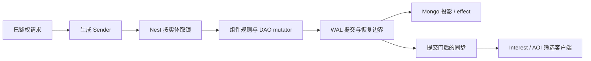

# SLG 框架接入与验收

本手册把 SLG 的主要业务路径映射到 core 的正式接口。验收对象是业务如何接入框架、事务和恢复保证是否成立；建筑数值、兵种、战斗规则、赛季政策和部署容量由游戏定义。下面的业务夹具只是验收样例：框架与生成器不包含任何 SLG 规则，生成器也不生成这些业务文件；完整的参考应用仍是 [game-demo](../../demo/README.md)。另一种游戏的独立手册见 [MMORPG](MMORPG-INTEGRATION.md)。

## 从哪里开始学习

先读[入门](../GETTING-STARTED.md)，再按“一个玩家建造 / 行军 → 两名玩家抢地 → 联盟 / 跨服 → 战斗与结算 → 恢复”的顺序实践。先明确哪些状态属于谁，再选框架模块：

| 概念 | 在 SLG 中表示什么 | 正确用法 |
| --- | --- | --- |
| Entity | 玩家、地块、联盟等有身份和生命周期的业务对象 | 存权威状态，是 Nest 取锁与事务的参与者 |
| DAO | 资源、队列、等级、归属、领奖事实和期限的持久字段 | 只在事务内用生成的 mutator 修改，不绕过跟踪直接改底层 map |
| Component | 对 DAO 的业务操作，如背包、城建、地图、计时 | 封装规则，不另存一份会与 DAO 分叉的权威状态 |
| Nest + Sender | 按实体调度，取锁、undo、提交与回复 | 端点鉴权后调用生成的 Sender；多实体一次传入全部已知参与者 |
| DataEngine + WAL | 持久提交、异步投影、恢复 | 分清内存完成、WAL durable 与 Mongo 可见，不用删 WAL 解决失败 |
| EntitySync + Interest | 把已可见状态发给有权观察的客户端 | AOI 是派生索引；客户端应用全量 / 增量，不反向决定服务器权威 |
| 实体定时器 | DAO 里的期限，加只索引已加载实体的 Driver | 资源与期限一起提交；离线补算由业务按 `Fire` 信息计算 |
| Service / Remote / Mirror / Saga | 邮件排行等独立服务、跨服实体读写、镜像与多步补偿 | 先选状态拥有者；Mirror 不授予写权，持实体锁期间不做远端 I/O |



提交门随 durability 与持久化装配工作，不是所有路径都“等 Mongo 落库后才回复”：`strict` 保证 WAL fsync，不保证回复时 Mongo 已投影（[DataEngine](guide/03-dataengine.md)）。

## 可运行的业务纵切

在仓库根目录使用 go.mod 声明的工具链，运行：

```bash
bash scripts/test-slg-generated.sh
```

脚本打印临时消费者目录，成功后删除，失败或设置 `ROOST_SLG_KEEP=1` 时保留。从 `game` 模板开始，经 CLI 添加 Player DAO、Player 持久定时器和 Tile 实体 / DAO；业务只修改 DAO 定义、回调与 handler，组件、访问器和 Sender 都由生成器生成。最后执行 race 行为用例、ID 检查和生成状态检查。

| 场景 | 业务选择 | 检查的框架契约 |
| --- | --- | --- |
| 建造 → 行军 → 抵达 | 一个建造队列，建造扣 10 金，2 秒完成后登记 5 秒行军；目标坐标限定在示例范围内 | 生成 Sender → Nest → DAO 与期限同事务；回调创建的下一阶段仍进入驱动索引 |
| 重放、取消与退款 | 目标建筑等级单调递增；已完成等级的重放不扣款；取消未完成节点只退款一次 | 重复调用不重复改变业务事实，取消的节点不再触发 |
| 独立研究队列 | 研究扣 5 金、3 秒完成，可与建造同时推进；目标等级重放不扣款 | 同一实体多个期限独立到期，不相互覆盖或提前触发 |
| 建造事务失败 | 业务返回错误，整次建造不成立 | 资源、待建节点、节点种子和提交后的驱动索引都回滚，不存在独立内存期限 |
| 离线资源产出 | 一次回调按 Deadline / Now / Interval 补算，最多补 10 期，库存上限 1000 | DAO 序列化重建后只补触发一次，之后从当前业务时间恢复周期；补算公式和上限由业务提供 |
| 两名玩家抢占同一地块 | Tile 在世界锁档，Player 在更高锁档；地块只能有一个拥有者，获胜者支付 1 金 | 多实体 Sender 和锁顺序；并发竞争只有一人获胜，归属与扣款一起提交，拥有者重放不再支付 |

上述数值是测试场景，不是公共框架规则。[业务文件与测试](../../scripts/testdata/slg/)使用正式生成的 DAO、组件、Sender、Nest 和定时器 Host。提交器是替身，离线恢复使用真实 DAO 的序列化 / 水合接口；它证明业务组合行为，文件 WAL fsync、Mongo 和跨进程恢复另由下面的真实依赖入口验收。

定时器回调只改自己已锁实体的 DAO、操作本实体定时器或记录 effect。需要交易、战斗结算等其他实体一起变化时，交给多实体 Nest handler；需要其他服务时，通过事务性 effect 或 Saga，不能在回调持锁期间同步做 I/O。

### 读生成工程

用 `ROOST_SLG_KEEP=1 bash scripts/test-slg-generated.sh` 保留工程，进入打印目录的 `project/`，按顺序读：

1. `db/def/player.go`、`db/def/tile.go`：玩家资源 / 等级 / 期限与地块拥有者分别存放，地块权威不放进 AOI。
2. `game/handler/slg_tasks.go`：handler 的窄接口、`rollback=undo durability=strict` 与多实体参数。
3. `game/entities/player/timer_handlers.go`：建造完成怎样登记下一段行军、研究怎样独立到期、离线收益怎样封顶。
4. `game/handler/syncsender/`：生成的 Sender 怎样把目标 ID 与业务参数交给 Nest；业务调用它，不手改生成文件。
5. `game/handler/slg_tasks_test.go`：并发抢地、取消重放、失败回滚、DAO 水合后的补触发。

业务源码在 [tasks.go.txt](../../scripts/testdata/slg/tasks.go.txt) 与 [timer_handlers.go.txt](../../scripts/testdata/slg/timer_handlers.go.txt)。调用生成接口的写法如下（放进保留的生成工程可直接编译；`client` 是当前服务的 Nest 客户端，EntityID 是完整 ID）：

```go
package slgflow

import (
	"context"

	syncsender "example.com/slg-practice/game/handler/syncsender"
	"github.com/tjbdwanghaibo/roost-core/framework/nest"
)

func buildResearchAndClaim(ctx context.Context, client nest.Client, playerEntityID, tileEntityID int64) (bool, error) {
	s := syncsender.NewSlgTasksSender(client)
	// 建造到 1 级，完工后向示例目的地 501 行军；返回实体内的定时器节点 ID。
	timerID, err := s.Sync_SLGStart(ctx, playerEntityID, 1, 501)
	if err != nil {
		return false, err
	}
	// 独立的研究队列，可与建造同时推进。
	if _, err := s.Sync_SLGResearch(ctx, playerEntityID, 1); err != nil {
		return false, err
	}
	// 取消建造；重复取消不重复退款。
	if _, err := s.Sync_SLGCancel(ctx, playerEntityID, timerID); err != nil {
		return false, err
	}
	// 玩家与 Tile 同一事务：只有拿到归属的一方支付，重放不再支付。
	return s.MultiSync_SLGClaimTile(ctx, playerEntityID, tileEntityID)
}
```

`timerID` 是实体内的定时器节点 ID，不是玩家 ID；路由用 `entity.BuildEntityID` 构造的完整 EntityID，不要把账号 ID、裸 PlayerID 与完整 EntityID 混用。

**建造完成为什么能接行军**：`handlerSLGStart` 在一个事务里检查等级 / 金币、扣款、登记建造节点。Tick handler 在同一实体的 Nest 锁和 undo 边界里执行回调；建造回调升级、清 pending、经 `NewTimer` 登记行军。这些操作共享当前 Tick 的调度视图，最外层收尾后报告下一期限，驱动据此继续投递；回调里 `Timer` / `Timers` 读的也是这份视图，刚登记的节点立即可见（[业务时间与实体定时器](guide/10-time.md#4-按实体的持久定时器)）。多队列不是多个后台 goroutine：建造、研究、行军是同一 Player DAO 里的不同节点、各自到期。离线实体不会被准点唤醒，重新加载后到期节点触发一次，`Fire.Now` / `Deadline` / `Interval` / `Overdue` 供业务补算（本例最多补 10 期）。

**抢地为什么必须是多实体事务**：`handlerSLGClaimTile(player, tile)` 检查地块空闲与玩家资源，然后同时改归属与扣款；竞争者看到已被占领时不扣款。锁顺序由 Nest 按参与者的分类确定（Tile 是 World，Player 在更高一档）。不要在持有玩家锁的 handler 里再发一个会倒序取地块锁的同步 Nest 请求；一次用多实体 Sender，或把跨服务流程拆成 Saga。

## 完整接入清单

| SLG 方向 | 接法与证据入口 | 业务仍需定义的内容 |
| --- | --- | --- |
| 登录、角色、断线与归属 | [玩家接入](PLAYER-ACCESS.md)，game-demo 的 account / EnterGame；真实凭据机器人与重连回归 | 渠道认证、区服开放与角色政策 |
| 城建、研究、行军与离线收益 | 上面的纵切；[业务时间与实体定时器](guide/10-time.md#4-按实体的持久定时器) | 队列、速度、消耗、加速、离线补算与库存上限 |
| 地图、领地竞争和兴趣同步 | Tile 竞争纵切；demo 地图 / Scene / terrain；[Block AOI](INTEREST-BLOCK-AOI.md) 与 [Sync](guide/04-sync.md) | 地块所有权、寻路限制、观察权限、战斗迷雾；空间索引不充当持久权威 |
| 联盟、跨实体交易与跨服结算 | demo Remote Guild；[Remote](guide/05-remote-mirror.md)、[Saga](guide/06-saga.md)；送礼的成功和补偿路径 | 联盟权限、名称唯一、成员上限、收件人路由和人工补偿政策 |
| 奖励、邮件、活动、排行与赛季 | demo 正式端点；通关计数与奖励同事务，排行提交累计快照；活动只在首次付款时贡献 | 奖励额度、活动窗口、赛季切换、补发政策；活动尽力贡献失败不自动补报是已接受取舍 |
| 商城、充值与资产到账 | demo platform → 玩家 grant → 账本，真实 Redis 交付回归 | 产品、支付校验、退款与资产规则；重复订单的业务语义 |
| 战斗、技能与配置 | demo Lockstep 机器人、技能目录编译；[技能 / 战斗](guide/08-skill.md)、[配置热更](guide/07-config.md) | SLG 战斗算法、兵种和技能 Host、版本钉住与数值平衡；帧同步和状态同步按实际玩法选择 |
| 持久化、恢复、搬服和运维 | 下面三套真实生成工程脚本；[schema](SCHEMA-MIGRATION.md)、[搬服](PLAYER-MIGRATION.md)、readiness / metrics / admin | 恢复目标、部署容量、监控接收、跨机与生产操作流程 |

对应的 demo 源码入口：联盟 [Guild](../../demo/game/entities/guild/)；跨服赠礼 [gift_item saga](../../demo/saga/gift_item/)；副本与排行 [FinishDungeon](../../demo/game/controllers/player/finish_dungeon.go.tmpl) / [ClaimDungeon](../../demo/game/handler/claim_dungeon.go.tmpl)；邮件 [ClaimMail](../../demo/game/controllers/player/claim_mail.go.tmpl) / [ClaimMailReward](../../demo/game/handler/claim_mail_reward.go.tmpl)；充值 [GrantPurchase](../../demo/game/handler/grant_purchase.go.tmpl) 与 [platform](../../demo/internal/service/platform/)；装备 [EquipItem](../../demo/game/handler/equip_item.go.tmpl)；世界事件 [World 定时组件](../../demo/game/entities/world/timer_component.go.tmpl) 与[活动接线](../../demo/internal/service/game/activity.go.tmpl)（手写接入 `entitytimer`，基础 `game` 工程用 `roost add timer`）。技能可单独入门：进入 `gameplay/skill/examples`（独立模块）运行 `go run ./fireball`，沿 Parse → Compile → Host → Runtime 阅读；该例用 MemoryHost，不代表持久化的战斗 Host 已接进 Nest 回滚。

业务命名、经济和战斗等规则缺少默认实现不自动构成框架缺陷。合法接口调用下出现丢期限、错误取消、重复提交、状态越权或生成物编译失败，则应在公共实现或 demo 接法中修复。维护者已明确接受的离线实体不被定时器准点唤醒、Remote 定时器不支持等边界，见 [已知限制](../maintenance/KNOWN-LIMITS.md)。

## 真实依赖与恢复验收

先按[隔离环境说明](../../wiring/scripts/integration/README.md)准备独立资源并设置脚本要求的地址变量，再运行：

```bash
bash scripts/test-demo-generated.sh
bash scripts/test-dataengine-generated.sh
bash scripts/test-remote-generated.sh
```

第一套覆盖正式 demo 的 Mongo 发号恢复、schema 迁移、Redis 交付、排行和活动榜、独立 Gate 消费者；第二套经正式 DAO / Entity / Nest 与文件 WAL / Mongo 跑三个进程阶段；第三套覆盖 Remote 的正式提交和 Mirror 接法。D12 新增消费者另有 `TestRealStepsRunNativeAndMongoStepsThroughTheMods` 与 `TestRealSubscribeEffectsDeliversEachEffectOnce`（integration 标签，需要真实 Mongo 和三节点 NATS JetStream）。每条脚本和测试必须检查退出状态、实际执行及 skip，不把编译或未开门变量算作功能通过。

完整 demo 场景用 `go run ./cmd/loadtest -count 4`（在新生成消费者中，依实际地址传 `-endpoint`、`-account-nats`）。它覆盖多条服务链，但不替代上面的建造 / 行军纵切，也不等同于所有 SLG 规则和部署规模均已验证。

本机功能、Cluster、跨机故障和长稳分别给结论；数据中心断电、跨机网络分区、目标规模或客户端引擎缺少实际证据时，继续保留为未验收项。当前执行结果在 [KNOWN-LIMITS](../maintenance/KNOWN-LIMITS.md) 维护，不为每一轮另建报告。

练习：在现有 handler 里加“加速建造但不能重复扣加速道具”，或“一个地块同时只能被一个联盟驻守”。先写清拥有者、幂等身份、事务参与者、取消和恢复语义，再选 Nest / 定时器 / Saga，不另设计一套与框架平行的持久或并发状态机。
