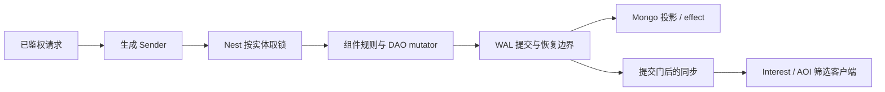

# SLG 场景到 core 框架：学习与接入手册

本手册把 SLG 的主要业务路径映射到 core 的正式接口。验收对象是业务如何接入框架、事务和恢复保证是否成立；建筑数值、兵种、战斗规则、赛季政策和部署容量由游戏定义。下面的业务夹具只是验收样例：框架与生成器不包含任何 SLG 规则，生成器也不生成这些业务文件；完整的参考应用仍是 [game-demo](../../demo/README.md)。

## 从哪里开始学习

适合准备使用 core 做 SLG 的后端工程师。先读[入门](../GETTING-STARTED.md)，再按“一个玩家建造 / 行军 → 两名玩家抢地 → 联盟 / 跨服 → 战斗与结算 → 恢复”的顺序实践。主仓库是 core，ssr 仅供业务思想对照，不能把旧 API 或旧并发假设直接移植过来。另一种游戏的独立手册见 [MMORPG](MMORPG-INTEGRATION.md)。

先明确哪些状态属于谁，再选择框架模块：

| 概念 | 在 SLG 中表示什么 | 正确用法 |
| --- | --- | --- |
| Entity | 玩家、地块、联盟等有身份和生命周期的业务对象 | 存权威状态，成为 Nest 取锁与事务参与者 |
| DAO | 资源、队列、等级、归属、领奖事实和期限的持久字段 | 只在合法事务内用生成 mutator 修改；不暴露可写底层 map 绕过跟踪 |
| Component | 对 DAO 的业务操作，如背包、城建、地图、计时 | 封装规则，不另存一份可与 DAO 分叉的权威状态 |
| Nest + Sender | 按实体调度，明确取锁、undo、提交与回复 | 端点鉴权后调用生成 Sender；多实体一次传入全部已知参与者 |
| DataEngine + WAL | 持久提交、异步投影、恢复与屏障 | 分清内存完成、WAL durable 与 Mongo 可见，不用删 WAL 解决失败 |
| EntitySync + Interest | 把已可见状态发给有权观察的客户端 | AOI 是派生索引；客户端应用全量 / 增量，不能反向决定服务器权威 |
| Entity timer | DAO 中保存的期限，加仅索引已加载实体的 Driver | 资源与定时任务一起提交；离线补算由业务按 Fire 信息计算 |
| Service / Remote / Mirror / Saga | 邮件排行等独立服务、跨服实体读写、镜像与多步补偿 | 先选状态拥有者；Mirror 不授予写权，持实体锁期间不做远端 I/O |



图中的提交门依当前 durability、watermark 与持久化装配工作，不能把所有路径都理解成“等待 Mongo 后才回复”。`strict` 保证 WAL durable，不保证回复时 Mongo 已投影。

## 可运行的业务纵切

在仓库根目录使用 go.mod 声明的工具链，运行：

```bash
bash scripts/test-slg-generated.sh
```

脚本打印临时消费者目录，成功后删除，失败或设置 `ROOST_SLG_KEEP=1` 时保留。从 `game` 模板开始，经 CLI 添加 Player DAO、Player 持久定时器和 Tile 实体 / DAO；业务只修改 DAO 定义、回调与 handler，组件、访问器和 Sender 都由生成器生成。最后执行 race 行为用例、ID 检查和生成状态检查。

| 场景 | 业务选择 | 检查的框架契约 |
| --- | --- | --- |
| 建造 → 行军 → 抵达 | 一个建造队列，建造扣 10 金，2 秒完成后登记 5 秒行军；目标坐标限定在示例范围内 | 生成 Sender → Nest → DAO 与期限同事务；回调创建的下一阶段仍进入驱动索引 |
| 重放、取消与退款 | 目标建筑等级单调递增；已完成等级的重放不扣款；取消未完成节点只退款一次 | 重复调用不重复改变业务事实，取消的节点不再触发 |
| 独立研究队列 | 研究扣 5 金、3 秒完成，可与建造同时推进；目标等级重放不扣款 | 同一实体多个期限独立到期，不相互覆盖或提前触发 |
| 建造事务失败 | 业务返回错误，整次建造不成立 | 资源、待建节点、节点种子和提交后的驱动索引都回滚，不存在独立内存期限 |
| 离线资源产出 | 一次回调按 Deadline / Now / Interval 补算，最多补 10 期，库存上限 1000 | DAO 序列化重建后只补触发一次，之后从当前业务时间恢复周期；补算公式和上限由业务提供 |
| 两名玩家抢占同一地块 | Tile 在世界锁档，Player 在更高锁档；地块只能有一个拥有者，获胜者支付 1 金 | 多实体 Sender 和锁顺序；并发竞争只有一人获胜，归属与扣款一起提交，拥有者重放不再支付 |

上述数值是测试场景，不是公共框架规则。[业务文件与测试](../../scripts/testdata/slg/)使用正式生成的 DAO、组件、Sender、Nest 和定时器 Host。提交器是替身，离线恢复使用真实 DAO 的序列化 / 水合接口；它证明业务组合行为，文件 WAL fsync、Mongo 和跨进程恢复另由下面的真实依赖入口验收。

定时器回调只改自己已锁实体的 DAO、操作本实体定时器或记录 effect。需要交易、战斗结算等其他实体一起变化时，交给多实体 Nest handler；需要其他服务时，通过事务性 effect 或 Saga，不能在回调持锁期间同步做 I/O。

## 建造、行军与抢地：如何使用

先运行上面的脚本。需要阅读生成代码时，用 `ROOST_SLG_KEEP=1 bash scripts/test-slg-generated.sh`，然后进入打印目录的 `project/`。按以下顺序阅读：

1. `db/def/player.go` 与 `db/def/tile.go`：分别存玩家资源 / 等级 / 期限和地块拥有者，不把地块权威塞进 AOI。
2. `game/handler/slg_tasks.go`：业务 handler 的窄接口、`rollback=undo durability=strict` 与多实体参数。
3. `game/entities/player/timer_handlers.go`：建造完成怎样登记下一段行军，研究怎样独立到期，离线收益怎样封顶。
4. `game/handler/syncsender/`：生成 Sender 如何把目标 ID 与业务参数发给 Nest；业务调用它，不手改生成文件。
5. `game/handler/slg_tasks_test.go`：并发抢同一地块、取消重放、失败回滚、DAO 水合后的补触发。

[实际业务源码](../../scripts/testdata/slg/tasks.go.txt)和[定时回调](../../scripts/testdata/slg/timer_handlers.go.txt)是学习主线。下面是这些已生成接口的调用片段，ctx、client 与完整 EntityID 由当前服务提供，不是独立可运行的 main：

```go
s := syncsender.NewSlgTasksSender(client)
// 建造目标等级 1，完工后向示例目的地 501 行军。
timerID, err := s.Sync_SLGStart(ctx, playerEntityID, 1, 501)
// 单独的研究队列，可与建造同时推进。
researchID, err := s.Sync_SLGResearch(ctx, playerEntityID, 1)
// 重复取消不能重复退款。
cancelled, err := s.Sync_SLGCancel(ctx, playerEntityID, timerID)
// 玩家和 Tile 同一事务：只有获得归属者支付，重复请求不再支付。
won, err := s.MultiSync_SLGClaimTile(ctx, playerEntityID, tileEntityID)
```

这里的 `timerID` 是实体内节点 ID，不是玩家 ID；路由使用 `entity.BuildEntityID` 构造的完整 EntityID，不能把账号 ID、裸 PlayerID、完整 EntityID 混用。示例中的临时变量只是展示调用方式，错误应由实际业务逐次处理。

### 建造完成为什么能接行军

`handlerSLGStart` 在同一事务中检查等级 / 金币、扣款、创建期限、登记 pending 节点。Tick handler 在同一实体的 Nest 锁和 undo 边界执行 Host 回调。建造回调升等级、清 pending、调用 `NewTimer` 登记行军；Host 在当前 Tick 栈内共享调度视图，最外层落定后报告下一期限，Driver 才能继续投递。回调中新建节点尚未落定时，`Timer / Timers` 仍是 DAO 视图，需要新 ID 时使用 `NewTimer` 返回值。

多队列不是多个后台 goroutine：建造、研究和行军是同一 Player DAO 中不同节点，各自独立期限。离线实体不会被准点唤醒；重新加载后到期节点触发一次。`Fire.Now / Deadline / Interval / Overdue` 给业务做补算，本例限制最多补 10 期。重复触发、加速 / 取消的退款政策必须由业务状态机约束。

### 抢地为什么必须是多实体事务

`handlerSLGClaimTile(player, tile)` 检查地块空闲、玩家资源，然后同时改归属与扣款；竞争者看到已被占领时不扣款。Tile 是 World 锁档，Player 在更高锁档，实际锁顺序由 Nest 按参与者确定。不要在拿住玩家锁后另起一个会倒序取地块锁的同步 Nest 请求；应一次使用多实体 Sender，或把跨服务流程拆成 Saga。

## 更多 SLG 路线的框架接法

| 业务路线 | 从哪个源码学习 | 使用方式与边界 |
| --- | --- | --- |
| 地图、寻路与行军可见性 | [Map 组件](../../demo/game/entities/player/map_component.go.tmpl)、[地图 runtime](../../demo/game/scene/runtime/)与 [Block AOI](INTEREST-BLOCK-AOI.md) | 位置 / 行军事实存 DAO；地形验证与兴趣索引分开，战争迷雾、侦察和联盟视野由业务授权 |
| 联盟、公会与跨服观察 | [Guild 组件](../../demo/game/entities/guild/)、[Remote 指南](guide/05-remote-mirror.md) | 联盟写走正式 owner / lease / fence；Mirror 只读快照，不能先看镜像再直接本地写 |
| 多人协作、交易与跨服赠礼 | [gift Saga](../../demo/saga/gift_item/)、[Saga 指南](guide/06-saga.md) | 同进程已知实体可用多实体 Nest；跨服务用原生步骤 / effect，失败补偿，结果未知按身份查询 |
| 联盟活动与世界事件 | [World 定时组件](../../demo/game/entities/world/timer_component.go.tmpl)、[活动服务接线](../../demo/internal/service/game/activity.go.tmpl) | World 参考实现手写接入 `entitytimer.Host / Driver`；基础 game 工程也可 `roost add timer --entity Player`。两者不要求把 demo 业务搬入生成器 |
| 副本、赛季奖励与排行 | [ClaimDungeon](../../demo/game/handler/claim_dungeon.go.tmpl)、[FinishDungeon](../../demo/game/controllers/player/finish_dungeon.go.tmpl) | 通关账本、奖励与每赛季累计次数同事务；排行用累计快照 `UpdateMax`，不是无限依赖短期去重环做增量 |
| 活动贡献与结算榜 | [活动接线](../../demo/internal/service/game/activity.go.tmpl) | 只在首次真实付款时贡献；活动失败不自动补报是已接受取舍，不能借重放把旧奖励贡献到新窗口 |
| 邮件与补偿资产 | [ClaimMail](../../demo/game/controllers/player/claim_mail.go.tmpl)、[ClaimMailReward](../../demo/game/handler/claim_mail_reward.go.tmpl) | 服务预留、玩家侧幂等奖励、服务提交是多阶段；玩家侧长期领取事实覆盖重放窗口 |
| 商城、充值与支付重试 | [GrantPurchase](../../demo/game/handler/grant_purchase.go.tmpl)、[platform](../../demo/internal/service/platform/) | 渠道订单身份与到账账本同事务；支付签名、商品、退款和审计是业务规则 |
| 装备、成长与配置 | [EquipItem](../../demo/game/handler/equip_item.go.tmpl)、[configdata](guide/07-config.md) | 装备从背包移入槽位、旧件归还与属性刷新同事务；长周期任务如何钉住配置版本需明确定义 |
| 战斗、技能与回放 | [技能指南](guide/08-skill.md)、[Lockstep 与客户端](guide/04-sync.md) | SLG 可按需求选状态同步、独立战斗计算或帧同步；兵种 / 战斗算法 / Host 不由框架预设 |
| 聊天、匹配与 session | [服务指南](guide/09-services.md)、[demo 机器人](../../demo/loadtest/scenarios/demo.yaml.tmpl) | 使用服务声明和正式客户端，按业务选择世界 / 联盟频道及战斗匹配；不为“使用全部框架”强行拼装互斥模式 |
| 运维、恢复和搬服 | [DataEngine](guide/03-dataengine.md)、[schema](SCHEMA-MIGRATION.md)、[按 sid 搬服](PLAYER-MIGRATION.md) | 先排空并核对 WAL / 投影，再切机器或 schema；readiness、业务指标与外部告警接收分别验收 |

技能模块可以单独入门：在仓库的 `gameplay/skill/examples` 目录运行 `go run ./fireball`，沿 Parse → Compile → Host → Runtime → Advance 阅读。该例使用 MemoryHost，证明技能计算流程，不代表已经把一个持久化 SLG 战斗 Host 接进 Nest 回滚。

## 完整接入清单

| SLG 方向 | 接法与证据入口 | 业务仍需定义的内容 |
| --- | --- | --- |
| 登录、角色、断线与归属 | [玩家接入](PLAYER-ACCESS.md)，game-demo 的 account / EnterGame；真实凭据机器人与重连回归 | 渠道认证、区服开放与角色政策 |
| 城建、研究、行军与离线收益 | 上面的纵切；[业务时间与实体定时器](guide/10-time.md#4-按实体的持久定时器) | 队列、速度、消耗、加速、离线补算与库存上限 |
| 地图、领地竞争和兴趣同步 | Tile 竞争纵切；demo 地图 / Scene / terrain；[Block AOI](INTEREST-BLOCK-AOI.md) 与 [Sync](guide/04-sync.md) | 地块所有权、寻路限制、观察权限、战斗迷雾；空间索引不充当持久权威 |
| 联盟、跨实体交易与跨服结算 | demo Remote Guild；[Remote](guide/05-remote-mirror.md)、[Saga](guide/06-saga.md)；送礼的成功和补偿路径 | 联盟权限、名称唯一、成员上限、收件人路由和人工补偿政策 |
| 奖励、邮件、活动、排行与赛季 | demo 正式端点；通关计数与奖励同事务，排行提交累计快照；活动只在首次付款时贡献 | 奖励额度、活动窗口、赛季切换、补发政策；活动尽力贡献失败不自动补报是已接受取舍 |
| 商城、充值与资产到账 | demo platform → 玩家 grant → 账本，真实 Redis 交付回归 | 产品、支付校验、退款与资产规则；重复订单的业务语义 |
| 战斗、技能与配置 | demo Lockstep 机器人、技能目录编译；[技能 / 战斗](guide/08-skill.md)、[配置热更](guide/07-config.md) | SLG 战斗算法、兵种和技能 Host、版本钉住与数值平衡；帧同步和状态同步按实际玩法选择 |
| 持久化、恢复、搬服和运维 | 下面三套真实生成工程脚本；[schema](SCHEMA-MIGRATION.md)、[搬服](PLAYER-MIGRATION.md)、readiness / metrics / admin | 恢复目标、部署容量、监控接收、跨机与生产操作流程 |

业务命名、经济和战斗等规则缺少默认实现不自动构成框架缺陷。合法接口调用下出现丢期限、错误取消、重复提交、状态越权或生成物编译失败，则应在公共实现或 demo 接法中修复。维护者已明确接受的离线实体不被定时器准点唤醒、Remote 定时器不支持等边界，见 [已知限制](../maintenance/KNOWN-LIMITS.md)。

## 真实依赖与恢复验收

先按[隔离环境说明](../../wiring/scripts/integration/README.md)准备独立资源并设置脚本要求的地址变量，再运行：

```bash
bash scripts/test-demo-generated.sh
bash scripts/test-dataengine-generated.sh
bash scripts/test-remote-generated.sh
```

第一套覆盖正式 demo 的 Mongo 发号恢复、schema 迁移、Redis 交付、排行和活动榜、独立 Gate 消费者；第二套经正式 DAO / Entity / Nest 与文件 WAL / Mongo 跑三个进程阶段；第三套覆盖 Remote 的正式提交和 Mirror 接法。D12 新增消费者另有 `TestRealStepsRunNativeAndMongoStepsThroughTheMods` 与 `TestRealSubscribeEffectsDeliversEachEffectOnce`（integration 标签，需要真实 Mongo 和三节点 NATS JetStream）。每条脚本和测试必须检查退出状态、实际执行及 skip，不把编译或未开门变量算作功能通过。

完整 demo 场景用 `go run ./cmd/loadtest -count 4`（在新生成消费者中，依实际地址传 `-endpoint`、`-account-nats`）。它覆盖多条服务链，但不替代上面的建造 / 行军纵切，也不等同于所有 SLG 规则和部署规模均已验证。

本机功能、Cluster、跨机故障和长稳分别给结论；数据中心断电、跨机网络分区、目标规模或客户端引擎缺少实际证据时，继续保留为未验收项。当前执行结果在 [KNOWN-LIMITS](../maintenance/KNOWN-LIMITS.md) 维护，不为每一轮另建报告。

## 从已修复问题学到的接入原则

| 真实实践遇到的问题 | 当前接法与学习结论 |
| --- | --- |
| 定时回调新建下一阶段后，DAO 有节点但驱动丢期限 | Host 当前 Tick 必须共享调度视图；业务无需绕开组件 API，观察 DAO 与调度索引两端才发现此类缺陷 |
| handler 的 `id / ctx / handlerName…` 参数使 Sender 编译失败 | 参数名合法时由生成器避让路由名 / 局部名；改名候选也要避让真实 handler 常量。优先正式生成、编译消费者发现契约缺口 |
| 多次通关超过短期请求环后，重放又加排行分 | 玩家持久事实负责是否已领奖，排行接收累计快照；服务请求环不保证无限期幂等 |
| 旧活动贡献回复覆盖新累计分 | 累计榜写入要单调；业务窗口与排行榜窗口应核对，不能只测顺序调用 |
| 慢连接测试偶发不关闭，或健康连接也被挤掉 | 按实际消费和队列压力建立夹具，不假定某个固定字节数必填满内核缓冲；测试稳定性与运行时缺陷分开 |

这些是学习用的已修复案例，不是当前仍开放的问题列表。现状与证据在 [KNOWN-LIMITS](../maintenance/KNOWN-LIMITS.md)，框架合同以当前源码和指南为准。

推荐练习：在现有 handler 中加入“加速建造但不能重复扣加速道具”，或“一个地块只能同时被一个联盟驻守”。先写清拥有者、幂等身份、事务参与者、取消和恢复语义，再选择 Nest / timer / Saga，避免先设计一套与框架平行的持久或并发状态机。
