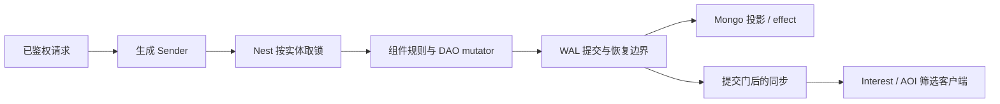

# SLG 框架学习与验收

本手册把 SLG 的主要业务路径映射到 core 的正式接口，分两部分：**第一部分“学习”**讲框架怎么用、为什么这样设计，按建造、行军、抢地等场景给出阅读顺序与可编译的调用示例；**第二部分“验收”**说明每个脚本证明什么、不证明什么。建筑数值、兵种、战斗规则、赛季政策和部署容量由游戏定义。下面的业务夹具只是学习和验收样例：框架与生成器不包含任何 SLG 规则，生成器也不生成这些业务文件；完整的参考应用仍是 [game-demo](../../demo/README.md)。另一种游戏的独立手册见 [MMORPG](MMORPG-INTEGRATION.md)。

## 第一部分：学习

### 专题优先级：跨服、视野、活动

SLG 的重点学习路线固定为这三条线。基础建造、行军和抢地提供事务入门，后续应向“跨服联盟活动／国战”串联，业务规则未定义的部分先作为待实现示例，不把框架模块存在当作玩法已经完成。

| 专题与 SLG 场景 | 首先追到的权威和正式接口 | 必须解释与验证 |
| --- | --- | --- |
| 跨服联盟／国战 | Player 留在原 sid；联盟等跨服实体走 [Remote／Mirror](guide/05-remote-mirror.md)；原服扣费与奖励协作用 [Saga](guide/06-saga.md) | 哪个进程能写、旧 owner 如何被 fence 拒绝；失败补偿与结果未知查询；Mirror 陈旧时不能据快照越权写；重复消息不重复扣兵／发奖 |
| 战争迷雾／侦察／联盟视野 | 权威位置／权限在业务 DAO；[SpatialComponent／Interest](INTEREST-BLOCK-AOI.md) 管空间事实和来源；Sync Profile 控制字段 | 空间候选不等于侦察权限；联盟退出撤销关系来源；一处观察撤销而其他来源仍命中时保留对象；最后来源消失才退订；不可见单位的敏感字段不能先下发再由客户端隐藏 |
| 赛季／联盟活动／跨服积分 | 本服 World 持久 timer → [ActivityRunner](../../demo/internal/service/game/activity.go.tmpl) → [activity 协调器](../../service/activity/) → 原服结算 | 窗口身份、参与服集合、阶段推进、贡献身份、累计榜乱序、结算确认、邮件与最终领奖分别何时完成；服离线、重启和人工补发怎样收口 |

**跨服学习顺序**：先标明每个状态的 owner sid，再读 Remote 正式写与 Mirror 读取；之后从 [gift_item](../../demo/saga/gift_item/) 学原服事务与跨服 Saga。`scripts/test-remote-generated.sh` 验证 Remote 路径，[MMO 双 sid 赠礼](MMORPG-INTEGRATION.md#13-双-sid-跨服赠礼)验证另一条实际多进程协作路径，两者不能互相代替。下一步 SLG 专题是把联盟权限、战场参与身份和原服奖励接到同一个业务流程；当前赠礼证据不证明国战权威或跨机故障已完成。

**视野学习顺序**：权威位置／权限 → 空间候选 → spatial／block／team 等来源归并 → Profile 字段白名单 → 提交后发布 → 客户端 Full／增量。`SpatialComponent.MoveWithObservedBlocks` 可表达“位置唯一、额外多块被观察”，本身不实现战争迷雾。重点读 [interest_test](../../framework/sync/entitysync/policy/interest_test.go) 的来源交接、回滚和发布屏障测试，再运行 `ROOST_NEST_GAME_RACE=1 bash scripts/perf/nest-game.sh --check-spatial` 学正式生成 DAO 接法。联盟情报共享的授权、撤销和额外扇出仍需 SLG 业务纵切，不能拿普通 AOI 半径测试替代。

**活动学习顺序**：

1. 从配置活动组与业务时钟确定窗口，用 `ActivityRunner.openWindow` 调用 `OpenActivity`；expected 集合根据该组与 App singleton 的存活查询取得。不能把路由分组当作每个服此刻在线的证明。
2. 本服 World 的持久期限经 `NotifyPhaseDue` 通知协调器。协调器不靠自身时钟启动业务阶段；某服通知后才启动聚合／宽限流程，具体见 [activity/types.go](../../service/activity/types.go)。
3. 业务成功事实形成稳定贡献身份，经 `Contribute` 上报；核对活动窗口，榜单保留较大累计值。demo 的尽力贡献失败不自动补报是既有取舍，正式赛季若要求不漏计，需要业务持久意图和重试，不能用重新执行领奖来补贡献。
4. `AttemptDispatch` 取得结算投递，`settle` 按原身份发送奖励邮件，再 `AckDispatch`。投递确认不等于玩家已领取；永久到账还需邮件／Player 的幂等事实，有限服务去重窗口不能代替永久账本。
5. 故障练习至少包括重复与跨窗贡献、晚到累计值、一个服未通知、结算投递中断、发邮件成功但确认丢失、玩家重复领取。重开投递、排除失联目标或补发应有明确业务授权和审计，不能默认删除账本重跑。

现有证据分层：通用 AOI／Remote／activity 模块有对应测试，demo 有活动榜及结算接法；§11 列真实资源入口。**跨服国战＋联盟迷雾＋赛季结算的联合消费者尚未在本手册验收**。接下来优先把该链路作为专题补齐，分别记录源码核对、实际运行与待验证状态。


### 1. 适合谁、先读什么

适合准备用 core 做 SLG 的后端工程师。先读[入门](../GETTING-STARTED.md)，再按“一个玩家建造 / 行军 → 两名玩家抢地 → 联盟 / 跨服 → 战斗与结算 → 恢复”的顺序实践：前两步有可运行的生成工程（§3～§5），后面几步从 game-demo 的现成接法学（§7）。

### 2. 模块分工：先分清状态归谁

先明确哪些状态属于谁，再选框架模块：

| 概念 | 在 SLG 中表示什么 | 正确用法 |
| --- | --- | --- |
| Entity | 玩家、地块、联盟等有身份和生命周期的业务对象 | 存权威状态，是 Nest 取锁与事务的参与者 |
| DAO | 资源、队列、等级、归属、领奖事实和期限的持久字段 | 只在事务内用生成的 mutator 修改，不暴露可写的底层 map 绕过脏跟踪 |
| Component | 对 DAO 的业务操作，如背包、城建、地图、计时 | 封装规则，不另存一份会与 DAO 分叉的权威状态 |
| Nest + Sender | 按实体调度，取锁、undo、提交与回复 | 端点鉴权后调用生成的 Sender；多实体一次传入全部已知参与者 |
| DataEngine + WAL | 持久提交、异步投影、恢复与屏障 | 分清内存完成、WAL durable 与 Mongo 可见，不用删 WAL 解决失败 |
| EntitySync + Interest | 把已可见状态发给有权观察的客户端 | AOI 是派生索引；客户端应用全量 / 增量，不能反向决定服务器权威 |
| 实体定时器（Entity timer） | DAO 里保存的期限，加一个只索引已加载实体的 Driver | 资源与期限在同一事务提交；离线补算由业务按 `Fire` 信息计算 |
| Service / Remote / Mirror / Saga | 邮件排行等独立服务、跨服实体读写、镜像与多步补偿 | 先选状态拥有者；Mirror 不授予写权，持实体锁期间不做远端 I/O |



图中的提交门随 durability、watermark 与持久化装配工作，不能理解成所有路径都“等 Mongo 落库后才回复”：`strict` 保证 WAL fsync，不保证回复时 Mongo 已投影（[DataEngine](guide/03-dataengine.md)）。

### 3. 建造、行军与抢地：如何使用

#### 3.1 生成工程从哪来

在仓库根目录使用 go.mod 声明的工具链运行：

```bash
ROOST_SLG_KEEP=1 bash scripts/test-slg-generated.sh   # 保留生成工程以便阅读；不加 KEEP 时成功即删除
```

脚本打印临时目录，生成工程在其中的 `project/`。它做的事就是一个新工程的接入步骤：

1. `roost project new slg-practice -module example.com/slg-practice -template game`；
2. `roost add dao Player --entity Player`、`roost add timer --entity Player`、`roost add entity Tile`、`roost add dao Tile --entity Tile`；
3. 业务只改这几处：在 `db/def/player.go`、`db/def/tile.go` 填 DAO 字段；把 `game/entities/tile/entity.go` 注解里的 `category=entity.EntityCategoryOther` 改为 `category=entity.EntityCategoryWorld`（地块是被许多玩家争用的世界对象，锁序要低于 Player）；写定时器回调 `game/entities/player/timer_handlers.go` 与 handler `game/handler/slg_tasks.go`；
4. `roost generate` 生成组件、访问器和 Sender，不手改生成文件。

#### 3.2 阅读顺序

进入 `project/` 后按顺序读：

1. `db/def/player.go`、`db/def/tile.go`：玩家资源 / 等级 / 期限与地块拥有者分别存放，地块权威不放进 AOI。
2. `game/handler/slg_tasks.go`：业务 handler 的窄接口（只声明要用的 `Dao()` / `TimerComp()`）、`rollback=undo durability=strict` 标记与多实体参数。
3. `game/entities/player/timer_handlers.go`：建造完成怎样登记下一段行军、研究怎样独立到期、离线收益怎样封顶。
4. `game/handler/syncsender/`：生成的 Sender 怎样把目标 ID 与业务参数交给 Nest；业务调用它，不手改。
5. `game/handler/slg_tasks_test.go`：并发抢同一地块、取消重放、失败回滚、DAO 水合后的补触发。

[实际业务源码](../../scripts/testdata/slg/tasks.go.txt)和[定时回调](../../scripts/testdata/slg/timer_handlers.go.txt)是学习主线。

#### 3.3 用 Sender 调用

下面的文件放进保留的生成工程（例如 `internal/slgflow/flow.go`）可直接编译；`client` 是当前服务的 Nest 客户端，EntityID 是完整 ID：

```go
package slgflow

import (
	"context"

	syncsender "example.com/slg-practice/game/handler/syncsender"
	"github.com/tjbdwanghaibo/roost-core/framework/nest"
)

func buildResearchAndClaim(ctx context.Context, client nest.Client, playerEntityID, tileEntityID int64) (bool, error) {
	s := syncsender.NewSlgTasksSender(client)
	// 建造到 1 级，完工后向示例目的地 501 行军；返回实体内的定时器节点 ID。
	timerID, err := s.Sync_SLGStart(ctx, playerEntityID, 1, 501)
	if err != nil {
		return false, err
	}
	// 独立的研究队列，可与建造同时推进。
	if _, err := s.Sync_SLGResearch(ctx, playerEntityID, 1); err != nil {
		return false, err
	}
	// 取消建造；重复取消不重复退款。
	if _, err := s.Sync_SLGCancel(ctx, playerEntityID, timerID); err != nil {
		return false, err
	}
	// 玩家与 Tile 同一事务：只有拿到归属的一方支付，重放不再支付。
	return s.MultiSync_SLGClaimTile(ctx, playerEntityID, tileEntityID)
}
```

`timerID` 是实体内的定时器节点 ID，不是玩家 ID；路由用 `entity.BuildEntityID` 构造的完整 EntityID，不要把账号 ID、裸 PlayerID 与完整 EntityID 混用。每次调用的错误都要按业务逐次处理，示例只演示调用方式。

#### 3.4 六个场景各学什么

| 场景 | 业务选择 | 学到的框架契约 |
| --- | --- | --- |
| 建造 → 行军 → 抵达 | 一个建造队列，建造扣 10 金，2 秒完成后登记 5 秒行军；目标坐标限定在示例范围内 | 生成 Sender → Nest → DAO 与期限同事务；回调创建的下一阶段仍进入驱动索引 |
| 重放、取消与退款 | 目标建筑等级单调递增；已完成等级的重放不扣款；取消未完成节点只退款一次 | 重复调用不重复改变业务事实，取消的节点不再触发 |
| 独立研究队列 | 研究扣 5 金、3 秒完成，可与建造同时推进；目标等级重放不扣款 | 同一实体多个期限独立到期，不相互覆盖或提前触发 |
| 建造事务失败 | 业务返回错误，整次建造不成立 | 资源、待建节点、节点种子和提交后的驱动索引都回滚，不存在独立的内存期限 |
| 离线资源产出 | 一次回调按 Deadline / Now / Interval 补算，最多补 10 期，库存上限 1000 | DAO 序列化重建后只补触发一次，之后从当前业务时间恢复周期；补算公式和上限由业务提供 |
| 两名玩家抢占同一地块 | Tile 在 World 锁档，Player 在更高锁档；地块只能有一个拥有者，获胜者支付 1 金 | 多实体 Sender 和锁顺序；并发竞争只有一人获胜，归属与扣款一起提交，拥有者重放不再支付 |

上述数值是样例，不是公共框架规则。这些场景实际证明到哪一步见 §10。

### 4. 建造完成为什么能接行军

`handlerSLGStart` 在一个事务里检查等级 / 金币、扣款、用 `NewTimer` 创建建造期限、把节点 ID 记为 pending。扣款、pending 和期限节点都是 Player DAO 的字段，所以要么一起提交，要么一起回滚——不存在“钱扣了、期限没登记”的中间态。

到期后，驱动给这个 Player 投递生成的 Tick 消息；Tick handler 在同一实体的 Nest 锁和 undo 边界里执行 Host 回调。建造回调升级、清 pending、再经 `NewTimer` 登记行军。这些回调内操作共享当前 Tick 的调度视图：内层操作不各自报告，最外层 Tick 收尾后才报告一次新的最早期限，驱动据此继续投递，所以行军这一阶段不会被外层的旧报告覆盖。回调里 `Timer` / `Timers` 读的也是这份视图，刚登记的节点立即可见，“没有就建一个”不会在一次 Tick 内重复登记；回调之外读 DAO（[业务时间与实体定时器](guide/10-time.md#4-按实体的持久定时器)，实现契约见 [impl/10-time §2A](impl/10-time.md#2a-按实体的持久定时器驱动)）。

多队列不是多个后台 goroutine：建造、研究和行军是同一 Player DAO 里的不同节点，各自有独立期限。离线实体不会被准点唤醒，重新加载后到期节点只触发一次；`Fire.Now` / `Deadline` / `Interval` / `Overdue` 给业务做补算，本例最多补 10 期。重复触发、加速 / 取消的退款政策要由业务状态机约束（本例用目标等级和 pending 节点 ID 做幂等事实）。

### 5. 抢地为什么必须是多实体事务

`handlerSLGClaimTile(player, tile)` 先检查地块是否空闲与玩家资源，然后同时改归属与扣款；竞争者看到已被占领时不扣款，已是拥有者的重放直接返回成功。归属和扣款必须同一事务：分两次请求时，任何一次失败或重放都会留下“地占了钱没扣”或“钱扣了地没占”。

锁顺序由 Nest 按参与者的分类决定，分类的取值就是锁序等级，取锁从低到高（[分类常量](../../framework/entity/category_order.go)）。Tile 改为 World，Player 保持模板的 Other，即 Player 在更高锁档；两个玩家同时抢同一块地时，两者都先取地块锁，不会交叉死锁。

不要在持有玩家锁的 handler 里再发一个会倒序取地块锁的同步 Nest 请求——框架直接拒绝 handler 内的同步 Nest 请求，返回 `ErrSyncInHandler`（异步投递返回 `ErrAsyncInHandler`，见 `framework/nest/client.go` 的 `validateClientDispatch`）。已知的参与者一次传给多实体 Sender；涉及其他服务的流程拆成 Saga。

### 6. 定时器回调能做什么

定时器回调只改自己已锁实体的 DAO、操作本实体的定时器或记录 effect。需要交易、战斗结算等其他实体一起变化时，交给多实体 Nest handler；需要其他服务时，通过事务性 effect 或 Saga，不能在回调持锁期间同步做 I/O。

### 7. 更多 SLG 路线：接法、源码与业务边界

| SLG 方向 | 从哪个源码 / 文档学 | 框架接法与证据入口 | 业务仍需定义 |
| --- | --- | --- | --- |
| 登录、角色、断线与归属 | [玩家接入](PLAYER-ACCESS.md)，game-demo 的 account / EnterGame | 真实凭据机器人与重连回归 | 渠道认证、区服开放与角色政策 |
| 城建、研究、行军与离线收益 | 上面的纵切；[业务时间与实体定时器](guide/10-time.md#4-按实体的持久定时器) | `roost add timer --entity Player`；期限与资源同事务 | 队列、速度、消耗、加速、离线补算与库存上限 |
| 地图、寻路与行军可见性 | [Map 组件](../../demo/game/entities/player/map_component.go.tmpl)、[地图 runtime](../../demo/game/scene/runtime/)、[Block AOI](INTEREST-BLOCK-AOI.md)、[Sync](guide/04-sync.md) | 位置 / 行军事实存 DAO；地形验证与兴趣索引分开；Tile 竞争纵切 | 地块所有权、寻路限制、战争迷雾、侦察与联盟视野；空间索引不充当持久权威 |
| 联盟、公会与跨服观察 | [Guild 组件](../../demo/game/entities/guild/)、[Remote 指南](guide/05-remote-mirror.md) | 联盟写走正式 owner / lease / fence；Mirror 只读快照，不能先看镜像再直接本地写 | 联盟权限、名称唯一、成员上限 |
| 多人协作、交易与跨服赠礼 | [gift_item saga](../../demo/saga/gift_item/)、[Saga 指南](guide/06-saga.md) | 同进程已知实体用多实体 Nest；跨服务用原生步骤 / effect，失败补偿，结果未知按身份查询 | 收件人路由与人工补偿政策 |
| 联盟活动与世界事件 | [World 定时组件](../../demo/game/entities/world/timer_component.go.tmpl)、[活动接线](../../demo/internal/service/game/activity.go.tmpl) | World 是手写接入 `entitytimer.Host` / `Driver` 的参考实现；基础 `game` 工程用 `roost add timer`；生成器不搬入 demo 业务 | 活动窗口与阶段规则 |
| 副本、赛季奖励与排行 | [ClaimDungeon](../../demo/game/handler/claim_dungeon.go.tmpl)、[FinishDungeon](../../demo/game/controllers/player/finish_dungeon.go.tmpl) | 通关账本、奖励与每赛季累计次数同事务；排行提交累计快照（`UpdateMax`），不依赖短期去重环做增量 | 奖励额度、赛季切换、补发政策 |
| 活动贡献与结算榜 | [活动接线](../../demo/internal/service/game/activity.go.tmpl) | 只在首次真实付款时贡献；结算榜保留较大的累计值 | 活动尽力贡献失败不自动补报是已接受取舍，不能借重放把旧奖励贡献到新窗口 |
| 邮件与补偿资产 | [ClaimMail](../../demo/game/controllers/player/claim_mail.go.tmpl)、[ClaimMailReward](../../demo/game/handler/claim_mail_reward.go.tmpl) | 服务预留、玩家侧幂等奖励、服务提交是多阶段；玩家侧长期领取事实覆盖重放窗口 | 邮件有效期与补发规则 |
| 商城、充值与支付重试 | [GrantPurchase](../../demo/game/handler/grant_purchase.go.tmpl)、[platform](../../demo/internal/service/platform/) | 渠道订单身份与到账账本同事务；platform → 玩家 grant → 账本有真实 Redis 交付回归 | 产品、支付签名、退款、审计与重复订单语义 |
| 装备、成长与配置 | [EquipItem](../../demo/game/handler/equip_item.go.tmpl)、[配置热更](guide/07-config.md) | 装备从背包移入槽位、旧件归还与属性刷新同事务 | 长周期任务如何钉住配置版本、数值平衡 |
| 战斗、技能与回放 | [技能 / 战斗](guide/08-skill.md)、[Lockstep 与客户端](guide/04-sync.md) | demo Lockstep 机器人、技能目录编译；按需求选状态同步、独立战斗计算或帧同步 | 兵种、战斗算法与技能 Host 不由框架预设 |
| 聊天、匹配与 session | [服务指南](guide/09-services.md)、[demo 机器人场景](../../demo/loadtest/scenarios/demo.yaml.tmpl) | 服务声明和正式客户端 | 世界 / 联盟频道与战斗匹配；不为“用全所有模块”强行拼装互斥模式 |
| 持久化、恢复、搬服和运维 | [DataEngine](guide/03-dataengine.md)、[schema](SCHEMA-MIGRATION.md)、[按 sid 搬服](PLAYER-MIGRATION.md) | 先排空并核对 WAL / 投影，再切机器或 schema；§11 的三套真实生成工程脚本；readiness / metrics / admin | 恢复目标、部署容量、监控接收、跨机与生产操作流程 |

技能模块可以单独入门：进入 `gameplay/skill/examples`（独立模块）运行 `go run ./fireball`，沿 Parse → Compile → Host → Runtime → Activate / Advance 阅读。该例用 MemoryHost，证明的是技能计算流程，不代表持久化的 SLG 战斗 Host 已接进 Nest 回滚。

### 8. 通用接入原则

| 原则 | 为什么 | 现行文档 / 回归 |
| --- | --- | --- |
| 定时器回调里只用组件 API（`NewTimer` / `RemoveTimer` / `ChangeTimer` / `Timer` / `Timers`）操作本实体期限，不另建调度器、不直接改 DAO 节点 map；验收时同时看 DAO 与驱动索引两端 | Host 在一次 Tick 内共享调度视图、最外层收尾后才报告期限；绕开组件会让 DAO 有节点而驱动没有期限，只看一端发现不了 | [impl/10-time §2A](impl/10-time.md#2a-按实体的持久定时器驱动)；`TestHostCallbackOperationsShareTheCurrentTick`（`framework/nest/entitytimer/host_test.go`） |
| handler 参数按业务含义命名，用正式生成并编译消费者来暴露生成契约的缺口，不手改生成的 Sender | 生成器只在 Sender 副本里给冲突名加后缀（本例 `Sync_SLGCancel` 的第二个参数生成为 `idArg`），handler 签名与线协议不变；手改会被下次生成覆盖 | [Nest 生成器](../../codegen/docs/NEST_RUNTIME.zh-CN.md)；`TestSenderNamesDoNotCollideWithBusinessArguments`（`codegen/internal/nest/generated_signatures_test.go`） |
| 长期幂等靠实体上的持久业务事实（目标等级、通关 / 领奖账本），服务的请求去重环只防短期重投 | 去重环有固定槽位，超过窗口的重放会被当成新请求；“是否已领”写在实体上才与奖励同事务 | `TestTheClearCountMovesOnlyWhenARunIsPaid`（[claim_dungeon_test](../../demo/game/handler/claim_dungeon_test.go.tmpl)）、`TestDungeonClearsBoardCountsEachRunOnceRealRedis`（[finish_dungeon_test](../../demo/game/controllers/player/finish_dungeon_test.go.tmpl)） |
| 排行 / 结算榜写累计快照且只增不减；业务窗口与榜单窗口要核对，测试要覆盖乱序到达的回复 | 延迟到达的旧回复会用较低的累计值覆盖新值，结果未知的重放也可能晚于窗口切换到达；只测顺序调用发现不了 | `TestActivityBoardKeepsTheLatestCumulativeScore`（[activity_test](../../demo/internal/service/game/activity_test.go.tmpl)） |
| 测试夹具按实际消费与队列压力建立，不假设固定字节数能填满内核缓冲；把测试不稳与运行时缺陷分开定位 | 不同系统的 TCP 缓冲自动调优不同，固定字节数在一台机器上能填满、在另一台上不能 | `TestALiveBroadcastOverEmbeddedTCPNeverWaitsForAStalledConnection`（`framework/sync/lockstep/tcp_test.go`）、`TestAConnectionThatCannotTakeAPushIsClosedAndTheOthersKeepIt`（`infra/network/gateway/tcp_test.go`） |

问题的现状与证据在 [KNOWN-LIMITS](../maintenance/KNOWN-LIMITS.md)，框架契约以当前源码和指南为准。

### 9. 练习

在现有 handler 里加“加速建造但不能重复扣加速道具”，或“一个地块同时只能被一个联盟驻守”。先写清拥有者、幂等身份、事务参与者、取消和恢复语义，再选 Nest / 定时器 / Saga，不另设计一套与框架平行的持久或并发状态机。

## 第二部分：验收

### 10. 业务纵切证明什么

```bash
bash scripts/test-slg-generated.sh
```

脚本按 §3.1 的步骤生成工程，replace 指回当前仓库，必须实际通过 6 条顶层 race 场景（§3.4）且无 skip，随后执行 `roost id check` 与 `roost generate --check`；成功删除临时工程，失败或 `ROOST_SLG_KEEP=1` 时保留。

- **证明**：公共 CLI 生成的 DAO、组件、Sender、Nest 与实体定时器 Host 在 6 个业务组合下的事务、回滚、锁顺序和期限行为；回调登记的下一阶段进入驱动索引（用例核对驱动的 `DueOf`）。
- **不证明**：提交器是替身，不含文件 WAL fsync 与 Mongo；离线恢复用真实 DAO 的序列化 / 水合接口重建实体，再由用例手动投递 Tick，不是真实重载，也不是驱动在加载后自动投递；单进程，无 Redis / NATS。[业务文件与测试](../../scripts/testdata/slg/)中的数值是样例。

### 11. 真实依赖与恢复验收

先按[隔离环境说明](../../wiring/scripts/integration/README.md)准备独立资源并设置脚本要求的地址变量，再运行：

```bash
bash scripts/test-demo-generated.sh
bash scripts/test-dataengine-generated.sh
bash scripts/test-remote-generated.sh
```

- 第一套在新生成的 game-demo 里跑正式 demo 的 Mongo 发号恢复、schema 迁移、Redis 交付、排行和活动榜，以及 `codegen/internal/roost` 的独立 Gate 消费者（`TestGateGeneratedBusinessConsumer`）与 `TestGeneratedSagaNativeStepsAndEffectConsumer`（新工程 `roost add saga -native` + `roost add effect` 填最小业务后，真实 Mongo / NATS / DataEngine / Nest 上一笔正向、一笔补偿与一条 effect 恰好一次）。
- 第二套经正式 DAO / Entity / Nest 与文件 WAL / Mongo 跑三个进程阶段。
- 第三套覆盖 Remote 的正式提交和 Mirror 接法。

D12 的框架胶水另有 wiring 包里的 integration 标签测试：`wiring/saga` 的 `TestRealStepsRunNativeAndMongoStepsThroughTheMods`、`TestRealStepsRunNativeStepsUnderTheRealNestScheduler`，`wiring/dataengine` 的 `TestRealSubscribeEffectsDeliversEachEffectOnce`，需要真实 Mongo 与三节点 NATS JetStream。每条脚本和测试都要检查退出状态、实际执行与 skip，不把编译通过或未设置门变量时的跳过算作功能通过。

### 12. 完整 demo 场景

在新生成的 game-demo 中用 `go run ./cmd/loadtest -count 4`（依实际地址传 `-endpoint`、`-account-nats`）。它覆盖多条服务链，但不替代上面的建造 / 行军纵切，也不等于所有 SLG 规则和部署规模已验证。

### 13. 结论怎样给

业务命名、经济和战斗等规则缺少默认实现，不自动构成框架缺陷；合法接口调用下出现丢期限、错误取消、重复提交、状态越权或生成物编译失败，则应在公共实现或 demo 接法中修复。维护者已接受的边界（离线实体不被定时器准点唤醒、Remote 托管实体不支持定时器等）见 [已知限制](../maintenance/KNOWN-LIMITS.md)。

本机功能、Cluster、跨机故障和长稳分别给结论；数据中心断电、跨机网络分区、目标规模或客户端引擎缺少实际证据时，继续保留为未验收项。当前执行结果在 [KNOWN-LIMITS](../maintenance/KNOWN-LIMITS.md)“SLG 接入验收的范围”维护，不为每一轮另建报告。
