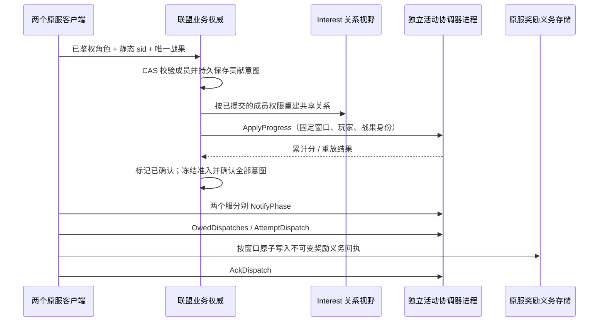
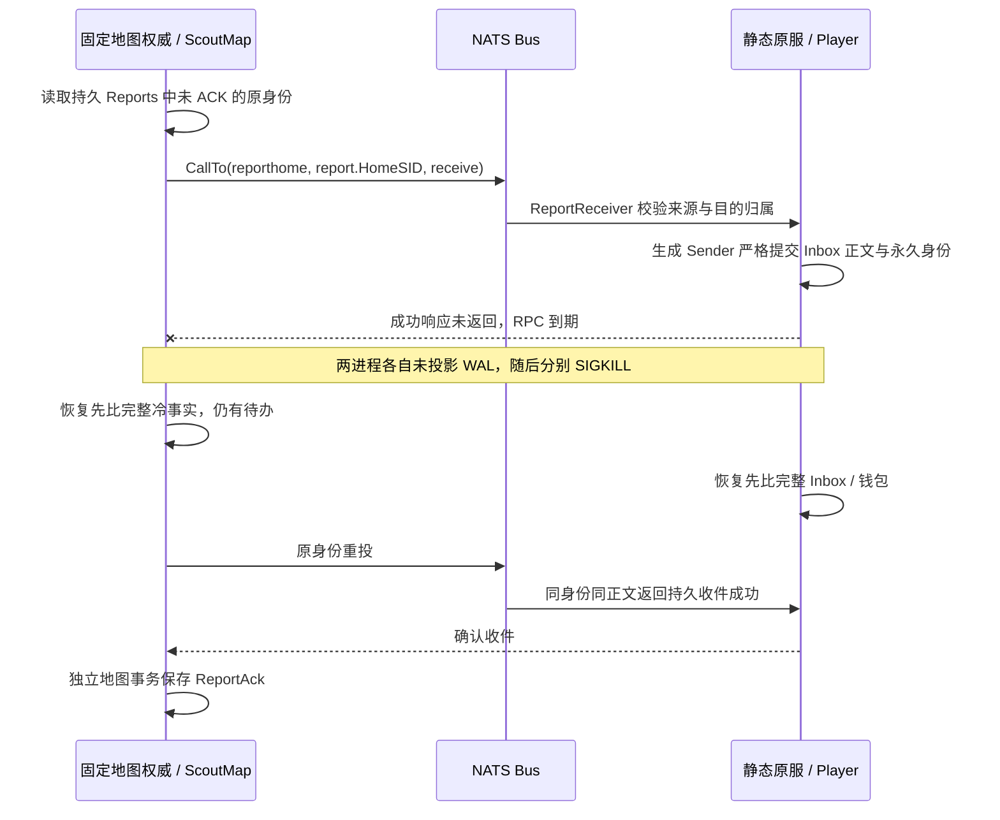
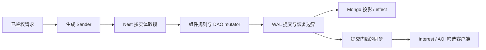
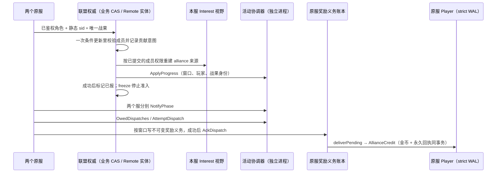

# SLG 框架学习与验收

本手册把 SLG 的主要业务路径映射到 core 的正式接口，分两部分：**第一部分“学习”**讲框架怎么用、为什么这样设计，按建造、行军、抢地等场景给出阅读顺序与可编译的调用示例；**第二部分“验收”**说明每个脚本证明什么、不证明什么。建筑数值、兵种、战斗规则、赛季政策和部署容量由游戏定义。下面的业务夹具只是学习和验收样例：框架与生成器不包含任何 SLG 规则，生成器也不生成这些业务文件；完整的参考应用仍是 [game-demo](../../demo/README.md)。另一种游戏的独立手册见 [MMORPG](MMORPG-INTEGRATION.md)。

学习主线分两段：建造、行军和抢地是事务入门（§3～§6）；跨服联盟活动把联盟权威、视野和活动奖励串成一条链路（§7），先分清框架已有、业务要做和框架没有的部分，不把框架模块存在当作玩法已经完成。

两个入口的范围须分开：`scripts/test-slg-generated.sh` 是 main 整合的 SLG 基础／联盟验收（§7、§12）；`scripts/test-slg-alliance-player.sh` 是下文的深化入口，在同一活动流程里增加 TCP、权限代际、持久位置与多块覆盖恢复。两者目前使用独立消费者夹具，不能把深化入口的结果归到基础入口。

## 第一部分：学习

### 专题优先级：跨服、视野、活动

SLG 的重点学习路线固定为这三条线。基础建造、行军和抢地提供事务入门，后续应向“跨服联盟活动／国战”串联，业务规则未定义的部分先作为待实现示例，不把框架模块存在当作玩法已经完成。

| 专题与 SLG 场景 | 首先追到的权威和正式接口 | 必须解释与验证 |
| --- | --- | --- |
| 跨服联盟／国战 | Player 留在原 sid；联盟等跨服实体走 [Remote／Mirror](guide/05-remote-mirror.md)；原服扣费与奖励协作用 [Saga](guide/06-saga.md) | 哪个进程能写、旧 owner 如何被 fence 拒绝；失败补偿与结果未知查询；Mirror 陈旧时不能据快照越权写；重复消息不重复扣兵／发奖 |
| 战争迷雾／侦察／联盟视野 | 权威位置／权限在业务 DAO；[SpatialComponent／Interest](INTEREST-BLOCK-AOI.md) 管空间事实和来源；Sync Profile 控制字段 | 空间候选不等于侦察权限；联盟退出撤销关系来源；一处观察撤销而其他来源仍命中时保留对象；最后来源消失才退订；不可见单位的敏感字段不能先下发再由客户端隐藏 |
| 赛季／联盟活动／跨服积分 | 本服 World 持久 timer → [ActivityRunner](../../demo/internal/service/game/activity.go.tmpl) → [activity 协调器](../../service/activity/) → 原服结算 | 窗口身份、参与服集合、阶段推进、贡献身份、累计榜乱序、结算确认、邮件与最终领奖分别何时完成；服离线、重启和人工补发怎样收口 |

**跨服学习顺序**：先标明每个状态的 owner sid，再读 Remote 正式写与 Mirror 读取；之后从 [gift_item](../../demo/saga/gift_item/) 学原服事务与跨服 Saga。`scripts/test-remote-generated.sh` 验证 Remote 路径，[MMO 双 sid 赠礼](MMORPG-INTEGRATION.md#13-双-sid-跨服赠礼)验证另一条实际多进程协作路径，两者不能互相代替。下一步 SLG 专题是把联盟权限、战场参与身份和原服奖励接到同一个业务流程；当前赠礼证据不证明国战权威或跨机故障已完成。

**视野学习顺序**：权威位置／权限 → 空间候选 → spatial／block／team 等来源归并 → Profile 字段白名单 → 提交后发布 → 客户端 Full／增量。`SpatialComponent.MoveWithObservedBlocks` 可表达“位置唯一、额外多块被观察”，本身不实现战争迷雾。重点读 [interest_test](../../framework/sync/entitysync/policy/interest_test.go) 的来源交接、回滚和发布屏障测试，再运行 `ROOST_NEST_GAME_RACE=1 bash scripts/perf/nest-game.sh --check-spatial` 学正式生成 DAO 接法。联盟情报共享的授权、撤销和额外扇出仍需 SLG 业务纵切，不能拿普通 AOI 半径测试替代。

**活动学习顺序**：

1. 从配置活动组与业务时钟确定窗口，用 `ActivityRunner.openWindow` 调用 `OpenActivity`；expected 集合根据该组与 App singleton 的存活查询取得。不能把路由分组当作每个服此刻在线的证明。
2. 本服 World 的持久期限经 `NotifyPhaseDue` 通知协调器。协调器不靠自身时钟启动业务阶段；某服通知后才启动聚合／宽限流程，具体见 [activity/types.go](../../service/activity/types.go)。
3. 业务成功事实形成稳定贡献身份，经 `Contribute` 上报；核对活动窗口，榜单保留较大累计值。demo 的尽力贡献失败不自动补报是既有取舍，正式赛季若要求不漏计，需要业务持久意图和重试，不能用重新执行领奖来补贡献。
4. `AttemptDispatch` 取得结算投递，`settle` 按原身份发送奖励邮件，再 `AckDispatch`。投递确认不等于玩家已领取；永久到账还需邮件／Player 的幂等事实，有限服务去重窗口不能代替永久账本。
5. 故障练习至少包括重复与跨窗贡献、晚到累计值、一个服未通知、结算投递中断、发邮件成功但确认丢失、玩家重复领取。重开投递、排除失联目标或补发应有明确业务授权和审计，不能默认删除账本重跑。

现有证据分层：通用 AOI／Remote／activity 模块有对应测试，demo 有活动榜及结算接法；§11 列真实资源入口。下面的联盟活动切片已把权限、关系视野、跨进程活动协调与原服奖励义务串在同一条测试中；**Player 实际到账与 Remote 联盟 owner 交接已有下面的生成消费者扩展；跨服国战、空间迷雾和跨机自动 HA 仍未在这条联合链路验收**。


### 联盟活动主线：从准入到原服接收奖励义务

可运行入口：[scripts/test-slg-alliance.sh](../../scripts/test-slg-alliance.sh)。业务实现集中在 [alliance.go](../../scripts/testdata/slg-alliance/alliance.go)，接线与视野在 [runtime_test.go](../../scripts/testdata/slg-alliance/runtime_test.go)，完整顺序与断言在 [alliance_test.go](../../scripts/testdata/slg-alliance/alliance_test.go)。这是正式服务接口的消费者，直接使用仓库已生成的 Activity RPC，没有手改生成文件，也未修改框架运行时。

**教学规则**：Alice 静态归属 sid 1000，Bob 静态归属 sid 1001；一个联盟、一个固定赛季窗口、一个公开据点。可信战斗权威每确认一个唯一战果贡献 10 分。退盟拒绝新贡献，已经获准的贡献和奖励保留。每个窗口最多 128 个战果，原服最多保留 128 个窗口回执；满后拒绝，不删除旧身份。客户端不能提供 sid、得分、战果成功或奖励清单。这个例子没有实现战斗判胜负，战果入口必须由真实游戏的可信战斗服务调用。



| 业务状态 / 输入 | 拥有者与框架接法 | 如何调用与失败处理 |
| --- | --- | --- |
| 成员、静态原服、待报战果 | 联盟业务记录；`versionstore.NewRedisStore`，无 TTL | `contribute` 在同一个 `Update` 中校验成员并记录意图；`revoke` 与贡献通过同一个 CAS 串行裁决。回调只计算状态，不执行 RPC；同身份重试可查旧事实，换玩家复用身份被拒 |
| 联盟共享据点、独立侦察来源 | 本服 `entitysync.Manager` + `policy.Interest` | `reconcile` 先 HoldSession，再由**已提交**的成员快照更新 `alliance` 来源；Apply 成功后 ReadySession。撤盟保留 `scout`，最后来源撤销才消失；应用失败保持 held。这里只发送公开据点 ID，没有敏感成员或账本字段 |
| 可靠贡献、丢失应用确认 | 联盟业务意图 + `activity.Coordinator` | `drain` 在 CAS 外调用 `ApplyProgress`，成功才标记 Sent；重启按原 `Key + participant + battleID` 重试。协调器的保留期为一小时，未确认意图达到该期限即停止自动补报，转人工对账，不生成新身份 |
| 活动阶段 | 本服业务时间线 + 协调器 expected 集合 | `freeze` 停止新准入；`phase` 要求所有意图 Sent 后才能 NotifyPhase。一个服通知时保持 collecting，两个服通知后 complete。教学 expected 固定为 1000/1001；生产从活动组与 singleton 存活事实取得 |
| 原服奖励义务、丢失 ACK | 静态 sid 分隔的业务 `versionstore` 存储 | `receive` 校验窗口、目标 sid、完整结算结果和冻结贡献，按窗口写不可变奖励清单与回执；写成功才 ACK。重投返回原回执，不提升存储版本；同窗口变更奖励清单被拒 |

**奖励义务不是金币到账**：这个切片的 ACK 表示原服已持久接收“谁应获得多少积分奖励”的义务。基础入口停在义务回执；下面的 Player 扩展继续把同一义务写入金币与永久到账身份。两个回执分属不同存储，不存在 Redis 与 Player 之间的分布式原子事务：先持久接收义务，再通过可重试的 Player 事务到账。协调器 ACK 不因此变成玩家领取的证明。邮件附件领取与 Saga 资产协作仍未接入本切片。

**视野如何继续扩展**：当前联合场景验证的是联盟与侦察两种授权来源归并，没有把“附近”自动等同可见。空间迷雾应由服务端侦察规则产生授权，再结合 `SpatialComponent` 的提交门、观察块与 Profile 白名单。跨服撤权通知仍存在传播窗口，正式产品需要定义可接受延迟和会话暂停策略；不能声称本例已验证撤权瞬间全服无泄漏。

运行方式（现有隔离测试 Redis / NATS；不启动或停止共享服务）：

```bash
ROOST_DATAENGINE_IT_REDIS_ADDR=127.0.0.1:6379 \
ROOST_DATAENGINE_IT_NATS_URL=nats://127.0.0.1:4222 \
bash scripts/test-slg-alliance.sh
```

实跑证据：`TestSLGAllianceActivity` 经 race 通过、无 skip，随后消费者 vet 通过。一个测试覆盖以下连续流程：八个并发重复战果只留一个意图；错服与身份盗用拒绝；退盟、独立侦察保留及最后来源撤销；已提交贡献丢失应用确认；冻结但仍有未确认意图时禁止结算；真正重启协调器后补报只计一次；超出重放期限拒绝自动补报；两服阶段屏障；原服义务已写未 ACK，再次重启协调器后通过 OwedDispatches 找回旧窗口、原 token 重投、不重写回执、错误 token 拒绝、重复 ACK 幂等。唯一 Redis 命名空间和 NATS subject 隔离，结束只清理本次资源。

**证据边界**：协调器是实际子进程，两个 sid 客户端使用不同 NATS 连接但位于同一父进程；服务发现为固定列表，未验收 etcd、singleton 或自动 HA。协调器执行正常排空重启；丢失的是测试注入的应用确认，协调器未注入网络分区、SIGKILL 或 Redis 故障。Redis 数据跨进程读取成功不证明节点断电持久性。视野已经真实回环 TCP 与正式帧 Receiver 重建对象表，NATS 失效提示验证重复／乱序后的权威重读；不证明跨机即时撤权、正式账号鉴权或消息不丢。基础入口的联盟权威用业务 Redis CAS；Remote 扩展改用正式生成实体并验证 owner 交接，见下文；基础入口的原服对象重建只验证持久义务回执；Player 扩展启动独立原服测试子进程做实际发奖和 SIGKILL，但不是带登录网关的完整 game 服务。

**问题归属与下一步**：可靠贡献意图、退盟政策、冻结屏障和永久奖励回执属于业务设计，本轮没有据此认定框架缺陷。Player 金币与永久到账回执已由下一节扩展验证。Remote 联盟权威与原服有界待发扫描也已由扩展接入。空间候选与授权交集、定期权限重读已由下文深化入口验证；持久 Player 视点、多目标授权筛选与一次性侦察期限已接入，Player 读取也已接入下述周期刷新验收，动态目标与正式 App Service 启停已由下文补齐教学验证，直线行军时间轨迹也已由下文接入，到达侦察报告也已接入持久事件消费；本服报告跨实体投递已由下文接入，下一步深化跨服地图版本协议及跨服投递；邮件附件、常驻投递调度和长期归档另行接入。MMO 跨服世界 Boss 可复用窗口 / 意图 / 回执思路，但需要自己的队伍与副本权限规则，不能复用本次结果声称 MMO 联合主线已完成。

### Player 到账扩展：义务已 ACK，金币仍能恢复补发

入口：[test-slg-alliance-player.sh](../../scripts/test-slg-alliance-player.sh)。它用 CLI 生成独立 game 工程的 Player DAO 和 Sender，复用上面的**同一条**联盟活动测试，并在原服奖励义务已经 ACK 后继续到账；不是把两个独立测试的通过当作串通。业务 handler 见 [handlers.go.txt](../../scripts/testdata/slg-alliance/player/handlers.go.txt)，真实 Runtime / WAL 接线见 [runtime_test.go](../../scripts/testdata/slg-alliance/player/runtime_test.go)，进程恢复与断言见 [delivery_test.go](../../scripts/testdata/slg-alliance/player/delivery_test.go)。

| 阶段 | 拥有者 / 正式接口 | 提交与失败顺序 |
| --- | --- | --- |
| 玩家建档 | 每个原服自己的 Player，生成 `AllianceHomeInit` Sender | 首次把静态 `HomeSID` 与空回执持久化；实体 Create 不是持久建档。已有角色不能改 sid |
| 读取待兑现义务 | 原服业务 `home.deliverPending` → `home.store.Get("rewards")` | 读取原活动窗口、玩家与金额，固定 Alice→1000 / Bob→1001 的教学映射；不从当前活动窗口推算，不信任客户端金额。ACK 后 OwedDispatches 已为空，仍须从原服义务记录恢复工作 |
| 实际到账 | `Sync_AllianceCredit` → Player Nest strict → 生成 DAO setter | 在同一事务中写 `Gold += amount` 与 `Receipts[activity.Key.String()] = amount`，无事务内 RPC。示例一贡献积分兑换一金币，这个数值属于业务 |
| 重复 / 冲突 | 同一个 Player 永久账本 | 同窗口同金额返回现有余额；错服、改金额拒绝且资产不变。最多 128 个窗口满后拒新身份，不删除旧回执；新赛季使用不同窗口身份 |
| 原服重启 | `engine.Runtime` + 文件 `nestwal` + Mongo projector | 每个 sid 独立 WAL、固定实体 ID。恢复先冷加载原事实，再读义务重试；不能先重试补出缺失事实，再声称恢复正确 |

```bash
ROOST_DATAENGINE_IT_REDIS_ADDR=127.0.0.1:6379 \
ROOST_DATAENGINE_IT_NATS_URL=nats://127.0.0.1:4222 \
ROOST_DATAENGINE_IT_MONGO_URI='mongodb://127.0.0.1:27017/?replicaSet=rs0' \
bash scripts/test-slg-alliance-player.sh
```

实跑：`TestSLGAlliancePlayerDelivery` race 通过、无 skip，生成消费者 build / vet / ID / generate --check 通过。两个原服**分别**执行“Player 建档＋两次空间移动＋侦察撤权＋到账”和“地图建档＋四次目标移动＋一次行军”的十一条已确认 strict WAL，断点确认投影数为 0、未投影数为 11，且原服 Delivered 尚未写入，再由父进程 SIGKILL 自己启动的子进程。恢复进程先比较完整钱包字符串（含 X/Y/Coverage/VisionMask/ScoutUntil）及独立地图状态（坐标、Revision、移动／行军回执及原始路线期限），再重建空间索引，并解出 HomeSID、10 金币和唯一永久回执；八路重放与重新读取同一 Redis 义务不增币；错服、改归属、同身份改金额被拒。正常关闭后第三个进程再次冷加载与重放，最终两人各 10 金币、各一个到账身份。成功清理本次唯一数据库，失败保留 WAL、数据库与子进程日志；`ROOST_SLG_REWARD_KEEP=1` 可保留成功工程。

本例不改变 ACK 的含义。`home.deliverPending` 已实现一次有界扫描与补发：按窗口／玩家排序，最多处理调用方指定的 1～128 个窗口，先调用 Player，再持久记录 Delivered。Player 调用失败不标完成；Player 已到账而 Delivered 未写时，重启仍能发现并重投。测试在这个间隙 SIGKILL，恢复时发现一条工作，第三进程发现零条；独立重放 Player 身份仍返回原余额。尚未接常驻后台循环、最终义务归档或无限期账本。固定两个角色的映射需由生产账号／角色注册表替换；这是内部受信任调用，未开放公网领奖 API。原服子进程按 sid 依次验收，不证明两服网络并发、进程自动拉起、Redis 故障、磁盘断电或 strict 结果未知。Gold 与永久回执经真实 WAL / Mongo 恢复，**Remote owner/fence 要看下一节的专门扩展；邮件附件与 Saga 未因本项通过而自动获得验收**。

生成器学习点：锁目标能力接口应命名为 `I...Entity`，或显式声明 `target`；不能用普通接口名让生成器猜锁目标。本夹具使用 `IAllianceRewardPlayerEntity`，失败时修业务声明，不手改生成 Sender。

### Remote 扩展：联盟换 owner，活动与奖励继续执行

运行入口沿用 Player 脚本，加 `ROOST_SLG_REMOTE=1`。它把**同一条**业务流程的联盟存储换为 Managed Remote `AllianceAuthority`，原服奖励义务仍在 Redis，Player 金币仍在原服 DAO；Player sid 从未迁移。相关文件：[生成 handler](../../scripts/testdata/slg-alliance/remote/handlers.go.txt)、[Remote Runtime 装配](../../scripts/testdata/slg-alliance/remote/runtime_test.go)、[业务 CAS 适配器](../../scripts/testdata/slg-alliance/remote/store_test.go)、[owner 交接验收](../../scripts/testdata/slg-alliance/remote/remote_test.go)。

```bash
ROOST_SLG_REMOTE=1 \
ROOST_DATAENGINE_IT_REDIS_ADDR=127.0.0.1:6379 \
ROOST_DATAENGINE_IT_NATS_URL=nats://127.0.0.1:4222 \
ROOST_DATAENGINE_IT_MONGO_URI='mongodb://127.0.0.1:27017/?replicaSet=rs0' \
bash scripts/test-slg-alliance-player.sh
```

| 步骤 | 框架与业务接法 | 要核对的事实 |
| --- | --- | --- |
| 正式生成 | `roost add mod remote_entity -service game`；生成 AllianceAuthority / DAO，再把业务实体声明改成 Remote category、`remote=managed`、`RemoteEntityBase` | 三处一起改，重新 generate；不手改生成 DAO 或 Sender。Remote 托管实体不挂本地实体定时器 |
| Runtime 装配 | `NewMongoCommitter` → `NewBackend` → `Assemble`；`MongoStore.SetRemoteProjection`；`Runtime` / Nest 注入同一个 Remote Manager | Mongo 为权威，Redis 锁和 L2 使用本次唯一前缀，两个 Runtime 各有独立 WAL。提交后能否写由 Remote 准入与 fence 决定 |
| 联盟事实读写 | 生成 `AllianceRemoteRead` / `AllianceRemoteCAS` Sender；整个成员与待报意图存为一个 DAO 字段 | 业务 Version 只控制条件更新，不代替 Remote marker / route / lock fence；明确版本冲突才重新读取计算，其他错误直接返回，不盲重试未知结果 |
| 首次拥有 | `ClaimRemoteOwnership`，未共享时 `EnterRemoteSharedMode` | 先读 Claim 返回的 Shared。接管可能继承 shared=true，此时再次 EnterShared 会被拒，不能把接入误用记为框架故障 |
| 交接 | owner 2000 调 `TransferRemoteOwnership(...,2001)` | marker 与 route epoch 均上升；旧 Runtime 仍活着时尝试撤销 Alice，被 writer fenced 拒绝 |
| 冷加载继续 | 新 Runtime sid 2001 使用新的内存管理器与自己的 WAL，从共同 Mongo 加载 | **先**比较完整业务事实与交接前一致，**再**补报；已有成员权限、冻结状态、待报战果均不被重新初始化 |
| 后续链路 | 原活动身份补报 → 两服阶段 → 原服义务 ACK → 有界扫描 → Player strict 资产与永久回执 | 继续运行两服的未投影 SIGKILL 恢复，不能只停在“Remote 改个字段成功” |

`TestSLGAllianceRemoteDelivery` 已在真实 Redis / Mongo / NATS 上 race 通过、无 skip；消费者 build / vet / ID / generate --check 通过。基础入口和不启用 Remote 的 Player 入口也分别复测。原服扫描先注入 Player 不可用，确认义务版本不变；再在资产已提交、完成标记未写时杀进程，恢复发现待发义务，第三进程不再发现待发项。

**范围**：两个联盟 owner 是同一父进程里的独立 Runtime，证明真实共享存储上的显式交接与旧写者拒绝；不证明跨机网络分区、自动选主、lease 中途过期或并发在途提交时的交接。此处 Remote 使用普通 NATS，快照推送按框架契约关闭，未验证 JetStream / Mirror 订阅；业务读通过权威 Nest 路径，不用陈旧 Mirror 作权限。原服 Player 与活动协调器仍有真实子进程。本例的 128 KiB 联盟状态与 128 条账本是教学限制，不是生产容量结论。

### 视野扩展：真实 TCP、权限代际与重连

[视野接线](../../scripts/testdata/slg-alliance/runtime_test.go) 经 [TCP 接线](../../scripts/testdata/slg-alliance/tcp_test.go) 的 `gateway.TCPServer / TCPRuntime` 和 `selfsync.PushPlayerFrame` 发送，两个实际回环 socket 用 `wire.Read` 收包；[fog_test.go](../../scripts/testdata/slg-alliance/fog_test.go) 再以正式 `frame.Receiver` 维护客户端对象表。所有三个联盟入口执行同一条链，包含真实断开／重新握手，不能把 Manager 的会话 id 与 TCP 连接生命周期混为一谈。

| 业务步骤 | 正式接法与提交顺序 | 实际断言 |
| --- | --- | --- |
| 退盟 | 持久 CAS 同时修改 Active 与 PermissionGeneration；重复退盟不增加代际 | alliance 来源消失，scout 仍命中时保留对象；最后来源撤销后 Bob 无据点 |
| 失效提示 | [permission_test.go](../../scripts/testdata/slg-alliance/permission_test.go) 用独立 NATS 连接发送权限代际；消息只表示重读下限，不携带成员授权 | 新提示、重复提示、延迟旧提示均拉当前持久权威；旧消息不能恢复旧权限 |
| 暂停与重建 | `HoldSession → 读取权威 → 校验代际 → Interest.Apply → ReadySession → Flush`；通知下限保留，失败重试不能降低 | 读失败、低于已知代际或通知下限、同代成员内容冲突均保持 held，不发送新帧 |
| TCP 重连 | 关闭旧 socket，等待接入注销；重新握手注册后 OpenHeldSession / Resubscribe，再读取最新权威 | 客户端收到新 Full；退盟者仍无据点；旧 epoch 帧不能进入应用回调 |
| 公开字段 | Sync 通道 envelope 和对象载荷逐包校验 | 场景对象仅 `{"objective":99}`，常驻控制标记仅 `{"view":true}`；没有成员名单、贡献意图和永久奖励回执 |

这是一套业务撤权接法，不是框架自动提供的分布式权限系统。普通 NATS Pub/Sub 可以丢通知；测试中的提示队列有界，满时丢提示而不能无界积压。生产需要定期权威重读、可信 subject 权限以及串行视野协调循环，定义最大缓存年龄和故障时是否断线；深化入口现在运行下文的定期重读循环，仍无跨机延迟验收。held 只停止后续发布，不能收回已经发给客户端的信息。两个固定测试票不代表真实账号服务验签。

位置 DAO / SpatialComponent 提交门与多块覆盖已由下面的原服扩展接入；战争迷雾授权和敌军隐身 Profile 仍未接入这条联合链；`MoveWithObservedBlocks` 的额外被观察覆盖不等于玩家侦察授权。不要把 TCP 据点视图通过解释成完整空间迷雾已完成。

### 空间扩展：持久位置、多个覆盖块与崩溃重建

沿用 `scripts/test-slg-alliance-player.sh`（可加 `ROOST_SLG_REMOTE=1`），[空间消费者](../../scripts/testdata/slg-alliance/player/spatial_test.go) 在每个原服 Player 的同一条奖励恢复链中执行；不需要另起示例项目。Player DAO 新增 X / Y（persist,sync）与 Coverage（persist）；位置和额外覆盖在一次 strict 事务里保存。客户端仅收到 x / y，不收到覆盖块、钱包或回执。

| 业务动作 | 接口与顺序 | 验收结果 |
| --- | --- | --- |
| 移动与覆盖 | 正式生成 `Sync_AllianceMove` → Nest Guard / undo → 手写 `SpatialComponent.MoveWithObservedBlocks` → DAO setter / Coverage JSON → strict WAL | handler 内特意 Flush，未提交的订阅仍不改变；显式回滚与非法块均不改钱包里的位置／覆盖，也不产生对象 |
| 多点观察同一目标 | main 新接口 `Watch(playerID, point, ObserverView{})`；`Show(entityID, point)`；两个观察点在不同块，目标真实位置固定为 700,700 | 两个实际 TCP 客户端各看到同一 subject，一份真实位置；覆盖不复制实体，也不移动位置 |
| 来源交接 | 第二观察端另有 scout 关系；移动提交只保留第一个覆盖块 | 移除第二块后 scout 保留对象；清除 scout 后第二端收到 Remove，第一端仍可见 |
| 崩溃 | Player 五条与地图建档／四次目标移动／一次行军六条，共十一条 strict 已确认但未投影记录后 SIGKILL | 新进程先比较完整钱包字节（包含 X/Y/Coverage/VisionMask/ScoutUntil）和独立地图状态，再建同步与空间索引；不是先发移动命令覆盖冷事实 |
| 冷重建 | 在尚未启动移动驱动的装配阶段，读取已加载 DAO → EnableSync / Register → Show → QueueObservedBlocks → Watch → Flush | 恢复端与第三进程均重建“第一端有对象、第二端无对象”，位置仍为 700,700；随后奖励重投不增币 |

冷重建的 `QueueObservedBlocks` 是已提交事实的索引恢复；在线改位置应统一走 SpatialComponent 与 Nest，不能把直接重建接口当作绕过提交门的写入口。示例地图／网格配置固定，Coverage 中的块号只属于本 Interest；正式产品地图配置升级需要版本或稳定业务坐标转换，不能直接沿用旧块号。

这一步验证了多块覆盖和独立来源交接，**尚未实现完整战争迷雾**。空间来源会直接订阅命中者；把侦察关系再加入同一个 Interest 是“并集”，不会形成“空间且已授权”的交集。隐藏敌军必须先设计授权过滤／分区或派生可见关系，不能把完整敌军加入本示例的公共空间源再指望客户端隐藏。两个固定观察视点不是行军单位、可移动侦察范围或跨服权限延迟验收。

### 授权交集与自动重读：漏通知后也能撤权

深化入口的 [视野投影](../../scripts/testdata/slg-alliance/runtime_test.go) 先计算 `inRange && (member.Active || scout)`，再分别发布已经筛过的 alliance / scout 关系；隐藏目标不登记到自动空间订阅源。固定教学地图 1000×1000、目标 (10,10)、范围半径 100，坐标越界或缺失即不可见。此处两个视点仍是测试中的服务器输入；下面另有原服消费者把已提交 Player 位置与侦察位图接入多目标筛选。二者尚未统一为跨服位置／权限版本协议。

[permissionLoop](../../scripts/testdata/slg-alliance/permission_loop.go) 串行执行初次读取、定时重读和通知唤醒；真实 NATS 回调只校验代际并 notify。最高代际用原子值保存，唤醒队列容量为 1；重复或旧通知不能降低下限，也不会堆积无限待办。每次刷新先 hold，再用有期限的 context 读取权威，成功才更新关系、Ready 和 Flush；失败保持 held，下一次 ticker 重试。读取实现必须遵守 context，循环本身不能强制终止不响应取消的 I/O。实例可由服务启动生命周期运行、关闭时 cancel 并等待返回；本例在测试主 goroutine 运行真实 ticker，没有自动部署常驻服务。

[联合验收](../../scripts/testdata/slg-alliance/permission_loop_test.go) 经三个既有脚本模式覆盖：

- 有权但离得远、在范围内但无权，TCP 对象表均为空；scout 也不能绕过范围。
- 实际 NATS 通知到达循环入口；一千次重复提示只保留一个唤醒和最高代际。
- Alice 持久撤权后故意不发通知，下一轮权威读超时且没有新帧，再下一轮定期读取恢复，客户端对象清空；取消后循环退出。同一活动的已获准贡献与原服奖励仍继续完成。

**最后一个对象撤销的现行接法**：早期测试发现 HoldSession 重置基线后，订阅清空却没有空 Full，客户端仍保留旧目标。main 已修复空订阅 Hold→Ready 的清场行为，Sync 回归验证通过。深化夹具仍保留无敏感信息的控制 subject 98，Receiver 忽略其载荷；它现在只是已有测试对象，生产接入不再需要用控制对象绕过空 Full 缺口。

每次 hold/ready 可能重发 Full，重读间隔与超时的毫秒值只是验收设置，不是容量或最大撤权延迟承诺。客户端已收到的信息无法撤回；失败期间只禁止新发布。跨机传播、常驻服务接线、跨服位置与权限的联合版本和多目标扇出仍需独立验收；持久 Player 权限与期限见下节。

### 持久视点与多目标筛选：移动、撤权和侦察期限共同恢复

[newDurableVision](../../scripts/testdata/slg-alliance/player/vision_test.go) 通过正式生成 `MultiSync_AllianceVision` 在本服同一次 Nest 多实体锁中取得 Player 的 X/Y、私有 VisionMask、ScoutUntil 和独立 ScoutMap 的目标位置，再计算半径与授权交集。隐藏目标不 Show 到公共空间 Interest；筛选结果用逻辑关系视野 901 的 `SetViewMembers` 发布，只挂接到获准客户端。四个目标的初始坐标为 501=(700,700)、502=(710,700)、503=(800,800)、504=(720,700)。初始长期授权 501 和 503，504 获得一次限时侦察，502 未授权；半径 50 与一小时赠送期限是教学规则。

| 过程 | 实际 TCP 对象表 |
| --- | --- |
| Player 建档在 (800,800) | 只看到 503；远处获准的 501 不下发 |
| 移动回滚或非法覆盖 | 持久位置不变，仍只有 503 |
| 移动提交到 (700,700) | 503 移除、501 与未过期的 504 出现；附近未授权的 502 始终缺席 |
| 撤销 501 的事务回滚／错误原服调用 | VisionMask 不变，仍可见 501 和 504 |
| 原服提交撤权 | 501 消失，期限前的 504 保留；第二客户端没有这份权限，全程无目标 |
| 504 到期前 1ms、恰好到期、到期后 1ms | 依次为只有 504、空、空；最后目标到期也经带控制标记的 Full 清空 |
| 到期前后重复建档 | 整份钱包不变，不续期、不恢复已撤销的位图 |
| SIGKILL 后恢复、第三进程复核 | 先比较包含位置／权限／期限的完整冷事实，随后重新读取并筛选，已撤销的 501 与离线过期的 504 不复活；钱包重投仍不重复到账 |

`VisionMask` 和 `ScoutUntil` 只持久化、不参与同步；客户端对象载荷只有 `{"target":目标ID,"x":当前X,"y":当前Y}`，逐包校验不带钱包、位图或未授权目标。常驻控制标记沿用上一节的空场景重建方式。生成 handler 的撤权注入失败点只供 undo 验收，正式业务应由受信任权限服务调用，不允许客户端设置位图。

期限接法：`handlerAllianceHomeInit` 首次在 Player strict 事务内写入 `fctx.Now().Add(time.Hour).UnixMilli()`，已有 HomeSID 的同服重试直接返回，不能按重试时刻重算。刷新读取已提交期限，并用注入的 `clock.Business` 判定 `now < ScoutUntil`；期限缺失或到期即排除 504，不靠删除持久位图表达过期。生产装配从 `app.BusinessClock(registry)` 获取业务钟，跨重启保持框架的业务时间不回退约束，客户端不得上传时间或授权期限。

验收用 `clock.BusinessFunc` 在服务端精确推进到期限前、等于期限、超过期限；没有等待真实一小时，也没有修改进程全局偏移。恢复进程先比较完整冷事实，再以超过期限的服务端测试时间首次发布；第三进程重复核对。到期过滤和重复建档不写新状态，Player 仍是建档／两次移动／撤权／到账五条未投影 WAL；地图另外建档一次、移动四次、发起行军一次，总计十一条。这是发布时惰性到期：通过下面的周期刷新清除在线客户端对象，未接独立实体 timer；攻击等业务命令仍需独立校验期限。

这条链验证了持久观察位置、有限多目标、永久撤权与一次性侦察期限的联合恢复。目标坐标现在归独立持久 ScoutMap；已实现下述十秒直线轨迹；尚未实现生产速度配置、多段寻路、障碍遮挡、多次付费侦察／续期身份账本或大量目标索引。目标移动和到期已由周期刷新验收，并经过正式 App Service 启停；完整生成 game 的其他模块装配与生产容量仍需独立验收。移动提交到刷新之间存在窗口，不能据此承诺跨服即时隐身。

### Player 周期刷新：期限、读失败与退出

`newDurableVision` 将发布与客户端断言分开：`refresh(ctx)` 负责 Hold → 生成 MultiSync Sender 联合读 Player／ScoutMap → 校验快照和业务期限 → SetViewMembers / Apply → Ready / Flush；`expect` 只消费真实 TCP 帧，不触发发布。读取必须使用循环传入的期限 context，不能另起无期限的后台读取。即使读取返回成功，也要先检查 `ctx.Err()`，迟到的快照不能恢复发布。

把 `refresh` 交给已有 `permissionLoop.run`，由唯一循环串行管理这个视野分区；业务操作或另一个 goroutine 不得同时对它调用 Flush / Ready。Player 和 ScoutMap 是同一本服 Nest 的权威读取，此适配器不消费远端权限代际参数；远端副本仍需前面独立的 minimum-generation 校验。

Player 与 Remote 两个深化入口均执行六轮真实 ticker 验收：

1. 初次联合读取，504 在期限前可见；随后通过生成 Sender 把目标 503 移入范围，不手动刷新、不发通知。
2. ticker 的下一轮看到 503 和 504；再将 503 移出并推进测试业务时钟到侦察期限。
3. 权威读取等到 context 超时并返回错误：会话保持 held，没有新帧。
4. 权威读取获得合法快照，但延迟到超时后才返回成功：刷新再次检查 context，仍不发布。
5. 读取返回损坏 JSON：不恢复 Ready，没有新帧。
6. 再次经生成 Sender 读权威，确认 503 已远离、504 已到期，带控制标记的 Full 清空客户端；取消后退出，不再发起下一轮读取。

每轮 20ms、读期限 50ms、测试总期限 2s 只用于功能验收，不能当作生产延迟或吞吐承诺。业务时间由注入时钟精确推进，调度／I/O 截止仍用真实系统时间。循环不会强行打断不响应 context 的 loader；正式接线需要依赖超时、可观察的失败状态、退出排空与每分区预算。held 阻止新发布，不会抹掉客户端已经收到的历史信息。此项属于业务消费接线，未修改公共框架保证。

### 动态地图与 game 服务启停

[地图 handler](../../scripts/testdata/slg-alliance/player/handlers.go.txt) 的 `ScoutMap` 是 CLI 新增的独立持久实体，每个原服一个教学地图，拥有四个目标、地图 Revision 和最多 128 条命令回执；Player 保留自己的位置与授权。`AllianceTargetMove` 只接受可信模拟产生的目标与坐标，按 expected Revision 写入；回执保存命令身份和原参数，同身份重试返回原 Revision，不把目标移回旧位置，改参数或旧版本新命令被拒。满账本拒新身份，长期归档另行设计。

```go
s := syncsender.NewAllianceRewardsSender(nestMgr)
// 目标 503 从远处进入玩家视野；坐标来自服务器地图规则。
revision, err := s.Sync_AllianceTargetMove(ctx, mapID, "target-in", 1, 503, 700, 700, false)
// 内部联合快照，禁止直接发给客户端；只在同一 Nest 内提供多实体一致读取。
raw, err := s.MultiSync_AllianceVision(ctx, playerID, mapID)
```

实际验收覆盖移动失败 undo、非法坐标、错误预期版本、目标进出范围、重复旧身份／改参数拒绝、周期发现移动，以及公开坐标载荷白名单。SIGKILL 后先比较完整地图字节，再重放旧移动身份；离散移动阶段 503 保持在 (950,950)、Revision=5，旧 `target-in` 仍返回回执 2，不重置地图；之后新增行军使 Revision=6，冷恢复保留整条路线，并按恢复时的业务时间求位置。钱包标记沿用 main 的修正：先写临时文件再 rename 为 ready.json，避免父进程在空标记已创建而内容尚未写完时杀进程；仅证明进程 SIGKILL，不是磁盘断电。

[VisionService](../../scripts/testdata/slg-alliance/vision_service.go) 实现正式 `app.Service`：Init 装配循环，Serve 独占刷新，Shutdown 取消并等待在途读取结束。停止期限不足则返回 context 错误，不能把未结束的读取当作已排空；再次 Shutdown 可继续等待。测试包含部分初始化、尚未 Serve 就停机、阻塞读取导致首次停机超时、释放后重试成功及幂等停机。

[服务验收](../../scripts/testdata/slg-alliance/player/service_test.go) 还执行 `app.New(...).RegisterServer("game", service).Execute()`，真实读取已装配的 Nest/WAL/地图/TCP，等 Service 结束后 App 才返回，之后由夹具关闭基础设施。这里明确关闭测试 singleton，未验证生产多副本准入；真实依赖由消费者预先装配，不声称完整生成 game 的所有 Mod 启动链已经部署。实际业务可把同一受管循环放入自己的 game Serve/Shutdown，并让 App 在 Service 排空后关闭依赖 Mod。

地图是原服本地权威；Remote 模式只替换联盟权威，不把这张地图变成跨服共享地图。跨服地图的 Remote owner、位置／权限版本联合协议、视野分区容量和自动进程拉起仍需单独实施。直线时间轨迹由下一节验证；多段路径、碰撞与遮挡仍是下一层业务规则。

### 连续行军：持久路线、时间求值与离线到达

[scout.Route](../../scripts/testdata/slg-alliance/scout/route.go) 保存起点／终点与绝对毫秒 Start/End。教学规则是地图内十秒直线移动，整数坐标插值；服务器在 `handlerAllianceMarch` 的 `nowUnixMilli` 参数中取得本条消息冻结时间；生成包装从 fctx 填入，`Sync_AllianceMarch` 不接受时钟或时间参数，客户端不能提供出发时间。路线、命令参数回执和地图 Revision 同一 strict 事务提交，客户端只收到当前位置，不收到完整路线、期限或命令账本。

```go
revision, err := s.Sync_AllianceMarch(ctx, mapID, "march", 5, 503,
    700, 700, false)
```

原身份重试先查询回执，返回原 Revision，不重算出发时间；同身份改目的地拒绝。中途新路线拒绝，直移命令也不能绕过路线改变坐标。到达后允许新身份从上一终点起步；下一段失败时起点、路线、版本与回执一并回滚。移动与行军共用 128 条回执预算，满后拒新身份，不能靠清账本允许旧命令重放。

视野刷新经 MultiSync 读联合快照，再用同一次服务器业务时间对所有路线求位置并检查侦察期限。坐标与时长先验证上限，`At(now)` 在起点／终点钳制，在中间做有界整数插值；不会按离线秒数补 tick，也不会逐帧写数据库。读视图不延长路线、不增加 WAL。跨进程业务时钟不回退仍是部署前提；十秒固定时长只是教学数值，不代表正式速度规则。

| 验收点 | 结果 |
| --- | --- |
| 行军事务注入失败 | 完整地图字节不变，没有残留路线或回执 |
| 从 (950,950) 到 (700,700)，出发／一半／90% | TCP 依次为不可见、不可见、可见；90% 的公开坐标为 (725,725) |
| 在途重试／改参数／改道／直接改坐标 | 原身份回执不变、不续期；其他冲突请求拒绝 |
| 十一条 WAL 未投影时在途 SIGKILL | 恢复先逐字节比较地图和钱包，再重试原行军身份；不重设起点和期限 |
| 冷恢复时间超过 End，及第三进程复核 | 首个 Full 就发布终点 (700,700)，目标 503 可见，奖励仍只到账一次 |
| 到达后申请下一段但注入失败 | 能进入下一段执行分支，随后完整回滚，原路线和终点不变 |

纯函数回归另验出发前、精确出发、精确到达、极大／极小 now、无效期限和非法坐标；真实链在独立子进程用测试专用 `clock.SetSource` 冻结／推进时间来源，消息从 fctx 取值；不等待十秒，也不修改全局偏移。位置求值钳制到终点与事件消费是两件事；下一节已接本地侦察报告的持久事件消费，战斗／采集／发奖仍需自己的幂等协议，不能把每次读到终点都当一次到达通知。

main 新增的 `gameplay/heartbeat`／`wiring/heartbeat` P1 已合入并跑定向回归，但本消费者未挂载心跳。心跳只驱动在线已加载实体，不能替代持久路线或离线事件账本；Shared Remote 禁挂心跳的 main 契约保留。连续碰撞、多段寻路、取消与返程、跨服地图权威及生产容量仍需独立实践。

### 到达事件：持久待办与报告同事务消费

行军事务现在同时写入 `Arrivals[marchKey]`，内含目标、原路线与未处理状态。事件身份是所属地图 ID 加行军命令 key，原路线不会因当前目标开启下一段而被覆盖。待办与路线共用一笔提交，所以第一组崩溃仍是十一条 WAL；视觉位置求值和只读快照不会生成报告。

生成接口分两步接入，消息执行时由 fctx 冻结业务时间：

```go
keys, err := s.Sync_AllianceDueArrivals(ctx, mapID, 128)
for _, key := range keys {
    applied, err := s.Sync_AllianceCompleteArrival(ctx, mapID, key, false)
    // 区分业务拒绝与提交结果未知；未知结果保留原身份查询／重试。
    // 成功且 applied=false 表示已存在同一报告。
}
```

`DueArrivals` 从持久事件中按 End／key 排序发现待办，limit 只能是 1～128；不依赖进程内计时列表，也不只查看当前 Routes。枚举和处理之间不是事务，Complete 必须再次确认原事件与服务器期限。`now == End` 可处理，提前、伪造身份拒绝。事件、路线和报告均受原有 128 条命令预算约束，不静默淘汰旧身份。

本轮业务效果是地图内保存侦察报告 `{Target, At, Destination}`，At 使用原计划 End；同时增加 ReportTotal 并置 Delivered，全部由同一个 ScoutMap strict 事务提交。已处理重试核对报告与事件一致，返回 false，不重写状态；重复或晚到处理不改变原到达时间，不把目标搬回旧位置，也不修改 Player 钱包。这里的 Delivered 仅指本地报告已落入同一事务，不代表通知客户端或跨服效果完成。

[到达恢复验收](../../scripts/testdata/slg-alliance/player/arrival_test.go) 在两个原服分别追加第二组三进程：

| 阶段 | 实际验证 |
| --- | --- |
| 第一组在途崩溃及两次恢复后 | 原持久到达事件仍可枚举，报告为零；视野读取没有消费事件 |
| 报告写进程 | End 前不可发现／处理；精确 End 能发现；非法 limit、未知身份拒绝；注入失败后整份地图字节不变 |
| worker 提交后八路并发重投 | worker 只提交一次，后续重投均返回 applied=false，报告数与 ReportTotal 都为 1，只有一条新增 strict WAL |
| 第二次 SIGKILL | 确认这条报告事务尚未投影，完整写入 arrival-ready 标记后父进程杀子进程 |
| 报告恢复与再下一进程 | 先比较完整冷事实，再延迟重试原身份；报告不重复、At 不变、待办为空、钱包不变 |

本节与前序在途场景共六个顺序子进程、两个 SIGKILL 断点；第一组验证在途事实与奖励，第二组验证到达本地效果。测试时间由服务端注入业务钟控制，没有等待真实行军时长。main 的 Shared Remote 心跳拒绝与限频更新已合入并通过 heartbeat race 回归，仍未据此宣称真实 Redis 下心跳交接已验收。

本接口已接入下述常驻到达 worker；全局地图发现／离线唤醒目录仍未接入。报告还会经下一节的两步协议投递至 Player 私有持久收件箱；客户端通知／邮件附件、Player 资产、战斗或采集另行接入；跨实体／跨服效果需明确 Outbox、Saga 或接收方永久回执，不能把本地图事务当成跨服务恰好一次。

### 常驻到达 worker：失败重试、排空与重启

[ArrivalWorker / ArrivalService](../../scripts/testdata/slg-alliance/arrival_service.go) 将持久待办枚举和生成 Sender 消费接入已有 Service 生命周期。`ArrivalService` 复用经过验证的 ticker／每轮 context 期限／Shutdown 排空能力；视野发布和到达消费各自独立，读视图不会产生报告。

`ArrivalWorker.Tick` 每轮枚举最多 Limit 个事件，先验证数量和身份（非空、最多 64 字节、无重复），成功且 context 未取消才顺序消费。一个期限覆盖整轮发现与消费，不为每条重新续超时，也不另起后台 goroutine。失败即结束本轮，下一轮从持久状态重新发现；不保存游标、不换新身份。返回错误可能是明确业务拒绝，也可能是结果未知，恢复仍依赖原事件幂等接口，而不是把所有错误都当作未写入。

生成消费者通过真实 ticker 跑三轮：第一次权威查询超时，第二次提交报告后模拟丢失成功响应，第三次重新枚举得到空待办并退出；之后八路直接重复调用都不再产生报告。报告仍只有一条未投影事务，随后原有第二次 SIGKILL／恢复链继续执行。

停机验收另让消费停在未提交的在途调用：Shutdown 先取消，短期限耗尽时如实返回 DeadlineExceeded；服务仍未结束，持久待办仍保留。释放阻塞后再次 Shutdown 成功，重启的 worker 能重新发现并完成原事件。报告恢复与再次冷加载两个进程还通过正式 `App.RegisterServer("game", arrivalService).Execute()` 启动 worker，确认已完成事件不再进入消费，App 返回前服务已排空。配置仍显式关闭测试 singleton，基础设施由夹具预装配。

main D22 的时间契约已同步：建档读 fctx.Now，行军／发现／消费 handler 的 `nowUnixMilli` 由生成包装注入，Sender 中没有业务钟参数；每条消息的时间分别在执行开始冻结。服务循环的等待、I/O 截止与停机仍用系统时间；视野这种 Nest 外的业务计算可以使用注入 Business。测试通过独立子进程中的 `clock.SetSource` 设置不可变时间来源并在清理时恢复，不把它当成生产动态改时接口。

本次只为已知 mapID 装配一个有界 worker。全局地图目录、多个分区的公平调度与退避、跨服 owner 路由、生产部署／长稳、报告客户端通知和跨服效果仍需分别验收；错误通过 Observe 暴露，不宣称已具备完整运维指标和告警。

### 报告投递：地图持久义务与 Player 永久收件回执

教学目标是让到达报告进入玩家私有收件箱；不增加金币，不等同客户端已经阅读或正式邮件附件到账。本轮采用**每张教学地图固定一个收件人**的规则：`Sync_AllianceMapInit(ctx, mapID, playerID, sid)` 在建档事务保存 Recipient/HomeSID，重试不能改变归属。多玩家军队共享地图时，应把收件归属移入每条行军的不可变事实，再分别验收，不能照搬单收件人假设。

[scout.Report](../../scripts/testdata/slg-alliance/scout/report.go) 固定 MapID、Key、Recipient、HomeSID、Target、原计划到达 At 和 Destination。永久身份为 MapID 加原行军 Key；正文改变必须拒绝，不能按重试时刻改写。`ReportAck` 与到达事件的 `Delivered` 分开：前者表示 Player 持久收件成功后地图确认，后者只表示地图已经生成本地报告。

[ReportDelivery.Deliver](../../scripts/testdata/slg-alliance/scout/delivery.go) 的调用顺序：

1. `Sync_AlliancePendingReports(ctx, mapID, limit)` 从持久 Reports 中发现未确认身份；按 Key 排序，limit 为 1～128。
2. `Sync_AllianceReport` 读取不可变信封，检查返回的 MapID/Key 与请求一致。
3. 原服 `Sync_AllianceReceiveReport(ctx, recipient, configuredSID, report, false)` 在独立 Player strict 事务保存完整正文。正文就是永久回执；同身份同内容返回未新增，同身份改内容拒绝，账本满 128 拒新身份。错收件人／错原服拒绝。
4. 收件成功且整轮 context 未取消，才执行独立地图事务 `Sync_AllianceAckReport(ctx, mapID, report, false)`；再次核对完整信封，持久保存确认位与 Revision。

两笔写之间没有分布式事务；地图锁内不做外部 RPC。发现和投递可装配到已有 `ArrivalWorker`／`ArrivalService`，本轮真实消费者用有界 Tick 验证这条协议。查询失败、收件失败、收件成功但响应丢失，或取消后的迟到成功均不继续 ACK。下轮从地图重读原义务；若收件已成功，则 Player 回原回执后再确认。Ack 自身返回未知结果也继续查询／重试同一信封。

**信任边界**：这些 Sender 是可信服务器内部接口，`Report.Valid` 只检查结构，不能证明报告来自合法地图。生产跨服入口还需路由、鉴权与地图 owner/fence；客户端不得上传信封调用收件或确认。Inbox 是仅持久化的私有字段，不进入公共同步 Profile。正文与去重身份不能为腾空间而随意删除。

真实 Mongo/WAL 消费者增加第三组进程：

| 场景 | 验收结果 |
| --- | --- |
| inbox-write | 错收件人／错原服拒绝；写后注入失败完整回滚；正式 worker 收件提交后模拟丢响应，地图未确认 |
| 第三个 SIGKILL | 只有一条新增且未投影的 Player 收件事务；写完整 Inbox 与 Map 快照标记后杀进程 |
| inbox-recover | 重投前先逐字比较两边完整冷事实；八路重投不重复收件，改正文／改确认内容拒绝；Ack 注入失败不改变地图；随后重投并确认 |
| inbox-verify | 再次冷加载两边完整事实，确认位仍在，待办为空，直接重试原收件与确认均幂等，钱包不变 |

上述本服链在两个静态原服各运行九个顺序子进程、三个 SIGKILL 断点。Player 与 `ROOST_SLG_REMOTE=1` 模式都走同一组报告验收；Remote 模式的联盟权威仍按既有接法交接，**报告的 ScoutMap 与收件 Player 仍在同一个原服 Runtime**，不据此声称跨服报告 RPC 已通过。另有纯协议回归覆盖错地图／错 Key、查询失败、查询或收件取消后迟到成功、收件错误与 Ack 错误，保证失败阶段不继续产生后续副作用。

本轮新增 Inbox 与地图收件归属仅用于每次新建的隔离消费者库；没有提供已有生产存档的 schema 转换。下节继续验证固定地图权威到原服的真实跨进程路由；Remote 地图交接、全局地图目录／公平调度、长期账本归档、客户端通知与真实部署容量仍待实施。

### 跨服报告：固定地图权威到静态原服的真实 RPC

本节将前述两笔持久事务放到独立进程。地图 2000 向静态原服 1000 投递，地图 2001 向静态原服 1001 投递；每对依次执行。地图进程只加载自己的 ScoutMap，原服进程只读取／写入原服 Player，两者独立 Runtime、Nest 与 WAL；父进程只控制故障和检查结果，不代替收件处理。



接入代码：[ReportReceiver](../../scripts/testdata/slg-alliance/scout/report_rpc.go)、[跨进程验收](../../scripts/testdata/slg-alliance/player/cross_report_test.go)。地图端仍用 `ReportDelivery`，只把 Receive 回调换为正式 `bus.CallTo(ctx, "reporthome", report.HomeSID, "receive", report, &accepted)`。Bus 的成功返回还必须带 `accepted=true`，才允许地图确认。接收方注册 `HandleRpc("receive", receiver.Handle)`，校验 FromSid、配置中的地图 ID／原服 sid／玩家 ID，再调用原服生成 Sender；不根据请求内容重新选择收件人。

`FromSid` 是受信任服务总线里的路由声明，**不是密码学认证**。本验收使用隔离本地 NATS，验证来源 allowlist 和目的归属拒绝；生产必须配置服务凭据与 subject ACL，防止任意连接伪造来源。这里的固定地图路由也不是 Remote owner/fence；不能同时启动多个地图写者，让不同本地 WAL 写相同地图身份。

在原有脚本中自动执行，无需新增开关：

| 场景 | 实际验证 |
| --- | --- |
| 非地图来源直接投递 | 管理端 FromSid 不在地图 allowlist，拒绝 |
| 合法地图来源、错误目的 | 错 HomeSID、Recipient 或 MapID 均拒绝 |
| Player 提交后不返回成功 | 接收端保存完整冷事实标记后等待真实 RPC context 到期；地图工作轮次返回错误，ReportAck 不变 |
| 两边独立崩溃 | 地图建档／行军／到达三条未投影 WAL，原服新增收件一条未投影 WAL；分别 SIGKILL，两边都不是先落 Mongo 再模拟重启 |
| 两边恢复再投递 | 在开放 RPC 前逐字核对完整冷事实；八个并发地图工作轮次重投同一信封，Player 收件箱不变、钱包不变、地图待办清空 |
| 正常排空与第三次启动 | 先排空 Bus 再关闭 Runtime；第三组进程再次核对两边完整最终事实，空待办重跑不改状态 |

每个原服在本服九进程之后追加三组地图／原服进程，共十五次子进程执行、五次 SIGKILL；两个原服都执行。Player 与 Remote 联盟模式均执行该链，但 Remote 模式只是沿用已有联盟权威，**本节 ScoutMap 仍是固定 sid 权威，尚未接 Managed Remote 地图交接**。测试在同机多进程、真实 NATS 与 Mongo 上完成，不证明跨机 HA、网络分区、生产 ACL、自动地图目录或容量。

main 本轮合入的批量作业按目标重新冻结业务时间、心跳 Reg 安全格式化已读源码并通过 fctx／Nest／heartbeat race 回归；本消费者继续走普通生成 Sender，不声称已接批量心跳或测过其性能。main 已改为只打印慢派发参数类型，不再反射读取可变参数；本轮 Nest race 回归通过。

### Managed Remote 地图：报告未确认时交接 owner

独立入口：

```bash
ROOST_SLG_REMOTE_MAP=1 bash scripts/test-slg-alliance-player.sh
```

仍需显式配置隔离 Redis、NATS、Mongo 副本集。此开关自动启用 Remote 装配，把本次新生成工程的 ScoutMap 定义改为 `category=Remote remote=managed`、DAO 改为 `dbscope=global`；继续使用同一份行军／到达／报告业务 handler，由 CLI 重新生成 DAO 与 Sender。该模式执行 `TestSLGRemoteMapReports` 的同进程交接和下述多进程联合子场景，不执行本服 MultiSync 视野或固定地图 SIGKILL 链，避免用一份结果替代另一种契约。

[装配](../../scripts/testdata/slg-alliance/remote/runtime_test.go) 复用 Remote MongoCommitter、Redis 锁／L2、Manager、DataEngine 与 Nest；各 Runtime 使用独立 WAL，所有 DAO 通过同一 DatabaseMap 指向本次唯一物理库。Claim 后先检查 Shared，只在需要时 EnterShared。地图待办和报告使用 Remote 正式写，不把旧固定权威的本地 WAL 搬给新 owner。

[验收](../../scripts/testdata/slg-alliance/remote/map_test.go) 的步骤如下：

1. owner 3000 建图、发起行军、生成报告；原服 1000 收件成功，地图尚未 ACK，保存完整地图与 Player 事实。
2. `TransferRemoteOwnership(..., 3001)`，确认 MarkerEpoch 和 RouteEpoch 均增加；旧 Runtime 保持运行，对原报告的 ACK 必须返回 `entity.ErrRemoteFenced`。
3. 新 Runtime Claim 并加载地图，在重投前逐字比较完整状态；原报告、路线、收件人、Revision 和未确认义务不变。
4. 新 owner 重投原报告，Player 返回已有永久回执；注入 ACK 事务失败，整个 Remote 地图回滚不变；随后正常确认，待办清空。
5. 再交接到 3002，第三个 Runtime 加载的完整最终状态与确认后相同；3001 的重复 ACK 也必须被 fence 拒绝。Player 仍只有一份报告，钱包不变。

原服接入 [RoutedReportReceiver](../../scripts/testdata/slg-alliance/scout/report_rpc.go)：每次 RPC 用 `Manager.GetRemoteOwnership` 重读权威所有权记录，不依赖调用方自报或进程缓存。传输信封 `RoutedReport` 包含原 `Report` 和独立 `OwnerRoute{SID, Marker, Route}`；接收方同时核对 FromSid、当前 owner、两种代际及原服／地图／收件人。路由代际不进入永久 Report 身份或 Player 正文，换 owner 不能因此产生新收件。

真实 NATS 验收覆盖：权威读取失败不写 Player；旧 owner＋旧代际拒绝；新 owner＋旧代际拒绝；旧 owner＋当前代际也拒绝。发送方只有在收到 `accepted=true` 后才允许地图 ACK。生产仍须服务凭据与 subject ACL；路由检查不替代传输身份认证。

**准入边界**：读取权威路由与 Player 提交是两次独立操作。交接前已经通过校验的请求，可能在交接后完成；本协议允许这份已固定报告收件，并用永久回执防重。它不提供“交接瞬间撤销所有已准入报告”的保证。需要撤回报告、取消奖励或改变收件归属的玩法须另设业务协议，不能仅增加一个 epoch 字段便宣称实现分布式 fence。

**本子场景范围**：上述三个 Remote Runtime 与原服 Runtime 在同一测试进程中，连接真实 Mongo／Redis／NATS；本子场景不杀进程。下节另外验证多进程 Managed Remote 交接与 SIGKILL 的联合路径；锁续期失败／租约中途过期、网络分区或跨机故障仍未验收。普通 NATS SyncBus 不确认快照推送订阅，Mirror 推送另验。成功关闭全部运行时后清理唯一库，失败保留证据。

main 新增的技能／Buff 心跳接入已核对并通过 `go test -race ./gameplay/skill/...`；Shared Remote 禁挂心跳的约束保持。本模式仍靠持久到达待办与有界工作轮次，不挂技能心跳、不宣称完成技能 Host 或战斗接入。

### 多进程 Managed Remote 地图交接与崩溃恢复

同一入口 `ROOST_SLG_REMOTE_MAP=1 bash scripts/test-slg-alliance-player.sh` 自动继续运行 `process_handoff_crash` 子场景。代码见 [map_process_test.go](../../scripts/testdata/slg-alliance/remote/map_process_test.go)：三个地图 owner sid 3100／3101／3102 与静态原服 1001 分别运行在独立进程；3101 与原服各恢复一次，共六次子进程执行、两次 SIGKILL。数据库使用本次唯一名称，WAL 各进程独立路径，恢复 3101 时只打开它自己的原路径。

| 阶段 | 业务事实与验收断言 |
| --- | --- |
| 3100 建图并交接到 3101 | 行军、报告和未 ACK 义务已由正式 Remote 写提交；MarkerEpoch、RouteEpoch 增加。3100 保持存活，原报告 ACK 返回 ErrRemoteFenced；携带旧路由的投递被原服拒绝 |
| 3101 开放服务前 | 先逐字比较整份地图冷状态，包括原路线、报告、收件归属、版本和未确认位；对齐后才注册 RPC |
| 原服收件成功但无成功回复 | 原服建档与 Inbox 收件两条 strict WAL 均未投影，保存完整 Inbox／钱包快照后等 RPC context 真正到期；3101 的工作轮次失败，地图仍保留原待办 |
| 新 owner 与原服分别 SIGKILL | 3100 继续存活。地图从 Remote Mongo 权威恢复，原服通过自己的 WAL 恢复；没有把 3100 的 WAL 搬给 3101，也没有宣称 Remote 写尚未落权威 |
| 恢复 3101 与原服 | 开放 RPC 前分别比较完整冷状态。3100 仍被 fence，拿当前代际也不能伪装当前来源。八路工作轮次重投原身份，Player 正文／钱包不变，地图 ACK 一次后待办为空 |
| 再交接到 3102 | 3101 保持存活且重复 ACK 被 fence；3102 在开放服务前比较确认后的完整地图，再跑空待办不改状态。最后先排空 Bus，再关闭各 Runtime |

原服通过公开 `MongoCommitter.GetOwnership` 只读权威所有权元数据，不 Claim、不加载地图实体；同进程子场景则通过 Manager 的公开查询入口读取相同权威。两者都不拿进程缓存或请求自报的代际当授权。路由校验与 Player 提交不原子的边界继续保持：交接前已经准入的不可变报告允许完成，永久回执负责防重。

本次联合证据仍是同一机器的独立进程，显式调用 Transfer、固定可用的 Mongo／Redis／NATS；没有验证故障检测后自动选主、锁续期失败、网络分区、Mongo failover、生产凭据／ACL 或跨机 HA。下一步优先验证所有权查询暂时失败后的恢复与交接在途请求，再推进部署级故障；不要把显式交接当自动接管。

本轮同步 main 的相关修正：Interest 写入口由登记日志交给应用方，异步 Drain 计入已执行未结算命令；空订阅 Hold→Ready 补空 Full；慢派发 trace 只打印参数类型；技能推进与具体驱动分离。已跑 Sync／policy、Nest、skill 的 race 回归和原有真实依赖链。深化夹具仍保留旧控制标记作为测试对象，当前框架已不需要依靠它实现空场景清空。

活动补报也沿用 main 的修正：联盟接入显式接收协调器 ReservationTTL，零值使用框架默认，Redis 与 Remote 联盟采用同一配置；超出保留期停止自动补报交业务对账，不再写死一小时。默认期限和自定义两小时以内／超期的回归在活动链入口执行。

### main 视野 API 迁移

main 已删除 `RelationSource`：业务现在先 `DefineRelationView(viewID, profile)`，再 `AttachView(playerID, viewID)`，用 `SetViewMembers` 修改目标集合。深化联盟分别为每个玩家定义 alliance / scout 逻辑视野；多块空间验收的 scout 视野与空间视野仍按持有计数合并，删除一个来源不影响另一个。持久目标筛选使用独立关系视野，避免未授权对象从公共空间视野进入客户端。

`NewSpatialComponent` 不再接 observer 布尔参数，跟随实体的空间视野由新政策统一推进；位置仍通过 Nest 提交门修改。沿用 main 契约并执行 policy 回归和真实消费者，没有保留旧 Relation API 兼容层。当前默认 ApplySync 适用于本夹具少量视野，main 的同步上限包括关系视野；大规模单位视野要显式评估 ApplyAsync，并按其异步应用契约等待 Drain，不能照搬本夹具的即时 Flush 断言。逻辑库映射缺失现在由 main 的投影／冷加载及 Remote 写入共同拒绝，本消费者继续显式绑定同一 DatabaseMap。

### main 新契约接入：逻辑库与物理库分开

DAO 定义保持 `db=main`，生成 `db.DatabaseMain`；脚本不再替换定义里的库名。每次运行把 `main` 经 `coredata.NewDatabaseMap` 映射到唯一的 `roost_slg_reward_it_*` 物理库，传给 `engine.MongoStoreConfig.Databases`。Remote 的 `MongoCommitter.BindDatabaseMap` 必须绑定同一张表，确保权威 DAO 写入与 DataEngine 冷加载／投影一致；Remote 控制库和 DataEngine 默认控制库仍直接使用物理库名。

这个改动使业务代码与部署库名解耦，且 WAL 仍记录逻辑名；带未投影记录时不得更换映射，否则 Runtime 拒绝启动。当前消费者沿用相同映射完成两服 strict WAL SIGKILL／冷恢复与 Remote owner 交接。映射不是数据迁移，跨进程配置一致性仍由部署保证。主分支契约与接法见 [DataEngine 指南](guide/03-dataengine.md)，不要直接用 DAO.DbName() 打开 Mongo 物理库。

### 1. 适合谁、先读什么

适合准备用 core 做 SLG 的后端工程师。先读[入门](../GETTING-STARTED.md)，再按“一个玩家建造 / 行军 → 两名玩家抢地 → 联盟 / 跨服 → 战斗与结算 → 恢复”的顺序实践：前两步有可运行的生成工程（§3～§5），联盟 / 跨服 / 活动结算有可运行的联合链路（§7，真实依赖模式），战斗与其余路线从 game-demo 的现成接法学（§8）。

### 2. 模块分工：先分清状态归谁

先明确哪些状态属于谁，再选框架模块：

| 概念 | 在 SLG 中表示什么 | 正确用法 |
| --- | --- | --- |
| Entity | 玩家、地块、联盟等有身份和生命周期的业务对象 | 存权威状态，是 Nest 取锁与事务的参与者 |
| DAO | 资源、队列、等级、归属、领奖事实和期限的持久字段 | 只在事务内用生成的 mutator 修改，不暴露可写的底层 map 绕过脏跟踪 |
| Component | 对 DAO 的业务操作，如背包、城建、地图、计时 | 封装规则，不另存一份会与 DAO 分叉的权威状态 |
| Nest + Sender | 按实体调度，取锁、undo、提交与回复 | 端点鉴权后调用生成的 Sender；多实体一次传入全部已知参与者 |
| DataEngine + WAL | 持久提交、异步投影、恢复与屏障 | 分清内存完成、WAL durable 与 Mongo 可见，不用删 WAL 解决失败 |
| EntitySync + Interest | 把已可见状态发给有权观察的客户端 | AOI 是派生索引；客户端应用全量 / 增量，不能反向决定服务器权威 |
| 实体定时器（Entity timer） | DAO 里保存的期限，加一个只索引已加载实体的 Driver | 资源与期限在同一事务提交；离线补算由业务按 `Fire` 信息计算 |
| Service / Remote / Mirror / Saga | 邮件排行等独立服务、跨服实体读写、镜像与多步补偿 | 先选状态拥有者；Mirror 不授予写权，持实体锁期间不做远端 I/O |



图中的提交门随 durability、watermark 与持久化装配工作，不能理解成所有路径都“等 Mongo 落库后才回复”：`strict` 保证 WAL fsync，不保证回复时 Mongo 已投影（[DataEngine](guide/03-dataengine.md)）。

### 3. 建造、行军与抢地：如何使用

#### 3.1 生成工程从哪来

在仓库根目录使用 go.mod 声明的工具链运行：

```bash
ROOST_SLG_KEEP=1 bash scripts/test-slg-generated.sh   # 保留生成工程以便阅读；不加 KEEP 时成功即删除
```

脚本打印临时目录，生成工程在其中的 `project/`。它做的事就是一个新工程的接入步骤：

1. `roost project new slg-practice -module example.com/slg-practice -template game`；
2. `roost add dao Player --entity Player`、`roost add timer --entity Player`、`roost add entity Tile`、`roost add dao Tile --entity Tile`；联盟活动（§7）再加 `roost add mod remote_entity -service game`、`roost add entity AllianceAuthority`、`roost add dao AllianceAuthority --entity AllianceAuthority`；
3. 业务只改这几处：在 `db/def/player.go`、`db/def/tile.go`、`db/def/alliance_authority.go` 填 DAO 字段（骨架的逻辑库 `db=main` 不改，联盟权威加 `dbscope=global`）；把 `game/entities/tile/entity.go` 注解里的 `category=entity.EntityCategoryOther` 改为 `category=entity.EntityCategoryWorld`（地块是被许多玩家争用的世界对象，锁序要低于 Player），把 `game/entities/alliance_authority/entity.go` 改为 Remote 托管（§7.4）；写定时器回调 `game/entities/player/timer_handlers.go`、handler `game/handler/slg_tasks.go`、`alliance_rewards.go`、`alliance_authority.go` 与联盟业务包 `game/alliance/alliance.go`；
4. `roost generate` 生成组件、访问器和 Sender，不手改生成文件。

#### 3.2 阅读顺序

进入 `project/` 后按顺序读：

1. `db/def/player.go`、`db/def/tile.go`：玩家资源 / 等级 / 期限与地块拥有者分别存放，地块权威不放进 AOI。
2. `game/handler/slg_tasks.go`：业务 handler 的窄接口（只声明要用的 `Dao()` / `TimerComp()`）、`rollback=undo durability=strict` 标记与多实体参数。
3. `game/entities/player/timer_handlers.go`：建造完成怎样登记下一段行军、研究怎样独立到期、离线收益怎样封顶。
4. `game/handler/syncsender/`：生成的 Sender 怎样把目标 ID 与业务参数交给 Nest；业务调用它，不手改。
5. `game/handler/slg_tasks_test.go`：并发抢同一地块、取消重放、失败回滚、DAO 水合后的补触发。

[实际业务源码](../../scripts/testdata/slg/tasks.go.txt)和[定时回调](../../scripts/testdata/slg/timer_handlers.go.txt)是学习主线。

#### 3.3 用 Sender 调用

下面的文件放进保留的生成工程（例如 `internal/slgflow/flow.go`）可直接编译；`client` 是当前服务的 Nest 客户端，EntityID 是完整 ID：

```go
package slgflow

import (
	"context"

	syncsender "example.com/slg-practice/game/handler/syncsender"
	"github.com/tjbdwanghaibo/roost-core/framework/nest"
)

func buildResearchAndClaim(ctx context.Context, client nest.Client, playerEntityID, tileEntityID int64) (bool, error) {
	s := syncsender.NewSlgTasksSender(client)
	// 建造到 1 级，完工后向示例目的地 501 行军；返回实体内的定时器节点 ID。
	timerID, err := s.Sync_SLGStart(ctx, playerEntityID, 1, 501)
	if err != nil {
		return false, err
	}
	// 独立的研究队列，可与建造同时推进。
	if _, err := s.Sync_SLGResearch(ctx, playerEntityID, 1); err != nil {
		return false, err
	}
	// 取消建造；重复取消不重复退款。
	if _, err := s.Sync_SLGCancel(ctx, playerEntityID, timerID); err != nil {
		return false, err
	}
	// 玩家与 Tile 同一事务：只有拿到归属的一方支付，重放不再支付。
	return s.MultiSync_SLGClaimTile(ctx, playerEntityID, tileEntityID)
}
```

`timerID` 是实体内的定时器节点 ID，不是玩家 ID；路由用 `entity.BuildEntityID` 构造的完整 EntityID，不要把账号 ID、裸 PlayerID 与完整 EntityID 混用。每次调用的错误都要按业务逐次处理，示例只演示调用方式。

#### 3.4 六个场景各学什么

| 场景 | 业务选择 | 学到的框架契约 |
| --- | --- | --- |
| 建造 → 行军 → 抵达 | 一个建造队列，建造扣 10 金，2 秒完成后登记 5 秒行军；目标坐标限定在示例范围内 | 生成 Sender → Nest → DAO 与期限同事务；回调创建的下一阶段仍进入驱动索引 |
| 重放、取消与退款 | 目标建筑等级单调递增；已完成等级的重放不扣款；取消未完成节点只退款一次 | 重复调用不重复改变业务事实，取消的节点不再触发 |
| 独立研究队列 | 研究扣 5 金、3 秒完成，可与建造同时推进；目标等级重放不扣款 | 同一实体多个期限独立到期，不相互覆盖或提前触发 |
| 建造事务失败 | 业务返回错误，整次建造不成立 | 资源、待建节点、节点种子和提交后的驱动索引都回滚，不存在独立的内存期限 |
| 离线资源产出 | 一次回调按 Deadline / Now / Interval 补算，最多补 10 期，库存上限 1000 | DAO 序列化重建后只补触发一次，之后从当前业务时间恢复周期；补算公式和上限由业务提供 |
| 两名玩家抢占同一地块 | Tile 在 World 锁档，Player 在更高锁档；地块只能有一个拥有者，获胜者支付 1 金 | 多实体 Sender 和锁顺序；并发竞争只有一人获胜，归属与扣款一起提交，拥有者重放不再支付 |

上述数值是样例，不是公共框架规则。这些场景实际证明到哪一步见 §11。

### 4. 建造完成为什么能接行军

`handlerSLGStart` 在一个事务里检查等级 / 金币、扣款、用 `NewTimer` 创建建造期限、把节点 ID 记为 pending。扣款、pending 和期限节点都是 Player DAO 的字段，所以要么一起提交，要么一起回滚——不存在“钱扣了、期限没登记”的中间态。

到期后，驱动给这个 Player 投递生成的 Tick 消息；Tick handler 在同一实体的 Nest 锁和 undo 边界里执行 Host 回调。建造回调升级、清 pending、再经 `NewTimer` 登记行军。这些回调内操作共享当前 Tick 的调度视图：内层操作不各自报告，最外层 Tick 收尾后才报告一次新的最早期限，驱动据此继续投递，所以行军这一阶段不会被外层的旧报告覆盖。回调里 `Timer` / `Timers` 读的也是这份视图，刚登记的节点立即可见，“没有就建一个”不会在一次 Tick 内重复登记；回调之外读 DAO（[业务时间与实体定时器](guide/10-time.md#4-按实体的持久定时器)，实现契约见 [impl/10-time §2A](impl/10-time.md#2a-按实体的持久定时器驱动)）。

多队列不是多个后台 goroutine：建造、研究和行军是同一 Player DAO 里的不同节点，各自有独立期限。离线实体不会被准点唤醒，重新加载后到期节点只触发一次；`Fire.Now` / `Deadline` / `Interval` / `Overdue` 给业务做补算，本例最多补 10 期。重复触发、加速 / 取消的退款政策要由业务状态机约束（本例用目标等级和 pending 节点 ID 做幂等事实）。

### 5. 抢地为什么必须是多实体事务

`handlerSLGClaimTile(player, tile)` 先检查地块是否空闲与玩家资源，然后同时改归属与扣款；竞争者看到已被占领时不扣款，已是拥有者的重放直接返回成功。归属和扣款必须同一事务：分两次请求时，任何一次失败或重放都会留下“地占了钱没扣”或“钱扣了地没占”。

锁顺序由 Nest 按参与者的分类决定，分类的取值就是锁序等级，取锁从低到高（[分类常量](../../framework/entity/category_order.go)）。Tile 改为 World，Player 保持模板的 Other，即 Player 在更高锁档；两个玩家同时抢同一块地时，两者都先取地块锁，不会交叉死锁。

不要在持有玩家锁的 handler 里再发一个会倒序取地块锁的同步 Nest 请求——框架直接拒绝 handler 内的同步 Nest 请求，返回 `ErrSyncInHandler`（异步投递返回 `ErrAsyncInHandler`，见 `framework/nest/client.go` 的 `validateClientDispatch`）。已知的参与者一次传给多实体 Sender；涉及其他服务的流程拆成 Saga。

### 6. 定时器回调能做什么

定时器回调只改自己已锁实体的 DAO、操作本实体的定时器或记录 effect。需要交易、战斗结算等其他实体一起变化时，交给多实体 Nest handler；需要其他服务时，通过事务性 effect 或 Saga，不能在回调持锁期间同步做 I/O。

### 7. 跨服联盟活动：权限、视野、活动与原服奖励

SLG 后续学习以“跨服联盟活动 / 国战”为主线，串起三件事：谁能写联盟（跨服）、谁能看到什么（视野）、活动贡献怎样变成原服玩家的奖励（活动）。本节先分清框架已有什么、业务要做什么、框架现在没有什么，再用一条可运行的联合链路（`ROOST_SLG_REAL=1`，§12）讲接法。

#### 7.1 方向：框架已有、业务要做、框架没有

| 方向 | 框架已有（正式接口） | 业务要做 | 框架现在没有（不要假设） |
| --- | --- | --- | --- |
| 跨服联盟 / 国战权威 | Remote 托管实体的 owner / lease / fence：`ClaimRemoteOwnership`、`EnterRemoteSharedMode`、`TransferRemoteOwnership`，旧 owner 写入被拒（[Remote 指南](guide/05-remote-mirror.md)）；Mirror 只读快照；跨服务多步协作用 [Saga](guide/06-saga.md) / effect | 联盟成员、权限、贡献意图这些业务事实与它们的条件更新；名称唯一、成员上限等唯一性规则 | 自动选主后的业务续跑策略、玩家（Player）随联盟跨 sid 迁移；本例只演练显式交接，不覆盖 lease 中途过期、跨机分区 |
| 战争迷雾 / 侦察 / 联盟视野 | Interest 的关系来源归并（`DefineRelationView / SetViewMembers / AttachView`，最后一个来源撤销才退订）、Block AOI 与 `SpatialComponent.MoveWithObservedBlocks`、Profile 字段白名单、Manager 的 `HoldSession` / `ReadySession`、`frame.Receiver` 拒绝旧 epoch 帧（[Block AOI](INTEREST-BLOCK-AOI.md)、[Sync](guide/04-sync.md)） | 侦察 / 迷雾规则产生“谁对什么有权”的授权；权限读取失败时先停发布；不可见对象的敏感字段不下发 | 跨服撤权传播协议（每服 Interest 只管本服会话，权限变化怎样通知各服、允许多大延迟由业务定义）；已经下发给客户端的信息无法收回，held 只停止后续发布 |
| 赛季 / 联盟活动 / 跨服积分 | [activity 协调器](../../service/activity/)：`OpenActivity`、`NotifyPhase`、`ApplyProgress`（按请求身份去重，去重只在 `ReservationTTL` 内有效）、`OwedDispatches` / `AttemptDispatch` / `AckDispatch`；demo 的 [ActivityRunner](../../demo/internal/service/game/activity.go.tmpl) 是接线参考 | 窗口身份、参与服集合（从活动组与存活事实取得）、持久贡献意图与补报、结算前冻结、原服奖励义务账本与 Player 永久到账回执、补发与人工对账政策 | 贡献意图 / 补报的通用组件（要业务自己持久化）；Redis 义务账本与 Player DAO 之间的分布式原子事务（只能“先持久接收义务、再可重试到账”）；常驻的原服补发调度 |

**每个方向必须解释与验证的事**：

- 跨服联盟 / 国战：哪个进程能写、旧 owner 怎样被 fence 拒绝；失败补偿与结果未知时按身份查询；Mirror 陈旧时不能据快照越权写；重复消息不重复扣兵 / 发奖。
- 视野：空间候选不等于侦察权限；退盟只撤关系来源，别的来源仍命中时保留对象，最后一个来源撤销才退订；不可见单位的敏感字段不能先下发再让客户端隐藏。
- 活动：窗口身份、参与服集合、阶段推进、贡献身份、累计榜乱序、结算确认、邮件与最终领奖各在何时完成；服离线、重启与人工补发怎样收口。

**跨服学习顺序**：先标出每个状态的 owner sid，再读 Remote 正式写与 Mirror 读取，之后从 [gift_item](../../demo/saga/gift_item/) 学原服事务与跨服 Saga。`scripts/test-remote-generated.sh` 验证 Remote 路径，[MMO 双 sid 赠礼](MMORPG-INTEGRATION.md#13-双-sid-跨服赠礼)验证另一条多进程协作路径，两者不能互相代替。

**视野学习顺序**：权威位置 / 权限 → 空间候选 → 各来源归并 → Profile 字段白名单 → 提交后发布 → 客户端 Full / 增量。`SpatialComponent.MoveWithObservedBlocks` 表达“位置唯一、额外多块被观察”，本身不实现战争迷雾。先读 [interest_test](../../framework/sync/entitysync/policy/interest_test.go) 的来源交接、回滚与发布屏障，再跑 `ROOST_NEST_GAME_RACE=1 bash scripts/perf/nest-game.sh --check-spatial` 学正式生成 DAO 的接法。

**活动学习顺序**（demo 的 `ActivityRunner`）：

1. `openWindow` 调 `OpenActivity`，expected 集合按活动组与存活查询取得；路由分组不等于每个服此刻在线。
2. 本服 World 的持久期限到点后 `NotifyPhaseDue` 通知协调器；协调器不靠自己的时钟启动阶段，第一个服通知后才开始宽限窗口（[types.go](../../service/activity/types.go)）。
3. 业务成功事实形成稳定贡献身份，经 `Contribute` 上报；核对活动窗口，榜单保留较大的累计值。demo 的尽力贡献失败不补报是已接受取舍；赛季若要求不漏计，按下面的联合链路做持久意图与补报，不能用重新执行领奖来补贡献。
4. `AttemptDispatch` 取得结算投递，`settle` 发奖后 `AckDispatch`。投递确认不等于玩家已领取；永久到账要靠邮件 / Player 上的幂等事实，有限的服务去重窗口代替不了永久账本。
5. 故障练习至少包括：重复与跨窗贡献、晚到的累计值、一个服未通知、结算投递中断、发邮件成功但确认丢失、玩家重复领取。重开投递、排除失联目标或补发要有明确的业务授权与审计，不能默认删账本重跑。

#### 7.2 生成与阅读顺序

`ROOST_SLG_KEEP=1 bash scripts/test-slg-generated.sh` 生成的工程里已有这条链路的全部业务文件（§3.1 第 2 步的 `add mod remote_entity` 与 `AllianceAuthority`）；`ROOST_SLG_REAL=1` 时脚本再把真实依赖测试复制进 `game/alliance/`。按顺序读：

1. `game/alliance/alliance.go`（源 [alliance.go](../../scripts/testdata/slg/alliance/alliance.go)）：联盟成员与贡献意图（`contribute` / `revoke` / `freeze`）、补报（`drain`）、阶段屏障（`phase`）、原服奖励义务（`home.receive`）与有界补发（`home.deliverPending`）。
2. `game/handler/alliance_rewards.go`（源 [alliance_rewards.go.txt](../../scripts/testdata/slg/alliance_rewards.go.txt)）：Player 建档 `AllianceHomeInit` 与到账 `AllianceCredit`，金币与永久到账回执同一 strict 事务。
3. `game/handler/alliance_authority.go`（源 [alliance_authority.go.txt](../../scripts/testdata/slg/alliance_authority.go.txt)）：Remote 托管的联盟权威，读与条件写 `AllianceRemoteRead` / `AllianceRemoteCAS`。
4. 测试（源 [alliance/](../../scripts/testdata/slg/alliance/)）：`runtime_test.go` 是协调器子进程、NATS 总线与视野接线；`alliance_test.go` 是连续流程与断言；`fog_test.go` 用 Receiver 解码视野帧；`player_*_test.go` 是 Player 的 WAL / Mongo 接线与 SIGKILL 恢复；`remote_*_test.go` 是 Remote 装配、业务 CAS 适配器与 owner 交接。

**教学规则**：Alice 静态归属 sid 1000，Bob 静态归属 sid 1001；一个联盟、一个固定赛季窗口、一个公开据点。可信战斗权威每确认一个唯一战果贡献 10 分（本例不实现战斗判胜负）。退盟拒绝新贡献，已获准的贡献保留。每个窗口最多 128 个战果，原服最多 128 个窗口回执，Player 最多 128 个到账身份；满后拒绝，不删除旧身份。客户端不能提供 sid、得分、战果成功或奖励金额。这些数值都是样例。

#### 7.3 状态归谁、怎样调用



| 业务状态 | 拥有者与框架接法 | 调用与失败处理 |
| --- | --- | --- |
| 成员、静态原服、贡献意图 | 联盟权威：基础入口用 `versionstore.NewRedisStore`，Remote 入口用生成的 Remote 托管实体 | `contribute` 在同一次条件更新里校验成员并记录意图，`revoke` 与它经同一版本串行裁决；回调只算状态、不做 RPC。同身份重试查回旧事实，换玩家复用身份被拒 |
| 贡献补报 | 联盟意图 + `activity.Coordinator.ApplyProgress` | `drain` 在条件更新之外调用 RPC，成功才标记已报；回复丢失时用原 `Key + 玩家 + 战果身份` 重试，协调器按请求身份去重。意图存在超过协调器的 `ReservationTTL` 即停止自动补报、转人工对账，不换身份重加：补报截止**必须**等于协调器配置的 `ReservationTTL`（去重只在这段时间内有效，晚于它补报会把同一战果计两次）。夹具里二者取同一个值——`newAlliance` 的 `reservationTTL` 参数传协调器配置用的 `coordinatorReservationTTL`（本例 1 小时），零值与 `activity.New` 一样按 `activity.DefaultReservationTTL`（30 分钟）；照抄默认配置时截止就是 30 分钟 |
| 活动阶段 | 本服业务时间线 + 协调器 expected 集合 | `freeze` 后 `phase` 要求全部意图已报才 `NotifyPhase`，否则结算会截断未报的战果；一个服通知时活动仍是 collecting，两个服都通知后完成。本例 expected 固定为 1000 / 1001 |
| 原服奖励义务 | 按 sid 分开的业务 `versionstore` 记录 | `receive` 核对投递的目标 sid、窗口、完成原因与冻结状态，从冻结的意图算出本服玩家积分，按窗口写不可变清单；写成功才 ACK。重投返回原记录、不提升版本；同窗口清单变化被拒 |
| Player 金币与永久回执 | 原服 Player DAO，生成 Sender `Sync_AllianceCredit` → Nest strict | 金币与 `Receipts[窗口]` 同一事务；同窗口同金额返回原余额，错服、改金额被拒。义务账本与 Player 是两个存储，没有跨存储原子事务：`deliverPending` 先到账、再标记完成，中间崩溃时恢复会重投同一身份，由 Player 回执去重 |

**奖励义务不是金币到账**：协调器 ACK 只表示原服已持久接收“谁应得多少”的义务；ACK 之后 `OwedDispatches` 为空，恢复必须从原服义务账本找工作（`deliverPending` 按窗口 / 玩家排序，一次最多 1～128 个窗口），不能靠协调器的索引或内存待发列表。本例是受信任的内部调用，不是公网领奖接口；常驻补发调度、义务归档、邮件附件与 Saga 资产协作仍要业务接入。

#### 7.4 联盟权威放进 Remote 托管实体

| 步骤 | 接法 | 要核对的事实 |
| --- | --- | --- |
| 生成 | `roost add mod remote_entity -service game`、`roost add entity AllianceAuthority`、`roost add dao AllianceAuthority --entity AllianceAuthority`；实体注解改为 `category=entity.EntityCategoryRemote remote=managed`、嵌入 `*entity.RemoteEntityBase`，DAO 写 `db=main dbscope=global` | 三处一起改再 `roost generate`；`dbscope=sid` 会被生成器拒绝。Remote 托管实体不挂本地实体定时器 |
| 装配 | `NewMongoCommitter` → `NewBackend` → `BindDatabaseMap`（Remote 先于投影启动，所以提前绑）→ `Assemble`；`MongoStore.SetRemoteProjection`（再绑同一张表为无操作）；Runtime 与 Nest 注入同一个 Remote Manager | 自建装配必须让 Remote 存储与 DataEngine 投影用同一张库名映射：任一边没有表时读写带库名的 DAO 文档直接返回 `dataengine.ErrDatabaseMapNotBound`（与 wiring 装配同一规则，维护者 2026-10-21），不会再按逻辑名 `main` 写进共享环境里名为 `main` 的库 |
| 读写 | 生成 Sender `Sync_AllianceRemoteRead` / `Sync_AllianceRemoteCAS`；联盟全部事实存为一个 DAO 字段 | 业务版本只管条件更新，不代替 Remote 的 marker / route / lock fence；只有明确的版本冲突才重读重算，其他错误直接返回，结果未知不盲目重执行 |
| 首次拥有 | `ClaimRemoteOwnership`，返回的 lease 未共享时再 `EnterRemoteSharedMode` | 先看 Claim 返回的 `Shared`：接管可能继承共享状态，再进一次会被拒，这是接入用法不是框架故障 |
| 交接 | owner 2000 调 `TransferRemoteOwnership(..., 2001)` | marker 与 route epoch 都上升；旧 Runtime 仍在运行时尝试写（撤销成员）被拒 |
| 冷加载继续 | 新 Runtime（sid 2001）用自己的 WAL 从 Mongo 加载 | 先比较完整联盟事实与交接前一致，再继续补报、阶段与 Player 到账 |

#### 7.5 视野：先停发布，再读权限

`fog.reconcileFrom` 的顺序是：两个会话先 `HoldSession` → 读联盟权限 → 按成员是否有效把联盟视野（一份共享关系视野，成员是联盟共有的据点）`AttachView` / `DetachView` 给该玩家 → `Interest.Apply` → `ReadySession` → `Flush`。权限读取失败时会话保持 held，Flush 不发新帧；不能拿旧缓存继续 Ready。`scout` 是独立来源：退出联盟只撤 `alliance`，仍有侦察时据点保留，最后一个来源撤销才产生删除。重连时 `CloseSession` → `OpenHeldSession` → `Resubscribe` → 重新 reconcile，客户端收到新的 Full；旧 epoch 的帧交给 Receiver 不会进入应用回调。每个对象载荷只有公开据点 `{"objective":99}`，没有成员名单、贡献意图或奖励账本。

held 只停止后续发布，不收回客户端已经收到的信息；传输是内存捕获，不是 TCP 客户端。

Hold → Ready 每次都开新 epoch、把仍在的对象按全量重发；最后一个据点被撤权、Ready 时一个订阅都不剩，客户端会收到一个不含对象的 Full 并清空（[ENTITY_SYNC §会话](ENTITY_SYNC.md#会话)，2026-10-21 起）。所以不需要为“最后一个对象撤销”另挂常驻的控制对象（学习分支 `fix/core-game-server-review` 曾用 subject 98 让每个新 epoch 至少有一个对象，那是这个缺口的绕法，main 上不要照抄）。周期刷新只在权限读取失败时才必须停发布；每次成功刷新都 Hold 会让每个对象每个周期全量重发一次，刷新频繁时把 Hold 留给读失败与重连。

#### 7.6 示例：原服到账与联盟条件写

下面的文件放进保留的生成工程（例如 `internal/slgalliance/flow.go`）可直接编译：

```go
package slgalliance

import (
	"context"

	syncsender "example.com/slg-practice/game/handler/syncsender"
	"github.com/tjbdwanghaibo/roost-core/framework/nest"
	"github.com/tjbdwanghaibo/roost-core/service/activity"
)

// reportContribution 补报一条已持久记录的贡献意图：重试时窗口、玩家和战果身份都不变，协调器按身份去重。
func reportContribution(ctx context.Context, c activity.Coordinator, key activity.Key, player, battleID string) error {
	_, err := c.ApplyProgress(ctx, key, player, battleID, activity.ProgressDelta{Score: 10, Progress: 1})
	return err
}

// creditObligation 由原服的受信任补发循环调用：key 与 amount 读自原服持久义务，homeSID 来自本进程配置，
// 都不来自客户端。重复调用返回原余额，不重复加金币。
func creditObligation(ctx context.Context, client nest.Client, playerEntityID int64, homeSID int32, key activity.Key, amount int64) (int64, error) {
	return syncsender.NewAllianceRewardsSender(client).Sync_AllianceCredit(ctx, playerEntityID, homeSID, key, amount)
}

// casAlliance 在 Remote 写准入之后做业务条件写；expected 是业务版本，不代替 Remote 的 fence。
func casAlliance(ctx context.Context, client nest.Client, allianceEntityID int64, expected uint64, next string) (string, error) {
	return syncsender.NewAllianceAuthoritySender(client).Sync_AllianceRemoteCAS(ctx, allianceEntityID, expected, next)
}
```

锁目标的能力接口按 `I...Entity` 命名（本例 `IAllianceRewardPlayerEntity`、`IAllianceAuthorityEntity`）或显式写 `target=`；两者都没有时 `roost generate` 报错，改业务声明，不手改生成的 Sender。

#### 7.7 进阶：深化联合链路的接法要点

前面六节是 main 上可运行的基础链路。学习分支 `fix/core-game-server-review` 在同一条活动流程上做过更深的实践（真实 TCP 视野、权限代际与定期重读、持久位置与多块覆盖、持久视点、行军路线、到达事件、常驻 worker、报告投递与跨服 / Remote 地图交接）。本固定分支已包含那套夹具（`scripts/testdata/slg-alliance`、`scripts/test-slg-alliance-player.sh`），详见前文；它们尚未合入 main，main 的基础入口和本分支深化入口证据分别记录。下面概括接法与边界。

| 主题 | 接法 | 边界与容易错的地方 |
| --- | --- | --- |
| 授权交集 | 先算 `在范围内 && (成员有效 \|\| 侦察授权)`，再把筛过的目标经关系视野发布：`DefineRelationView` → `AttachView` 给获准玩家 → `SetViewMembers` 改集合（[Block AOI](INTEREST-BLOCK-AOI.md)） | 空间来源会直接订阅命中者，再加一个侦察关系只是**并集**，不是“空间且已授权”的交集；隐藏目标不要 `Show` 进公共空间 Interest 再指望客户端隐藏 |
| 权限刷新循环 | 一个视野分区只由一个循环串行刷新：Hold → 带期限的 context 读权威 → 校验代际 → Apply → Ready → Flush；读成功后再查一次 `ctx.Err()`，迟到的成功不发布；失败保持 held，下一轮 ticker 重试 | 失效通知只是“重读下限”：最高代际用原子值、唤醒队列容量 1，重复或旧通知不能降低下限、不能堆积；普通 NATS 会丢通知，所以必须定期重读。held 不收回已发信息；每次 Hold → Ready 全量重发，最后一个对象撤销由框架补空 Full（§7.5），不需要常驻控制对象 |
| 期限与业务时间 | 侦察等期限在首次建档的 strict 事务里按 `fctx.Now()` 派生并持久化，同服重试直接返回、不按重试时刻重算；刷新时按注入的业务钟惰性判定到期 | 发布时惰性到期只管可见性，攻击等业务命令要自己再校验期限；测试用 `clock.SetSource` / `clock.BusinessFunc` 推进业务时间，不等真实时长、不改全局偏移 |
| 行军路线 | 路线存起点、终点与绝对的 Start / End，与命令回执、地图 Revision 同一 strict 事务；`At(now)` 在两端钳制、中间有界整数插值；handler 的 `nowUnixMilli` 由生成包装从 fctx 填，Sender 不收时间参数 | 不按离线秒数补 tick、不逐帧写库；“读到终点”不等于一次到达事件，到达要有自己的持久事件 |
| 到达事件 | 发起行军的事务同时写到达待办；`DueArrivals(limit 1～128)` 从持久事件按 End / key 发现，`CompleteArrival` 再确认原事件与服务器期限，效果（报告）与“已处理”同一事务 | 枚举与处理之间不是事务；重复或晚到处理返回“已存在”，不改原到达时间；不依赖进程内计时列表 |
| 常驻 worker | 实现 `app.Service`：Init 装配、Serve 独占循环、Shutdown 取消并等待在途调用；每轮一个期限覆盖发现与消费，失败即结束本轮，下一轮从持久状态重新发现 | 不存游标、不换身份；停机期限不足如实返回 context 错误，不能把未结束的调用当已排空；返回错误可能是结果未知，靠原身份幂等接口收口 |
| 跨实体 / 跨服投递 | 两步：接收方在自己的 strict 事务里存完整正文作永久回执（同身份同内容返回已有、改内容拒绝）；发送方收到明确的“已接收”后，再用独立事务记 ACK | 两笔写之间没有分布式事务，锁内不做外部 RPC；查询失败、取消后的迟到成功都不 ACK。`FromSid` 是受信任总线的路由声明，不是认证，生产要服务凭据与 subject ACL |
| Remote 地图交接 | 地图换成 Remote 托管实体后，旧 owner 的 ACK 返回 `entity.ErrRemoteFenced`；接收方每次用 `GetRemoteOwnership` 重读所有权核对来源 | 路由代际不进永久身份；交接前已通过校验的请求可能在交接后完成——协议允许这份报告收件并靠永久回执防重，不提供“交接瞬间撤销所有已准入请求” |

可靠贡献意图、退盟政策、冻结屏障和永久奖励回执都是业务设计；这条链路没有据此发现框架缺陷（学习分支撞到的“最后一个对象撤销后客户端不清空”是框架缺口，已在 Sync 里修掉，见 §7.5）。MMORPG 的跨服世界 Boss 可以复用“窗口 / 意图 / 回执”的思路，但队伍、副本权限和退队分奖规则要自己定义（[MMORPG §6](MMORPG-INTEGRATION.md#6-保持-player-归属的跨服协作)）。

### 8. 更多 SLG 路线：接法、源码与业务边界

| SLG 方向 | 从哪个源码 / 文档学 | 框架接法与证据入口 | 业务仍需定义 |
| --- | --- | --- | --- |
| 登录、角色、断线与归属 | [玩家接入](PLAYER-ACCESS.md)，game-demo 的 account / EnterGame | 真实凭据机器人与重连回归 | 渠道认证、区服开放与角色政策 |
| 城建、研究、行军与离线收益 | 上面的纵切；[业务时间与实体定时器](guide/10-time.md#4-按实体的持久定时器) | `roost add timer --entity Player`；期限与资源同事务 | 队列、速度、消耗、加速、离线补算与库存上限 |
| 地图、寻路与行军可见性 | [Map 组件](../../demo/game/entities/player/map_component.go.tmpl)、[地图 runtime](../../demo/game/scene/runtime/)、[Block AOI](INTEREST-BLOCK-AOI.md)、[Sync](guide/04-sync.md) | 位置 / 行军事实存 DAO；地形验证与兴趣索引分开；Tile 竞争纵切 | 地块所有权、寻路限制、战争迷雾、侦察与联盟视野；空间索引不充当持久权威 |
| 联盟、公会与跨服观察 | [Guild 组件](../../demo/game/entities/guild/)、[Remote 指南](guide/05-remote-mirror.md) | 联盟写走正式 owner / lease / fence；Mirror 只读快照，不能先看镜像再直接本地写；联合链路见 §7.4 | 联盟权限、名称唯一、成员上限 |
| 多人协作、交易与跨服赠礼 | [gift_item saga](../../demo/saga/gift_item/)、[Saga 指南](guide/06-saga.md) | 同进程已知实体用多实体 Nest；跨服务用原生步骤 / effect，失败补偿，结果未知按身份查询 | 收件人路由与人工补偿政策 |
| 联盟活动与世界事件 | [World 定时组件](../../demo/game/entities/world/timer_component.go.tmpl)、[活动接线](../../demo/internal/service/game/activity.go.tmpl) | World 是手写接入 `entitytimer.Host` / `Driver` 的参考实现；基础 `game` 工程用 `roost add timer`；生成器不搬入 demo 业务 | 活动窗口与阶段规则；跨服联盟活动的贡献意图、阶段屏障与原服奖励见 §7 |
| 副本、赛季奖励与排行 | [ClaimDungeon](../../demo/game/handler/claim_dungeon.go.tmpl)、[FinishDungeon](../../demo/game/controllers/player/finish_dungeon.go.tmpl) | 通关账本、奖励与每赛季累计次数同事务；排行提交累计快照（`UpdateMax`），不依赖短期去重环做增量 | 奖励额度、赛季切换、补发政策 |
| 活动贡献与结算榜 | [活动接线](../../demo/internal/service/game/activity.go.tmpl) | 只在首次真实付款时贡献；结算榜保留较大的累计值 | 活动尽力贡献失败不自动补报是已接受取舍，不能借重放把旧奖励贡献到新窗口 |
| 邮件与补偿资产 | [ClaimMail](../../demo/game/controllers/player/claim_mail.go.tmpl)、[ClaimMailReward](../../demo/game/handler/claim_mail_reward.go.tmpl) | 服务预留、玩家侧幂等奖励、服务提交是多阶段；玩家侧长期领取事实覆盖重放窗口 | 邮件有效期与补发规则 |
| 商城、充值与支付重试 | [GrantPurchase](../../demo/game/handler/grant_purchase.go.tmpl)、[platform](../../demo/internal/service/platform/) | 渠道订单身份与到账账本同事务；platform → 玩家 grant → 账本有真实 Redis 交付回归 | 产品、支付签名、退款、审计与重复订单语义 |
| 装备、成长与配置 | [EquipItem](../../demo/game/handler/equip_item.go.tmpl)、[配置热更](guide/07-config.md) | 装备从背包移入槽位、旧件归还与属性刷新同事务 | 长周期任务如何钉住配置版本、数值平衡 |
| 战斗、技能与回放 | [技能 / 战斗](guide/08-skill.md)、[Lockstep 与客户端](guide/04-sync.md) | demo Lockstep 机器人、技能目录编译；按需求选状态同步、独立战斗计算或帧同步 | 兵种、战斗算法与技能 Host 不由框架预设 |
| 聊天、匹配与 session | [服务指南](guide/09-services.md)、[demo 机器人场景](../../demo/loadtest/scenarios/demo.yaml.tmpl) | 服务声明和正式客户端 | 世界 / 联盟频道与战斗匹配；不为“用全所有模块”强行拼装互斥模式 |
| 持久化、恢复、搬服和运维 | [DataEngine](guide/03-dataengine.md)、[schema](SCHEMA-MIGRATION.md)、[按 sid 搬服](PLAYER-MIGRATION.md) | 先排空并核对 WAL / 投影，再切机器或 schema；§12 的真实依赖脚本；readiness / metrics / admin | 恢复目标、部署容量、监控接收、跨机与生产操作流程 |

技能模块可以单独入门：进入 `gameplay/skill/examples`（独立模块）运行 `go run ./fireball`，沿 Parse → Compile → Host → Runtime → Activate / Advance 阅读。该例用 MemoryHost，证明的是技能计算流程，不代表持久化的 SLG 战斗 Host 已接进 Nest 回滚。

### 9. 通用接入原则

| 原则 | 为什么 | 现行文档 / 回归 |
| --- | --- | --- |
| 定时器回调里只用组件 API（`NewTimer` / `RemoveTimer` / `ChangeTimer` / `Timer` / `Timers`）操作本实体期限，不另建调度器、不直接改 DAO 节点 map；验收时同时看 DAO 与驱动索引两端 | Host 在一次 Tick 内共享调度视图、最外层收尾后才报告期限；绕开组件会让 DAO 有节点而驱动没有期限，只看一端发现不了 | [impl/10-time §2A](impl/10-time.md#2a-按实体的持久定时器驱动)；`TestHostCallbackOperationsShareTheCurrentTick`（`framework/nest/entitytimer/host_test.go`） |
| handler 参数按业务含义命名，用正式生成并编译消费者来暴露生成契约的缺口，不手改生成的 Sender | 生成器只在 Sender 副本里给冲突名加后缀（本例 `Sync_SLGCancel` 的第二个参数生成为 `idArg`），handler 签名与线协议不变；手改会被下次生成覆盖 | [Nest 生成器](../../codegen/docs/NEST_RUNTIME.zh-CN.md)；`TestSenderNamesDoNotCollideWithBusinessArguments`（`codegen/internal/nest/generated_signatures_test.go`） |
| 长期幂等靠实体上的持久业务事实（目标等级、通关 / 领奖账本），服务的请求去重环只防短期重投 | 去重环有固定槽位，超过窗口的重放会被当成新请求；“是否已领”写在实体上才与奖励同事务 | `TestTheClearCountMovesOnlyWhenARunIsPaid`（[claim_dungeon_test](../../demo/game/handler/claim_dungeon_test.go.tmpl)）、`TestDungeonClearsBoardCountsEachRunOnceRealRedis`（[finish_dungeon_test](../../demo/game/controllers/player/finish_dungeon_test.go.tmpl)） |
| 排行 / 结算榜写累计快照且只增不减；业务窗口与榜单窗口要核对，测试要覆盖乱序到达的回复 | 延迟到达的旧回复会用较低的累计值覆盖新值，结果未知的重放也可能晚于窗口切换到达；只测顺序调用发现不了 | `TestActivityBoardKeepsTheLatestCumulativeScore`（[activity_test](../../demo/internal/service/game/activity_test.go.tmpl)） |
| 测试夹具按实际消费与队列压力建立，不假设固定字节数能填满内核缓冲；把测试不稳与运行时缺陷分开定位 | 不同系统的 TCP 缓冲自动调优不同，固定字节数在一台机器上能填满、在另一台上不能 | `TestALiveBroadcastOverEmbeddedTCPNeverWaitsForAStalledConnection`（`framework/sync/lockstep/tcp_test.go`）、`TestAConnectionThatCannotTakeAPushIsClosedAndTheOthersKeepIt`（`infra/network/gateway/tcp_test.go`） |

未解决问题与剩余限制在 [KNOWN-LIMITS](../maintenance/KNOWN-LIMITS.md)，已修复问题的经过见 [CHANGELOG](../../CHANGELOG.md)；框架契约以当前源码和指南为准。

### 10. 练习

在现有 handler 里加“加速建造但不能重复扣加速道具”，或“一个地块同时只能被一个联盟驻守”。先写清拥有者、幂等身份、事务参与者、取消和恢复语义，再选 Nest / 定时器 / Saga，不另设计一套与框架平行的持久或并发状态机。

## 第二部分：验收

### 11. 业务纵切证明什么

```bash
bash scripts/test-slg-generated.sh
```

脚本按 §3.1 的步骤生成工程（含联盟活动的 Remote 实体与业务文件），replace 指回当前仓库，必须实际通过 6 条顶层 race 场景（§3.4）且无 skip，随后对整个工程 build / vet，执行 `roost id check` 与 `roost generate --check`；成功删除临时工程，失败或 `ROOST_SLG_KEEP=1` 时保留。脚本不挂在 `dataengine-env.sh test`、不在根包门禁里，改 DAO / 组件 / Sender / Nest / 实体定时器 / Remote 实体生成时手动跑。

- **证明**：公共 CLI 生成的 DAO、组件、Sender、Nest 与实体定时器 Host 在 6 个业务组合下的事务、回滚、锁顺序和期限行为；回调登记的下一阶段进入驱动索引（用例核对驱动的 `DueOf`）；联盟活动的业务包、Player 到账 handler 与 Remote 托管实体的生成物能编译并通过 vet；联盟的补报截止跟随协调器的 `ReservationTTL`（纯内存用例 `TestAllianceReportWindowFollowsTheCoordinatorReservationTTL`，缺省模式就跑；其余联盟用例缺省模式只编译与 vet）。
- **不证明**：提交器是替身，不含文件 WAL fsync 与 Mongo；离线恢复用真实 DAO 的序列化 / 水合接口重建实体，再由用例手动投递 Tick，不是真实重载，也不是驱动在加载后自动投递；单进程，无 Redis / NATS。[业务文件与测试](../../scripts/testdata/slg/)中的数值是样例。

### 12. 真实依赖与恢复验收

先按[隔离环境说明](../../wiring/scripts/integration/README.md)准备独立资源并设置脚本要求的地址变量（`ROOST_DATAENGINE_IT_MONGO_URI` / `_REDIS_ADDR` / `_NATS_URL`）。

#### 12.1 联盟活动联合链路（`ROOST_SLG_REAL=1`）

```bash
ROOST_SLG_REAL=1 bash scripts/test-slg-generated.sh
```

共享隔离环境上运行时先持有 `$ROOST_DATAENGINE_IT_ROOT/remote-acceptance.lock`。缺省模式通过后，脚本把 [alliance/](../../scripts/testdata/slg/alliance/) 的测试复制进 `game/alliance/`，vet 后依次运行三条用例，每条都必须实际 PASS、无 skip。写 Mongo 的两条各用一个本次唯一的物理库（`roost_slg_it_<ppid>_<pid>_player` / `_remote`，DAO 的逻辑库 `main` 经 `NewDatabaseMap` 映射过去，与进程的 `dataengine.databases` 同一条规则）和一份 WAL 根；Redis 键前缀与 NATS subject 也按本次运行唯一。成功后删除库和 Redis 键；失败时保留工程、WAL、子进程日志并打印库名。

| 用例 | 实际走过的流程 | 关键断言 |
| --- | --- | --- |
| `TestSLGAllianceActivity` | 业务 Redis CAS 联盟；正式 Activity RPC 经真实 NATS 调用协调器子进程（两个静态 sid 客户端各一条 NATS 连接，同在父进程）；协调器正常排空重启两次 | 八路并发同一战果只留一个意图；错服、换玩家复用身份、退盟后新贡献、冻结后新贡献被拒；退盟撤 `alliance` 来源而 `scout` 保留，最后来源撤销才消失；Receiver 解码的视野帧与权限一致，权限读取失败时不发布，重连收到新 Full、旧 epoch 帧被拒；注入“协调器已应用、本地未确认”后，冻结但有未报意图时阶段被拒；重启协调器后超过协调器保留期（`coordinatorReservationTTL`，1 小时）的意图拒绝自动补报，正常补报每人 Score 10、Applies 1；一个服通知后仍 collecting；原服写义务后不 ACK、再重启协调器，`OwedDispatches` 找回原窗口，投递 token 不变、Attempts 为 2，重投不改义务记录版本，错 token 拒绝，重复 ACK 幂等 |
| `TestSLGAlliancePlayerDelivery` | 上一行的同一条流程，ACK 之后继续：每个原服依次起 write / recover / verify 三个子进程，各用自己的 strict 文件 WAL 与真实 Mongo | write：注入 Player 不可用时义务不标完成、版本不变；建档与到账两条 strict 记录已确认、投影数 0、未投影 2、原服未标完成时被父进程 SIGKILL。recover：冷加载后完整钱包与崩溃前一致（HomeSID、10 金币、一个到账身份），再从义务账本发现 1 条待发并重投（余额不变）；八路并发重放、错服、改归属、同窗口改金额都不改钱包。verify：第三个进程发现 0 条待发，钱包不变 |
| `TestSLGAllianceRemoteDelivery` | 联盟权威换成生成的 Remote 托管实体（sid 2000 首次拥有并进入共享）；冻结后、补报之前在同一父进程内 `TransferRemoteOwnership` 到 sid 2001，再继续补报、阶段、原服义务与两个原服的 Player 到账（同上一行） | 初始 lease 为 sid 2000 且共享；交接后 marker 与 route epoch 都上升；旧 Runtime 仍在运行时写入被拒；sid 2001 冷加载的联盟事实（成员、冻结状态、待报意图）与交接前序列化后一致；八路并发同一战果经业务版本冲突重试后全部成功、只计一次 |

**不证明**：两个联盟 owner 与两个 sid 客户端都在同一父进程，协调器与原服 Player 是本机子进程；服务发现是固定列表，不含 etcd、singleton 或自动 HA；协调器只做正常排空重启，没有注入网络分区、SIGKILL 或 Redis 故障；Redis 跨进程读到数据不证明节点断电持久；Remote 用普通 NATS SyncBus（默认可丢），不经 Mirror 读，未验证 JetStream 与 Mirror 订阅、lease 中途过期或在途提交时的交接；视野传输是内存捕获，不是 TCP 客户端，也没有空间迷雾或跨服撤权；原服子进程按 sid 依次运行，不证明两服并发、进程自动拉起或 strict 结果未知；这条链路不含实体定时器，离线定时器的真实重载与驱动投递看下面的通用脚本。128 条 / 128 KiB 是教学上限，不是容量结论。

#### 12.2 通用真实依赖脚本

```bash
bash scripts/test-demo-generated.sh
bash scripts/test-dataengine-generated.sh
bash scripts/test-remote-generated.sh
```

- 第一套在新生成的 game-demo 里跑正式 demo 的 Mongo 发号恢复、schema 迁移、Redis 交付、排行和活动榜，以及 `codegen/internal/roost` 的独立 Gate 消费者（`TestGateGeneratedBusinessConsumer`）与 `TestGeneratedSagaNativeStepsAndEffectConsumer`（新工程 `roost add saga -native` + `roost add effect` 填最小业务后，真实 Mongo / NATS / DataEngine / Nest 上一笔正向、一笔补偿与一条 effect 恰好一次）。
- 第二套经正式 DAO / Entity / Nest 与文件 WAL / Mongo 跑三个进程阶段。
- 第三套覆盖 Remote 的正式提交和 Mirror 接法。

D12 的框架胶水另有 wiring 包里的 integration 标签测试：`wiring/saga` 的 `TestRealStepsRunNativeAndMongoStepsThroughTheMods`、`TestRealStepsRunNativeStepsUnderTheRealNestScheduler`，`wiring/dataengine` 的 `TestRealSubscribeEffectsDeliversEachEffectOnce`，需要真实 Mongo 与三节点 NATS JetStream。每条脚本和测试都要检查退出状态、实际执行与 skip，不把编译通过或未设置门变量时的跳过算作功能通过。

### 13. 完整 demo 场景

在新生成的 game-demo 中用 `go run ./cmd/loadtest -count 4`（依实际地址传 `-endpoint`、`-account-nats`）。它覆盖多条服务链，但不替代上面的建造 / 行军纵切与联盟活动链路，也不等于所有 SLG 规则和部署规模已验证。

### 14. 结论怎样给

业务命名、经济、战斗和赛季政策等规则缺少默认实现，不自动构成框架缺陷；合法接口调用下出现丢期限、错误取消、重复提交、状态越权或生成物编译失败，则应在公共实现或 demo 接法中修复。维护者已接受的边界（离线实体不被定时器准点唤醒、Remote 托管实体不支持定时器等）见 [已知限制](../maintenance/KNOWN-LIMITS.md)。

本机功能、Cluster、跨机故障和长稳分别给结论；数据中心断电、跨机网络分区、目标规模或客户端引擎缺少实际证据时，继续保留为未验收项。本部分是本游戏验收范围的完整说明；[KNOWN-LIMITS](../maintenance/KNOWN-LIMITS.md#游戏接入验收) 的游戏接入验收表只列一行摘要，不为每一轮另建报告。
