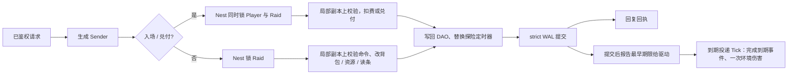
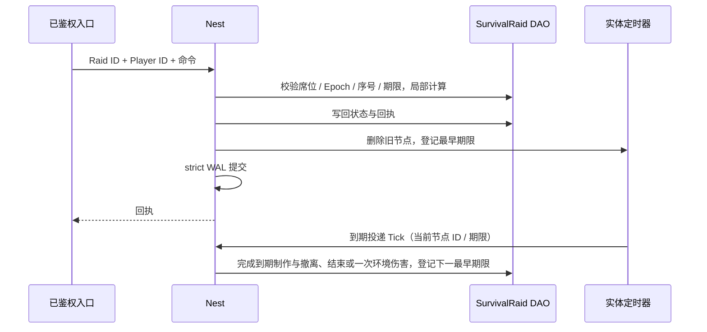

# 合作生存撤离框架学习与验收

本手册把“四人付费入局、采集制作、扛环境伤害、读条撤离后把带出的物资兑成永久资产”的主要业务路径映射到 core 的正式接口，分两部分：**第一部分“学习”**讲框架怎么用、为什么这样设计，按配置、成局、入场、局内命令、期限、兑付的顺序给出阅读顺序与可编译的调用示例；**第二部分“验收”**说明脚本证明什么、不证明什么。地图、物资、配方、伤害、价格由游戏定义。下面的业务夹具（四个相邻区域：0 是安全撤离区，1 / 2 / 3 分别产木材、矿石、食物；2 木材 + 1 食物制作一个药剂；死亡掉落整个背包；撤离读条完成后按固定单价兑换永久金币）只是学习和验收样例：框架与生成器不包含任何生存撤离规则，生成器也不生成这些业务文件；完整的参考应用仍是 [game-demo](../../demo/README.md)。其他游戏类型的手册见 [SLG](SLG-INTEGRATION.md)、[MMORPG](MMORPG-INTEGRATION.md)、[MOBA](MOBA-INTEGRATION.md)、[卡牌 RPG](CARD-RPG-INTEGRATION.md)、[合作塔防](TOWER-DEFENSE-INTEGRATION.md)。

## 第一部分：学习

### 1. 适合谁、先读什么

适合准备用 core 做合作生存、搜打撤一类“局内物资只有带出来才算数”的游戏的后端工程师。先读[入门](../GETTING-STARTED.md)、[Nest / Entity](guide/02-nest-entity.md)、[DataEngine](guide/03-dataengine.md)；第一次学建议先读完 [SLG 手册](SLG-INTEGRATION.md)的第一部分（它把 Entity / DAO / Nest / 实体定时器的基本接法讲得最细），再读本篇；同样是“多人共享一个房间实体”的写法，[合作塔防](TOWER-DEFENSE-INTEGRATION.md)更短，可以先读。

本类型选择**服务器权威探险**：一个探险实体拥有名单、公共资源点、每名玩家的位置 / 生命 / 背包、制作与撤离读条、死亡掉落和期限；玩家命令都在这个实体的 Nest 锁内裁决，客户端不上报坐标、背包或伤害。局内物品只在探险实体内改变归属，永久资产只在入场扣费与撤离兑付两个多实体事务里跨到 Player。

### 2. 模块分工：生存撤离里的状态归谁

| 业务状态 | 拥有者 | 框架接法 | 业务边界 |
| --- | --- | --- | --- |
| 永久金币、建档标记 | Player DAO | 生成的 Player DAO 字段，只在 Nest 事务里经 mutator 修改 | 局外逐件仓库、装备携入携出另建模；本例只用金币 |
| 一次探险：名单、冻结配置、资源点、各席位置 / 生命 / 背包 / 制作 / 撤离 / 封存清单、死亡掉落、期限、每席命令账本 | SurvivalRaid 实体的 DAO | `roost add entity SurvivalRaid` + `add dao`；与 Player 同一原服，入场 / 兑付用多实体 Sender | 状态整段存成一个业务 JSON，每席账本至多 128 条 |
| 制作完成、撤离完成、环境伤害、探险结束这些期限 | SurvivalRaid 的实体定时器（一个节点，取最早期限） | `roost add timer --entity SurvivalRaid`；节点存 DAO，驱动到期投递 Tick | 离线到期只在加载后触发一次，框架不追帧；一次触发里业务处理所有已到期事件、环境伤害只算一次 |
| 配置（探险时长、伤害间隔、制作 / 撤离时长、生命、背包容量、入场费、资源量、单价） | configdata Store / Snapshot | 注册对象定义 → Load 时校验 → 成局时捕获一份快照，按值传给 Sender | 字段范围由业务 `Validate` 定义；失败不发布 |
| 物资守恒 | 纯函数 | 加载与每次修改后 `Validate` 计算整局物资账 | 守恒公式属于业务 |
| 客户端看到的探险 | 业务视图 `View` | 已鉴权入口经 Nest 锁内读取，只返回允许的字段 | 不公开他人背包、制作、撤离清单和账本；死亡掉落公开 |
| 登录与账号、成局 | account / Player 静态 sid、匹配服务 | 复用正式生命周期与登录鉴权 | 夹具直接用合成的已鉴权身份和固定名单；“一名玩家同时只在一局”这类唯一性由业务处理，框架提供参考 [service/match](../../service/match) |



`strict` 保证回复前 WAL fsync，不保证回复时 Mongo 已投影（[DataEngine](guide/03-dataengine.md)）。

### 3. 入场、采集制作、撤离与兑付：如何使用

#### 3.1 生成工程从哪来

在仓库根目录使用 go.mod 声明的工具链运行：

```bash
ROOST_SURVIVAL_EXTRACTION_KEEP=1 bash scripts/test-survival-extraction-generated.sh   # 保留生成工程以便阅读；不加 KEEP 时成功即删除
```

脚本打印临时目录，生成工程在其中的 `project/`。它做的事就是一个新工程的接入步骤：

1. `roost project new survival-extraction-practice -module example.com/survival-extraction-practice -template game`；
2. `roost add dao Player --entity Player`、`roost add entity SurvivalRaid`、`roost add dao SurvivalRaid --entity SurvivalRaid`、`roost add timer --entity SurvivalRaid`；
3. 业务只改这几处：在 `db/def/player.go` 加 ``Gold int64 `bson:"gold" dao:"persist"` `` 与 ``Initialized bool `bson:"initialized" dao:"persist"` ``，在 `db/def/survival_raid.go` 加 ``State string `bson:"state" dao:"persist"` `` 与 ``WakeTimer int64 `bson:"wake_timer" dao:"persist"` ``；把 `game/entities/survival_raid/entity.go` 注解里的 `category=entity.EntityCategoryOther` 改为 `EntityCategoryWorld`（入场 / 兑付时 Raid 与 Player 一起锁，Raid 放在更低的锁档，锁序固定）；放入业务包 `game/survival/`、定时回调 `game/entities/survival_raid/timer_handlers.go` 与 handler `game/handler/survival_extraction.go`；
4. `roost generate` 生成组件、访问器和 Sender，不手改生成文件。加字段时 generate 会打印 DAO 持久键变化的 WARN（加字段不需要迁移，老文档读成零值），见第 8 节。

生成的 `internal/bootstrap/generated.go` 已用 `wiring/entitytimer` 的 Mod 装配 SurvivalRaid 的定时器驱动（加载前绑业务时钟、Nest 可用后启动投递循环、停机时先停驱动），`internal/registry/nest_gen.go` 已登记 handler；业务不手写这两处接线。夹具的测试不起整个 App，所以在用例里手动 `TimerDriver.SetClock` / `Bind` / `Start`，顺序与 Mod 相同。

#### 3.2 阅读顺序

进入 `project/` 后按顺序读（括号里是仓库内的源文件）：

| 顺序 | 文件 | 先回答的问题 |
| --- | --- | --- |
| 1 | `game/survival/rules.go`（[rules.go.txt](../../scripts/testdata/survival-extraction/rules.go.txt)） | 配置怎样经校验发布？一次探险怎样固定一代？ |
| 2 | `game/survival/state.go`（[state.go.txt](../../scripts/testdata/survival-extraction/state.go.txt)） | 探险状态存了什么、视图裁掉什么？物资守恒怎样算？下一期限怎样取？ |
| 3 | `game/survival/match.go`（[match.go.txt](../../scripts/testdata/survival-extraction/match.go.txt)） | 入场、命令身份怎样核对？期限到达时按什么顺序处理制作、撤离、结束和环境伤害？ |
| 4 | `game/handler/survival_extraction.go`（[handlers.go.txt](../../scripts/testdata/survival-extraction/handlers.go.txt)） | 入场费与入场事实、兑付与封存清单在哪个锁与提交边界里一起生效？ |
| 5 | `game/entities/survival_raid/timer_handlers.go`（[timer_handlers.go.txt](../../scripts/testdata/survival-extraction/timer_handlers.go.txt)） | 回调怎样核对节点身份与期限？ |
| 6 | `game/handler/syncsender/` | 生成的 Sender 怎样把目标 ID 与业务参数交给 Nest；业务调用它，不手改 |
| 7 | [gameplay_test.go.txt](../../scripts/testdata/survival-extraction/gameplay_test.go.txt)、[rules_test.go.txt](../../scripts/testdata/survival-extraction/rules_test.go.txt) | 并发、拒绝、回滚、重连与守恒怎样实际验证 |
| 8 | [persistence/recovery_test.go](../../scripts/testdata/survival-extraction/persistence/recovery_test.go) | 制作与撤离都在途时被 SIGKILL 后怎样从未投影 WAL 恢复？兑付后再重启会不会再到账？ |

身份要分开理解：Player / SurvivalRaid 用框架完整 EntityID；“这名玩家进过这一局”是 Raid 上这一席的 `Joined` 事实（固定 Raid ID + Player ID）；每席的命令序号是这一席的单调序号域，Epoch 是这一席的会话代际；定时器节点 ID 是 Raid 内的独立身份。配置内容 hash、业务 State 里的 `Schema`、DAO 的 `_schema` 与 core 版本是四个不同的概念。

#### 3.3 用 Sender 调用

下面的文件放进保留的生成工程（例如 `internal/raidflow/flow.go`）可直接编译。`client` 是当前服务的 Nest 客户端，`catalog` 是进程启动时 `survival.OpenCatalog` 打开的配置，`now` 是服务器业务时钟（毫秒），EntityID 都是完整 ID：

```go
package raidflow

import (
	"context"

	syncsender "example.com/survival-extraction-practice/game/handler/syncsender"
	survival "example.com/survival-extraction-practice/game/survival"
	"github.com/tjbdwanghaibo/roost-core/framework/configdata"
	"github.com/tjbdwanghaibo/roost-core/framework/nest"
)

// openRaid 由成局服务在名单确定后调用：配置、名单与时间来自服务器。同一 Raid ID 重试返回原探险，名单不同则拒绝。
func openRaid(ctx context.Context, client nest.Client, catalog *configdata.Store,
	raidID int64, players [survival.Seats]int64, now int64) error {
	rules, err := survival.CaptureRules(catalog.Current()) // 一次探险只捕获一份快照
	if err != nil {
		return err
	}
	s := syncsender.NewSurvivalExtractionSender(client)
	for _, id := range players {
		// 内存里 Create 实体不等于持久建档；首次建档（送初始金币）要经过一次正式事务，重复调用不再加钱。
		if err := s.Sync_SurvivalPlayerInit(ctx, id); err != nil {
			return err
		}
	}
	_, err = s.Sync_SurvivalInit(ctx, raidID, players, rules, now)
	return err
}

// enterAndGather 是已鉴权入口：付费入场（重试只查原事实、不重复扣费），再走到木材区采集一件。
// playerID 来自鉴权会话；超时重试时原样重发同一条命令，不分配新序号。
func enterAndGather(ctx context.Context, client nest.Client, raidID, playerID int64, now func() int64) (survival.Receipt, error) {
	s := syncsender.NewSurvivalExtractionSender(client)
	if err := s.MultiSync_SurvivalEnter(ctx, playerID, raidID, now()); err != nil {
		return survival.Receipt{}, err
	}
	v, err := s.Sync_SurvivalView(ctx, raidID, playerID)
	if err != nil {
		return survival.Receipt{}, err
	}
	move := survival.Command{Seq: v.Self.NextSeq, Epoch: v.Self.Epoch, Kind: "move", A: 1}
	if _, err := s.Sync_SurvivalCommand(ctx, raidID, playerID, move, now()); err != nil {
		return survival.Receipt{}, err
	}
	gather := survival.Command{Seq: move.Seq + 1, Epoch: move.Epoch, Kind: "gather", A: 0} // A 是资源索引：0 木材
	return s.Sync_SurvivalCommand(ctx, raidID, playerID, gather, now())
}

// claim 在本人撤离完成（或死亡）后调用；金额只按服务器封存的清单与冻结单价计算，重试返回同一金额。
func claim(ctx context.Context, client nest.Client, playerID, raidID int64) (int64, error) {
	return syncsender.NewSurvivalExtractionSender(client).MultiSync_SurvivalClaim(ctx, playerID, raidID)
}
```

`raidID` 要用 id-gen 发的新号并先创建实体：直接 `Create` 不读存储，不能复用删过档或存了没加载的 ID（[删档后该 ID 不可再用，D10](guide/03-dataengine.md#4-冷加载与-schema)；框架只在 GetOrCreate 上守这一点）。归档旧探险时要保留入场与兑付身份，不能删掉 Raid 后用同一 ID 重开来绕过账本。夹具在测试里直接建实体，没有演示 id-gen 与匹配接线。每次调用的错误都要按业务逐次处理，示例只演示调用方式。

命令字段：`move` 的 A 是目标区域（只能到相邻区域，两次移动至少隔 100ms）；`gather` 的 A 是资源索引 0～2，玩家必须站在区域 A+1；`loot` 的 A 是死亡玩家的席位 0～3、B 是物资索引 0～3（木材、矿石、食物、药剂）；`craft`、`cancel_craft`、`heal`、`extract`、`cancel_extract` 的 A、B 都是 0。客户端不提供坐标、背包、伤害、时间和兑付金额。

#### 3.4 十二个场景各学什么

| 场景（测试名前缀 `TestSurvivalExtraction`） | 业务选择 | 学到的框架契约 |
| --- | --- | --- |
| `DeathRefundsUnfinishedCraftAndConservesItems` | 在野外扛到 1 血时开始制作，下一次环境伤害致死 | 未完工制作先退料再整包掉落；凭空多出一件掉落时加载被守恒校验拒绝 |
| `OfflineDamageIsBoundedAndRaidEndFixed` | 期限过去 30 秒只扣一次血；结束时刻不因此延后，到点时在场玩家死亡 | “一次触发只算一次伤害、结束时刻不延长”是业务选择（纯状态测试，框架的加载后补触发见第二部分） |
| `StrictDecodeLedgerAndMissingAdmission` | 尾随数据、超大状态被拒；某席账本直接填满 128 条后新命令被拒、旧回执仍可重放；没入场的席位不能操作，结束时记为 missed | 加载时严格解码并校验不变量；准入事实是持久业务状态 |
| `ConfigurationSnapshotPreservesPricesAndDuration` | 合法热更发布新一代、已开探险的单价与时长不变；非法热更被拒 | configdata 校验失败不替换当前快照；已捕获的值不被新发布改写 |
| `AdmissionAtomicAndIdempotent` | 入场写入后 handler 失败；四人各四次并发入场 | 多实体事务：入场费与 `Joined` 一起提交或一起回滚，每人只扣一次 |
| `SharedNodeCompetitionAndRetry` | 四人在同一资源点各把同一采集命令并发发三次；资源耗尽、站错区域 | 单实体 Nest 串行 + 业务序号：每条命令只采一次，资源点不被多扣；业务拒绝不写状态 |
| `CraftCapacityCancellationAndHealing` | 制作预扣原料并占住 3 格；背包满后采集被拒；取消退料、重发取消不重复退；期限到达完成制作；治疗只用一个药剂 | 期限由驱动 `DeliverDue` 投递；回执重放不重复改背包 |
| `DeathDropsAndConcurrentLoot` | 野外连扛六次伤害死亡、整包掉落；三人并发抢同一件食物；死者兑付为 0 | 竞争同一件物品只有一人成功；死亡不复活、不重复掉落 |
| `ChannelCancellationAndAtomicClaim` | 移动打断撤离读条；读条中不能制作；读条完成前兑付被拒；完成后封存清单；兑付写入后失败回滚；八次并发兑付 | 多实体兑付：Player 金币与 Raid 的 `Claimed` 一起提交，只到账一次 |
| `ReconnectPrivateInventoryAndDeadline` | 断线后不能操作；新会话票提升 Epoch，旧票断开与旧 Epoch 命令被拒，新会话按序号查旧回执；局外人查看被拒，队友视图不含他人背包；期限到达后的新命令被拒，定时器完成制作 | 会话代际由业务存在探险里；准入以期限为界 |
| `ExpiryCannotReopenOrReenter` | 业务时钟越过结束时刻一小时后投递一次（实体一直在内存，不是进程重启）：已开始且在结束前完成的撤离保留，其他人死亡；之后重复入场不复活、不再扣费 | 终态由服务器判定；一次触发处理到结束为止的全部到期事件 |
| `UndoRestoresMaterialsJobAndTimer` | 制作写入后 handler 失败 | undo 回滚后背包、制作任务和定时器节点一起恢复，重试同一命令成功 |

上述数值是样例，不是公共框架规则。这些场景实际证明到哪一步见第 11 节。

### 4. 配置为什么要按值捕获

`OpenCatalog` 用 `configdata.MustRegisterObject` 登记 `survival_rules`（`survival.json`），`Validate` 失败整次加载 / 重载被拒，旧快照继续服务（[业务表发布](guide/07-config.md#3-业务表发布)）。成局入口捕获 `catalog.Current()` 再 `CaptureRules` 得到 `Rules` 值交给 `Sync_SurvivalInit`；整份 `Rules` 写进探险状态，之后的入场费、时长、伤害间隔与兑付单价都用开局那一代，热更只影响新探险。公网请求**不携带** Rules。

### 5. 入场、命令身份与物资守恒

`MultiSync_SurvivalEnter(player, raid, now)` 同时锁 Player 与 Raid：Player 必须已建档，这一席若已 `Joined` 就直接返回（不再扣费、不复活）；否则扣 5 永久金币、置 `Joined`、给初始物资（2 木材 + 1 食物），一个事务提交。入场同样受期限约束，结束后未入场的席位记为 missed。

`Sync_SurvivalCommand(raid, player, command, now)`：每席的命令序号从 1 单调递增，相同序号与逐字段相同的命令重放返回原回执；换内容或跳序被拒。命令还带 Epoch（本席当前会话代际），不符即拒绝。收到未知结果时按序号重发同一命令或用 `Sync_SurvivalReceipt` 查回执，不要为“再试一次”分配新序号。每席账本至多 128 条，满了拒绝新命令而不淘汰旧回执；后台期限和兑付不受账本影响。

所有业务写 handler 都是 `rollback=undo durability=strict`：规则先在解码出的局部副本上执行，校验成功才写回 DAO；写入之后的拒绝由 Nest undo 撤回 DAO 与定时器。`Validate` 计算整局物资账：资源点 + 所有背包 + 所有死亡掉落 + 封存清单 + 在途制作的原料 + 已完成制作消耗的原料，要等于初始资源与已入场玩家的初始物资之和；药剂存量 + 已使用数要等于完成制作数。只检查余额非负发现不了“凭空多出一件”。

制作在途时原料仍占背包 3 格，玩家不能靠预扣腾出空位、采满后再让取消或死亡退料溢出。完成撤离时局内背包清空，物资写进不可变的 `Extracted` 清单；兑付不删除清单，所以重试返回同一金额。

### 6. 期限与持久探险定时器



探险只用一个定时器节点：期限取探险结束、下次环境伤害、四席制作完成与撤离完成中最早的一个。最早期限已到、Tick 还没提交时，新命令一律被拒（等定时器提交后重发原命令即可，已成功的回执查询不受影响），所以玩家命令不能越过待处理的死亡或撤离。回调核对节点 ID 与 `WakeTimer`、`Param1` 与原期限后，按固定顺序处理：

1. 完成已经到期的制作与撤离。开始制作和撤离时都要求完成时刻早于探险结束，二者不能在同一玩家身上同时进行。
2. 到达探险结束时刻时，仍在场的玩家死亡，未入场的席位记为 missed；已经到期的撤离在第 1 步保留成功。
3. 未结束且环境期限已到时，野外（区域 1～3）每人扣 1 血、只算一次，下次环境期限从当前时间起算。

**框架不追帧**：实体不在内存期间到期的节点，加载后只触发一次（[按实体的持久定时器](guide/10-time.md#4-按实体的持久定时器)）。本例据此在一次触发里处理所有已到期的制作 / 撤离与探险结束，但环境伤害只算一次，不按离线时长逐次补扣；结束时刻永不延长，停机再久也不能靠离线续命。这是“硬结束 + 离线伤害暂停”的业务选择：需要准点推进的玩法让实体常驻内存、由驱动按期投递 Nest 消息；需要按墙钟补算离线伤害的业务自己在回调里做有界补算（`Fire` 带原定期限、触发时刻与 `Overdue` 标志）。驱动不唤醒不在内存的实体，离线的探险直到下次加载才推进。所有席位都终结后本局结束、不再登记定时器；个人撤离完成即可兑付，不必等队友。

回调只经组件 API 操作本探险的期限，不另建调度器、不直接改节点 map；需要 Player 一起变化的事交给多实体 handler（[SLG §6](SLG-INTEGRATION.md#6-定时器回调能做什么)）。回调在 Nest 锁与事务内执行；校验失败时 panic，Nest 回滚这次 Tick，驱动收不到新期限报告会重投（`entitytimer.redelivered_total` 持续增长说明 Tick 在报错或回滚）。

### 7. 重连与视图

可信入口签发新的会话票，`Sync_SurvivalConnect(raid, player, ticket, true)` 把这一席的 Epoch 提升到新票；旧票的断开与旧 Epoch 的命令都被拒，旧连接不能踢掉新连接。新会话用 `Sync_SurvivalReceipt(raid, player, epoch, seq)` 查旧序号的回执（Epoch 填当前值）。掉线的玩家仍按期限承受环境伤害与探险结束，不能靠断线停表。

`View` 返回阶段、期限、资源点、死亡掉落、各席公开状态（ID、状态、位置、生命、在线），以及本席自己的背包、封存清单、制作 / 撤离完成时刻和下一序号；不含他人背包、制作、清单与账本，配置只给 hash。不要给 `State` 加 Sync 标记或直接下发整个实体；需要推送时按 [self_sync](PLAYER-ACCESS.md#7-玩家看自己的状态self_sync) 写业务视图。夹具只验证了字段与归属校验，没有联调公网 TCP 协议或客户端引擎。

### 8. 兑付与存储格式

`MultiSync_SurvivalClaim(player, raid)` 同时锁 Player 与 Raid，只在本人已撤离或已死亡时可用：撤离者按封存清单与冻结单价得金币，死亡为 0；Player 金币与这一席的 `Claimed` 一起提交，并发重试和冷加载后的重试都只得一份。这是同一原服内的多实体原子提交，不是跨 sid 的分布式事务；Player 在别的 sid 时走 Remote / Saga 原服协作（[Saga](guide/06-saga.md)；原生步骤单进程容量有限，见 Saga 指南 §5）。

存储格式要分两层看：

- **DAO 持久键**：`gold` / `initialized` / `state` / `wake_timer` 这些 `bson` 名就是 Mongo 里的键（[DESIGN-TODO D13](../maintenance/DESIGN-TODO.md#d13-dao-持久键的来源与水合时的键集合校验)）。以后改 Go 字段名要保留原 `bson` 名；改了 `bson` 名或删字段时，库里的旧键不再加载、下一次整文档写回即丢失，`roost generate` 与加载时只打 WARN。要改就先离线迁移（[schema 变更手册 §1](SCHEMA-MIGRATION.md#1-现行规则运行时只认当前-schema)）。
- **业务 JSON**：`State` 里的 `Schema=1` 是业务格式版本，加载时拒绝未知字段、尾随数据、超过 256 KiB 的状态以及违反守恒的物资账。改业务格式同样要离线迁移并配套代码，只改 DAO 字段的 `_schema` 不等于迁移了 JSON 内容。

### 9. 接入时容易踩的问题

- **锁目标没被识别**：Nest 生成器在不写 `target` / `targets` 时，把类型名含 `Entity` 的参数推断为锁目标；本夹具的锁接口叫 `ISurvivalRaidEntity` / `ISurvivalPlayerEntity`。名字不含 `Entity` 又没写 `target(s)` 时，`roost generate` 报 `//roost:nest found no entity parameter` 并点名 handler（[Nest 生成器](../../codegen/docs/NEST_RUNTIME.zh-CN.md)）。
- **多实体锁档**：入场与兑付同时锁 Player 与 Raid。分类的取值就是锁序等级（`framework/entity/category_order.go`），Raid 是多名玩家争用的场景对象，放在 `EntityCategoryWorld`（3.1 第 3 步），总比 Player 先取锁，锁序固定。
- **handler 里不发同步 Nest 请求**：已知参与者一次传给多实体 Sender；handler 内的同步请求被框架拒绝（`ErrSyncInHandler`）。
- **内存里建实体不等于建档**：`Create` 只建内存实例；首次建档、首次入场都要经过一次正式事务，重试只查原事实。

### 10. 练习

加“局外仓库：撤离时把药剂按件存进 Player 而不是兑成金币”或“队友复活”。先写清拥有者、幂等身份（哪个序号域、哪个准入事实）、事务参与者、配置代际和恢复语义，再选 Nest / 定时器 / Saga，不另造一套与框架平行的持久或并发状态机。

## 第二部分：验收

### 11. 业务纵切证明什么

```bash
bash scripts/test-survival-extraction-generated.sh
```

脚本按 3.1 的步骤生成工程，`replace` 指回当前检出（在 `generate` 之前），必须实际通过 12 条顶层 race 场景（3.4：4 条规则 + 8 条 Nest）且无 skip，随后执行消费者 build / vet、`roost id check` 与 `roost generate --check`；成功删除临时工程，失败或 `ROOST_SURVIVAL_EXTRACTION_KEEP=1` 时保留。脚本不挂在 `dataengine-env.sh test`、不在根包门禁里，改 `game` 模板、`add dao` / `add entity` / `add timer`、多实体 Sender 或 Nest 生成时手动跑。

- **证明**：公共 CLI 生成的 Player / SurvivalRaid DAO、SurvivalRaid 实体定时器、多实体 Sender 与 Nest 在 12 个业务组合下的事务、undo 回滚、锁顺序、业务幂等和期限核对；配置原子发布与按值冻结；物资守恒校验；视图字段与归属校验。Nest 用例里的期限经驱动的 `DeliverDue` 投递（实体一直在内存）。
- **不证明**：提交器是替身，不含文件 WAL fsync 与 Mongo；没有经过加载后补触发与驱动投递循环的计时（`ExpiryCannotReopenOrReenter` 是业务时钟跳过结束时刻，不是重启）；单进程，无 Redis / NATS；鉴权与会话票是合成身份；账本上限在纯状态测试里直接填满，没有经 Nest 跑满 128 条命令。夹具里的数值是样例。

### 12. 真实 WAL / Mongo 崩溃恢复

先按[隔离环境说明](../../wiring/scripts/integration/README.md)准备独立 Mongo 副本集并设置地址变量（不要指向生产库或共享业务库；共享隔离环境下遵守那里的持锁与命名规则），再运行：

```bash
ROOST_SURVIVAL_EXTRACTION_REAL=1 bash scripts/test-survival-extraction-generated.sh
```

它在第 11 节之后追加 `TestSurvivalExtractionRealCrashRecovery`（已登记根包 `integration_coverage_test.go`），用本次唯一的 DAO 库与 WAL 目录：

1. 子进程经 strict 文件 WAL 提交四名玩家建档、开局、四人入场，以及 6 条命令：玩家 0 开始制作；玩家 1 去木材区采集一件、回安全区开始撤离读条；玩家 2 走进野外。后台投影关闭，断言 WAL 有 15 条已确认未投影的记录（4 建档 + 1 开局 + 4 入场 + 6 命令）、制作与撤离都在途且有待执行定时器后，父进程 SIGKILL 自己启动的子进程。
2. 父进程用同一 WAL 与 Mongo 冷加载，业务时间比开局晚 10 秒（撤离读条、制作与第一个环境期限都已过；若一直在线，按 5 秒间隔玩家 2 会扣两次血）：整份探险状态与定时器 ID 和崩溃前逐字节一致；6 条命令按原样重放，回执不变。
3. 断言冷加载已把存量最早期限报告给驱动索引（`DueOf`），然后启动驱动自己的投递循环（`Driver.Start`，与进程装配同一入口；用例不调用 `DeliverDue`）：循环投递一次加载后的补触发，投递计数恰为 1——这一次里玩家 0 得到药剂、玩家 1 的清单封存为 3 木材 + 1 食物、玩家 2 只扣 1 血，结束时刻不变。重复入场不再扣费；玩家 1 先兑付得 4。另外三人在安全区开始撤离（玩家 2 先走回安全区），业务时间推进到读条完成时刻，循环按时投递第 2 次，三人同时撤离、本局结束，全程无重投。
4. 停驱动后四人各兑付三次，最终永久金币为 100 / 99 / 98 / 98（初始 100、入场费 5，加各自清单 5 / 4 / 3 / 3）；正常关闭后再起第三个进程冷加载：核对探险状态与四人金币和关闭前一致，再重试入场、重放所有命令并重试兑付，结果不变。成功后删除本次库；失败保留生成工程、WAL 与库名供诊断。

对照：在真实依赖模式下把第 3 步的 `Start` 换掉跑一次，用例在等补触发的有界等待处失败（`bounded wait expired`，脚本退出码 1），所以补触发确实由循环完成。

- **证明**：strict 已确认的提交在 SIGKILL 后可从未投影 WAL 恢复，在途的制作与撤离读条、背包、资源点、回执与定时器节点完整恢复；驱动投递循环在冷加载后自动补触发一次、不追帧，业务在这一次里有界地处理到期事件；之后按时投递下一期限；跨进程重试不重复扣入场费或重复兑付。
- **不证明**：提交在途 / 结果未知时的崩溃、磁盘断电、WAL 损坏或丢盘；探险结束时刻在恢复路径上的处理（恢复用例在结束前收局，结束处理由 Nest 用例覆盖）；循环在系统时钟下的长时间计时（用例冻结业务时钟、由循环按 MaxWait 重读）、准入失败重试与 Redeliver（由 entitytimer 包测试覆盖）；多进程 / 跨机、Redis / NATS；四个逻辑玩家是同进程 Sender 并发，不是四台客户端，容量与长稳未测。

### 13. 结论怎样给

地图、物资、配方、伤害和价格缺少默认实现，不自动构成框架缺陷；合法接口调用下出现丢期限、重复扣费 / 到账、物资凭空增减、状态越权或生成物编译失败，则应在公共实现中修复。本夹具在当前 main 上没有触发框架或生成器缺陷。当前存储是教学规模：每席账本 128 条、单个状态至多 256 KiB 整体提交、加载时整段校验，没有生产吞吐或延迟承诺。

尚未实施或验收：真实客户端与公网鉴权、会话票签发、匹配与队友补位、开放世界地图与 AOI / 视野、命中 / 物理移动 / 反作弊、PvP 与队友伤害、完整 Skill Host、局外逐件仓库与装备携入携出、自动结算、长期归档、跨 sid 兑付与权威 HA（均不因此算框架缺陷）。本机功能、跨机故障和长稳分别给结论；缺少实际证据的继续保留为未验收项。本部分是本游戏验收范围的完整说明；[KNOWN-LIMITS](../maintenance/KNOWN-LIMITS.md#游戏接入验收) 的游戏接入验收表只列一行摘要，不为每一轮另建报告。
