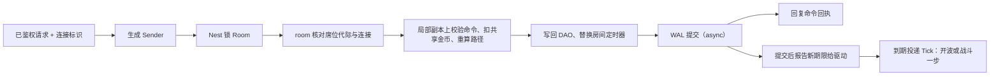
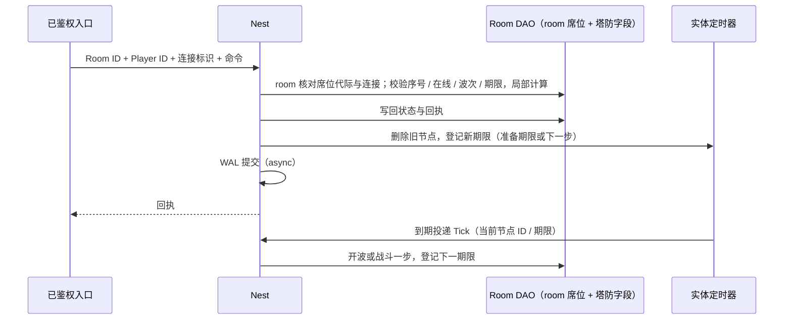

# 合作塔防框架学习与验收

本手册把“四人合作、共享金币建塔、怪物沿路径进攻基地”的主要业务路径映射到 core 的正式接口，分两部分：**第一部分“学习”**讲框架怎么用、为什么这样设计，按配置、成局、建造、波次、领奖的顺序给出阅读顺序与可编译的调用示例；**第二部分“验收”**说明脚本证明什么、不证明什么。地图、塔、怪物、经济和波次内容由游戏定义。工程按“装模块 + 只写模块没覆盖的部分”组织（R9，2026-11-17）：席位与重连归 `room` 模块、玩家金币归 `wallet`、建档归 `enter`，塔防房并入 room 的 `Room` 实体；下面的业务夹具（5×5 地图、入口格 0、基地格 24、三波每波三只怪物、建造 / 升级 / 出售、全员准备或期限到达开波）只是学习和验收样例：框架与生成器不包含任何塔防规则，生成器也不生成这些业务文件；完整的参考应用仍是 [game-demo](../../demo/README.md)。其他游戏类型的手册见 [SLG](SLG-INTEGRATION.md)、[MMORPG](MMORPG-INTEGRATION.md)、[MOBA](MOBA-INTEGRATION.md)、[卡牌 RPG](CARD-RPG-INTEGRATION.md)、[合作生存撤离](SURVIVAL-EXTRACTION-INTEGRATION.md)。

## 第一部分：学习

### 1. 适合谁、先读什么

适合准备用 core 做塔防、合作 PvE 守关一类游戏的后端工程师。先读[入门](../GETTING-STARTED.md)、[Nest / Entity](guide/02-nest-entity.md)、[DataEngine](guide/03-dataengine.md)；第一次学建议先读完 [SLG 手册](SLG-INTEGRATION.md)的第一部分（它把 Entity / DAO / Nest / 实体定时器的基本接法讲得最细），再读本篇。

本类型选择**服务器权威房间**：一个房间实体（room 模块的 `Room`）拥有地图、塔、路径、怪物、基地与共享金币，四名玩家的命令都在这个实体的 Nest 锁内裁决；战斗由服务器按期限一步步推进，客户端只提交建造 / 升级 / 出售 / 准备，不上报命中、伤害或怪物坐标。需要帧同步的玩法看 [MOBA](MOBA-INTEGRATION.md)。

### 2. 模块分工：塔防里的状态归谁

| 业务状态 | 拥有者 | 框架接法 | 业务边界 |
| --- | --- | --- | --- |
| 永久金币 | **wallet 模块**（Player DAO 的 `Wallet`） | `roost module add wallet`；领奖在同一笔事务里调 `Wallet().Add` | 局内金币与永久金币是两个经济域，只在领奖事务里跨过去；“领过没有”是长期事实，记在 Room（wallet 的去重窗口只防短期重发） |
| 建档做过没有 | **enter 模块**（Player DAO 的 `Enter`） | `roost module add enter`；建档经 `EnterInit`，领奖查 `Enter().Built()` | Q6：只装 enter，不装 login / portal，Robot 用夹具鉴权 |
| 席位、代际与连接、在线、房主 | **room 模块**（`Room` 实体的 `Seats` / `EpochSeed` / `Online`） | `roost module add room`；入座 `RoomJoin`、换连接 `RoomReconnect`、断线 `RoomDisconnect`（断线订阅自动调） | 在线状态不落库，重启后全员断线、成员 `RoomReconnect` 才上线；连接标识必须来自服务端 Session |
| 一个房间的塔防事实：名单、冻结配置、地格与塔、路径、怪物、基地、共享金币、阶段与期限、每席准备 / 领奖 / 命令账本 | `RoomDao` 末尾的塔防字段 `TowerState` / `TowerWakeTimer`（手写） | 在 room 模块的 `db/def/room.go` 里追加；与 Player 同一原服，领奖用多实体 Sender | 状态整段存成一个业务 JSON，每席账本至多 128 条 |
| 名单准入 | Room 实体上的 `event.RoomJoining` 监听（手写，借鉴 matchroom） | `//roost:listen` 写在 `game/entities/room/tower.go` | 塔防房只放名单里的人；普通房放行 |
| 准备期限、战斗一步的期限 | Room 的实体定时器（手写类型 `TimerTowerPhase`） | `roost add timer --entity Room`；节点存 DAO，驱动到期投递 Tick | 离线到期只在加载后触发一次，框架不追帧；本例每次触发只算一步 |
| 配置（准备时长、步长、波数、怪物血量、基地血量、建造费用） | configdata Store / Snapshot | 注册对象定义 → Load 时校验 → 成局时捕获一份快照，按值传给 Sender | 字段范围由业务 `Validate` 定义；失败不发布 |
| 路径 | 纯函数 | 业务确定性 BFS，与扣费 / 建塔同事务 | 多路导航、动态改道属于业务 |
| 客户端看到的房间 | 业务视图 `View` | 已鉴权入口经 Nest 锁内读取，只返回允许的字段 | 原始 DAO State 含各席账本，不加 Sync 标记 |
| 登录与账号、成局 | account / Player 静态 sid、匹配服务 | 复用正式生命周期与登录鉴权 | 夹具直接用合成的已鉴权身份和固定名单；“一名玩家同时只在一个房间”这类唯一性由业务处理，框架提供参考 [service/match](../../service/match) |



业务写 handler 不写 durability，用缺省 `async`：记录写进 WAL 文件就回复，fsync 由组提交稍后完成——进程崩溃（SIGKILL、panic、OOM）不丢已回复的修改，整机掉电或内核崩溃可能丢最后一个组提交间隔（缺省 10ms）；回复时也不保证 Mongo 已投影（[DataEngine](guide/03-dataengine.md)）。

### 3. 共享建造、波次与团队奖励：如何使用

#### 3.1 生成工程从哪来

在仓库根目录使用 go.mod 声明的工具链运行：

```bash
ROOST_TOWER_DEFENSE_KEEP=1 bash scripts/test-tower-defense-generated.sh   # 保留生成工程以便阅读；不加 KEEP 时成功即删除
```

脚本打印临时目录，生成工程在其中的 `project/`。它做的事就是一个新工程的接入步骤：

1. `roost project new tower-defense-practice -module example.com/tower-defense-practice -template game`；
2. 装模块：`roost module add room wallet enter`（脚本经公用的 [`genre-common/modules.sh`](../../scripts/testdata/genre-common/modules.sh) `add`；Player / Room 的主 DAO 与玩家 TCP 接入由安装计划代办），再 `roost add timer --entity Room`；
3. 业务只改这几处：在 room 模块的 `db/def/room.go` 的 `RoomDao` 末尾加 ``TowerState string `store:"tower_state" dao:"nosync"` `` 与 ``TowerWakeTimer int64 `store:"tower_wake_timer" dao:"nosync"` ``；放入业务包 `game/modules/towerdefense/`、定时回调 `game/entities/room/timer_handlers.go`（覆盖 `add timer` 生成的示例）、名单监听 `game/entities/room/tower.go` 与 handler `game/handler/tower_defense.go`。Room 的实体注解已经是 `EntityCategoryWorld`（room 模块写的），领奖时 Room 与 Player 一起锁，锁序固定，不用再改；Player 不再加金币与建档字段（wallet / enter 的状态由安装器追加）；
4. 接入公共 Robot：在最终 `roost generate` 之前运行 `python3 scripts/testdata/robot-common/install.py <仓库根> <工程根> tower-defense`，安装业务 PB、已鉴权 TCP → Sender 接线、`loadtest.Commands`、`cmd/robot` 与网络用例 `game/handler/robot_network_test.go`（自定义 module 由安装器读 go.mod）；
5. `roost generate` 生成组件、访问器和 Sender，不手改生成文件。加字段时 generate 会打印 DAO 持久键变化的 WARN（加字段不需要迁移，老文档读成零值），见第 7 节。

生成的 `internal/bootstrap/generated.go` 已用 `wiring/entitytimer` 的 Mod 装配 Room 的定时器驱动（绑定 Nest、Nest 可用后启动投递循环、停机时先停驱动；业务时间是驱动缺省的 `fctx.Now`），`internal/registry/nest_gen.go` 已登记 handler；业务不手写这两处接线。夹具的测试不起整个 App，所以在用例里手动 `TimerDriver.SetClock` / `Bind` / `Start`，顺序与 Mod 相同。

#### 3.2 阅读顺序

进入 `project/` 后按顺序读（括号里是仓库内的源文件）：

| 顺序 | 文件 | 先回答的问题 |
| --- | --- | --- |
| 1 | `game/modules/towerdefense/rules.go`（[rules.go.txt](../../scripts/testdata/tower-defense/rules.go.txt)） | 配置怎样经校验发布？一个房间怎样固定一代？ |
| 2 | `game/modules/towerdefense/state.go`（[state.go.txt](../../scripts/testdata/tower-defense/state.go.txt)） | 房间状态存了什么、视图裁掉什么？BFS 怎样保证入口到基地始终可达？加载时校验哪些不变量？ |
| 3 | `game/modules/towerdefense/match.go`（[match.go.txt](../../scripts/testdata/tower-defense/match.go.txt)） | 命令的序号与波次怎样核对、断线的席位为什么只能重放？准备屏障与开波、一步战斗怎样确定性推进？ |
| 4 | `game/handler/tower_defense.go`（[handlers.go.txt](../../scripts/testdata/tower-defense/handlers.go.txt)） | 开房与名单为什么一笔事务？命令怎样先过 room 的代际与连接围栏？共享金币、塔、路径、回执和定时器在哪个锁与提交边界里一起生效？领奖怎样经 wallet 与 Room 的 Claimed 原子提交？ |
| 5 | `game/entities/room/tower.go`（[room_roster.go.txt](../../scripts/testdata/tower-defense/room_roster.go.txt)） | 名单准入怎样挂在 room 的 `RoomJoining` 事件上？普通房为什么放行？ |
| 5A | `game/entities/room/timer_handlers.go`（[timer_handlers.go.txt](../../scripts/testdata/tower-defense/timer_handlers.go.txt)） | 回调怎样核对节点身份与期限？为什么每次只算一步？ |
| 5B | room / wallet / enter 模块的 README（[room](../../modules/room/README.md)、[wallet](../../modules/wallet/README.md)、[enter](../../modules/enter/README.md)） | 模块管到哪、不管什么；`roost module verify` 跑的是哪些场景 |
| 6 | `game/handler/syncsender/` | 生成的 Sender 怎样把目标 ID 与业务参数交给 Nest；业务调用它，不手改 |
| 7 | [gameplay_test.go.txt](../../scripts/testdata/tower-defense/gameplay_test.go.txt)、[rules_test.go.txt](../../scripts/testdata/tower-defense/rules_test.go.txt) | 并发、拒绝、回滚、重连与胜负怎样实际验证 |
| 8 | [persistence/recovery_test.go](../../scripts/testdata/tower-defense/persistence/recovery_test.go) | 波次进行中被 SIGKILL 后怎样从未投影 WAL 恢复？领奖后再重启会不会再发奖？ |

身份要分开理解：Player / Room 用框架完整 EntityID（本夹具的玩家号就是 Player 的 EntityID，room 的席位也以它为键）；地格号 0～24 是房间内坐标；每席的命令序号是这一席的单调序号域，Epoch 是 room 给这一席分配的代际（房间级 `EpochSeed` 只增不减），连接标识是服务端 Session 的 `ConnectionID`；定时器节点 ID 又是房间内的独立身份。配置内容 hash、业务 State 里的 `Schema`、DAO 的 `_schema` 与 core 版本是四个不同的概念。

#### 3.3 用 Sender 调用

下面的文件放进保留的生成工程（例如 `internal/towerflow/flow.go`）可直接编译。`client` 是当前服务的 Nest 客户端，`catalog` 是进程启动时 `towerdefense.OpenCatalog` 打开的配置；调用方不传业务时间：handler 的 `nowUnixMilli` 参数由生成的分发包装从本条消息冻结的业务时间（`fctx.NowMilli()`，见 [guide/10-time §1A](guide/10-time.md#1a-业务时间一律取自-ctxd22-1)）填，Sender 签名里没有它；EntityID 都是完整 ID：

```go
package towerflow

import (
	"context"

	syncsender "example.com/tower-defense-practice/game/handler/syncsender"
	roomentity "example.com/tower-defense-practice/game/entities/room"
	roomlogic "example.com/tower-defense-practice/game/modules/room"
	tower "example.com/tower-defense-practice/game/modules/towerdefense"
	"github.com/tjbdwanghaibo/roost-core/framework/app"
	"github.com/tjbdwanghaibo/roost-core/framework/configdata"
	"github.com/tjbdwanghaibo/roost-core/framework/nest"
	"github.com/tjbdwanghaibo/roost-core/infra/network/gateway"
)

// openRoom 由成局服务在名单确定后调用：配置由服务器捕获，名单与时间来自服务器，不来自客户端。
// roomUnique 是服务端分配、不复用的房号；开房与名单同一笔事务（TowerInit 里调 Room().Open），同号重试不重新开局，名单不同则拒绝。
// 玩家建档走 enter 模块（进入游戏时的 EnterInit），这里不再另建。
func openRoom(ctx context.Context, registry *app.Registry, client nest.Client, catalog *configdata.Store,
	roomUnique int64, players [tower.Seats]int64) (int64, error) {
	rules, err := tower.CaptureRules(catalog.Current()) // 一个房间只捕获一份快照
	if err != nil {
		return 0, err
	}
	roomID, err := roomlogic.EntityID(roomUnique)
	if err != nil {
		return 0, err
	}
	rooms, err := roomentity.LifecycleFromRegistry(registry) // 与 room.Open 相同：先经 lifecycle 取到或建出实体
	if err != nil {
		return 0, err
	}
	if _, _, err = rooms.GetOrCreate(ctx, roomUnique); err != nil {
		return 0, err
	}
	return roomID, syncsender.NewTowerDefenseSender(client).Sync_TowerInit(ctx, roomID, players, rules)
}

// buildAndReady 是已鉴权入口：玩家先经 room 的 RoomJoin（或换连接后的 RoomReconnect）入座，再读视图取本席的代际、
// 下一序号和当前波次，然后建塔、准备。playerID 与连接标识都来自服务端 Session；公网请求只带地格。
// 超时重试时原样重发同一条命令，不分配新序号。
func buildAndReady(ctx context.Context, client nest.Client, session gateway.Session, roomID int64, cell int) (tower.Receipt, error) {
	playerID := session.Principal().PlayerID
	connection, err := roomlogic.ConnectionKey(session)
	if err != nil {
		return tower.Receipt{}, err
	}
	s := syncsender.NewTowerDefenseSender(client)
	v, err := s.Sync_TowerView(ctx, roomID, playerID, connection)
	if err != nil {
		return tower.Receipt{}, err
	}
	build := tower.Command{Seq: v.Self.NextSeq, Epoch: v.Self.Epoch, Round: v.Round, Kind: "build", A: cell}
	if _, err := s.Sync_TowerCommand(ctx, roomID, playerID, connection, build); err != nil {
		return tower.Receipt{}, err
	}
	ready := tower.Command{Seq: build.Seq + 1, Epoch: v.Self.Epoch, Round: v.Round, Kind: "ready"}
	return s.Sync_TowerCommand(ctx, roomID, playerID, connection, ready)
}

// claim 在房间终态后由每名玩家各自调用；奖励由服务器按团队终态推导，重试只返回同一金额。
func claim(ctx context.Context, client nest.Client, playerID, roomID int64) (int64, error) {
	return syncsender.NewTowerDefenseSender(client).MultiSync_TowerClaim(ctx, playerID, roomID)
}
```

`roomUnique` 要用 id-gen 发的新号，经生成的 lifecycle `GetOrCreate` 取到或建出实体（与 `room.Open` 相同）：直接 `Create` 不读存储，不能复用删过档或存了没加载的 ID（[删档后该 ID 不可再用，D10](guide/03-dataengine.md#4-冷加载与-schema)；框架只在 GetOrCreate 上守这一点）。夹具在测试里直接建实体，没有演示 id-gen、lifecycle 与匹配接线。每次调用的错误都要按业务逐次处理，示例只演示调用方式。

命令字段：`build` 的 A 是地格、B 必须为 0；`upgrade` / `sell` 的 A 是地格、B 是期望的当前塔等级；`ready` 的 A、B 都是 0。客户端不提供费用、伤害、怪物坐标、基地血量、时间、胜负和奖励。

#### 3.4 十一个场景各学什么

| 场景（测试名前缀 `TestTowerDefense`） | 业务选择 | 学到的框架契约 |
| --- | --- | --- |
| `RouteAlwaysConnectsEntranceAndBase` | 任一格单独建塔都有绕路；入口两侧都被堵时无路 | 纯业务 BFS，邻接顺序固定，同一棋盘同一路径 |
| `BattleDeterminismAndOneStepOfflineCatchup` | 同一状态两份副本逐步推进结果相同、参考布防获胜；期限过去一小时后只开波 / 只算一步 | 推进是确定性纯函数；“每次触发只算一步”是业务选择（不在 Nest 里，框架的加载后补触发见第二部分） |
| `StrictBoundsAndFrozenConfiguration` | 尾随数据、超大状态、非法路径、外人拥有的塔被拒；某席账本直接填满 128 条后新命令被拒、旧回执仍可重放 | 加载时严格解码并校验不变量，状态被改时拒绝而不是带病运行 |
| `CatalogReloadOnlyAffectsNewRooms` | 合法热更发布新一代、已开房间的规则不变；非法热更被拒 | configdata 校验失败不替换当前快照；已捕获的值不被新发布改写 |
| `ConcurrentCellReservationAndRetry` | 四人并发在同一格建塔 | 单实体 Nest 串行 + 业务序号：只有一人成功、共享金币只扣一次，重发同一命令返回原回执不再扣费 |
| `BlockingRouteAndForeignSaleRollback` | 堵死入口、在入口建塔、卖别人的塔、按旧等级升级都被拒；升级后出售退一半，重发出售不重复退款 | 业务拒绝不写任何状态（DAO 与定时器 ID 都不变）；扣费、建塔、路径同一事务 |
| `ReadyDisconnectAndOldConnection` | 已准备不能改塔；room 把席位标成断线后它不能下新命令、视图里显示离线；换连接 `RoomReconnect` 拿到新代际后，旧代际迟到的断线不影响新连接、旧代际命令被拒，新连接按新代际查旧回执，旧连接拿着新代际也查不到；期限到达后迟到的准备被拒，未全员准备也按期开波 | 席位代际与连接归 room 模块，塔防命令先过 room 的代际与连接围栏；准入以期限为界，期限之后的输入等定时器提交后再说 |
| `UndoRestoresSharedGoldRouteAndTimer` | 建塔写入后 handler 失败 | undo 回滚后塔、共享金币、路径和定时器节点一起恢复，重试同一命令成功 |
| `CooperativeVictoryAndAtomicRewards` | 四人建塔、全员准备、三波九只怪全部击杀、基地满血；领奖写入后失败回滚；四人各四次并发领奖 | 驱动 `DeliverDue` 按期推进；多实体领奖事务：wallet 余额与 Room 的 Claimed 一起提交或一起回滚，每人只得一份（70） |
| `DefeatNoRewardAndViewCopy` | 不建塔，六只怪逃逸、基地归零失败；失败领奖为 0；局外人查看被拒、经 room 的 `RoomJoin` 入座被名单监听拒绝（`room_not_member`，先于满员检查）；改视图里的路径不影响权威状态 | 终态由服务器判定；名单准入挂在 room 的拦截事件上；视图是副本，不引用权威切片 |
| `RobotBusiness` | 公共 Robot 经 loopback TCP / PB 发本玩法的业务命令：每条新 TCP 连接先带当前代际接管席位（经 Play 转 room 的 `RoomReconnect`），业务闭环、结算重试、TCP 重连后旧代际的重放被拒与拒绝路径 | 网络接入、连接标识（`room.ConnectionKey`）、正式 Sender / Nest 与 DAO 是同一条链路；鉴权与提交器是替身（[Robot](ROBOT.md)） |

上述数值是样例，不是公共框架规则。这些场景实际证明到哪一步见第 11 节。

#### 3.5 模块化之后场景语义的变化（R9，2026-11-17）

场景名与条数（11）不变；下面几条的断言改成读模块状态，旧断言 → 新断言：

| 场景 | 旧断言 | 新断言 |
| --- | --- | --- |
| `ReadyDisconnectAndOldConnection` | 夹具自己的 `Sync_TowerConnect(ticket)` 把席位标成断开 / 用新票提升 Epoch；旧票的断开返回错误 | room 的 `RoomDisconnect` 标断线（返回 changed=true，视图 `Connected=false`）；`RoomReconnect(旧代际, 新连接)` 拿新代际；旧代际的断线返回 changed=false、不报错、新连接仍在线；另加“旧连接拿新代际查回执被拒（`room_stale_epoch`）” |
| `CooperativeVictoryAndAtomicRewards`、`RobotBusiness` | `Player.Gold == 70` | wallet 的 `Wallet.Coins == 70`（领奖改调 `Wallet().Add`；原夹具的 100 万上限换成 wallet 的溢出检查） |
| `DefeatNoRewardAndViewCopy` | 局外人查看被拒 | 另加：局外人 `RoomJoin` 被名单监听拒绝（`room_not_member`） |
| `RobotBusiness` | TCP 重连后原样重放第一条命令得到原回执 | 每条新连接先接管席位；TCP 重连并接管之后，旧代际的原样重放被拒（客户端改用 `TowerReceipt` 按新代际查旧回执） |
| 全部 Nest 场景 | 建档 `Sync_TowerPlayerInit` 置 `Initialized` | enter 的 `Sync_EnterInit`，领奖查 `Enter().Built()` |
| `TestTowerDefenseRealCrashRecovery` | WAL 19 条未投影 | 23 条（多 4 次 `RoomJoin`）；另断言冷加载后 room 席位与代际都在、在线状态为空（全员断线），同一连接、同一代际的命令重放仍得原回执 |

变异证明（把模块调用去掉或改错，对应场景变红，恢复后变绿）记在 [R9 批 0 证据](../maintenance/evidence/r9-batch0-20261117/README.md)。

同日稍后，room 补了公开入口 `Room().Authorize`（代际 + 连接 + 在线），塔防的新命令改经它：断线席位的新命令由 room 拒绝（`room_stale_epoch`，原来是 `Apply` 里的规则错误），`ReadyDisconnectAndOldConnection` 的断言（被拒且状态、定时器不变）不变；重放与查回执仍是塔防自己那一支（第 5 节）。[证据](../maintenance/evidence/room-authorize-20261117/README.md)。

### 4. 配置为什么要按值捕获

`OpenCatalog` 用 `configdata.MustRegisterObject` 登记 `tower_rules`（`tower.json`），`Validate` 失败整次加载 / 重载被拒，旧快照继续服务（[业务表发布](guide/07-config.md#3-业务表发布)）。成局入口捕获 `catalog.Current()` 再 `CaptureRules` 得到 `Rules` 值交给 `Sync_TowerInit`；整份 `Rules` 写进房间状态，之后的建造费用、波数、怪物血量、步长都用开局那一代，热更只影响新房间。公网请求**不携带** Rules。

### 5. 命令身份、共享金币与阻路校验

`Sync_TowerCommand(room, player, connection, command)`（`now` 由分发包装填）：handler 的身份围栏 `towerMember` 分两支：新命令经 room 的 `Room().Authorize(player, Epoch, connection)`——代际是这一席当前的、`connection` 是这一席认下的那条连接、这条连接现在在线，三样一并核对；已有回执的重放（`Seq` 落在本席已有回执之内）与 `TowerReceipt` 查回执是塔防自己的一支，只核对 `Room().Member(player, Epoch)` 的代际与连接、**不要求在线**（重启后全员断线时，原连接、原代际的重试仍得原回执；`Authorize` 要求在线，所以这一支不用它）。旧代际、旧连接、新命令时断线一律 `room_stale_epoch`，旧连接的输入不会落到新会话上。之后每席的命令序号从 1 单调递增，相同序号与逐字段相同的命令重放返回原回执（不再扣费、不再建塔，断线的席位也可以重放）；换内容或跳序被拒；新命令还要 Round（当前波次）相符。收到未知结果时按序号重发同一命令或用 `Sync_TowerReceipt` 查回执，不要为“再试一次”分配新序号，否则会再建一座塔。

建塔、升级、出售都在房间状态的局部副本上计算：校验地格、所有者、期望等级和共享金币，建塔后重算 BFS，入口到基地不可达就整体拒绝；成功才写回 DAO、替换定时器并追加回执。不能先扣款再异步算路线。战斗阶段禁止建造 / 出售，路线不会在怪物行进中变化。

每席账本至多 128 条，满了拒绝新命令而不淘汰旧回执（淘汰会让旧请求被当成新请求重复扣费）；后台波次推进和领奖不受账本影响。正式服需要归档 / 分片方案。

### 6. 波次推进与持久房间定时器



全员准备时立即开波；有人未准备或掉线，就在准备期限到达时用现有防御开波。战斗中每步：塔按地格升序攻击射程内最靠近基地的怪物（同位置按怪物序号），伤害 `2 × 等级`；之后存活的怪物前进一格，走到基地的扣基地 2 点血。一波打完发 6 点局内补给并回到准备阶段；基地归零即失败，打完全部波次且基地存活即胜利。

每次状态推进都替换房间定时器（`saveTower`：`RemoveTimer` 旧节点、`NewTimerAt` 新期限、ID 记进 `TowerWakeTimer`）。回调核对节点 ID 与 `TowerWakeTimer`、`Param1` 与原期限，旧计时事件不会推进新阶段。**框架不追帧**：实体不在内存期间到期的节点，加载后只触发一次（[按实体的持久定时器](guide/10-time.md#4-按实体的持久定时器)）；本例据此每次触发只开波或只算一步，下一期限从实际触发时间起算，停机一小时不会在一次加载里补算一小时的伤害。需要准点推进的玩法让实体常驻内存、由驱动按期投递 Nest 消息；需要按墙钟补算离线损失的业务自己在回调里做有界补算（`Fire` 带原定期限、触发时刻与 `Overdue` 标志），不要循环丢失的所有 tick。驱动不唤醒不在内存的实体，离线的房间直到下次加载才推进。波次推进不看在线：全员断线（包括重启之后、成员还没 `RoomReconnect` 时）已有防御照样按期限打。

回调只经组件 API 操作本房间的期限，不另建调度器、不直接改节点 map；需要 Player 一起变化的事交给多实体 handler（[SLG §6](SLG-INTEGRATION.md#6-定时器回调能做什么)）。回调在 Nest 锁与事务内执行；校验失败时 panic，Nest 回滚这次 Tick，驱动收不到新期限报告会重投（`entitytimer.redelivered_total` 持续增长说明 Tick 在报错或回滚）。

### 7. 重连、视图、领奖与存储格式

重连全部归 room 模块：入座 `RoomJoin`、换连接后带上次确认的代际 `RoomReconnect`（CAS 分配新代际）、连接关闭由断线订阅自动 `RoomDisconnect`（要登记 manager `NewRoomPresence`，见 [room README](../../modules/room/README.md)）；旧代际迟到的断线不影响新连接，旧代际的命令被拒。在线状态不落库：进程重启后全员断线，成员 `RoomReconnect` 才重新在线。新连接用 `Sync_TowerReceipt(room, player, connection, epoch, seq)` 查旧序号的回执（Epoch 填当前值），不能把旧命令换新序号重做。`View` 只返回地图、塔、路径副本、怪物、各席公开状态和本席的 Epoch / 下一序号，不含各席账本和整份配置（只有配置 hash）。不要给 `State` 加 Sync 标记或直接下发整个实体；需要推送时按 [self_sync](PLAYER-ACCESS.md#7-玩家看自己的状态self_sync) 写业务视图。夹具只验证了字段与归属校验，没有联调公网 TCP 协议或客户端引擎。

`MultiSync_TowerClaim(player, room)` 同时锁 Player 与 Room，回查权威终态与 enter 的建档：胜利每人 70，失败为 0；wallet 的 `Add`（不留回执，只发一次由 `Claimed` 保证，wallet README 的写法）与 Room 上这一席的 `Claimed` 一起提交，并发重试和冷加载后的重试都只得一份。这是同一原服内的多实体原子提交，不是跨 sid 的多人原子奖励；Player 在别的 sid 时走 Remote / Saga 原服协作（[Saga](guide/06-saga.md)；原生步骤单进程容量有限，见 Saga 指南 §5），本地 MultiSync 不升级成分布式事务。

存储格式要分两层看：

- **DAO 持久键**：`tower_state` / `tower_wake_timer`（以及模块的 `wallet` / `enter` / room 的数字键）这些 `store` 键就是 Mongo 里的键（[DESIGN-TODO D13](https://github.com/tjbdwanghaibo/roost-core/blob/132ed79f689df01dc8df0ea3a44e9a768ee126d9/docs/maintenance/DESIGN-TODO.md#d13-dao-持久键的来源与水合时的键集合校验)）。以后改 Go 字段名要保留原 `store` 键；改了 `store` 键或删字段时，库里的旧键不再加载、下一次整文档写回即丢失，`roost generate` 与加载时只打 WARN。要改就先离线迁移（[schema 变更手册 §1](SCHEMA-MIGRATION.md#1-现行规则运行时只认当前-schema)）。
- **业务 JSON**：`TowerState` 里的 `Schema=1` 是业务格式版本，加载时拒绝未知字段、尾随数据、超过 256 KiB 的状态以及与 BFS 不一致的路径。改业务格式同样要离线迁移并配套代码，只改 DAO 字段的 `_schema` 不等于迁移了 JSON 内容。

### 8. 接入时容易踩的问题

- **锁目标没被识别**：Nest 生成器在不写 `target` / `targets` 时，把类型名含 `Entity` 的参数推断为锁目标；本夹具的锁接口叫 `ITowerRoomEntity` / `ITowerPlayerEntity`。名字不含 `Entity` 又没写 `target(s)` 时，`roost generate` 报 `//roost:nest found no entity parameter` 并点名 handler（[Nest 生成器](../../codegen/docs/NEST_RUNTIME.zh-CN.md)）。
- **多实体锁档**：领奖同时锁 Player 与 Room。分类的取值就是锁序等级（`framework/entity/category_order.go`），Room 是多名玩家争用的场景对象，room 模块把它放在 `EntityCategoryWorld`，总比 Player 先取锁，锁序固定。
- **改了 room 模块的文件之后**：塔防在 `db/def/room.go` 里追加字段、在 Room 实体上加监听与定时器；room 自带的 34 条场景（`roost module verify room`）照跑，监听对普通房放行就是为了不改它们的语义。不要改 `game/components/room/room.go` 里代际与连接的 CAS 检查（room README）。
- **连接标识**：命令、视图、回执都带连接标识，必须由接入层从服务端 Session 取（`room.ConnectionKey`），不能从客户端 PB 里取，也不能用玩家号或账号 SessionID 代替。
- **handler 里不发同步 Nest 请求**：已知参与者一次传给多实体 Sender；handler 内的同步请求被框架拒绝（`ErrSyncInHandler`）。
- **期限之后的命令**：期限已到但 Tick 还没提交时，新命令被拒；等定时器提交后读新视图再发，不要靠重复请求越过期限。

### 9. 练习

加“投票拆塔”或“Boss 波次掉落局外材料”。先写清拥有者、幂等身份（哪个序号域）、事务参与者、配置代际和恢复语义，再选 Nest / 定时器 / Saga，不另造一套与框架平行的持久或并发状态机。

## 第二部分：验收

### 10. 跑什么

```bash
bash scripts/test-tower-defense-generated.sh
```

脚本按 3.1 的步骤生成工程，`replace` 指回当前检出（在 `generate` 之前），必须实际通过 11 条顶层 race 场景（3.4：4 条规则 + 6 条 Nest + 1 条业务 Robot）且无 skip，随后执行消费者 build / vet、`roost id check` 与 `roost generate --check`，再经 `genre-common/modules.sh verify` 跑 `roost module verify --json`：已装的 room 34、wallet 17、enter 29 条模块场景，每个模块通过数等于本检出 `modules/<名>/module.yaml` 的 `verify.pass`、0 skip（结果留在输出目录的 `module-verify.json`）；成功删除临时工程，失败或 `ROOST_TOWER_DEFENSE_KEEP=1` 时保留。缺省模式由 `scripts/pretag.sh` 每次发版跑（根包 `TestGeneratedScriptsAreInPretag` 防止漏掉），并把真实依赖用例复制进工程只编译（`go vet`），生成器签名变化在发版前就会暴露；真实依赖模式不挂在 `dataengine-env.sh test`，改 `game` 模板、`add dao` / `add entity` / `add timer`、多实体 Sender 或 Nest 生成时手动跑。

业务 Robot 用例 `TestTowerDefenseRobotBusiness` 由 `scripts/testdata/robot-common/install.py` 安装（3.1 的 Robot 一步）：真实 TCP / PB → 正式 Sender / Nest → DAO 的业务闭环、结算重试、TCP 重连及拒绝路径断言，同时生成 `cmd/robot` 与 `loadtest/README.md`。鉴权与持久化是替身，不能替代上线验收；十三类玩法的通过数与网络验收边界见 [Robot](ROBOT.md#当前验证结果2026-11-01)。

### 11. 业务纵切证明什么

- **证明**：room / wallet / enter 模块装进玩法工程后与手写塔防代码共存（模块自带场景照过），公共 CLI 生成的 Player / Room DAO、Room 实体定时器、多实体 Sender 与 Nest 在 10 个业务组合下的事务、undo 回滚、锁顺序、业务幂等和期限核对；配置原子发布与按值冻结；视图字段与归属校验。Nest 用例里的波次推进经驱动的 `DeliverDue` 投递（实体一直在内存）。
- **不证明**：提交器是替身，不含文件 WAL fsync 与 Mongo；没有经过加载后补触发与驱动投递循环的计时；单进程，无 Redis / NATS；鉴权是合成身份，断线由用例直接调 `RoomDisconnect`（没有登记断线订阅 manager、没有真实连接关闭事件）；账本上限在纯状态测试里直接填满，没有经 Nest 跑满 128 条命令。夹具里的数值是样例。

### 12. 真实 WAL / Mongo 崩溃恢复

先按[隔离环境说明](../../wiring/scripts/integration/README.md)准备独立 Mongo 副本集并设置地址变量（不要指向生产库或共享业务库；共享隔离环境下遵守那里的持锁与命名规则），再运行：

```bash
ROOST_TOWER_DEFENSE_REAL=1 bash scripts/test-tower-defense-generated.sh
```

它在第 10 节之后追加 `TestTowerDefenseRealCrashRecovery`（已登记根包 `integration_coverage_test.go`），用本次唯一的 DAO 库与 WAL 目录：

1. 子进程经文件 WAL 提交（业务命令缺省 async）四名玩家建档（enter）、开房与名单、四人经 room 入座、各建一座塔并准备（第四个准备立即开第一波），再把业务时间推到第一步期限、用 `DeliverDue` 投递一次，打完第一波的第一步；后台投影关闭，断言 WAL 有 23 条已确认未投影的记录（5 个实体新建 + 4 建档 + 1 开房 + 4 入座 + 8 命令 + 1 Tick；Nest 之外 `Create` 新建持久实体时各补一条 strict 隔离事务）、房间处于战斗阶段第 1 步且有待执行定时器后，父进程 SIGKILL 自己启动的子进程。崩溃点在**波次进行中**：三只怪物已各前进一格、部分掉血。
2. 父进程用同一 WAL 与 Mongo 冷加载，业务时间比崩溃时晚一小时：整份房间状态（塔、路径、每只怪物的血量与位置、基地、共享金币、各席回执、期限）与定时器 ID 和崩溃前逐字节一致；room 的席位与代际都在、在线状态为空（全员断线，不落库）；四人的 8 条命令用原连接标识、原代际按原样重放，回执不变。
3. 断言冷加载已把存量期限报告给驱动索引（`DueOf`），然后启动驱动自己的投递循环（`Driver.Start`，与进程装配同一入口；用例不调用 `DeliverDue`）：循环投递一次加载后的补触发，只算第 2 步，下一期限从实际触发时间起算，投递计数恰为 1。之后用例把业务时间逐个推到期限本身，循环按时投递，每个期限计数加 1，打完三波获胜（击杀 9、逃逸 0），全程无重投。
4. 停驱动后四人各领奖三次，每人 wallet 余额 70；正常关闭后再起第三个进程冷加载：核对房间状态与四人金币和关闭前一致，再重放所有命令并重试领奖，结果不变。成功后删除本次库；失败保留生成工程、WAL 与库名供诊断。

对照：在真实依赖模式下把第 3 步的 `Start` 换掉跑一次，用例在等补触发的有界等待处失败（`bounded wait expired`，脚本退出码 1），所以补触发确实由循环完成。

- **证明**：已回复的提交（业务命令 async，写进 WAL 文件即回复）在进程 SIGKILL 后可从未投影 WAL 恢复，进行中的波次（怪物血量 / 位置、路径、定时器节点）完整恢复；驱动投递循环在冷加载后自动补触发一次、不追帧，之后按时投递每个期限；跨进程重试不重复扣费或发奖。
- **不证明**：提交在途 / 结果未知时的崩溃、磁盘断电、WAL 损坏或丢盘；循环在系统时钟下的长时间计时（用例冻结业务时钟、由循环按 MaxWait 重读）、准入失败重试与 Redeliver（由 entitytimer 包测试覆盖）；多进程 / 跨机、Redis / NATS；四个逻辑玩家不是四台客户端，容量与长稳未测。

### 13. 结论怎样给

地图、塔、怪物、经济和波次缺少默认实现，不自动构成框架缺陷；合法接口调用下出现丢期限、重复扣费 / 发奖、状态越权或生成物编译失败，则应在公共实现中修复。本夹具在当前 main 上没有触发框架或生成器缺陷。当前存储是教学规模：每席账本 128 条、单个状态至多 256 KiB 整体提交、加载时整段校验；500ms 步长不构成延迟或吞吐承诺。

尚未实施或验收：正式客户端与公网鉴权、匹配与中途补位、会话票签发服务、共享资金防恶意消耗、投票拆塔、完整 Skill Host 与状态效果、多路导航与动态改道、Boss 内容、战斗广播、自动派奖、房间归档、跨 sid 奖励与权威 HA（均不因此算框架缺陷）。本机功能、跨机故障和长稳分别给结论；缺少实际证据的继续保留为未验收项。本部分是本游戏验收范围的完整说明；[KNOWN-LIMITS](../maintenance/KNOWN-LIMITS.md#游戏接入验收) 的游戏接入验收表只列一行摘要，不为每一轮另建报告。
