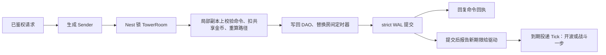
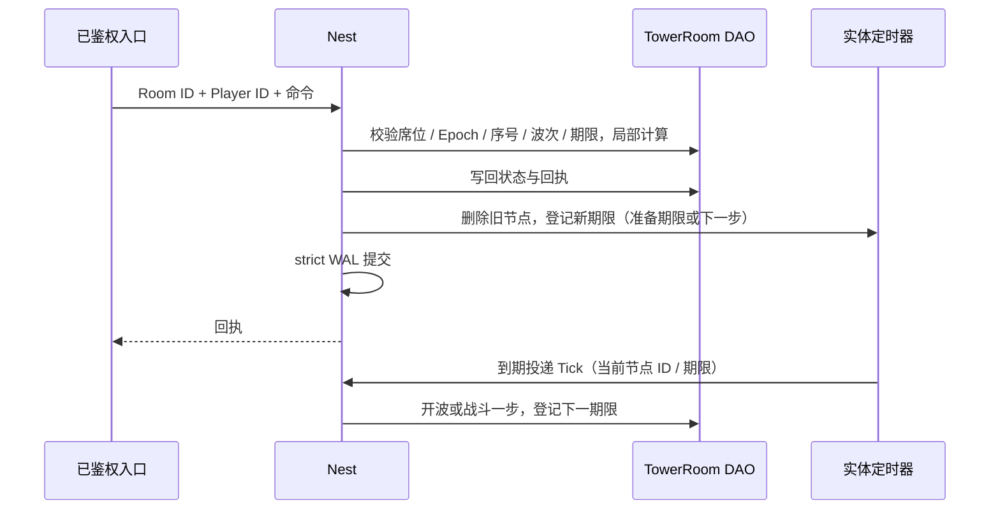

# 合作塔防框架学习与验收

本手册把“四人合作、共享金币建塔、怪物沿路径进攻基地”的主要业务路径映射到 core 的正式接口，分两部分：**第一部分“学习”**讲框架怎么用、为什么这样设计，按配置、成局、建造、波次、领奖的顺序给出阅读顺序与可编译的调用示例；**第二部分“验收”**说明脚本证明什么、不证明什么。地图、塔、怪物、经济和波次内容由游戏定义。下面的业务夹具（5×5 地图、入口格 0、基地格 24、三波每波三只怪物、建造 / 升级 / 出售、全员准备或期限到达开波）只是学习和验收样例：框架与生成器不包含任何塔防规则，生成器也不生成这些业务文件；完整的参考应用仍是 [game-demo](../../demo/README.md)。其他游戏类型的手册见 [SLG](SLG-INTEGRATION.md)、[MMORPG](MMORPG-INTEGRATION.md)、[MOBA](MOBA-INTEGRATION.md)、[卡牌 RPG](CARD-RPG-INTEGRATION.md)、[合作生存撤离](SURVIVAL-EXTRACTION-INTEGRATION.md)。

## 第一部分：学习

### 1. 适合谁、先读什么

适合准备用 core 做塔防、合作 PvE 守关一类游戏的后端工程师。先读[入门](../GETTING-STARTED.md)、[Nest / Entity](guide/02-nest-entity.md)、[DataEngine](guide/03-dataengine.md)；第一次学建议先读完 [SLG 手册](SLG-INTEGRATION.md)的第一部分（它把 Entity / DAO / Nest / 实体定时器的基本接法讲得最细），再读本篇。

本类型选择**服务器权威房间**：一个房间实体拥有地图、塔、路径、怪物、基地与共享金币，四名玩家的命令都在这个实体的 Nest 锁内裁决；战斗由服务器按期限一步步推进，客户端只提交建造 / 升级 / 出售 / 准备，不上报命中、伤害或怪物坐标。需要帧同步的玩法看 [MOBA](MOBA-INTEGRATION.md)。

### 2. 模块分工：塔防里的状态归谁

| 业务状态 | 拥有者 | 框架接法 | 业务边界 |
| --- | --- | --- | --- |
| 永久金币、建档标记 | Player DAO | 生成的 Player DAO 字段，只在 Nest 事务里经 mutator 修改 | 局内金币与永久金币是两个经济域，只在领奖事务里跨过去 |
| 一个房间：名单、冻结配置、地格与塔、路径、怪物、基地、共享金币、阶段与期限、每席命令账本 | TowerRoom 实体的 DAO | `roost add entity TowerRoom` + `add dao`；与 Player 同一原服，领奖用多实体 Sender | 状态整段存成一个业务 JSON，每席账本至多 128 条 |
| 准备期限、战斗一步的期限 | TowerRoom 的实体定时器 | `roost add timer --entity TowerRoom`；节点存 DAO，驱动到期投递 Tick | 离线到期只在加载后触发一次，框架不追帧；本例每次触发只算一步 |
| 配置（准备时长、步长、波数、怪物血量、基地血量、建造费用） | configdata Store / Snapshot | 注册对象定义 → Load 时校验 → 成局时捕获一份快照，按值传给 Sender | 字段范围由业务 `Validate` 定义；失败不发布 |
| 路径 | 纯函数 | 业务确定性 BFS，与扣费 / 建塔同事务 | 多路导航、动态改道属于业务 |
| 客户端看到的房间 | 业务视图 `View` | 已鉴权入口经 Nest 锁内读取，只返回允许的字段 | 原始 DAO State 含各席账本，不加 Sync 标记 |
| 登录与账号、成局 | account / Player 静态 sid、匹配服务 | 复用正式生命周期与登录鉴权 | 夹具直接用合成的已鉴权身份和固定名单；“一名玩家同时只在一个房间”这类唯一性由业务处理，框架提供参考 [service/match](../../service/match) |



`strict` 保证回复前 WAL fsync，不保证回复时 Mongo 已投影（[DataEngine](guide/03-dataengine.md)）。

### 3. 共享建造、波次与团队奖励：如何使用

#### 3.1 生成工程从哪来

在仓库根目录使用 go.mod 声明的工具链运行：

```bash
ROOST_TOWER_DEFENSE_KEEP=1 bash scripts/test-tower-defense-generated.sh   # 保留生成工程以便阅读；不加 KEEP 时成功即删除
```

脚本打印临时目录，生成工程在其中的 `project/`。它做的事就是一个新工程的接入步骤：

1. `roost project new tower-defense-practice -module example.com/tower-defense-practice -template game`；
2. `roost add dao Player --entity Player`、`roost add entity TowerRoom`、`roost add dao TowerRoom --entity TowerRoom`、`roost add timer --entity TowerRoom`；
3. 业务只改这几处：在 `db/def/player.go` 加 ``Gold int64 `bson:"gold" dao:"persist"` `` 与 ``Initialized bool `bson:"initialized" dao:"persist"` ``，在 `db/def/tower_room.go` 加 ``State string `bson:"state" dao:"persist"` `` 与 ``WakeTimer int64 `bson:"wake_timer" dao:"persist"` ``；把 `game/entities/tower_room/entity.go` 注解里的 `category=entity.EntityCategoryOther` 改为 `EntityCategoryWorld`（领奖时 Room 与 Player 一起锁，Room 放在更低的锁档，锁序固定）；放入业务包 `game/towerdefense/`、定时回调 `game/entities/tower_room/timer_handlers.go` 与 handler `game/handler/tower_defense.go`；
4. `roost generate` 生成组件、访问器和 Sender，不手改生成文件。加字段时 generate 会打印 DAO 持久键变化的 WARN（加字段不需要迁移，老文档读成零值），见第 7 节。

生成的 `internal/bootstrap/generated.go` 已用 `wiring/entitytimer` 的 Mod 装配 TowerRoom 的定时器驱动（加载前绑业务时钟、Nest 可用后启动投递循环、停机时先停驱动），`internal/registry/nest_gen.go` 已登记 handler；业务不手写这两处接线。夹具的测试不起整个 App，所以在用例里手动 `TimerDriver.SetClock` / `Bind` / `Start`，顺序与 Mod 相同。

#### 3.2 阅读顺序

进入 `project/` 后按顺序读（括号里是仓库内的源文件）：

| 顺序 | 文件 | 先回答的问题 |
| --- | --- | --- |
| 1 | `game/towerdefense/rules.go`（[rules.go.txt](../../scripts/testdata/tower-defense/rules.go.txt)） | 配置怎样经校验发布？一个房间怎样固定一代？ |
| 2 | `game/towerdefense/state.go`（[state.go.txt](../../scripts/testdata/tower-defense/state.go.txt)） | 房间状态存了什么、视图裁掉什么？BFS 怎样保证入口到基地始终可达？加载时校验哪些不变量？ |
| 3 | `game/towerdefense/match.go`（[match.go.txt](../../scripts/testdata/tower-defense/match.go.txt)） | 命令的身份（席位、Epoch、Seq、波次）怎样核对？准备屏障与开波、一步战斗怎样确定性推进？ |
| 4 | `game/handler/tower_defense.go`（[handlers.go.txt](../../scripts/testdata/tower-defense/handlers.go.txt)） | 共享金币、塔、路径、回执和定时器在哪个锁与提交边界里一起生效？领奖怎样与 Player 原子提交？ |
| 5 | `game/entities/tower_room/timer_handlers.go`（[timer_handlers.go.txt](../../scripts/testdata/tower-defense/timer_handlers.go.txt)） | 回调怎样核对节点身份与期限？为什么每次只算一步？ |
| 6 | `game/handler/syncsender/` | 生成的 Sender 怎样把目标 ID 与业务参数交给 Nest；业务调用它，不手改 |
| 7 | [gameplay_test.go.txt](../../scripts/testdata/tower-defense/gameplay_test.go.txt)、[rules_test.go.txt](../../scripts/testdata/tower-defense/rules_test.go.txt) | 并发、拒绝、回滚、重连与胜负怎样实际验证 |
| 8 | [persistence/recovery_test.go](../../scripts/testdata/tower-defense/persistence/recovery_test.go) | 波次进行中被 SIGKILL 后怎样从未投影 WAL 恢复？领奖后再重启会不会再发奖？ |

身份要分开理解：Player / TowerRoom 用框架完整 EntityID；地格号 0～24 是房间内坐标；每席的命令序号是这一席的单调序号域，Epoch 是这一席的会话代际；定时器节点 ID 又是房间内的独立身份。配置内容 hash、业务 State 里的 `Schema`、DAO 的 `_schema` 与 core 版本是四个不同的概念。

#### 3.3 用 Sender 调用

下面的文件放进保留的生成工程（例如 `internal/towerflow/flow.go`）可直接编译。`client` 是当前服务的 Nest 客户端，`catalog` 是进程启动时 `towerdefense.OpenCatalog` 打开的配置，`now` 是服务器业务时钟（毫秒），EntityID 都是完整 ID：

```go
package towerflow

import (
	"context"

	syncsender "example.com/tower-defense-practice/game/handler/syncsender"
	tower "example.com/tower-defense-practice/game/towerdefense"
	"github.com/tjbdwanghaibo/roost-core/framework/configdata"
	"github.com/tjbdwanghaibo/roost-core/framework/nest"
)

// openRoom 由成局服务在名单确定后调用：配置由服务器捕获，名单与时间来自服务器，不来自客户端。
// 同一 Room ID 重试返回原房间，不重新开局；名单不同则拒绝。
func openRoom(ctx context.Context, client nest.Client, catalog *configdata.Store,
	roomID int64, players [tower.Seats]int64, now int64) (tower.View, error) {
	rules, err := tower.CaptureRules(catalog.Current()) // 一个房间只捕获一份快照
	if err != nil {
		return tower.View{}, err
	}
	s := syncsender.NewTowerDefenseSender(client)
	for _, id := range players {
		// 内存里 Create 实体不等于持久建档；建档要经过一次正式事务。
		if err := s.Sync_TowerPlayerInit(ctx, id); err != nil {
			return tower.View{}, err
		}
	}
	return s.Sync_TowerInit(ctx, roomID, players, rules, now)
}

// buildAndReady 是已鉴权入口：先读视图取本席的 Epoch、下一序号和当前波次，再建塔、准备。
// playerID 来自鉴权会话；公网请求只带地格。超时重试时原样重发同一条命令，不分配新序号。
func buildAndReady(ctx context.Context, client nest.Client, roomID, playerID int64, cell int, now func() int64) (tower.Receipt, error) {
	s := syncsender.NewTowerDefenseSender(client)
	v, err := s.Sync_TowerView(ctx, roomID, playerID)
	if err != nil {
		return tower.Receipt{}, err
	}
	build := tower.Command{Seq: v.Self.NextSeq, Epoch: v.Self.Epoch, Round: v.Round, Kind: "build", A: cell}
	if _, err := s.Sync_TowerCommand(ctx, roomID, playerID, build, now()); err != nil {
		return tower.Receipt{}, err
	}
	ready := tower.Command{Seq: build.Seq + 1, Epoch: v.Self.Epoch, Round: v.Round, Kind: "ready"}
	return s.Sync_TowerCommand(ctx, roomID, playerID, ready, now())
}

// claim 在房间终态后由每名玩家各自调用；奖励由服务器按团队终态推导，重试只返回同一金额。
func claim(ctx context.Context, client nest.Client, playerID, roomID int64) (int64, error) {
	return syncsender.NewTowerDefenseSender(client).MultiSync_TowerClaim(ctx, playerID, roomID)
}
```

`roomID` 要用 id-gen 发的新号并先创建实体：直接 `Create` 不读存储，不能复用删过档或存了没加载的 ID（[删档后该 ID 不可再用，D10](guide/03-dataengine.md#4-冷加载与-schema)；框架只在 GetOrCreate 上守这一点）。夹具在测试里直接建实体，没有演示 id-gen 与匹配接线。每次调用的错误都要按业务逐次处理，示例只演示调用方式。

命令字段：`build` 的 A 是地格、B 必须为 0；`upgrade` / `sell` 的 A 是地格、B 是期望的当前塔等级；`ready` 的 A、B 都是 0。客户端不提供费用、伤害、怪物坐标、基地血量、时间、胜负和奖励。

#### 3.4 十个场景各学什么

| 场景（测试名前缀 `TestTowerDefense`） | 业务选择 | 学到的框架契约 |
| --- | --- | --- |
| `RouteAlwaysConnectsEntranceAndBase` | 任一格单独建塔都有绕路；入口两侧都被堵时无路 | 纯业务 BFS，邻接顺序固定，同一棋盘同一路径 |
| `BattleDeterminismAndOneStepOfflineCatchup` | 同一状态两份副本逐步推进结果相同、参考布防获胜；期限过去一小时后只开波 / 只算一步 | 推进是确定性纯函数；“每次触发只算一步”是业务选择（不在 Nest 里，框架的加载后补触发见第二部分） |
| `StrictBoundsAndFrozenConfiguration` | 尾随数据、超大状态、非法路径、外人拥有的塔被拒；某席账本直接填满 128 条后新命令被拒、旧回执仍可重放 | 加载时严格解码并校验不变量，状态被改时拒绝而不是带病运行 |
| `CatalogReloadOnlyAffectsNewRooms` | 合法热更发布新一代、已开房间的规则不变；非法热更被拒 | configdata 校验失败不替换当前快照；已捕获的值不被新发布改写 |
| `ConcurrentCellReservationAndRetry` | 四人并发在同一格建塔 | 单实体 Nest 串行 + 业务序号：只有一人成功、共享金币只扣一次，重发同一命令返回原回执不再扣费 |
| `BlockingRouteAndForeignSaleRollback` | 堵死入口、在入口建塔、卖别人的塔、按旧等级升级都被拒；升级后出售退一半，重发出售不重复退款 | 业务拒绝不写任何状态（DAO 与定时器 ID 都不变）；扣费、建塔、路径同一事务 |
| `ReadyDisconnectAndOldConnection` | 已准备不能改塔；掉线的席位不能操作；新会话票提升 Epoch 后旧连接的断开与旧 Epoch 命令被拒，新会话按序号查旧回执；期限到达后迟到的准备被拒，未全员准备也按期开波 | 会话代际由业务存在房间里；准入以期限为界，期限之后的输入等定时器提交后再说 |
| `UndoRestoresSharedGoldRouteAndTimer` | 建塔写入后 handler 失败 | undo 回滚后塔、共享金币、路径和定时器节点一起恢复，重试同一命令成功 |
| `CooperativeVictoryAndAtomicRewards` | 四人建塔、全员准备、三波九只怪全部击杀、基地满血；领奖写入后失败回滚；四人各四次并发领奖 | 驱动 `DeliverDue` 按期推进；多实体领奖事务：Player 金币与 Room 的 Claimed 一起提交或一起回滚，每人只得一份（70） |
| `DefeatNoRewardAndViewCopy` | 不建塔，六只怪逃逸、基地归零失败；失败领奖为 0；局外人查看被拒；改视图里的路径不影响权威状态 | 终态由服务器判定；视图是副本，不引用权威切片 |

上述数值是样例，不是公共框架规则。这些场景实际证明到哪一步见第 11 节。

### 4. 配置为什么要按值捕获

`OpenCatalog` 用 `configdata.MustRegisterObject` 登记 `tower_rules`（`tower.json`），`Validate` 失败整次加载 / 重载被拒，旧快照继续服务（[业务表发布](guide/07-config.md#3-业务表发布)）。成局入口捕获 `catalog.Current()` 再 `CaptureRules` 得到 `Rules` 值交给 `Sync_TowerInit`；整份 `Rules` 写进房间状态，之后的建造费用、波数、怪物血量、步长都用开局那一代，热更只影响新房间。公网请求**不携带** Rules。

### 5. 命令身份、共享金币与阻路校验

`Sync_TowerCommand(room, player, command, now)`：每席的命令序号从 1 单调递增，相同序号与逐字段相同的命令重放返回原回执（不再扣费、不再建塔）；换内容或跳序被拒。命令还带 Epoch（本席当前会话代际）和 Round（当前波次），二者不符即拒绝，旧连接的输入不会落到新会话上。收到未知结果时按序号重发同一命令或用 `Sync_TowerReceipt` 查回执，不要为“再试一次”分配新序号，否则会再建一座塔。

建塔、升级、出售都在房间状态的局部副本上计算：校验地格、所有者、期望等级和共享金币，建塔后重算 BFS，入口到基地不可达就整体拒绝；成功才写回 DAO、替换定时器并追加回执。不能先扣款再异步算路线。战斗阶段禁止建造 / 出售，路线不会在怪物行进中变化。

每席账本至多 128 条，满了拒绝新命令而不淘汰旧回执（淘汰会让旧请求被当成新请求重复扣费）；后台波次推进和领奖不受账本影响。正式服需要归档 / 分片方案。

### 6. 波次推进与持久房间定时器



全员准备时立即开波；有人未准备或掉线，就在准备期限到达时用现有防御开波。战斗中每步：塔按地格升序攻击射程内最靠近基地的怪物（同位置按怪物序号），伤害 `2 × 等级`；之后存活的怪物前进一格，走到基地的扣基地 2 点血。一波打完发 6 点局内补给并回到准备阶段；基地归零即失败，打完全部波次且基地存活即胜利。

每次状态推进都替换房间定时器（`saveTower`：`RemoveTimer` 旧节点、`NewTimerAt` 新期限、ID 记进 `WakeTimer`）。回调核对节点 ID 与 `WakeTimer`、`Param1` 与原期限，旧计时事件不会推进新阶段。**框架不追帧**：实体不在内存期间到期的节点，加载后只触发一次（[按实体的持久定时器](guide/10-time.md#4-按实体的持久定时器)）；本例据此每次触发只开波或只算一步，下一期限从实际触发时间起算，停机一小时不会在一次加载里补算一小时的伤害。需要准点推进的玩法让实体常驻内存、由驱动按期投递 Nest 消息；需要按墙钟补算离线损失的业务自己在回调里做有界补算（`Fire` 带原定期限、触发时刻与 `Overdue` 标志），不要循环丢失的所有 tick。驱动不唤醒不在内存的实体，离线的房间直到下次加载才推进。

回调只经组件 API 操作本房间的期限，不另建调度器、不直接改节点 map；需要 Player 一起变化的事交给多实体 handler（[SLG §6](SLG-INTEGRATION.md#6-定时器回调能做什么)）。回调在 Nest 锁与事务内执行；校验失败时 panic，Nest 回滚这次 Tick，驱动收不到新期限报告会重投（`entitytimer.redelivered_total` 持续增长说明 Tick 在报错或回滚）。

### 7. 重连、视图、领奖与存储格式

重连：可信入口签发新的会话票，`Sync_TowerConnect(room, player, ticket, true)` 把这一席的 Epoch 提升到新票；旧票的断开与旧 Epoch 的命令都被拒，旧连接不能踢掉新连接。新会话用 `Sync_TowerReceipt(room, player, epoch, seq)` 查旧序号的回执（Epoch 填当前值），不能把旧命令换新序号重做。`View` 只返回地图、塔、路径副本、怪物、各席公开状态和本席的 Epoch / 下一序号，不含各席账本和整份配置（只有配置 hash）。不要给 `State` 加 Sync 标记或直接下发整个实体；需要推送时按 [self_sync](PLAYER-ACCESS.md#7-玩家看自己的状态self_sync) 写业务视图。夹具只验证了字段与归属校验，没有联调公网 TCP 协议或客户端引擎。

`MultiSync_TowerClaim(player, room)` 同时锁 Player 与 Room，回查权威终态：胜利每人 70，失败为 0；Player 金币与 Room 上这一席的 `Claimed` 一起提交，并发重试和冷加载后的重试都只得一份。这是同一原服内的多实体原子提交，不是跨 sid 的多人原子奖励；Player 在别的 sid 时走 Remote / Saga 原服协作（[Saga](guide/06-saga.md)；原生步骤单进程容量有限，见 Saga 指南 §5），本地 MultiSync 不升级成分布式事务。

存储格式要分两层看：

- **DAO 持久键**：`gold` / `initialized` / `state` / `wake_timer` 这些 `bson` 名就是 Mongo 里的键（[DESIGN-TODO D13](../maintenance/DESIGN-TODO.md#d13-dao-持久键的来源与水合时的键集合校验)）。以后改 Go 字段名要保留原 `bson` 名；改了 `bson` 名或删字段时，库里的旧键不再加载、下一次整文档写回即丢失，`roost generate` 与加载时只打 WARN。要改就先离线迁移（[schema 变更手册 §1](SCHEMA-MIGRATION.md#1-现行规则运行时只认当前-schema)）。
- **业务 JSON**：`State` 里的 `Schema=1` 是业务格式版本，加载时拒绝未知字段、尾随数据、超过 256 KiB 的状态以及与 BFS 不一致的路径。改业务格式同样要离线迁移并配套代码，只改 DAO 字段的 `_schema` 不等于迁移了 JSON 内容。

### 8. 接入时容易踩的问题

- **锁目标没被识别**：Nest 生成器在不写 `target` / `targets` 时，把类型名含 `Entity` 的参数推断为锁目标；本夹具的锁接口叫 `ITowerRoomEntity` / `ITowerPlayerEntity`。名字不含 `Entity` 又没写 `target(s)` 时，`roost generate` 报 `//roost:nest found no entity parameter` 并点名 handler（[Nest 生成器](../../codegen/docs/NEST_RUNTIME.zh-CN.md)）。
- **多实体锁档**：领奖同时锁 Player 与 Room。分类的取值就是锁序等级（`framework/entity/category_order.go`），Room 是多名玩家争用的场景对象，放在 `EntityCategoryWorld`（3.1 第 3 步），总比 Player 先取锁，锁序固定。
- **handler 里不发同步 Nest 请求**：已知参与者一次传给多实体 Sender；handler 内的同步请求被框架拒绝（`ErrSyncInHandler`）。
- **期限之后的命令**：期限已到但 Tick 还没提交时，新命令被拒；等定时器提交后读新视图再发，不要靠重复请求越过期限。

### 9. 练习

加“投票拆塔”或“Boss 波次掉落局外材料”。先写清拥有者、幂等身份（哪个序号域）、事务参与者、配置代际和恢复语义，再选 Nest / 定时器 / Saga，不另造一套与框架平行的持久或并发状态机。

## 第二部分：验收

### 10. 跑什么

```bash
bash scripts/test-tower-defense-generated.sh
```

脚本按 3.1 的步骤生成工程，`replace` 指回当前检出（在 `generate` 之前），必须实际通过 10 条顶层 race 场景（3.4：4 条规则 + 6 条 Nest）且无 skip，随后执行消费者 build / vet、`roost id check` 与 `roost generate --check`；成功删除临时工程，失败或 `ROOST_TOWER_DEFENSE_KEEP=1` 时保留。脚本不挂在 `dataengine-env.sh test`、不在根包门禁里，改 `game` 模板、`add dao` / `add entity` / `add timer`、多实体 Sender 或 Nest 生成时手动跑。

### 11. 业务纵切证明什么

- **证明**：公共 CLI 生成的 Player / TowerRoom DAO、TowerRoom 实体定时器、多实体 Sender 与 Nest 在 10 个业务组合下的事务、undo 回滚、锁顺序、业务幂等和期限核对；配置原子发布与按值冻结；视图字段与归属校验。Nest 用例里的波次推进经驱动的 `DeliverDue` 投递（实体一直在内存）。
- **不证明**：提交器是替身，不含文件 WAL fsync 与 Mongo；没有经过加载后补触发与驱动投递循环的计时；单进程，无 Redis / NATS；鉴权与会话票是合成身份；账本上限在纯状态测试里直接填满，没有经 Nest 跑满 128 条命令。夹具里的数值是样例。

### 12. 真实 WAL / Mongo 崩溃恢复

先按[隔离环境说明](../../wiring/scripts/integration/README.md)准备独立 Mongo 副本集并设置地址变量（不要指向生产库或共享业务库；共享隔离环境下遵守那里的持锁与命名规则），再运行：

```bash
ROOST_TOWER_DEFENSE_REAL=1 bash scripts/test-tower-defense-generated.sh
```

它在第 10 节之后追加 `TestTowerDefenseRealCrashRecovery`（已登记根包 `integration_coverage_test.go`），用本次唯一的 DAO 库与 WAL 目录：

1. 子进程经 strict 文件 WAL 提交四名玩家建档、开房、四人各建一座塔并准备（第四个准备立即开第一波），再把业务时间推到第一步期限、用 `DeliverDue` 投递一次，打完第一波的第一步；后台投影关闭，断言 WAL 有 14 条已确认未投影的记录（4 建档 + 1 开房 + 8 命令 + 1 Tick）、房间处于战斗阶段第 1 步且有待执行定时器后，父进程 SIGKILL 自己启动的子进程。崩溃点在**波次进行中**：三只怪物已各前进一格、部分掉血。
2. 父进程用同一 WAL 与 Mongo 冷加载，业务时间比崩溃时晚一小时：整份房间状态（塔、路径、每只怪物的血量与位置、基地、共享金币、各席回执、期限）与定时器 ID 和崩溃前逐字节一致；四人的 8 条命令按原样重放，回执不变。
3. 断言冷加载已把存量期限报告给驱动索引（`DueOf`），然后启动驱动自己的投递循环（`Driver.Start`，与进程装配同一入口；用例不调用 `DeliverDue`）：循环投递一次加载后的补触发，只算第 2 步，下一期限从实际触发时间起算，投递计数恰为 1。之后用例把业务时间逐个推到期限本身，循环按时投递，每个期限计数加 1，打完三波获胜（击杀 9、逃逸 0），全程无重投。
4. 停驱动后四人各领奖三次，每人 70；正常关闭后再起第三个进程冷加载：核对房间状态与四人金币和关闭前一致，再重放所有命令并重试领奖，结果不变。成功后删除本次库；失败保留生成工程、WAL 与库名供诊断。

对照：在真实依赖模式下把第 3 步的 `Start` 换掉跑一次，用例在等补触发的有界等待处失败（`bounded wait expired`，脚本退出码 1），所以补触发确实由循环完成。

- **证明**：strict 已确认的提交在 SIGKILL 后可从未投影 WAL 恢复，进行中的波次（怪物血量 / 位置、路径、定时器节点）完整恢复；驱动投递循环在冷加载后自动补触发一次、不追帧，之后按时投递每个期限；跨进程重试不重复扣费或发奖。
- **不证明**：提交在途 / 结果未知时的崩溃、磁盘断电、WAL 损坏或丢盘；循环在系统时钟下的长时间计时（用例冻结业务时钟、由循环按 MaxWait 重读）、准入失败重试与 Redeliver（由 entitytimer 包测试覆盖）；多进程 / 跨机、Redis / NATS；四个逻辑玩家不是四台客户端，容量与长稳未测。

### 13. 结论怎样给

地图、塔、怪物、经济和波次缺少默认实现，不自动构成框架缺陷；合法接口调用下出现丢期限、重复扣费 / 发奖、状态越权或生成物编译失败，则应在公共实现中修复。本夹具在当前 main 上没有触发框架或生成器缺陷。当前存储是教学规模：每席账本 128 条、单个状态至多 256 KiB 整体提交、加载时整段校验；500ms 步长不构成延迟或吞吐承诺。

尚未实施或验收：正式客户端与公网鉴权、匹配与中途补位、会话票签发服务、共享资金防恶意消耗、投票拆塔、完整 Skill Host 与状态效果、多路导航与动态改道、Boss 内容、战斗广播、自动派奖、房间归档、跨 sid 奖励与权威 HA（均不因此算框架缺陷）。本机功能、跨机故障和长稳分别给结论；缺少实际证据的继续保留为未验收项。本部分是本游戏验收范围的完整说明；[KNOWN-LIMITS](../maintenance/KNOWN-LIMITS.md#游戏接入验收) 的游戏接入验收表只列一行摘要，不为每一轮另建报告。
