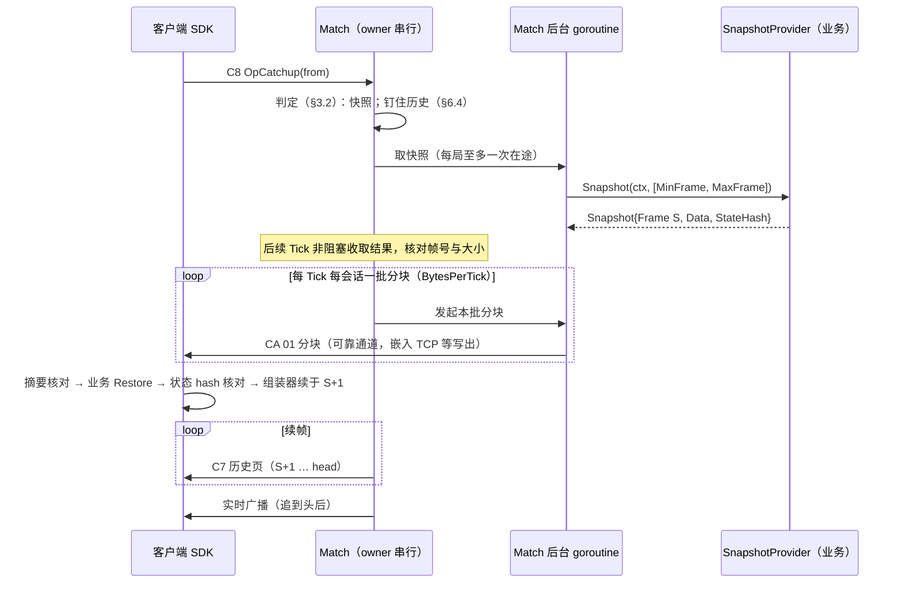

# 功能设计：Lockstep 可追帧也可全量快照恢复（2026-10-20）

**状态：已实施（P1～P5，维护者 2026-10-20 批准，§12 全部按推荐）。** 分期见 §11，实施记录与偏差见 §14。P5 同时实施了维护者 2026-10-20 的追加决定：恢复中被 Detach 计 `failed{reason="detached"}`（§14 P5）；MOBA 持久对局 `Room` 接快照来源已决定接入，另行实施中（§14 P4 第 1 条）。现行说明以 [guide/04-sync §6](../framework/guide/04-sync.md#落后的会话怎样回来追帧快照或自动) 与 [impl/04-sync §2D](../framework/impl/04-sync.md#2d-lockstep-快照恢复的实现契约) 为准，本篇 §3～§10 是评审稿（§6.3 已按实测改写），与实现不同处以 §14 为准。

维护者 2026-10-20 决定把 [DESIGN-TODO D1](DESIGN-TODO.md#d1-lockstep-历史的保留与过期策略) 的方案 B（全量快照恢复）立项为一个 feature，要求先写设计给他看；本篇写于评审前，评审后按 §11 分期实施。基线 origin/main `fb4c36cc`（相对 `f2d952b4` 只改了 DataEngine，Lockstep 相关源码未变）。范围在 Sync 三大块之一的 `framework/sync/lockstep`，以及它的两端：Go 客户端（`FrameAssembler`、`robot.LockstepBot`）与 C# SDK（`client/dotnet`），协议金样 `client/spec/packets.json`。

维护者已定的方向（原话要点）：

- 恢复方式做成 Match 的选项：`catchup`（只追帧，即现状）、`snapshot`（总是全量快照）、`auto`（缺的帧还在历史窗口内就追帧，超出窗口或缺口超过阈值就发快照；配置了快照来源时作缺省，§12 已定）。
- 快照来源由业务提供，框架只定接口；先只提供接口 + 一个“服务器参考模拟”示例实现。“健康客户端上传快照、多数一致才采信”牵涉作弊判定，本期不做。
- 框架负责：判断走追帧还是走快照；快照分块后走可靠通道、发送速度随链路放慢（复用嵌入 TCP 的 `PushLockstepSessionWritten` 等写出机制；独立 Gate 下暂不做写出回执，要写清行为）；快照之后续发输入；客户端恢复后哈希校验；Go 与 C# SDK 的“收快照、恢复、续帧”接口。

读码说明：codebase-memory 图停在 2026-10-14 一代，落后于 HEAD；本篇引用的源码位置全部按当前工作树源码重新核对（`path:line` 均按基线）。

## 1. 现状与问题

### 1.1 现在的恢复只有追帧

- 客户端发现缺帧（冗余补不上）后发 `C8 01 03 from`（`OpCatchup`），`Match.startCatchup`（[match.go:594](../../framework/sync/lockstep/match.go)）登记游标；之后每次 `Tick` 由 `pumpCatchup`（[match.go:709](../../framework/sync/lockstep/match.go)）经可靠通道每会话一页（`CatchupBatchFrames`，缺省 32 帧）在途地发 C7 历史页，追到头后切回实时广播。
- 历史默认只保留 `DefaultHistoryRetainFrames` = 3600 帧（[match.go:64](../../framework/sync/lockstep/match.go)，60Hz 60 秒 / 30Hz 120 秒），`Tick` 末尾 `retainWindow` 滚动裁剪（[match.go:523](../../framework/sync/lockstep/match.go)）。
- 起点早于窗口：`StartCatchup` 立即返回 `*CatchupUnservableError`（[match.go:619](../../framework/sync/lockstep/match.go)）；追帧途中被窗口越过：下一次 `Tick` 判定（[match.go:724](../../framework/sync/lockstep/match.go)）。两种情况都经可靠通道发 `C9 01 from start` 通知（[wire.go:164](../../framework/sync/lockstep/wire.go)），客户端终止：Go `FrameAssembler.Ingest` 返回该错误（[assembler.go:42](../../framework/sync/lockstep/assembler.go)），`robot.LockstepBot` 进入 `ErrLockstepBotTerminal`（[robot/lockstep.go:181](../../robot/lockstep.go)），C# `LockstepClient` 抛 `LockstepCatchupUnservableException` 并终止实例（[LockstepClient.cs:121](../../client/dotnet/Roost.Client/LockstepClient.cs)）。这是 D1 方案 C（`a6376934`）定下的“越界即终止、交由业务踢出或重开”。

### 1.2 问题

1. **越界即终止**：断线超过窗口（60Hz 下 60 秒）的玩家只能被踢出或开新局。移动网络切换、进电梯、切后台接电话、客户端崩溃重启这些常见情况都可能超过 60 秒；MOBA、RTS 一局 20～40 分钟，玩家“掉线后回不来”是不可接受的产品体验。
2. **窗口占内存，调大窗口代价线性**：窗口是“允许断线秒数 × 逻辑帧率”，10 席 × 8 字节输入下 3600 帧约 1.5MB / 局；想支持 10 分钟断线就是 36000 帧、约 15MB / 局，一台机器几百局时就是 GB 级，而且绝大多数局用不到。
3. **长断线即使在窗口内，追帧也慢**：追帧净速度是每 Tick `CatchupBatchFrames - 1` 帧（[match.go:110](../../framework/sync/lockstep/match.go)），客户端还要把这些帧全部重算一遍。缺 3000 帧的客户端在网络侧要约 100 个 Tick，再加上客户端重算 3000 帧的 CPU（重模拟的游戏在手机上可能是秒级）。缺口越大，一份状态快照越划算。
4. **中途加入 / 客户端重启后丢了本地状态**：客户端进程重启后本地状态为空，只能从帧 1 追；对局一长，帧 1 早已被裁掉。
5. **业务各自造轮子**：MOBA 5v5 夹具为了让窗口外的玩家回来，自己从持久日志分页补帧（[room.go.txt:254](../../scripts/testdata/moba/room.go.txt) 的 `replay`，[MOBA-INTEGRATION §5.7](../framework/MOBA-INTEGRATION.md#57-重连宿主代际与交接)），每帧重写整段日志并从第 1 帧重算，正式长局用不了；该夹具同时已有服务器参考模拟（`Round.Reference`）与 `Snapshot` / `Restore`（[simulation.go.txt:280](../../scripts/testdata/moba/simulation.go.txt)），只是框架没有把它接进恢复流程的口子。

## 2. 目标与非目标

**目标**

- Match 增加恢复方式选项 `catchup` / `snapshot` / `auto`，由框架在服务端判定走哪条路；`catchup` 保持现状逐字节不变。
- 定义业务快照来源接口 `SnapshotProvider`（Go），框架只负责调用、校验大小与帧号、共享、分块下发、计数与失败通知，不解释快照内容。
- 快照分块经可靠通道下发，发送节奏沿用追帧的“每会话一份在途 + 可靠通道随链路放慢”；嵌入 TCP 用 `TCPSender` 的等写出通道。
- 快照之后从快照帧的下一帧续发历史页，再接回实时广播；客户端按帧号连续应用，不出现缺口。
- 客户端两层校验：分块重组后的字节摘要（框架）+ 恢复后的业务状态 hash 与服务端给出的值核对（业务回调返回，SDK 比较）。
- Go（`FrameAssembler`、`robot.LockstepBot`）与 C#（`LockstepAssembler`、`LockstepClient`）提供“收快照、恢复、续帧”接口；`client/spec/packets.json` 金样更新。
- 一个“服务器参考模拟”示例实现，加 MOBA 夹具的长断线恢复验收。

**非目标（本期不做）**

- 客户端上传快照、多数一致才采信：牵涉作弊判定（谁可信、少数派如何处置），维护者 2026-10-20 明确不做，列为后续方向（§13）。
- 反作弊：快照来自服务器参考模拟，框架不判断客户端是否作弊；关键帧 hash 仍只用于发现分歧（`NoMajority` 不等于识别作弊者）。快照让客户端拿到完整局内状态，但全输入帧同步本来就能让改过的客户端重算出全部状态，信息暴露面不变（同 [MOBA-INTEGRATION](../framework/MOBA-INTEGRATION.md) 对战争迷雾的说明）。
- 独立 Gate 的写出回执：维护者 2026-10-20 决定暂不做（[KNOWN-LIMITS](KNOWN-LIMITS.md#lockstep)“Lockstep 追帧链路背压（独立 Gate）”）；本篇只写清在独立 Gate 下快照怎么节流、有什么风险（§6.3）。
- 服务器参考模拟本身、快照编码、检查点持久化与宿主崩溃续赛：都是业务的；框架不提供默认模拟，也不替业务持久化快照。
- 帧号回绕、跨对局复用路由（现有限制不变）。
- game-demo 战斗接入（见 §12 第 13 条）。

## 3. 恢复方式与判定规则

### 3.1 选项

```go
// RecoveryMode 决定落后的会话怎样回到对局。
type RecoveryMode uint8

const (
	// RecoveryUnset 是零值：没有配置 Snapshots.Provider 时等于 RecoveryCatchup（现行行为），
	// 配置了 Provider 时等于 RecoveryAuto（§12 第 1 条，已定）。
	RecoveryUnset RecoveryMode = iota
	// RecoveryCatchup 只追帧；越界以 ErrCatchupUnservable 失败并发失败通知（现状）。
	RecoveryCatchup
	// RecoverySnapshot 对每个追帧请求都先发全量快照，再从快照帧之后追帧。
	RecoverySnapshot
	// RecoveryAuto 缺的帧都还在窗口内、且缺口不超过 AutoCatchupMaxFrames 时追帧，否则发快照。
	RecoveryAuto
)
```

`NewMatch` 校验：`RecoverySnapshot` / `RecoveryAuto` 要求 `Snapshots.Provider` 与 `Reliable` 都非 nil，否则 `ErrMatchConfigInvalid`。旁观者（`SpectatorCatchup`）与座位用同一套判定。

### 3.2 判定（请求时）

客户端协议不变：仍只发 `OpCatchup(from)`；走哪条路由服务端判定，客户端从收到的第一条下行消息知道结果（C7 页、快照分块或失败通知）。记 `start` = 仍保留的最早帧，`head` = 最新已切帧，`gap` = `head + 1 - from`（`from` 为 0 按 1）：

| 模式 | `from >= start` 且（阈值为 0 或 `gap <= AutoCatchupMaxFrames`） | `from >= start` 但 `gap` 超过阈值 | `from < start`（已被裁掉） |
| --- | --- | --- | --- |
| catchup | 追帧（现状） | 追帧（现状，catchup 模式不看阈值） | `*CatchupUnservableError` + 失败通知（现状） |
| snapshot | 快照 | 快照 | 快照 |
| auto | 追帧 | 快照 | 快照 |

`StartCatchup` 在 snapshot / auto 模式下走快照路线时返回 nil（不再返回 `*CatchupUnservableError`）；只有 catchup 模式的越界、或快照路线最终失败（§4.3）才让客户端终止。

### 3.3 判定（进行中）

- 追帧途中被窗口越过（`state.next < start`，现在 [match.go:724](../../framework/sync/lockstep/match.go) 的分支）：catchup 模式照旧发失败通知；auto / snapshot 模式改为转入取快照，不通知客户端失败。
- 宿主主动要求：新增 `Match.StartSnapshot(player)` / `SpectatorSnapshot(session)`，不论模式都走快照（例如 `OnDesync` 判出某席离群后，宿主用服务器参考状态把它拉回；是否这样处置离群者是业务的选择）。要求配置了 Provider。

### 3.4 `auto` 的阈值怎么定

`AutoCatchupMaxFrames` 比较的是“追帧的总代价”和“快照的总代价”：

- 追帧：网络字节约 `gap × 每帧字节`（10 席 × 8 字节输入约 100～200 字节 / 帧），网络侧耗时约 `gap / (CatchupBatchFrames - 1)` 个 Tick，**加上客户端重算 `gap` 帧的 CPU**；
- 快照：网络字节 = 快照大小（MOBA 夹具 Arena 是几 KB 的 JSON，重的 RTS 可能几百 KB～MB），加上取快照的延迟、客户端反序列化，再加上从快照帧到头部那一段的追帧（通常是一个检查点间隔）。

框架不知道客户端重算一帧要多久，也不知道业务快照多大，所以阈值不能由框架算出。推荐缺省 0，即“只按窗口判断”：窗口内一律追帧，行为与现状完全相同，`auto` 只把“越界即终止”换成“越界发快照”。模拟重的游戏按“客户端愿意花在重算上的秒数 × 逻辑帧率”自己配（例如 60Hz、最多重算 10 秒 → 600）。阈值的取值见 §12 第 2 条。

### 3.5 与 `CatchupMaxFailures` / `CatchupSendTimeout` 的关系

- **同一个失败计数**：一次恢复（从请求到回到实时）只有一个连续失败计数，追帧页发送失败、快照分块发送失败、取快照失败都计入；任何一次成功清零。达到 `CatchupMaxFailures`（缺省 8）放弃这次恢复。
- **发送失败不触发换路**：`auto` 不因为追帧页连续发不出去就改发快照——发送失败说明链路有问题，快照只会更大。换路只在“游标落到窗口之前”或“缺口超过阈值”时发生。
- **取快照失败可以回退**：`auto` 下取快照失败（§4.3）而追帧仍可服务时（只是超过阈值、没有越界），回退为追帧，不计失败、不通知客户端。
- **放弃后的表现**：因发送失败放弃时与现状一致——不发通知（链路本来就坏了），会话回到实时广播；客户端缺口仍在，会按现有的重试规则（robot `CatchupRetryPackets`、C# `retryPackets`，缺省 64 个包）再次请求，服务端重新判定。因快照来源失败放弃时发失败通知（§5.3），客户端终止。
- **`CatchupSendTimeout`**：限一次发起（一页，或本 Tick 的一批分块，§6.1）的总时长，超时计一次失败、下一 Tick 从已确认的偏移重发。

## 4. `SnapshotProvider` 接口草案

### 4.1 Go 签名

```go
// SnapshotRequest 描述一次取快照。快照帧号必须落在 [MinFrame, MaxFrame]：
// MinFrame = 发起时历史仍保留的最早帧 - 1（框架保证 MinFrame+1 起的帧在恢复期间不被裁掉，§6.4），
// MaxFrame = 发起时已切出的最新帧（服务器参考模拟不可能超前于已切帧）。
type SnapshotRequest struct {
	MinFrame FrameID
	MaxFrame FrameID
	Reason   SnapshotReason // out_of_window / over_threshold / mode_snapshot / host_forced，供业务记录与指标
}

// Snapshot 是业务在某一帧的完整局内状态。
type Snapshot struct {
	// Frame 的含义：状态 = 依次应用帧 1..Frame 之后的结果；0 表示开局初始状态。
	Frame FrameID
	// Data 是业务编码，框架不解释、不复制：交出后业务不得再修改（多个恢复中的会话共享同一份）。
	Data []byte
	// StateHash 是业务在 Frame 处的状态 hash，算法与关键帧 ReportHash 相同；客户端恢复后核对。
	// HasStateHash 为 false 时客户端只校验字节摘要、不核对状态（不推荐，见 §7.3）。
	StateHash    uint64
	HasStateHash bool
}

// SnapshotProvider 是快照来源，由业务实现（例如服务器参考模拟的检查点）。
//
// 调用线程：Match 在自己起的 goroutine 上调用 Snapshot——不是调用 Tick 的协程，也不是 Nest worker；
// Tick 只非阻塞地收结果（与追帧页的 launchSend 同一做法），所以实现可以阻塞（读检查点存储、
// 向房间 owner 的邮箱要一份序列化结果），但必须响应 ctx（MatchConfig.Snapshots.FetchTimeout）。
// 实现必须并发安全：它与房间 owner 同时运行，不得直接读 owner 独占的模拟状态（用 §8 的检查点发布写法）。
// 同一场对局同一时刻最多一次调用在途；多个会话同时等快照时共用这一次的结果。
type SnapshotProvider interface {
	Snapshot(ctx context.Context, req SnapshotRequest) (Snapshot, error)
}

// ErrSnapshotUnavailable 表示此刻没有落在请求范围内的快照（例如开局后第一个检查点还没发布）。
var ErrSnapshotUnavailable = errors.New("lockstep match: no snapshot in the requested range")
```

`MatchConfig` 增加：

```go
type MatchConfig struct {
	// ...现有字段不变...
	Recovery  RecoveryMode
	Snapshots SnapshotConfig
}

type SnapshotConfig struct {
	Provider SnapshotProvider
	// AutoCatchupMaxFrames 是 auto 的缺口阈值；0 = 只按窗口判断（§3.4，缺省 0 已定）。
	AutoCatchupMaxFrames int
	// MaxBytes 是快照大小上限；0 取 DefaultMaxSnapshotBytes（4 MiB，已定），不得超过 MaxSnapshotBytes（硬上限 64 MiB，已定）。
	MaxBytes int
	// ChunkBytes 是一个分块的数据字节数；0 取 DefaultSnapshotChunkBytes（16 KiB，已定）；
	// 加上分块头后不得超过可靠通道声明的载荷上限（Reliable 实现 DatagramPayloadLimiter 时核对，TCPSender 与 gate.Transport 都实现）。
	ChunkBytes int
	// BytesPerTick 是每会话每 Tick 最多发起的快照字节（可靠通道随链路放慢时）；0 取缺省 64 KiB（已定）。
	BytesPerTick int
	// UnpacedBytesPerTick 用于只做准入、不随链路放慢的可靠通道（独立 Gate）；0 取缺省 16 KiB（已定）。§6.3
	UnpacedBytesPerTick int
	// FetchTimeout 限一次 Provider 调用；0 取 2s。
	FetchTimeout time.Duration
	// PinFrames 是恢复期间历史最多比保留窗口多留的帧数；0 取 HistoryRetainFrames（§6.4，已定）。
	PinFrames int
}
```

### 4.2 帧号、数据与哈希的约束

- `MinFrame <= Frame <= MaxFrame`；越界视为无效快照（计一次失败，下一 Tick 重取，往往能拿到更新的检查点）。
- `len(Data)` 在 `[1, MaxBytes]`；超过 `MaxBytes` 是**确定失败**：不重试，发失败通知（原因 `snapshot_too_large`），`Tick` 返回带 `ErrSnapshotTooLarge` 的错误并计数。业务该做的是缩小快照或调大上限，重试没有意义。
- `StateHash` 推荐必填：恢复后状态核对是“快照能用”的唯一端到端证据（§7.3）。默认的输入链 hash（`robot.FrameHasher`、C# `LockstepInputHasher`）无法从快照重建，用默认 hash 的客户端要求 `StateHash` 就是 Frame 处的输入链值（参考实现见 §8）。
- 框架另算字节摘要（SHA-256，§5.2）放进首个分块，保护分块重组；它与 `StateHash` 是两件事。

### 4.3 错误语义（取不到快照时怎么办）

| Provider 结果 | 框架处理 |
| --- | --- |
| 成功，帧号与大小合法 | 采用；分给所有正在等快照的会话；开始分块下发 |
| `ErrSnapshotUnavailable`、其他错误、ctx 超时、帧号越界、空数据 | auto 且追帧仍可服务（没越界、只超阈值）→ 回退追帧，不计失败；否则计一次失败，下一 Tick 重取（每 Tick 至多一次在途）；达到 `CatchupMaxFailures` → 发失败通知（原因 `snapshot_unavailable`），删除恢复状态 |
| 超过 `MaxBytes` | 确定失败，立即发失败通知（`snapshot_too_large`），不重试 |
| Provider panic | 在调用 goroutine 内 recover，转成错误按上面第二行处理并记 ERROR 日志（避免业务 bug 让整个进程崩掉；维护者若要求 panic 直接崩进程可改） |

失败都进 `Tick` 返回的 joined error（与现在追帧失败一样），并计 `lockstep.snapshot.failed.total{reason}`。

### 4.4 调用线程与阻塞边界（快池不阻塞）

- Provider 调用、分块发送都在 Match 起的 goroutine 上；`Tick` 只做非阻塞收取，最多等 `CatchupSendWait`（缺省 5ms，与追帧页共用同一个计时器），从不等 Provider。
- Match 本身仍由宿主在业务池与 Entity 锁之外串行驱动（包注释的现行约束不变）；Nest handler 只能把命令投给房间 owner，不能等它。`TCPSender` 发送前的 `fctx.BlockingError` 守卫保留。
- Provider 想要房间 owner 的最新状态时有两种合法写法：①owner 每 K 帧发布一份不可变检查点，Provider 读最新一份（推荐，§8）；②Provider 把请求投进 owner 的邮箱并在 ctx 内等回复——owner 的 `Tick` 从不等 Provider，所以不会互等。禁止在 Provider 里直接读 owner 独占的模拟对象。

## 5. 协议设计

所有新下行消息与 C7 广播 / 追帧页、C9 通知走**同一条路由**（RS v2 Lockstep 标志 flags=5、同一 message id、经可靠通道），客户端按首字节分流：C7 广播与历史页、C8 上行命令（不变）、C9 恢复失败通知、**CA 快照分块（新增）**。

### 5.1 快照分块 `CA 01`

```text
chunk  = magic(0xCA) version(1) transfer(uvarint, 非 0) offset(uvarint) [header，仅当 offset = 0] data
header = frame(uvarint) total(uvarint, 1..上限) flags(1 字节) [stateHash(uvarint64)，当 flags bit0] digest(32 字节)
data   = 至少 1 字节，offset + len(data) <= total
flags  : bit0 = 携带 StateHash；其余位必须为 0
digest : SHA-256(完整快照字节)
```

- `transfer` 是 Match 内单调递增的传输编号：同一会话重新发起快照（重试、窗口越过、换连接）用新编号，客户端遇到新编号且 `offset = 0` 时丢弃未完成的旧传输；新编号但 `offset != 0` 是坏包。
- 客户端只接受 `offset == 已收字节数` 的分块；`offset` 小于已收字节数且同一 `transfer` 视为重发（服务端把超时但其实已写出的分块再发了一次），丢弃不报错；大于则是坏包。
- 首块之外不重复头部：可靠通道有序（TCP；KCP 有序；QUIC 用每路由一条单向流，[quic_transport.go:224](../../framework/sync/nettransport/quic_transport.go)），重发只发生在已确认偏移处。
- 最后一块到齐（已收 = `total`）后客户端先核对摘要，再交给业务恢复（§7）。快照传完后服务端从 `frame + 1` 起发普通 C7 历史页，追到头再接回实时广播；快照本身不携带任何帧。
- 首块头部约 70 字节；`ChunkBytes` 的缺省值（16 KiB）远小于 `wire.DefaultMaxPayload`（1 MiB）与 KCP / QUIC 的 `MaxReliableBytes`（1 MiB）。

### 5.2 哈希算法

两层，各管一件事：

| 层 | 算法 | 谁算 / 谁核对 | 发现什么 |
| --- | --- | --- | --- |
| 字节摘要 | SHA-256（32 字节，放首块） | 服务端算、SDK 核对 | 分块重组错误、截断、实现 bug；可靠通道本身已有完整性，这一层是端到端的兜底 |
| 状态 hash | 业务 uint64（与关键帧 `ReportHash` 同一算法） | Provider 给出、业务恢复回调返回、SDK 比较 | 客户端版本 / 规则 / 确定性不一致：字节对了但恢复出的状态不同 |

选 SHA-256 的理由：Go 标准库、C# `netstandard2.1` 的 `System.Security.Cryptography` 都内置，Unity / IL2CPP 可用；MOBA 夹具的 `Digest` 已经用它；4 MiB 在手机上约 10ms 量级，一次恢复只算一次。备选见 §12 第 3 条。

### 5.3 恢复失败通知 `C9` 升到 v2

```text
notice = magic(0xC9) version(2) reason(uvarint) from(uvarint) start(uvarint)
reason : 1 history_trimmed       起点已被裁掉（原 v1 语义，要求 from < start）
         2 snapshot_unavailable  快照来源连续失败达到 CatchupMaxFailures
         3 snapshot_too_large    快照超过 MaxBytes
         4 recovery_expired      恢复期间钉住的历史超过 PinFrames 上限（§6.4）
```

原因 2～4 不要求 `from < start`（`start` 仍填当时仍保留的最早帧，供日志）。客户端收到任何原因都终止本场（与现状一致），错误里带原因。Go 侧 `*CatchupUnservableError` 增加 `Reason` 字段，`errors.Is(err, ErrCatchupUnservable)` 对所有原因成立（客户端“终止、交业务处理”的判断点不变）；C# 侧 `LockstepCatchupUnservableException` 增加 `Reason`。

### 5.4 与现有消息的关系

- **C7 广播 / 历史页**：格式不变；快照之后的续帧就是普通历史页。
- **C8 上行命令**：不变，不新增“请求快照”命令（§12 第 11 条）；`OpCatchup(from)` 是唯一的恢复请求。
- **会话在恢复期间不收实时广播**：沿用现在“`catchups` 里的会话跳过广播”（[match.go:505](../../framework/sync/lockstep/match.go)）；只有走 KCP / QUIC 这类两条通道分开的传输时，恢复开始前已发出的实时数据报可能晚到，SDK 在快照传输期间丢弃 C7 帧（§7.1），快照之后的页会重新覆盖它们。

### 5.5 版本兼容

项目未上线（维护者 2026-10-06 规则），不兼容旧客户端：

- C9 v1 删除，服务端只发 v2；旧客户端把 v2 / CA 当坏包终止，表现与“越界即终止”相同，不会静默错帧。
- `client/spec/packets.json`：`catchup_unservable` 改为 v2 字节；新增 `recovery_failed_snapshot_unavailable`、`snapshot_first_chunk`、`snapshot_next_chunk` 三条（由 Go 编码器生成，`go test ./client/wire -run TestClientProtocolGolden -update`），C# 测试消费并核对重组、摘要与状态 hash。
- CHANGELOG 写“升级需同时更新服务端与客户端 SDK（Go / C#）”。维护者宣布上线后改为必须兼容。

### 5.6 时序



## 6. 发送与背压

### 6.1 发送节奏（与追帧页同一套机制）

- 每会话同一时刻只有一份发送在途（现在 `catchupState.inflight`）。快照阶段每 Tick 发起一次：后台 goroutine 依次发送若干分块，直到本批达到 `BytesPerTick` 或传完；每块调用一次 `SendReliable`，整批受 `CatchupSendTimeout` 约束；回报“成功写出的字节数”，游标只前进到已确认处。
- 本批没发完（超时 / 失败）：已确认部分保留，失败计一次，下一 Tick 从确认偏移重发。
- 恢复期间每会话的积压最多是在途的一批（≤ `BytesPerTick`，加上至多一批已被写协程取走、超时后仍在写的部分），不会因快照超过嵌入 TCP 的每连接出站上限（1024 帧 / `max(2 MiB, 2 × (max_payload + 16))`）。
- 实时广播在 `Tick` 里先于快照与追帧发出，不受影响；一个慢会话只拖慢它自己的恢复。

### 6.2 嵌入 TCP 等等写出的通道

- `TCPSender.SendReliable` 接 `TCPRuntime.PushLockstepSessionWritten`（[tcp.go:56](../../framework/sync/lockstep/tcp.go)、[tcp_runtime.go:262](../../infra/network/gateway/tcp_runtime.go)）：每块入队并等写进 socket，后一块随后才发，快照速度降到链路速度（`640e9fac` 定下的规则原样复用）。
- 嵌入 TCP 的全进程驻留预算耗尽（`gateway.ErrResidentBudgetExhausted`）时这一块当场被拒、连接不关，计一次恢复失败，下一 Tick 重发。
- 快照与这名玩家的 PB / Sync 推送共用同一条连接的出站队列：传输期间其他推送最多多等一批（缺省 64 KiB）的写出时间。
- KCP / QUIC：窗口满时 `SendReliable` 阻塞（[guide/04 §6](../framework/guide/04-sync.md#经嵌入-tcp-追帧随链路放慢)），同样随链路放慢。

### 6.3 独立 Gate：只准入时的行为与风险

本节在 P5 按 P4 的 toxiproxy 实测（[演练报告](../performance/LOCKSTEP-SNAPSHOT-DRILL-20261020.md) §3）改写；评审稿的写法（“链路低于 `UnpacedBytesPerTick × 帧率` 时 Gate 侧积压在约一秒内超过 `max_age` 250ms、关闭连接”）与实测不符，原文见 Git 历史 `fe9453dd`。

`wiring/gate.Transport.SendReliable`（[transport.go](../../wiring/gate/transport.go)）经 `GameIngress.PushBound` 进 Game 侧有界队列，返回 nil 只表示 Game 本地准入；之后经 NATS 到 Gate 侧队列再写 socket，**写出后没有回执**。`gate.Transport` 不实现 `nettransport.ReliablePacer`，Match 按只准入处理，每会话每 Tick 发 `UnpacedBytesPerTick`（缺省 16 KiB：30Hz 下约 492 KB/s，60Hz 下约 983 KB/s），这个预算就是发送速率。Game 侧准入失败（`ErrReliableBackpressure`）计一次恢复失败。

**实测**（30Hz，框架、Gate、Match 参数全部缺省，每档最多重连 3 次，每次是新连接上的空客户端从第 1 帧请求）：

| 快照 | 下行限速 | 结果 |
| --- | --- | --- |
| 1 MiB | 不限速 | 恢复（传输 2.1s） |
| 1 MiB | 256 KB/s | 恢复（传输 4.1s，没有断开） |
| 1 MiB | 64 KB/s | 三次都约 12.7s 后被 Gate 断开（收到 48/64 块），未恢复 |
| 4 MiB | 不限速 | 恢复（传输 8.5s） |
| 4 MiB | 256 KB/s | 三次都约 6.4s 后被 Gate 断开（收到 98/256 块），未恢复 |

**结论**：

1. **是否断开取决于快照大小、每 Tick 预算、链路速度三者，不只看速率**。发送快于链路时，超出的部分（约 `大小 × (1 − 链路 / 发送速率)`）先堆在 Gate 侧 socket 发送缓冲与沿途缓冲里：堆得下就传完（1 MiB / 256 KB/s 超出约 0.5 MB，低于预算却恢复了），堆不下就断开（4 MiB / 256 KB/s 超出约 2 MB；1 MiB / 64 KB/s 超出约 0.9 MB）。缓冲能吸收多少随系统与沿途设备变化，这是由两档对比得出的推断，没有单独测量缓冲占用。
2. **断开发生在 Gate 写 socket 的期限到期，不是 `max_age` 积压规则**。Gate 日志 `gate closed binding after channel failure ... err="player tcp: connection cannot take the frame: writev ...: i/o timeout"`，`gate.channel.failure_total{phase="socket",role="gate"}` 每次 +1：Gate 往 socket 写一帧写到一半时写期限到期，按连接故障关闭（[tcp_session.go](../../infra/network/gateway/tcp_session.go) `writeFrame`：期限取 `write_timeout` 与调用方期限中较早者）。Gate 的调用方期限来自这一帧的发送预算（[gate_outbound.go](../../infra/network/gateway/gate_outbound.go) `writeOutbound`：`Budget.Context` 取包内剩余预算与 `outbound.send_timeout` 缺省 250ms 中较小者），按代码在缺省配置下它总早于 5s 的 `write_timeout`；但演练日志没有区分是哪一个期限，**具体是 5s `write_timeout` 还是单帧发送预算先到期，尚未确认**。两者都是“慢链路跟不上就断开”（[GATEWAY §4](../framework/GATEWAY.md#慢消费者跟不上就断开)）的同一类规则，结论不变。
3. **每次重连从头重传**。Gate 断开后 Game 的 `OnClosed` 调 `DetachSession`，进行中的恢复随会话一起清掉；新连接是新会话、新传输编号，快照不续传。演练中三次连接的分块数逐字节相同，每次多发约 0.8～1.6 MB；客户端按现行 SDK 规则会一直重连重试，在同一位置被断开。
4. **观测**：演练时（计数实施前）`lockstep.snapshot.failed.total` 三次都不变，只有 `lockstep.snapshot.total{reason="out_of_window"}` 每次重连 +1（不分会话）。维护者 2026-10-20 决定 A：恢复进行中的会话被 Detach 计 `lockstep.snapshot.failed.total{reason="detached"}`（P5 实施，§14），这个循环从此表现为 `failed{detached}` 与 `snapshot.total{out_of_window}` 同步增长。
5. **风险 2：快照挤占同一玩家的其他推送**。PB、Sync、Lockstep 共用每绑定 OutSeq 与有界出站，传输期间这名玩家的 Sync / PB 推送延迟上升（未单独测量）。

**给业务的配置建议（按实测）**：

- 先估最大快照大小 S 和要支持的最低下行带宽 B（扣掉同一连接上 Sync / PB 的占用）。让快照发送速率 `UnpacedBytesPerTick × 逻辑帧率` 不高于 B，并留余量（例如取一半）；预算小于 `ChunkBytes`（缺省 16 KiB）时把 `ChunkBytes` 一起调小——每批至少发一块，否则速率降不到“一块 / Tick”以下。
- 传输时长约 `S / (UnpacedBytesPerTick × 帧率)`，必须短于 `PinFrames / 帧率`（缺省 3600 帧，30Hz 下约 120 秒），否则 `recovery_expired`；传输期间这名玩家不收实时帧。
- 1 MiB 级快照在链路略低于预算时实测能靠缓冲传完，但大快照不能指望缓冲；不要以“没超过预算”为准，按 S 与 B 一起算。
- 调大 Gate 的 `write_timeout` / `outbound.send_timeout` 没有测过，不作为建议。
- 做不到时：用嵌入 TCP / KCP / QUIC（实现 `ReliablePacer`，随链路放慢，演练中 64 KB/s 下 4 MiB 也能传完），或等 Gate 写出回执。

**根本解法**仍是 Gate 写出 socket 后回执给 Game，让 `SendReliable` 能等写出——等有具体游戏用“Lockstep + 独立 Gate”时与追帧背压一起做（登记仍在 KNOWN-LIMITS）。业务侧说明同步在 [guide/04-sync §6](../framework/guide/04-sync.md#经嵌入-tcp-追帧随链路放慢)。

新增的可选接口（放 `framework/sync/nettransport`）：

```go
// ReliablePacer 由“发送会随链路放慢”的可靠通道实现（等写出、或窗口满即阻塞）。
// 没实现或返回 false 的通道视为只准入，Match 用 UnpacedBytesPerTick 节流快照。
type ReliablePacer interface {
	PacesReliableToLink() bool
}
```

`TCPSender` 返回 true（可靠通道等写出）；KCP / QUIC 传输返回 true；`gate.Transport` 不实现。game-demo 在独立 Gate 部署时 `battleLinks` 让追帧页也只准入（`4f9d8c1f`），若将来 demo 接快照，同样按只准入处理。

### 6.4 恢复期间的历史钉住

快照帧 S 之后的帧必须在续帧时还在历史里。传输慢于窗口推进时，没有保护就会“快照传完、S+1 已被裁掉”，然后重取快照、再被越过，慢链路上永远完不成。

- 取快照期间钉住发起时的 `start`；采用快照后钉住 `S+1`；续帧期间钉住会话游标；回到实时即释放。`retainWindow` 的裁剪点 = min(正常裁剪点, 所有恢复中会话的钉住点)。
- 上限：钉住最多让历史比 `HistoryRetainFrames` 多留 `PinFrames` 帧（推荐缺省 = `HistoryRetainFrames`，即最坏两倍窗口，10 席 3600 帧约 3MB / 局）。超过上限的会话放弃恢复，发失败通知（`recovery_expired`），释放钉住。
- 备选是不钉住、越过就重取（实现更简单，但窗口一旦缩短，慢链路上会循环失败），见 §12 第 7 条。

## 7. 客户端 SDK 接口草案

### 7.1 Go：`FrameAssembler`

`Ingest` 只能返回帧，表达不了“快照到了”。新增 `Receive` 作为主入口，`Ingest` 保留给只用追帧的调用方：

```go
// Delivery 是一个下行包的处理结果。
type Delivery struct {
	Frames   []Frame          // 按序可应用的帧
	Snapshot *ReceivedSnapshot // 非 nil：快照已完整且字节摘要已核对；调用方恢复后必须调用 ResumeAfterSnapshot
}

type ReceivedSnapshot struct {
	Frame        FrameID
	Data         []byte // 调用方独占的副本
	StateHash    uint64
	HasStateHash bool
}

// Receive 处理 C7 / C9 / CA。快照传输进行中收到的 C7 帧丢弃（计入 Duplicates）：快照之后的历史页会重发它们。
// 返回 Snapshot 后、ResumeAfterSnapshot 之前，再调用 Receive 返回 ErrSnapshotNotApplied。
func (a *FrameAssembler) Receive(packet []byte) (Delivery, error)

// ResumeAfterSnapshot 在业务恢复状态并核对成功后调用：清空乱序缓冲中 <= frame 的帧，下一帧期待 frame+1。
func (a *FrameAssembler) ResumeAfterSnapshot(frame FrameID)

// Ingest 不变；收到 CA 分块返回 ErrSnapshotUnsupported（没启用快照恢复的客户端明确终止，而不是当坏包）。
func (a *FrameAssembler) Ingest(packet []byte) ([]Frame, error)
```

`NewFrameAssembler` 增加选项：客户端可接受的快照上限（缺省等于服务端 `DefaultMaxSnapshotBytes`；首块 `total` 超过它即坏包，防恶意包让客户端分配大内存）。

### 7.2 Go：`robot.LockstepBot`

```go
type LockstepBotConfig struct {
	// ...现有字段不变...

	// Restore 用快照替换 bot 的模拟状态，返回恢复后的状态 hash（与 Hash 同一算法）。
	// nil 表示 bot 不支持快照恢复：收到快照即终止（ErrLockstepBotTerminal，链上 ErrSnapshotUnsupported）。
	// 没有设置 Simulate / Hash 的纯线协议 bot 可以不设：默认输入链 hasher 直接以 StateHash 作为新的链值。
	Restore func(snapshot lockstep.ReceivedSnapshot) (stateHash uint64, err error)
}
```

`HandleBroadcast` 收到快照时：丢弃未完成的 pending 帧与 apply 游标（快照取代它们）→ 调 `Restore` → 比较 hash → `ResumeAfterSnapshot(S)` → 清除追帧去重状态 → `Stats().SnapshotsRestored++`。`FrameHasher` 增加 `Reset(sum uint64)`。

### 7.3 校验失败怎么办

| 失败 | Go | C# | 理由 |
| --- | --- | --- | --- |
| 分块坏包（头部、偏移、超限） | `Receive` 返回 `ErrFrameCorrupt`，bot 终止 | `InvalidDataException`，`Failure` 终止 | 与现在坏 C7 包同一处理 |
| 字节摘要不符 | `ErrSnapshotCorrupt`，终止 | 同上 | 可靠通道上出现即是实现缺陷，重试会得到同样结果 |
| 业务 `Restore` 返回错误 | bot 终止 | `Failure` 终止 | 业务状态可能已被部分覆盖，无法安全继续 |
| 状态 hash 不符 | `*SnapshotMismatchError{Frame, Want, Got}`（`errors.Is ErrSnapshotMismatch`），终止 | `LockstepSnapshotMismatchException`，终止 | 字节对而状态不同，说明客户端版本 / 规则 / 确定性与服务器参考不一致；再要一份快照结果相同。业务据此提示更新客户端或踢出 |
| 没有恢复回调 | `ErrSnapshotUnsupported`，终止 | `LockstepSnapshotUnsupportedException`，终止 | 不能跳过快照继续模拟 |

不做自动重试，也不自动上报服务端；业务需要时可在终止前自己发一次 `ReportHash(S, got)`，让服务端日志里留下不一致的证据（是否这样做见 §12 第 12 条）。

### 7.4 C#

```csharp
public sealed class LockstepSnapshot
{
    public uint Frame { get; }
    public ReadOnlyMemory<byte> Data { get; }
    public ulong StateHash { get; }
    public bool HasStateHash { get; }
}

public sealed class LockstepDelivery
{
    public IReadOnlyList<LockstepFrame> Frames { get; }
    public LockstepSnapshot? Snapshot { get; }
}

public sealed class LockstepAssembler
{
    public LockstepAssembler(int maxBuffered = 256, int maxSnapshotBytes = 4 << 20);
    // 事务式处理 C7 / C9 / CA；快照传输中的 C7 帧丢弃；快照完成前不提交部分状态。
    public LockstepDelivery Receive(ReadOnlySpan<byte> packet);
    public void ResumeAfterSnapshot(uint frame);
    public IReadOnlyList<LockstepFrame> Ingest(ReadOnlySpan<byte> packet); // 遇 CA 抛 LockstepSnapshotUnsupportedException
}

public sealed class LockstepClient
{
    // restore 在调用方线程（Unity 主线程）上同步执行，返回恢复后的状态 hash；null 表示不支持快照。
    public LockstepClient(TcpSession session, uint commandId, uint broadcastId, TimeSpan timeout,
        int maxBuffered = 256, int retryPackets = 64,
        Func<LockstepSnapshot, ulong>? restore = null, int maxSnapshotBytes = 4 << 20);
    public Task HandlePushAsync(Packet packet, Action<LockstepFrame> simulate, CancellationToken cancellation = default);
}

public sealed class LockstepInputHasher { public void Reset(ulong value); /* 其余不变 */ }
```

`HandlePushAsync` 收到完整快照时：核对摘要 → 调 `restore` → 比较 `StateHash` → `ResumeAfterSnapshot` → 重置追帧重试计数；分块未齐时只记录进度、不模拟。所有失败都按 §7.3 记为 `Failure` 并终止实例，沿用“单所有者、串行 await、模拟在首次 await 前完成”的现有约束。Unity 适配层不变（它只转发 `Packet`）。

## 8. 服务器参考模拟示例的形态

示例要演示的是**接线**，不是玩法：房间 owner 在切帧后推进参考模拟，每 K 帧发布一份不可变检查点；Provider 在任意 goroutine 读最新检查点。

```go
// 房间 owner（唯一 goroutine）上：
frame, err := match.Tick(ctx)          // 帧已切出并写进历史；err 只说明部分发送失败
reference.Apply(frame)                 // 服务器参考模拟必须照样应用（MOBA-INTEGRATION 的既有规则）
if frame.ID%checkpointEvery == 0 {
	checkpoints.Publish(lockstep.Snapshot{Frame: frame.ID, Data: reference.Encode(),
		StateHash: reference.Hash(), HasStateHash: true})
}

// 检查点缓存：owner 写、Provider 读，原子指针，无锁。
type checkpointCache struct{ latest atomic.Pointer[lockstep.Snapshot] }
func (c *checkpointCache) Publish(s lockstep.Snapshot) { c.latest.Store(&s) }
func (c *checkpointCache) Snapshot(_ context.Context, req lockstep.SnapshotRequest) (lockstep.Snapshot, error) {
	s := c.latest.Load()
	if s == nil || s.Frame < req.MinFrame || s.Frame > req.MaxFrame {
		return lockstep.Snapshot{}, lockstep.ErrSnapshotUnavailable
	}
	return *s, nil
}
```

检查点间隔 K 决定“快照帧离头部多远”（续帧最多 K 帧加取快照与传输期间新切的帧）和 owner 上的序列化开销；窗口必须大于 K 加余量，否则发布的检查点可能已经早于 `MinFrame`（§10）。

放哪里（§12 第 10 条）。推荐两处都做、各管一件事：

1. **框架示例**：`framework/sync/lockstep/example_snapshot_test.go` 的 `Example_snapshotRecovery`（外部测试包，`go test ./...` 会运行并比对输出）：一个十几行的确定性小模拟（整数位置 + 输入链 hash）、上面的检查点缓存、一个客户端断线超过窗口后经快照回到同一状态。它是接口用法的唯一权威样例，随包编译，不会腐烂。检查点缓存本期**不导出**为框架类型，符合“框架先只提供接口”；第二个游戏也需要时再提升。
2. **MOBA 夹具**：`scripts/testdata/moba` 已有服务器参考模拟（单路 `State`、5v5 `Arena`，`Snapshot` / `Restore` / `Digest` 在 [simulation.go.txt:280](../../scripts/testdata/moba/simulation.go.txt) 与 [arena.go.txt:97](../../scripts/testdata/moba/arena.go.txt)），作业务形态的验收：KCP 网络测试的服务端循环在切帧后发布 Arena 检查点；`Room`（[room.go.txt:49](../../scripts/testdata/moba/room.go.txt)，当前 `HistoryRetainFrames` = 64、无可靠通道）是否改为 auto + 可靠通道、从而去掉业务 `replay` 分页，作为夹具自己的取舍单独评估，本期不强制。MOBA 的状态 hash 用 `State.Hash()` 同一做法（SHA-256 前 8 字节）。

## 9. 测试与验收计划

先红后绿：这是新功能，没有“修前缺陷”，红证据取“同一场景在当前代码上的现行行为”——断线超过窗口后客户端收到 C9 并终止（`TestMatchCatchupAbandonedWhenHistoryTrimmed` 的同一断言改为 auto 模式期望恢复，在当前代码上必然失败，失败文本原样记录）。不在“恰好能过的规模”上验收：快照大小、断线时长、限速都按下表的上限档跑。

| 层 | 用例（按功能主题放进现有文件，文件名不带编号） | 断言 |
| --- | --- | --- |
| 单元：判定 | `match_test.go`：三种模式 × 窗口内 / 超阈值 / 越界 / 追帧途中被越过 | 走向与 §3.2 表一致；catchup 模式逐字节同现状（现有用例全部不改） |
| 单元：Provider 线程 | 同上 | Provider 永久阻塞时 `Tick` 耗时 ≤ `CatchupSendWait` 量级；ctx 超时被计失败；panic 被 recover；多个会话同时请求只调用一次；`-race -count=2` |
| 单元：错误语义 | 同上 | `ErrSnapshotUnavailable` 在 auto 可追帧时回退；达到 `CatchupMaxFailures` 发 C9 v2 原因 2；超大发原因 3 且不重试；帧号越界 / 空数据计失败 |
| 单元：传输 | `snapshot_test.go`（新主题文件）或并入 `match_test.go` | 分块按序、整批超时后从确认偏移重发、Detach / 换连接取消在途并换 `transfer`、`BytesPerTick` 与 `UnpacedBytesPerTick` 按 `ReliablePacer` 选用 |
| 单元：钉住 | `history_long_test.go` | 传输期间历史不裁到 S+1 之后；超 `PinFrames` 发原因 4 并释放；恢复结束后历史回到窗口大小；108000 帧长局里周期性断线—快照恢复，底层数组峰值有界 |
| 单元：连续性 | `match_test.go` | 客户端 `FrameAssembler` 收快照 → 续帧 → 实时，帧号无洞、输入载荷一致、状态 hash 与参考一致；旁观者同样 |
| 编解码 | `lockstep_test.go` + `FuzzDecodeSnapshotChunk` | 严格拒绝坏头、零 `transfer`、偏移跳跃、`total` 超限、尾字节、flags 保留位；C9 v2 往返 |
| 客户端 Go | `robot/lockstep_test.go` | `Restore` 成功续帧；hash 不符 / 无回调 / 摘要错终止；pending 帧被快照取代；默认 hasher 以 StateHash 续链 |
| 真实回环 TCP | `tcp_test.go`（与现有三条同一夹具） | 4 MiB 快照经 `TCPSender` 发给先停读再慢读的客户端：传完、连接不断、积压不超过一批；另一会话的追帧与实时帧不受影响 |
| 限速链路 | toxiproxy（`scripts/mirror-local.sh` 私有实例），一次性演练、证据放 `docs/performance/benchmarks/<label>/` | 嵌入 TCP 下 256 KiB/s、64 KiB/s 两档：传输耗时与 `大小 / 速率` 对应、连接不断；独立 Gate 下 `UnpacedBytesPerTick` 高于链路时观察到 Gate 关闭连接（把 §6.3 风险落成实测，不是验收通过） |
| C# 金样与 SDK | `client/spec/packets.json`、`LockstepTests.cs`、`scripts/test-client-dotnet.sh` | 新金样解码；重组、重发去重、偏移跳跃、超限、摘要错、hash 不符、无回调；`TestClientSDKAgainstGeneratedPlayerTCP` 扩展一段经真实生成工程 TCP 的快照恢复 |
| MOBA 夹具 | `arena_network_test.go.txt`（十个 KCP 客户端）：一个客户端断线超过窗口（窗口设小以缩短用例） | 重连后 auto 走快照，从 Arena 检查点恢复，局末与服务器参考、其他九个客户端同摘要；`scripts/test-moba-generated.sh` 跑 |
| 根包门禁 | `metric_names_gate_test.go`、`TestMatchPromiseMetricNamesArePinned`、`integration_coverage_test.go` | 新指标登记进 OBSERVABILITY；新增的生成工程真实依赖用例有入口 |

本地验收线：`GOWORK=off go build ./... && go vet ./...`，`go test -race -count=2 ./framework/sync/lockstep ./robot`，跨包改动 push 前 `GOWORK=off go test ./...`，根包 `GOWORK=off go test -count=1 .`；改金样后跑 `scripts/test-client-dotnet.sh`。

新增指标（名字属于包契约，进 OBSERVABILITY 并被钉住）：`lockstep.snapshot.total{reason}`（发起的快照恢复）、`lockstep.snapshot.bytes.total`（下发字节）、`lockstep.snapshot.failed.total{reason}`（unavailable / too_large / invalid / abandoned / expired）。

## 10. 对历史窗口缺省值的影响

有了快照，窗口不再决定“断线多久还能回来”，只需覆盖：

1. `MinHistoryRetainFrames`（64）：Sequencer 仍视为在线的落后量，不变；
2. `auto` 阈值内的追帧：窗口 ≥ `AutoCatchupMaxFrames`（阈值为 0 时这一项不起作用）；
3. 快照新鲜度：检查点必须落在 `[MinFrame, MaxFrame]` 内，窗口 > 检查点间隔 K + 取快照延迟对应的帧数，否则最新检查点可能已早于窗口，`ErrSnapshotUnavailable`；
4. 业务的回放 / 观战需要（框架不管）。

例如 60Hz、每 5 秒一个检查点（K = 300）、阈值 600，窗口 900～1200 帧就够，比 3600 省三分之二。但 3600 帧在 10 席下只有约 1.5MB / 局，省下的内存很少；窗口短了，还会让更多短断线改走快照（序列化与带宽更贵），并依赖每个游戏的 K。推荐**本期不改缺省 3600**（§12 第 9 条），等有游戏按真实断线分布和快照大小测过再定；文档补一条“配置了快照后窗口的下限 = max(阈值, K + 余量)”，`NewMatch` 不做这项检查（K 是业务的，框架不知道）。

## 11. 实施分期与工作量估计

按单个 agent 的工作日估，不含维护者评审往返：

| 期 | 内容 | 估计 |
| --- | --- | --- |
| P1 服务端核心 | `RecoveryMode` / `SnapshotConfig` / `SnapshotProvider`、判定与状态机、取快照 goroutine 与共享、分块编码与 C9 v2、钉住、`ReliablePacer`（含 `TCPSender`、KCP、QUIC 实现）、指标、单元与 fuzz、真实回环 TCP | 4～5 天 |
| P2 Go 客户端 | `FrameAssembler.Receive` / `ResumeAfterSnapshot`、`robot.LockstepBot.Restore`、金样更新 | 1.5～2 天 |
| P3 C# SDK | 分块解码与重组、SHA-256、`LockstepClient` restore 路径、异常类型、C# 测试与生成工程端到端 | 2 天 |
| P4 示例与验收 | 框架 Example、MOBA 夹具长断线恢复、toxiproxy 限速演练与证据 | 2～3 天 |
| P5 文档 | guide / impl 04、SYNC-OPTIMIZATION、MOBA-INTEGRATION、client README、OBSERVABILITY、KNOWN-LIMITS、CHANGELOG、D1 收口；发版时的双文档 | 1 天 |

合计约 10～13 个工作日。P1 改的是 Sync 块的 Match 状态机，按三大块最高优先级 review；P1 合入前 P2 / P3 可以先按本篇的协议并行写解码与金样。catchup 模式行为不变是 P1 的硬约束：现有 lockstep、robot、C# 与 MOBA 用例全部不改即通过。热路径（`Tick` 无恢复会话时）只多一次空 map 判断，P1 仍按维护手册 §8 第 4 条对 `BenchmarkHistoryRollingWindow` 与 Match Tick 做前后 benchstat。

## 12. 需要维护者决定的点

每条给推荐与理由；“按推荐”即全部采用。**维护者 2026-10-20 批准：13 条全部按推荐。**

1. **`auto` 是否作缺省****已定：按推荐。**。推荐：`Recovery` 零值在**配置了 Provider 时**解析为 `auto`，没配 Provider 时仍是 `catchup`。理由：配了快照来源却缺省不用它没有意义；没配的对局行为逐字节不变，现有工程零改动。备选：零值永远是 `catchup`、要用快照必须显式写 `auto`（更显式，但多一个“配了却没生效”的坑）。
2. **`auto` 阈值缺省值****已定：按推荐。**（`AutoCatchupMaxFrames`）。推荐 0（只按窗口判断）。理由：框架不知道客户端重算一帧的成本和快照大小，任何非零缺省都是猜；0 让窗口内行为与现状相同，`auto` 只把“越界终止”换成“越界快照”，风险最小；模拟重的游戏按“愿意重算的秒数 × 帧率”自配。备选：缺省 600（60Hz 10 秒）。
3. **哈希算法****已定：按推荐。**。推荐：字节摘要 SHA-256 + 业务 uint64 状态 hash 两层。理由：Go / C# 标准库都有，Unity 可用，MOBA 夹具已在用，一次恢复只算一次、成本可忽略；状态 hash 才能发现“字节对、状态错”。备选：xxHash64 / CRC32C（更快，但 C# `netstandard2.1` 无内置，要自带实现并多一份金样）；只用状态 hash 不做字节摘要（省 32 字节，但重组 bug 会表现为难查的状态不一致）。
4. **快照大小上限****已定：按推荐。**。推荐缺省 4 MiB、硬上限 64 MiB。理由：MOBA / RTS 局内状态通常 KB～几百 KB，4 MiB 留足余量；客户端要按上限预分配校验，太大会让恶意首块撑爆手机内存；嵌入 TCP 64 KiB/Tick、30Hz 下 4 MiB 约 2 秒传完。
5. **分块大小****已定：按推荐。**。推荐 16 KiB。理由：远小于 TCP / KCP / QUIC 的 1 MiB 单包上限和 Gate `MaxPayloadBytes`；块小则重发代价小、对同连接其他推送的队头阻塞小；每块头部只有十几字节（首块约 70 字节），开销 < 0.5%。
6. **每 Tick 发送量****已定：按推荐。**。推荐 `BytesPerTick` 64 KiB（随链路放慢的通道），`UnpacedBytesPerTick` 16 KiB（只准入的通道，即独立 Gate），并新增 `nettransport.ReliablePacer` 让 Match 自动选用。理由：随链路放慢的通道上它只是上限，真实速度由链路决定；只准入的通道上它就是速率，必须低于最慢的目标链路，否则 Gate 断连（§6.3）。备选：只留一个旋钮、不加接口（更简单，但同一个游戏换部署形态就要改配置）。
7. **恢复期间是否钉住历史****已定：按推荐。**。推荐钉住，`PinFrames` 缺省 = `HistoryRetainFrames`（最坏两倍窗口）。理由：不钉住时一旦传输慢于窗口推进就会“传完即过期、重取、再过期”，慢链路上永远回不来；钉住的代价有上限且只在有人恢复时发生。备选：不钉住、越过就重取（实现少一块，但以后缩短窗口时会出问题）。
8. **失败通知的形式****已定：按推荐。**。推荐 C9 升 v2、加 `reason` 字段，删除 v1。理由：一个“恢复失败”消息、一处客户端判断点（`errors.Is ErrCatchupUnservable`）；未上线可以不兼容。备选：保留 C9 v1、另加一个快照失败消息（客户端多一个分支，两种失败语义其实相同：终止本场）。
9. **历史窗口缺省是否随快照缩短****已定：按推荐。**。推荐本期不改（仍 3600）。理由见 §10：省的内存少，缩短会把更多短断线推到更贵的快照，并依赖业务检查点间隔；等有游戏实测断线分布与快照大小再定。
10. **服务器参考模拟示例放哪、检查点缓存是否导出****已定：按推荐。**。推荐：框架包内 `Example_snapshotRecovery`（接口用法的权威样例，`go test ./...` 运行）+ MOBA 夹具（业务形态与网络验收）；检查点缓存本期不导出为框架类型。理由：符合“框架先只提供接口 + 一个示例”；Example 随包编译不腐烂；第二个游戏需要时再提升为导出类型。
11. **客户端能否主动要求快照（新增上行命令）****已定：按推荐。**。推荐不加；宿主可调 `StartSnapshot`。理由：客户端已有的 `OpCatchup` 足以触发（越界或超阈值时服务端自动选快照）；让客户端强制快照会给恶意客户端一个廉价的放大手段（每次请求让服务端发 MB 级数据）。
12. **客户端恢复后状态 hash 不一致****已定：按推荐。**。推荐：SDK 终止实例、不自动重试；业务可选在终止前发一次 `ReportHash(S, got)` 留证。理由：同一份快照重试结果相同，不一致只说明客户端版本 / 确定性有问题，该由业务提示更新或踢出；SDK 不自动上报，避免把一次本地错误变成服务端的 desync 告警噪声。
13. **game-demo 战斗是否本期接入****已定：按推荐。**。推荐不接。理由：demo 是手写参考实现（维护者 2026-10-18 规则），战斗只有 45 帧，远小于窗口，服务端没有参考模拟；接入要给 demo 造一个服务器参考模拟，与本期目标无关。框架 Example 与 MOBA 夹具已覆盖接法。

## 13. 后续方向（本期不做）

- **客户端上传快照、多数一致采信**：服务器不跑参考模拟的游戏（纯客户端模拟）需要它；要先定作弊模型——多少个健康客户端、怎么挑、少数派怎么处置、与 `DesyncDetector` 的 quorum 规则如何统一。
- **独立 Gate 写出回执**：让 `gate.Transport.SendReliable` 能等写出，追帧与快照都随链路放慢（KNOWN-LIMITS 已登记）。
- **检查点持久化与宿主崩溃续赛**：MOBA 5v5 现在每帧重写整段日志并从第 1 帧重算；有了快照接口，可以把检查点 + 之后的输入段作为持久事实，恢复上限与 tick 预算可测。属于业务 / 夹具层面，另行设计。
- **增量快照 / 压缩**：先测真实游戏的快照大小再说；分块格式的 `flags` 留了位。

## 14. 实施记录

### P1 服务端核心（2026-10-20）

已实施：`RecoveryMode` / `SnapshotConfig` / `SnapshotProvider`（[snapshot.go](../../framework/sync/lockstep/snapshot.go)）、请求时与进行中判定、`StartSnapshot` / `SpectatorSnapshot`、取快照 goroutine 与共享、CA 01 分块与 C9 v2（[snapshot_wire.go](../../framework/sync/lockstep/snapshot_wire.go)、[wire.go](../../framework/sync/lockstep/wire.go)）、历史钉住、`nettransport.ReliablePacer`、指标、金样。用例在 [snapshot_test.go](../../framework/sync/lockstep/snapshot_test.go)（判定表、Provider 线程、错误语义、分块节奏与重发、钉住、窗口越过改走快照、宿主强制、长局、编解码与两个 fuzz）与 [tcp_test.go](../../framework/sync/lockstep/tcp_test.go)（真实回环 TCP，4 MiB，带只准入对照）。热路径前后对照见 [benchmarks/lockstep-snapshot-p1-20261020](../performance/benchmarks/lockstep-snapshot-p1-20261020/benchstat.txt)（无差异）。

与本篇草案的偏差（都已在代码注释里写明）：

1. **分块大小核对改用新接口 `nettransport.ReliablePayloadLimiter`（`MaxReliableBytes`）**，不用 `DatagramPayloadLimiter`：KCP / QUIC 的 `MaxDatagramPayload` 是数据报上限（1200），拿来核对可靠通道会把 16 KiB 分块误判为超限。实现方：KCP、QUIC（`config.MaxReliableBytes`）、`TCPSender`、`gate.Transport`（与各自单包上限相同）、`AsyncTransport`（已有同名方法）；`CompositeTransport` 转发。
2. **`SnapshotReceiver` 与 `ReceivedSnapshot` 在 P1 提供**（导出，服务端测试与 P2 的 `FrameAssembler.Receive` 共用），重组规则按 §5.1：新编号且偏移 0 取代未完成的旧传输；同编号偏移小于已收字节（含已完成传输的重发）丢弃；偏移跳跃、越过 total、首块超过上限是坏包；到齐后核对 SHA-256，不符返回 `ErrSnapshotCorrupt`。
3. **恢复进行中的重复请求是幂等的**：已在追帧 / 续帧的会话再发 `OpCatchup(from)` 且 `from` 不早于游标时照原样继续，snapshot 模式也不为重试重新发快照（避免客户端重试让服务端反复发 MB 级数据）；更早的起点才按 §3.2 重新判定。快照在取或在传时任何追帧请求都是空操作。
4. **Provider 不响应 ctx**：Match 在 `FetchTimeout` 到期后按超时计失败、不再等它，下一 Tick 可以再发起一次——“同一局至多一次在途”只对遵守 ctx 的实现成立（接口注释写明）。取快照后的帧号 / 大小校验与 SHA-256 在调用 goroutine 内完成，Tick 只收结果。
5. **错误与标签**：新增 `ErrSnapshotTooLarge`、`ErrSnapshotInvalid`（帧号越界或空数据）、`ErrSnapshotNotConfigured`（没有 Provider 时 `StartSnapshot`）、`ErrSnapshotCorrupt`（客户端摘要不符）；panic 转成内部错误、指标标签记 `unavailable`。auto 超阈值取快照失败回退追帧时只计 `failed{unavailable}`，不进 Tick 错误。
6. **C9 v2 编码函数**：`EncodeCatchupUnservable(from, start)` 保留为 history_trimmed 的写法（服务端追帧越界、robot 测试沿用），新增 `EncodeRecoveryFailure(reason, from, start)`；`CatchupUnservableError.Reason` 为 0 时按 history_trimmed 解释。解码对所有原因要求 `from >= 1`，只对 history_trimmed 要求 `from < start`。
7. **钉住点**：等快照的会话钉住进入快照阶段时的窗口起点；采用快照后钉 `Frame + 1`；续帧钉游标。`retainWindow` 裁剪点 = min(正常裁剪点, 钉住点)，下限为正常裁剪点 − `PinFrames`，早于下限的会话发 `recovery_expired`。宿主手动 `TrimHistory` 不受钉住约束。

给 P2 / P3 的协议要点：金样在 [client/spec/packets.json](../../client/spec/packets.json)（`catchup_unservable` 已是 v2：`c9 02 01 ac02 f0a204`；`recovery_failed_snapshot_unavailable`：reason 2、from 90000、start 70000；`snapshot_first_chunk` + `snapshot_next_chunk`：transfer 3，帧 1234，总长 24，状态 hash 9223372036854780468（最高位为 1，验证 uvarint64），两块数据拼起来是 ASCII `roost-snapshot-golden-24`，首块带其 SHA-256）。生成：`GOWORK=off go test ./client/wire -run TestClientProtocolGolden -update`。C# SDK 在 P3 之前仍按 v1 解码 C9，`scripts/test-client-dotnet.sh` 在 `catchup_unservable` 处失败，属预期。

### P2 Go 客户端（2026-10-20）

已实施：`FrameAssembler.Receive` / `ResumeAfterSnapshot` / `SnapshotInProgress` / `NewFrameAssemblerLimits` 与客户端错误 `ErrSnapshotUnsupported`、`ErrSnapshotNotApplied`、`ErrSnapshotMismatch` / `*SnapshotMismatchError`（[assembler.go](../../framework/sync/lockstep/assembler.go)，重组复用 P1 的 `SnapshotReceiver`）；`robot.LockstepBotConfig.Restore` / `MaxSnapshotBytes` / `ReportSnapshotMismatch`、`LockstepBotStats.SnapshotsRestored`、`FrameHasher.Reset`（[robot/lockstep.go](../../robot/lockstep.go)）。用例：[snapshot_test.go](../../framework/sync/lockstep/snapshot_test.go) 末尾的 `TestFrameAssembler*`（收快照与续帧、快照帧早于已应用帧、C9 v2 原因、校验失败、缓冲里已有快照帧之后的帧、经 Match 的连续性）；[robot/lockstep_test.go](../../robot/lockstep_test.go) 末尾五条（带 Restore 续帧、纯线协议续输入链、失败一律终止、快照取代 pending 帧、传输停住后重试）；[client/wire/golden_test.go](../../client/wire/golden_test.go) 的 `TestClientProtocolGoldenDecodesThroughTheGoClient`（金样 `catchup_unservable`、`recovery_failed_snapshot_unavailable`、`snapshot_first_chunk` + `snapshot_next_chunk` 经 `FrameAssembler` 与 robot 解码，金样未改）；[tcp_test.go](../../framework/sync/lockstep/tcp_test.go) 的 `TestRobotsRecoverFromASnapshotOverEmbeddedTCP`（真实回环 TCP，上下行都走嵌入 TCP；一个 bot 断线 4 个窗口后换连接重连，auto 走快照、续帧到头部，与一直在线的 bot 关键帧 hash 逐帧一致、无分歧判定；带 Restore 的模拟 bot（快照 40 KiB、多块）与纯线协议 bot 各一遍）。

修前红（基线 `dd76c112`，临时用例，场景同 `TestLockstepBotWithoutRestoreContinuesTheInputChain`）：

```text
FrameAssembler.Ingest(CA first chunk) = lockstep: frame encoding corrupt: bad header
after a snapshot at frame 200 and pages 201..205: Next = 1, terminal = <nil>, catch-up requests [1]; want Next 206
```

即现行 bot 并不终止：`Ingest` 的坏包错误走 `checkGap` 变成一次追帧请求，之后的页全部缓冲在缺口后面，bot 停在帧 1。

与本篇草案的偏差：

1. **客户端快照上限用新构造函数 `NewFrameAssemblerLimits(maxBuffer, maxSnapshotBytes)`**，`NewFrameAssembler(maxBuffer)` 签名不变（等于上限取缺省），现有调用方（含 MOBA 夹具、demo 模板）不改。
2. **`ResumeAfterSnapshot` 清空整个乱序缓冲**，不只是 `<= frame` 的部分。缓冲里的帧都是恢复开始前收到的实时帧，服务端快照之后从 `frame + 1` 起发历史页、追到头才接回实时，它们一定会被重发。只清 `<= frame` 时，缓冲里的 `frame + 1` 在续帧页到达后不会被删除（组装器只在 `Next` 那一帧到达时按 `Next + 1` 往后排空），留下一个永远不清的条目：`Gap()` 恒为真，bot 每 `CatchupRetryPackets` 个包就再请求一次追帧，也占一个缓冲名额。P3 实施 C# 时发现同一问题（C# 表现为卡住），已统一为清空整个缓冲。用例 `TestFrameAssemblerResumeDropsBufferedFramesPastTheSnapshot`；把实现改回只清 `<= frame` 时它在 `after resume: next 21, gap true` 处变红，去掉这一断言后在续帧之后报 `pages from frame+1: released [21 22 23 24], next 25, gap true`。
3. **`IngestFrames` 也遵守快照状态**：传输进行中丢弃帧（计入 Duplicates），交出快照后、`ResumeAfterSnapshot` 前返回 `ErrSnapshotNotApplied`，与 `Receive` 一致（robot 的 `HandleFrames` 走这条）。`ResumeAfterSnapshot` 不校验 `frame` 是否等于交出的快照帧；快照帧可以早于已应用的帧（snapshot 模式下检查点落后于客户端），组装器回到 `frame + 1` 重新交出之后的帧。
4. **快照分块的错误在 bot 里一律终止**：§7.3 的“分块坏包 → 终止”在 robot 里按“这是快照分块（首字节 0xCA）且 `Receive` 报错”判断，C7 坏包仍沿用“请求追帧”的现行规则，不改。
5. **传输中的追帧重试**：快照传输开始但未到齐也算缺口未合（`checkGap` 加 `SnapshotInProgress`），每个推进中的分块把重试计数清零；没有在途请求（宿主 `StartSnapshot` 强制的快照）时，第一个分块把当前 `Next` 记为在途请求。这样服务端放弃一次传输、会话回到实时广播后，被丢弃的实时包按 `CatchupRetryPackets` 节奏再请求（服务端重新判定、换新传输编号），而传输推进时不会因分块多于重试阈值（4 MiB / 16 KiB = 256 块 > 64）而重复请求。
6. **纯线协议 bot 的缺省恢复**：`Restore` 为 nil 且没设 `Simulate` / `Hash` 时，以快照的 `StateHash` 作为新的输入链值；快照不带 `StateHash` 时无从续链，按 `ErrSnapshotUnsupported` 终止。设了 `Restore` 但没设 `Hash` 时，`Restore` 返回的就是输入链值（与 `Hash` 同一算法的约定），bot 以它 `Reset` 输入链 hasher；状态 hash 不符时不 `Reset`、直接终止。
7. **`ReportSnapshotMismatch`（缺省 false）**：§12 第 12 条“业务可选在终止前发一次 `ReportHash(S, got)`”做成 bot 配置开关；发送失败不改变终止结论。

### P3 C# SDK（2026-10-20）

已实施（只改 `client/dotnet`、`client/README.md`、`scripts/test-client-dotnet.sh` 注释）：

- C9 v2 解码（[LockstepCodec.cs](../../client/dotnet/Roost.Client/LockstepCodec.cs) `DecodeCatchupUnservable`）：`LockstepRecoveryFailureReason`（1～4）进 `LockstepCatchupUnservableException.Reason`；规则与 Go `DecodeCatchupUnservable` 相同（所有原因 from ≥ 1，只有 history_trimmed 要求 from < start，v1 / 未知原因 / 尾字节 / start 溢出是坏包）。
- CA 01 解码 `DecodeSnapshotChunk`（internal）与重组（[LockstepClient.cs](../../client/dotnet/Roost.Client/LockstepClient.cs) `LockstepAssembler.Receive` / `AcceptChunk`），规则逐条对照 Go `SnapshotReceiver`：新编号且偏移 0 取代旧传输、新编号偏移非 0 坏包、同编号偏移小于已收（含已完成传输）丢弃、跳跃 / 越过 total / 首块超上限坏包、坏包时丢弃进行中的传输（编号清零）、摘要不符时编号保留（之后的重发丢弃）。SHA-256 用 `SHA256.Create().ComputeHash`（netstandard2.1 与 Unity / Mono 都有；`SHA256.HashData` 是 .NET 5+，不用）。
- 类型：`LockstepSnapshot`、`LockstepDelivery`、`LockstepSnapshotCorruptException`、`LockstepSnapshotMismatchException`、`LockstepSnapshotUnsupportedException`；`LockstepAssembler(maxBuffered, maxSnapshotBytes)`、`Receive`、`ResumeAfterSnapshot`、`SnapshotInProgress` / `SnapshotPending`；`LockstepClient(..., restore, maxSnapshotBytes)`、`SnapshotInProgress`、`SnapshotsRestored`；`LockstepInputHasher.Reset`。Unity 适配层不变（只转发 `Packet`）。
- 测试（[LockstepTests.cs](../../client/dotnet/Roost.Client.Tests/LockstepTests.cs)、[Program.cs](../../client/dotnet/Roost.Client.Tests/Program.cs)）：金样 `catchup_unservable` / `recovery_failed_snapshot_unavailable` / `snapshot_first_chunk` + `snapshot_next_chunk`（两块重组、SHA-256、uvarint64 状态 hash）；`TestLockstepSnapshot` 覆盖重发（首块、中间块、已完成传输）、跳跃、越过 total、新 transfer 取代与被取代传输的后续块、新 transfer 偏移非 0、摘要不符、头部严格校验与客户端上限、传输中 C7 丢弃、Resume 前拒收、`Ingest` 遇快照；`LockstepSnapshotClient`（真实回环 TCP）覆盖缺口 → 追帧 → 分块期间不模拟、不重发追帧 → restore → 从快照帧 +1 续帧，以及状态 hash 不符、restore 抛错、无 restore、摘要不符、分块跳跃五种终止。
- 修前红：`scripts/test-client-dotnet.sh` 在 `catchup_unservable` 金样处 `Unhandled exception. System.IO.InvalidDataException: Invalid catch-up notice header.`（`LockstepCodec.cs:79`，exit 134）。修后 `bash scripts/test-client-dotnet.sh` 退出 0（含 `TestClientSDKAgainstGeneratedPlayerTCP`）。断言有效性另做两处变异核对（临时改源码后恢复）：去掉“传输中不计缺口重试”，回环用例报 `catchup re-sent during snapshot transfer`；去掉“偏移小于已收即丢弃”，重组用例报 `Snapshot chunk overruns total.`。

与 §7.3 / §7.4 草案的偏差：

1. **摘要不符的异常类型**：§7.3 表写 C# 与坏包同为 `InvalidDataException`，但 `InvalidDataException` 是密封类不能派生；改为独立的 `LockstepSnapshotCorruptException : Exception`（带 `Frame`），`LockstepClient` 同样记为 `Failure` 终止。坏包仍是 `InvalidDataException`。
2. **`ResumeAfterSnapshot` 清空整个乱序缓冲**（Go 草案写“清空 <= frame 的帧”）：服务端快照之后从 frame+1 发历史页一直追到头，缓冲里的帧都会重发；只清 <= frame 时，若缓冲里留着 frame+1，下一页的 frame+1 会被当重复跳过而让缺口卡住（现有组装只在收到 `Next` 那帧时才排空缓冲）。没有待恢复快照时调用抛 `InvalidOperationException`。
3. **`maxSnapshotBytes` 越界抛 `ArgumentOutOfRangeException`**（<= 0 或 > 64 MiB），Go 是 <= 0 取缺省、超过硬上限截断；与 C# 现有构造参数校验一致。
4. **快照帧号允许为 0**（与 Go 解码相同）：`SnapshotRequest.MinFrame` = 最早保留帧 − 1，开局快照对应第 0 帧，恢复后从第 1 帧模拟。
5. **快照传输期间 `LockstepClient` 不计缺口重试、不重发追帧**（草案只写恢复后重置计数）：否则每个分块包都计一次“停滞”，默认 64 块（约 1 MiB）后就会重发 `OpCatchup`；服务端在传快照时把它当空操作（§14 P1 第 3 条），但客户端不该制造这类请求。
6. **传输期间收到的 C7 先严格解码再丢弃**：坏 C7 仍按坏包终止；坏 C7 不取消进行中的快照传输（Assembler 层面），`LockstepClient` 因终止也不会再收分块。
7. **状态 hash 只在快照带 hash 时比较**；不带时 `restore` 的返回值不使用。
8. **`restore == null` 的 `LockstepClient` 走 `Ingest`**：第一块分块到达即抛 `LockstepSnapshotUnsupportedException`，不先缓冲整份快照。
9. **新增只读状态**：Assembler 的 `SnapshotInProgress` / `SnapshotPending`，Client 的 `SnapshotInProgress` / `SnapshotsRestored`（草案未列，供业务显示进度与计数）。`LockstepCatchupUnservableException` 构造函数加可选 `reason` 参数（缺省 `HistoryTrimmed`）。

未完成 / 留给后续期：

- **经真实生成工程的快照恢复端到端**（§9 表 C# 行的最后一项）：`TestClientSDKAgainstGeneratedPlayerTCP` 的服务端夹具（`codegen/internal/roost/player_client_test.go` 内的 `clientSDKGeneratedTest`）里 Match 没有配 `SnapshotProvider`，要覆盖就得改这段 Go 夹具，超出 P3 只改 C# 的范围；留给 P4 与框架 Example 一起做。P3 的快照路径由金样（Go 编码器生成）+ 回环 TCP 用例覆盖。
- Unity 编辑器 / IL2CPP 上未实测 `SHA256.Create`（与 README 现有“尚未在 Unity 编辑器 / IL2CPP 平台实测”的边界相同）。

### P4 示例与验收（2026-10-20）

只加示例、夹具、测试与证据，框架代码与生成器未改。

- **框架示例**（[example_snapshot_test.go](../../framework/sync/lockstep/example_snapshot_test.go) 的 `Example_snapshotRecovery`，外部测试包，随 `go test ./...` 运行并核对输出）：两席确定性小模拟（整数位置，状态 hash 为编码的 FNV-1a）；房间 owner 每切一帧推进参考模拟、每 16 帧把参考状态编码后经 `atomic.Pointer[lockstep.Snapshot]` 发布，`checkpointCache.Snapshot` 只交出落在 `[MinFrame, MaxFrame]` 内的检查点（§8 原样）；席位 2 在第 20 帧后断线，第 200 帧后换会话重连、照常发 `OpCatchup(21)`（窗口 64 帧，历史起点 137），按 1ms Tick 推进到回到实时：恰好一次快照恢复、快照帧是检查点帧，席位 2、一直在线的席位 1 与参考模拟在头部状态相同。检查点缓存是示例里的业务代码，按 §12 第 10 条不导出。
- **MOBA 夹具**（只改 `scripts/testdata/moba`）：[arena.go.txt](../../scripts/testdata/moba/arena.go.txt) 加 `Arena.Hash`（SHA-256 前 8 字节，同 `State.Hash`）、`RestoreArena`（严格解码：未知字段、尾随数据、版本或种子不符拒绝）、`ArenaCheckpoints`（检查点缓存，实现 `SnapshotProvider`，`Served` 计交出次数）；[arena_network_test.go.txt](../../scripts/testdata/moba/arena_network_test.go.txt) 把十个 KCP 会话的建立抽成 `newArenaKCP` / `connect`（原用例行为不变），新增 `TestMOBAFiveVFiveKCPClientsRecoverFromSnapshotAfterLongDisconnect`：Match 窗口 64 帧、配 `ArenaCheckpoints`（每 16 帧发布）；席位 2、8（各属一队）在第 40 帧后 `DetachSession` 并关掉 KCP 会话，第 296 帧前（4 个窗口后）换新会话 `Attach`、照常从第 41 帧请求追帧（此时历史起点 232）；恢复中的玩家不提交输入，快照与历史页非阻塞收取，追到当前帧后改回逐帧等待实时广播；断言两人各恢复一次、快照帧是检查点帧、两个等快照的会话共用一次取快照（`Served() == 1`）、局末（第 360 帧）十人与服务器参考同摘要。`scripts/test-moba-generated.sh` 的 PASS 断言 25 → 26。实测两人都从第 288 帧的检查点恢复。
- **生成工程 C# 端到端**（P3 留下的项）：[player_client_test.go](../../codegen/internal/roost/player_client_test.go) 的 `clientSDKGeneratedTest` 服务端夹具给 Match 配 `HistoryRetainFrames` 64 与检查点 Provider：服务器参考模拟是输入链 hash（`robot.FrameHasher`，与 C# `LockstepInputHasher` 同一算法），每 8 帧发布一份 40 KiB 检查点（前 16 字节为帧号与链值，其余是可推导的填充，经真实 TCP 分 3 块）；夹具隐藏下行的函数放行 CA / C9（原来对所有包都按 C7 解码）。新 PB 触发：44 = 断线期间切 200 帧并丢弃全部下行，45 = 按 5ms 周期切帧直到座位回到实时，46 = 核对客户端在头部上报的链值。C#（[LockstepTests.cs](../../client/dotnet/Roost.Client.Tests/LockstepTests.cs) `GeneratedLockstepSnapshot`）：原有流程后发 44，关闭会话、重新登录，新建带 `restore` 的 `LockstepClient`（新实例从第 1 帧开始），提交下一帧输入、收到实时帧即发现缺口并请求追帧，发 45，消费到头部：恰好一次恢复、快照帧是检查点帧、之后的帧连续且只应用一次，上报的链值与服务器参考一致（C# 侧经 46 核对，Go 侧在 C# 进程退出后再核对一次）。实测：断线到第 212 帧，从第 208 帧的检查点恢复，头部第 216 帧。
- **toxiproxy 限速演练**：证据放 [docs/performance/LOCKSTEP-SNAPSHOT-DRILL-20261020.md](../performance/LOCKSTEP-SNAPSHOT-DRILL-20261020.md)（夹具与原始日志在 `docs/performance/benchmarks/lockstep-snapshot-p4-toxiproxy-20261020/`），本篇只记结论。嵌入 TCP：256 KB/s、64 KB/s 下 1 MiB 与 4 MiB 快照都恢复成功、连接不断，客户端传输耗时与“大小 / 速率”之比 1.00～1.04；64 KB/s 下个别批次超过 `CatchupSendTimeout` 后从已确认偏移重发（不影响结果）。独立 Gate（只准入，缺省 16 KiB/Tick 约 492 KB/s）：64 KB/s（1 MiB）与 256 KB/s（4 MiB）下每次连接都在同一位置被 Gate 断开、重连后从头再传，三次都没恢复——§6.3 风险 1 实测成立；256 KB/s（1 MiB）恢复成功。

修前红（新功能没有修前缺陷，取“同一场景去掉快照来源、其余不变”在当前代码上的行为，原文）：

```text
Example_snapshotRecovery:  panic: lockstep match: catch-up range trimmed from history: from 21, history starts at 137
MOBA:  arena_network_test.go:371: player 2 3 from frame 41: lockstep match: catch-up range trimmed from history: from 41, history starts at 232
生成工程服务端：WARN player tcp dispatch failed player_id=7 message_id=50001 sequence=3 over_budget=false err="lockstep match: catch-up range trimmed from history: from 1, history starts at 150"
C#：Unhandled exception. System.IO.IOException: Unable to read data from the transport connection: Connection reset by peer.（at Program.GeneratedLockstepSnapshot ... LockstepTests.cs:line 276）
```

即 catchup 模式下越界请求在 `HandleCommand` 处以 `ErrCatchupUnservable` 失败（MOBA 的 `3` 是 `OpCatchup` 的数值）；生成工程的 handler 把这个错误返回给接入层，连接被关，C# 在下一次请求时看到连接被重置。

与草案的偏差与说明：

1. **MOBA 的快照来源接在 KCP 场景直接驱动的 Match 上，不接 `Room`**：`Room` 的 Match 只有一个暂存 datagram 的发送器，广播要等权威 Sender 确认提交后才发（§5.6）；配快照必须给它可靠通道，而追帧页与快照分块由 Match 的后台 goroutine 直接经可靠通道发出，会绕过“先提交、再广播”这道门（可能发出尚未提交的帧）。§8 已把“Room 是否改为 auto + 可靠通道、去掉业务 replay 分页”列为夹具自己的取舍、本期不强制；接法要另行设计，本期不做。**维护者 2026-10-20 决定接入（选 B），涉及“只发已提交的页 / 块”的门，另行实施中。**
2. **演练用共享隔离环境的 toxiproxy**（§9 表写的是 `mirror-local.sh` 私有实例）：按本期任务要求，持 `remote-acceptance.lock`、只建带 `lsp4-` 前缀的临时代理、用完删除，演练后代理列表与演练前相同。
3. **独立 Gate 的断开方式与 §6.3 写法不同**：实测是 Gate 写 socket 时写期限到期（`player tcp: connection cannot take the frame: writev ...: i/o timeout`，`gate.channel.failure_total{phase="socket"}`），不是出站积压超过 `max_age` 250ms；是 5s `write_timeout` 还是该帧剩余发送预算先到期，这次没有区分（尚未确认）。“链路速度低于 `UnpacedBytesPerTick × 帧率` 即断开”也不准确：1 MiB / 256 KB/s 低于预算却传完了（超出部分被缓冲吸收），4 MiB / 256 KB/s 才断开。§6.3 的正文留给 P5 按实测改写。
4. **框架看不出独立 Gate 下的反复重来**：Gate 断开后 Game 的 `OnClosed` 调 `DetachSession`，`Detach` 丢掉进行中的恢复时不计任何指标，`lockstep.snapshot.failed.total` 不动，只有 `lockstep.snapshot.total{reason="out_of_window"}` 每次重连 +1（不分会话）。§6.3 写的“计数 `failed{abandoned}` 与同一会话的重复快照次数”现状只能间接看出后一项。是否在“恢复进行中被 Detach”时计一次失败（例如新原因 `detached`），交维护者决定。**维护者 2026-10-20 决定 A（计数），P5 已实施。**
5. **嵌入 TCP 的“写出”是写进本机 socket 发送缓冲**：服务端认为恢复结束时，客户端可能还差 1 MB 以上（本机发送缓冲自动增长上限 4 MiB，加代理缓冲）；之后的实时帧排在这些字节后面，客户端在链路排空后才回到头部。没有断连、没有丢帧，只是慢链路玩家恢复后头几秒的实时延迟等于排空时间（推断，见演练报告 §2）。
6. **C# 重连即新实例**：`LockstepClient` 绑定一个 `TcpSession`，重新登录后业务要新建实例，组装器从第 1 帧开始；窗口内会从第 1 帧追帧（业务须先把模拟状态重置到开局），越界才走快照。端到端用例走的是越界路径。P5 写 client README 时要讲清这一点。

留给 P5：guide / impl 04、SYNC-OPTIMIZATION、client README、OBSERVABILITY、GATEWAY 的现行说明；MOBA-INTEGRATION 第一部分（§4.4 场景表加第 26 条、标题“二十五个”，§5.7 / §6 讲快照恢复与 `Room` 未接的原因），本期只改了第二部分验收；KNOWN-LIMITS“Lockstep 追帧链路背压（独立 Gate）”按演练实测补数据，本期只改了游戏接入验收表的 MOBA 行；§6.3 按上面第 3、4 条改写；D1 收口。

### P5 现行文档收口（2026-10-20）

把快照恢复写进现行文档，内容以当前源码与 P1～P4 的实际偏差为准：

- [guide/04-sync §6](../framework/guide/04-sync.md#落后的会话怎样回来追帧快照或自动)：恢复方式与判定表、`SnapshotConfig` 字段与缺省、快照来源与检查点写法（指向 `Example_snapshotRecovery`）、下发与钉住、失败与客户端表现、Go / robot / C# 的恢复接口与“重连即新实例”；原“追帧越界：明确失败，不自动重同步”改为[越界的处理：按恢复方式区分](../framework/guide/04-sync.md#越界的处理按恢复方式区分)；嵌入 TCP 与独立 Gate 两节补快照的实测与配置建议。
- [impl/04-sync §2D](../framework/impl/04-sync.md#2d-lockstep-快照恢复的实现契约)：配置解析、会话状态机、取快照 goroutine 与共享、分块与重发、钉住、客户端重组、错误与指标、修改检查；契约第 3 条、文件与回归索引同步。
- [SYNC-OPTIMIZATION](../framework/SYNC-OPTIMIZATION.md#lockstep-快照恢复2026-10-20) 新增快照恢复一节；[MOBA-INTEGRATION](../framework/MOBA-INTEGRATION.md) 第一部分 §4.4（二十六个场景，加第 26 条）、§5.7、§6、§7；[client README](../../client/README.md#快照恢复) 补 Go 客户端接口与重连即新实例；[OBSERVABILITY](../framework/OBSERVABILITY.md) 三条快照指标的口径；[GATEWAY](../framework/GATEWAY.md) 的 `PushLockstepSessionWritten` 用途；本篇 §6.3 按 P4 实测改写；[KNOWN-LIMITS](KNOWN-LIMITS.md#lockstep)、[DESIGN-TODO D1](DESIGN-TODO.md#d1-lockstep-历史的保留与过期策略)、CHANGELOG 收口。

**追加实施：恢复中被 Detach 计数**（维护者 2026-10-20 决定 A，回应 P4 第 4 条）。[match.go](../../framework/sync/lockstep/match.go) `dropCatchup`：会话处于快照恢复中（`snapshot != nil` 或 `recovered`，且不在失败通知待发阶段）时计 `lockstep.snapshot.failed.total{reason="detached"}`。`dropCatchup` 是 `Detach` / `DetachSession` / `DetachSpectator` 与“同一席位 `Attach` 到新会话”的唯一收尾点，所以这四种拆会话都计；普通追帧不计（不是快照恢复）；失败通知已在途的不重复计（已按原因计过）；`Match.Close` 不经这里、不计（对局结束不是恢复失败；维护者原话“断线、Close”按连接关闭——Game `OnClosed` → `DetachSession`——理解，若要求 `Match.Close` 也计，改 `Close` 一处）。回归 `TestMatchSnapshotRecoveryDetachIsCounted`（[snapshot_test.go](../../framework/sync/lockstep/snapshot_test.go)）：等快照、传快照、快照之后续帧三个阶段 × 座位 / 旁观者各断言 +1，普通追帧、失败通知在途、`Match.Close` 断言 0。修前红（基线 `8781b32a`，同一用例，原文）：

```text
--- FAIL: TestMatchSnapshotRecoveryDetachIsCounted/waiting/spectator=false (0.00s)
    snapshot_test.go:1309: lockstep.snapshot.failed.total{reason=detached} = 0 after detaching a session waiting, want 1
--- FAIL: TestMatchSnapshotRecoveryDetachIsCounted/transferring/spectator=false (0.00s)
    snapshot_test.go:1309: lockstep.snapshot.failed.total{reason=detached} = 0 after detaching a session transferring, want 1
--- FAIL: TestMatchSnapshotRecoveryDetachIsCounted/recovered/spectator=false (0.00s)
    snapshot_test.go:1309: lockstep.snapshot.failed.total{reason=detached} = 0 after detaching a session recovered, want 1
```

（旁观者三条同样失败。）三条“计 0”的反例另做变异核对：把条件改成恒真后，“普通追帧”与“失败通知在途”两条分别报 `detached = 1 for a plain catch-up, want 0`、`detached = 1 after the recovery already failed, want 0`（首版“失败通知在途”用例里状态在断言前已被删除、反例不成立，改为让通知停在发送里后才有效）。

**MOBA `Room`**：维护者 2026-10-20 决定接入快照来源（选 B），需要“只发已提交的页 / 块”的门，可能改框架，另派实施；本期文档写为“接入进行中（另行实施）”，落地后补记。

**其余文档里的 Go 注释**：`ErrCatchupUnservable` 与 `MatchConfig.HistoryRetainFrames` 的注释原写“不做全量重同步”，改为按恢复方式区分。

留给后续：发版时的双文档（`docs/release/`）；下次发版须把生成物最低版本（`codegen/internal/roost/manifest.go` `minimumVersions.Core` 与 `framework-compat.yml` 的 minimum）升到含 C9 v2 的版本。

## 15. Room 接入：已提交门（2026-10-20）

维护者 2026-10-20 决定把快照恢复接到 MOBA 夹具的 `Room` 上（P4 汇报中的选项 B，见 §14 P4 偏差第 1 条）。本节先写现状核对与方案（实施前），实施结果见 §15.6。基线 origin/main `8781b32a`。

### 15.1 现状：Match 历史里有尚未提交的帧

- `Room.tick`（[room.go.txt:103](../../scripts/testdata/moba/room.go.txt)）先 `match.Tick`，再 `persist`（[room.go.txt:108](../../scripts/testdata/moba/room.go.txt)）。`Match.Tick` 切帧后立刻 `history.Append`（[match.go:538](../../framework/sync/lockstep/match.go)），所以从 Tick 返回到权威提交返回之间，Match 历史的头部是一帧**尚未提交**的帧；提交失败或结果未知时 Room 关闭，这一帧可能永远不会提交，换宿主或重启后同一帧号会按新的输入重新切出。
- 现在 Room 不会把这一帧发出去，靠的是三件事：①实时广播经暂存区，提交成功后才发；②Room 没有可靠通道，`OpCatchup` 在 `startCatchup` 处以 `ErrCatchupUnavailable` 失败，Match 根本不发追帧页；③窗口外的帧由业务 `replay` 从 `record.Frames`（只含已提交帧）分页。**没有“提交后才 Append 进 Match”的约定，也做不到**：帧由 `Tick` 切出，切出即进历史。
- 一旦给 Room 配可靠通道：同一次 `Tick` 里 `pumpCatchup` 读 `history.ReadRange(next, batch)`（[match.go:832](../../framework/sync/lockstep/match.go)）并在后台 goroutine 上立刻经可靠通道发出，游标接近头部的会话会收到刚切出、还没提交的帧——绕过了“先提交、再广播”。回到实时的判定（[match.go:729](../../framework/sync/lockstep/match.go)，游标进入本 Tick 冗余包的覆盖范围）没有问题：之后会话收的是实时广播，Room 的暂存区照样把它挡到提交之后。
- 快照：分块内容来自业务 Provider，只要检查点在提交后才发布，快照帧就不会超前；但 `SnapshotRequest.MaxFrame` 现在取已切出的头部（[snapshot.go:401](../../framework/sync/lockstep/snapshot.go)），框架层面没有挡住超前的检查点。
- 结论：现有约定**不**保证 Match 历史只含已提交帧，门不能只在业务层“快照只取已提交检查点”就算完——追帧页也要挡。

### 15.2 方案

| 方案 | 做法 | 代价 |
| --- | --- | --- |
| A 业务层包可靠通道 | Room 给 Match 的可靠通道包一层：解码 C7 页，页里有未提交帧就在发送 goroutine 上等 Room 的提交信号，Room 关闭时取消 | 不改框架；但页里含未提交头部帧的每个 Tick 都要等满 `CatchupSendWait` 才返回（Room owner 每帧多停 5ms）；业务要解析框架协议字节；“页已读出、等提交”与提交内容是否一致又要业务自己论证 |
| **B 框架选项 `MatchConfig.CommittedFrame`（推荐，采用）** | `CommittedFrame func() FrameID` 返回宿主已提交的最新帧。配置后：追帧页只读到 `min(最新帧, CommittedFrame())`，游标已越过它的会话本 Tick 不发页、保留恢复状态等下一 Tick；取快照的 `MaxFrame` 取同一个值。nil 表示切出即提交（现行行为逐字节不变） | 改 Sync 三大块之一的 `lockstep`：需要红测试、`-race`；只在有恢复中的会话时每次 `pumpCatchup` 多调一次回调，没有恢复中会话的 Tick 热路径不变（前后 benchstat 对照） |

B 的不变量：可靠通道上发出的任何 C7 帧、任何快照分块对应的快照帧，都 ≤ 发起发送时 `CommittedFrame()` 的值。强制点只有两处：`pumpCatchup` 读页的上界、`launchFetch` 的 `MaxFrame`。C9 通知不带帧。回到实时广播后发什么由宿主的 Datagrams 决定——`CommittedFrame` 的使用前提是宿主自己已把实时广播挡到提交之后（Room 的暂存区），框架只挡它自己在后台发出的东西。

调用约定：在调用 `Tick` 的协程上调用（Room 的 owner 读自己的 `record`，不用锁），不得阻塞；返回值大于最新帧时按最新帧处理。限制：宿主的提交落后切帧超过 `RedundancyDepth - 1` 帧时，恢复中的会话会一直经可靠通道逐页跟随已提交帧、不切回实时广播（切回时本 Tick 的冗余包覆盖不到它缺的帧）；Room 每个 Tick 同步提交，只落后一帧，冗余深度 3，不受影响。

### 15.3 Room 的接法

- 新构造 `RecoverRoomWithSnapshots(record, persist, wire, RoomSnapshots{Reliable, Checkpoints, CheckpointEvery})`；`RecoverRoom` 签名与行为不变（无可靠通道、无快照来源），现有用例不改。
- Match 配 `Reliable`、`Snapshots.Provider = Checkpoints`（`Recovery` 零值即 auto）、`CommittedFrame = len(record.Frames)`。`record` 只在提交成功后替换，所以它就是已提交帧数。
- 检查点只取已提交状态：提交返回的 `saved.Reference` 是权威实体在实体锁内按已提交日志重算出的 Arena（`Round.Update` 里 `Replay` + `Apply`），帧号 = `len(saved.Frames)`；每 `CheckpointEvery` 帧（缺省 16，须小于 64 帧窗口）在提交成功后 `Publish`。`RecoverRoomWithSnapshots` 重建完 Match 后先发布 `record.Reference`（已提交头部），交接 / 重启后的新宿主立刻能服务快照。
- 新增 `catchup` 操作（客户端的 `OpCatchup(from)`）：`HostEndpoint` 只接受当前绑定会话，Room 转给 `match.HandleCommand`。
- 配了可靠通道后，`Match.Tick` 返回的错误可能只是某个会话的追帧页 / 分块发送失败。Room 改为：帧已切出（`f.ID != 0`）就照常提交，发送错误并入返回值、不停房间；停房间只留给 Match 已关闭、提交失败或结果未知、提交记录不符。没配可靠通道时 Tick 的错误只可能来自暂存区（十个会话、容量十，实际不会发生），行为不变。

### 15.4 快照恢复与持久补帧的分工

- **Match 窗口内**（起点仍在最近 64 帧里）：auto 追帧页，受已提交门约束。
- **越过窗口**：auto 发已提交检查点的快照、从检查点帧 +1 续帧，**不走持久补帧**。理由：持久补帧要客户端从它已有的帧一直重算到头部，进程重启丢了本地状态的客户端只能从第 1 帧重算；夹具的 `Round.Frames` 每帧整段重写、样例上限 600 帧，正式长局用不了；快照按状态大小一次到位（Arena 几 KB），续帧最多一个检查点间隔加传输期间新切的帧。
- **持久补帧 `replay` 保留给**：用 `RecoverRoom`（没配可靠通道）的宿主；没有快照能力的客户端（没实现 `Restore`，收到快照分块即终止）——业务让它改用 `replay` 从第 1 帧重算；审计、回放与延迟观战（`ObserverFrames`），它们要的是逐帧输入而不是状态。
- 一个会话同一时刻只走一条路：框架恢复（追帧页或快照）在 Match 内，`replay` 在业务 RPC 上，两者都只交出已提交帧，客户端都经 `FrameAssembler` 按帧号连续应用。

### 15.5 测试计划

| 用例 | 位置 | 证明 |
| --- | --- | --- |
| `TestMatchCommittedFrameGatesCatchupAndSnapshots` | `framework/sync/lockstep/snapshot_test.go` | 提交停在 K、已切出 K+1 时：追帧页最多到 K、游标越过 K 时不发页也不结束恢复；取快照 `MaxFrame` = K；提交跟上后续帧无洞、回到实时；nil 时行为不变 |
| `TestMOBARoomCatchupNeverSendsUncommittedFrames` | `scripts/testdata/moba/round_handlers_test.go.txt`（生成的 BattleRound Sender 与 Nest 提交） | 追帧请求后下一帧的提交卡住：卡住期间可靠通道发出的帧最大号 = 已提交帧；提交以结果未知结束、房间停止后，任何通道上都没有出现这一帧；按已提交记录 `resume` 重建的房间续帧到头部、与权威同摘要。窗口外的玩家经快照恢复，全程每个可靠包在发送时都不超过已提交帧 |
| `TestMOBAFiveVFiveRoomKCPClientsRecoverFromCommittedSnapshot` | `scripts/testdata/moba/arena_network_test.go.txt` | 十个真实 loopback KCP 客户端接 `Room`（经 `HostEndpoint`）；两人断线超过 4 个窗口后换会话重连、照常请求追帧，经已提交检查点快照恢复、续帧到头部，局末十人与权威同摘要；客户端收到的每一帧都不超过当时的已提交帧 |

先红：去掉门（`CommittedFrame` 不生效）时框架用例与 Room 用例的失败原文；不配 Provider（`RecoverRoom`）时 Room 越界请求的失败原文。
