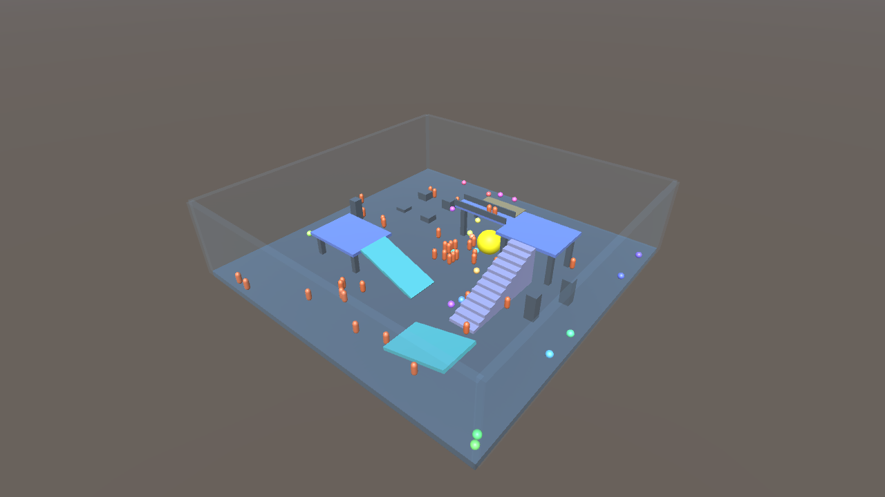

# 20 人 / 20Hz / 3D PhysX 场景验收（2026-10-25）

当前 Crowd 场景采用 20 个独立 TCP 控制客户端、50 个 NPC 胶囊、一个自由大球，共 71 个动态刚体。物理 50Hz，客户端控制输入各 20Hz，状态同步 20Hz；本轮没有改变为 20Hz 物理。场地 50×50m。

地形由 Go 和 Unity 共用 `gameplay/physics/terrain.json`，包括 4m/6m 平台、约 21.8° 坡道、12 级台阶、高架桥及护栏、桥下通道、低顶隧道、台座、柱阵和 15° 侧坡。43 个静态 box 都是真实服务器碰撞体，旋转由原生 PhysX 处理；玩家有真实重力和垂直运动。围墙 12m，显示采用半透明材质。

AOI 使用 10m XZ Block 粗筛和 XYZ 球形距离精筛，12m 进入、14m 退出，自己始终可见。Chunk 为 25m，处理进入、移除和重入；不做视线遮挡。Unity 槽位 0 为全场只读观察者，不计入下表 20 个控制连接。

## 60 秒独立性能结果

macOS 26.5.2 arm64、10 个逻辑 CPU、Go 1.27.3、PhysX 4.1.2；原生物理 worker 1，Nest short/long/io 为 2/1/1。测试期间未并行运行 Unity、race、编译或图谱重建。实际墙钟 60.55 秒，未使用 race 编译。原始结果见 [result.json](20hz/result.json)、[host.log](20hz/host.log)，源文件与二进制摘要见 [source-manifest.json](source-manifest.json)。

| 指标 | 结果 |
| --- | ---: |
| 控制输入发送 / 接收 / 拒绝 | 24,000 / 24,000 / 0 |
| 失败客户端 | 0 / 20 |
| CPU（一个核心为 100%） | 10.14% |
| 最大 RSS | 21.72 MiB |
| 服务器总下行 | 2.765 Mbps |
| 平均每客户端下行 | 17.28 KB/s |
| 总上行 | 4.76 KB/s |
| 平均 / 最大可见对象 | 13.88 / 55 |
| 单步物理平均 / 最大 | 491.98µs / 3452µs |
| 物理完成 tick | 2999 |
| AOI 进入 / 离开 / 重入 | 4891 / 4628 / 3486 |
| 垂直位移超过 1m 的玩家 | 20 / 20 |
| 玩家中心高度范围 | 0.382～6.588m |

带宽是 TCP 应用数据量，未包含 TCP/IP、加密和生产 Gate 开销；CPU/RSS 只计服务器进程，未计 Python 客户端。平均带宽不是峰值带宽。当前人数、地形和可见数量都与此前 50 人平面场景不同，不能直接当作同口径性能提升比例。此轮未测生产网络延迟、Linux 或长期容量。

## 初轮缺陷及修复

原 4m 围墙低于新 6m 平台，玩家能越墙落出有限地面。初轮最低 y 达到 -16452.576m，旧验收只检查 AOI 与移动而没有检查边界，所以原始 `failed_clients=0` 不能作为通过证据。[invalid-low-walls/result.json](invalid-low-walls/result.json) 原样保留，此轮性能数值不参与最终结论。

修复将场景边界升至 12m；不以逐拍钳制坐标掩盖碰撞。新增完整世界 3000 tick 回归，检查全部 71 个动态对象，每拍要求 y≥-0.1、|x|/|z|≤25.1；网络验收同样检查收到的所有对象。负对照恢复旧 4m 围墙后，在 tick 88 检出 ID 59 越界；恢复 12m 后通过，见 [修前](low-wall-regression-before.txt) / [修后](low-wall-regression-after.txt)。这是越界/坠落回归，不代表零瞬时穿透或任意控制输入永远无法离开场地。

定向回归另覆盖旋转坡道滚落、XYZ 高度 AOI、地形人口元数据一致性。以下命令通过（四包 race 各两轮、vet、Python 与 shell 语法）：

```sh
GOCACHE=/tmp/roost-physics-gocache GOWORK=off go test -race -tags physx -count=2 ./infra/physics/physx ./gameplay/physics ./cmd/physics-viewer ./framework/sync/chunksync
GOCACHE=/tmp/roost-physics-gocache GOWORK=off go vet -tags physx ./infra/physics/physx ./gameplay/physics ./cmd/physics-viewer
PYTHONPYCACHEPREFIX=/tmp/roost-physics-pycache python3 -m py_compile scripts/physics/measure-crowd.py
bash -n scripts/physics/verify-crowd.sh scripts/physics/create-viewer.sh
```

## 复跑与构建边界

原生 API 新增刚体旋转并改为 `rp_add_pose`，需要重建 native 动态库与 Go 宿主。Unity 同步 C# 文件、Editor/ViewerProject.cs 和 `Resources/PhysicsTerrain.json`，包依赖包含 `com.unity.modules.jsonserialize: 1.0.0`；新建脚本已覆盖。

```sh
scripts/physics/build-native.sh
GOWORK=off go build -tags physx -o artifacts/physics-viewer ./cmd/physics-viewer
python3 scripts/physics/measure-crowd.py --seconds 60 --hz 20 --port 19092 --output artifacts/crowd-3d-20hz
scripts/physics/verify-crowd.sh /absolute/unity/project
```

宿主仍为本地原生 PhysX + Nest 提交 + Chunk TCP 展示链路，并未接入生产 Gate 的身份认证、输入限流与实际网络环境。原始单机/客户端物理对照场景保留；当前 Crowd 画面显示服务器权威状态，不伪称两端同输入的确定性对照。

CBM 刷新失败：共享服务 index worker exit=1，覆盖查询返回该 worktree 未索引；本轮依赖源码和运行验证，不声称图谱已刷新。未停止共享索引服务。

## Unity 视觉验证

Unity 6000.3.12f1 实际运行通过：`frames=200 tick=766 bodies=71 bytes=842020`，见 [验收输出](unity-validation.txt)。该轮包含编辑器竞争，不作为性能样本。首次编译发现缺少 JSON 序列化模块，已同步修复新建脚本和当前项目依赖后复跑通过。


