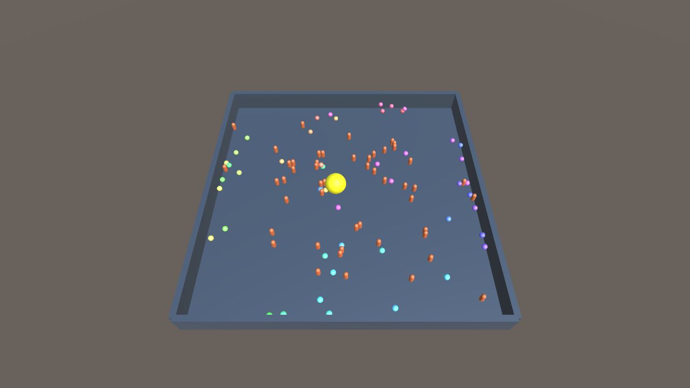

# 50 客户端控制 / 101 刚体（2026-10-25）

> 历史 50 人平地样本。当前 Crowd 已按维护者要求改为 20 人立体场景，不保留旧人数/地形兼容路径；本文数值和摘要保持原样，下面的旧场景命令不能用当前代码原样复现。当前入口见 [20 人 3D 报告](../chunk-physx-3d-20261025/README.md)。

本地单宿主，50 条独立控制 TCP 连接，每条连接控制一个小球；另有 50 个 NPC 胶囊和 1 个自由大球。50×50m 围场、25m Chunk，全部客户端订阅完整场地的 101 个动态对象。不是仅在服务器循环模拟 50 个输入，也不是 50 个 Unity 编辑器。

## 实测

macOS 26.5.2 arm64、10 逻辑 CPU、Go 1.27.3、PhysX 4.1.2。GOMAXPROCS 未强设。物理 dispatcher 1 worker，Nest short/long/io=2/1/1。物理 50Hz，每客户端 20Hz 上行控制，总输入目标 1000 条/秒；20Hz/50Hz 下行各顺序运行约 60 秒。资源测量不运行 Unity、不并发编译测试或索引。

| 同步上限 | 服务器 CPU（100%=1核） | RSS峰值 | 全部客户端下行 | 每客户端下行 | 全部客户端上行 | 物理步平均 / 最大 | 完成物理拍数 |
| --- | ---: | ---: | ---: | ---: | ---: | ---: | ---: |
| 20Hz | 15.90% | 22.44MiB | 50.41Mbps | 126.03KB/s | 11.90KB/s | 221.04µs / 5.920ms | 2998 |
| 50Hz | 23.05% | 23.12MiB | 128.29Mbps | 320.73KB/s | 12.00KB/s | 151.33µs / 11.599ms | 2998 |

每档客户端发送 60,000 条，服务器 accepted=60,000、rejected=0；全部 50 客户端通过序号连续、有限值、完整 101 对象和自身小球移动核验，failed_clients=0。没有观测到输入调度迟到（客户端未出现负的下次等待时长），不等价于端到端输入延迟为零。

20Hz 档每客户端最终 tick=2996..2997，50Hz 档均为 2997。发送取最新绝对快照，允许合并跳 tick，不允许协议 seq 丢失。全部控制球的“最大偏离初始位置”至少约 41m；大球也被实际推动（两档最大偏离初态约 25.76m / 19.77m）。这些值用于确认运动发生，不是位移精度或两档相同输入验证：客户端按序号生成固定施力，实际网络到达的应用 tick 并不固定，不能把不同运行轨迹作为发送频率改变物理的证据。

CPU 用 wait4 获取服务器所有 Go/native 线程的 user+system 时间，除以观测进程墙钟；不包括 Python 客户端或 Unity。RSS 为服务器峰值。全量首次基线和 RSv2 包头计入接收量，TCP/IP/ACK/链路层开销不计。上行包括 4 字节槽位握手和 12 字节输入。墙钟包含短暂启动/关闭，20Hz 约 60.54s，50Hz 约 60.01s；不以模拟 tick×dt 当作实际运行时长。物理耗时包含 NPC/输入邮箱取值、原生 Step 和状态读回，不等于全进程成本。

当前每个对象仍是 53 字节物理状态，加对象 ID/长度、Chunk 和包头；未量化或做字段 mask。全可见 50 倍扇出使带宽比单客户端显著增加：50Hz 比 20Hz 多约 2.54 倍下行。此结论限定在 101 刚体、50 接收者、loopback 60 秒样本，不能当作公网延迟或服务器容量上限，也未测试生产 Gate/AOI、Linux、多机或长稳。

## 输入约束与实现

详见 [框架契约](../../../framework/CHUNK-PHYSICS.md#50-客户端控制场景2026-10-25)。每连接绑定唯一槽位；重复占槽、序号重放、非有限/过大加速度拒绝。邮箱只保留最新期望加速度，不允许客户端写权威位置。失联 250ms 后停止施力，断开释放槽位，旧连接不能释放或写入新所有者。50 槽各收首条输入后启动物理；完整物理结果仍经原有 Nest/StateDAO 成功提交后同步。

这条上行是 loopback 验收宿主的控制协议，没有帐号鉴权、输入确认或生产 Gate 接线，不把它写成线上可直接部署的多人服务。输入属于持续控制状态，可合并；不能照搬到不可丢的业务事件。

## 证据与复跑

- `20hz/`、`50hz/`：result.json、每客户端 clients.json、宿主 host.log。
- `measured-build-sha256.json`：本轮实际性能二进制、动态库与客户端脚本摘要。测量后补齐读取 deadline 错误处理和更及时的断线释放，不改变稳态输入/模拟/同步流程；新代码另跑 race 与断线回归，不把样本伪称为重跑结果。
- `scripts/physics/measure-crowd.py`：独立真实控制客户端与接收核验，CPU 与客户端开销分开。
- `scripts/physics/verify-crowd.sh`：启动 50 控制客户端，再以 Unity 旁观。此轮资源数据受 Unity 和回归测试竞争影响，保留在 artifacts，不作为性能样本。

```sh
GOWORK=off go build -tags physx -o artifacts/physics-viewer ./cmd/physics-viewer
python3 scripts/physics/measure-crowd.py --aoi-radius 0 --seconds 60 --hz 20 --output artifacts/crowd-20
python3 scripts/physics/measure-crowd.py --aoi-radius 0 --seconds 60 --hz 50 --output artifacts/crowd-50
scripts/physics/verify-crowd.sh /Users/whb/roost/roost-physics-viewer
```

Unity 项目新增 `Assets/Scenes/Crowd.unity`，收到 200 帧、101 对象后自动验证通过并导图。画面只显示服务器权威状态，原来的 PhysicsComparison 双端对照场景保留。图中彩色小球由独立网络连接控制，橙色为 NPC 胶囊，黄色为大球。



已执行相关四包 race/count=2、go vet；补测输入所有权/重放/无效值/过期/旧连接隔离，以及真实 net.Pipe 断线排空。CBM 尝试索引仍失败，coverage 返回未索引，本轮以直接源码和实测为依据。未提交、未发版。

当前 crowd 默认 AOI；上面的历史全场复跑命令已补 `--aoi-radius 0`，原始数值与证据不变。最新结果见 [AOI 报告](../chunk-physx-aoi-20261025/README.md)。
