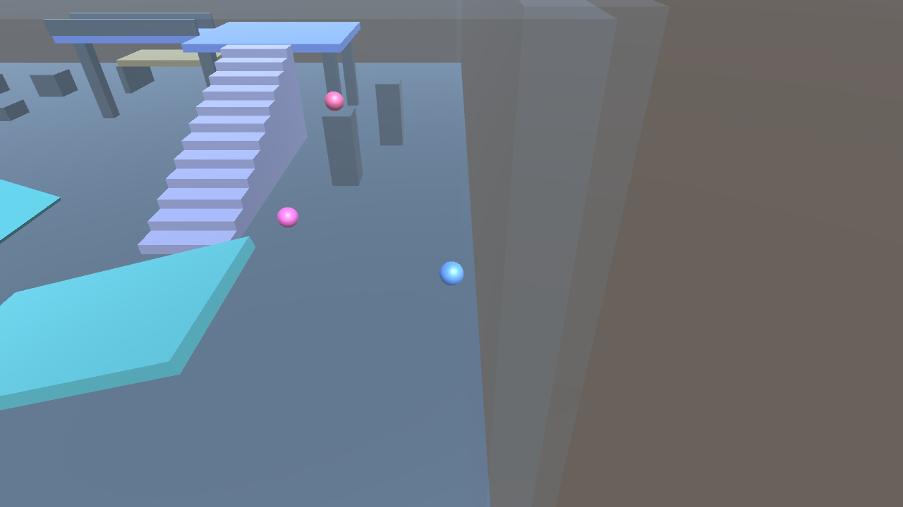

# Room Entity 与 Unity 输入验证（2026-10-25）

基线 4bfe26a1，macOS ARM64，Unity 6000.3.12f1，PhysX 4.1.2。本报告是功能验证，不是容量或端到端延迟基准。Linux 实跑按维护者要求暂缓。

实际链路：Unity 输入 → loopback TCP → physicsroom.Submit → PhysX 50Hz → EntityHost / Nest Guard / StateDAO → 3D AOI / Chunk → Unity 解码显示。20 个玩家球、50 胶囊、一个自由大球；本次一个 Unity 客户端控制第 13 球，其余刚体只参与物理。新帧发送上限 20Hz，AOI 12m 进入 / 14m 退出。

最终 Unity 输出：

```
ROOST_VIEWER_TCP_PHYSICS_PASS frames=200 tick=1417 bodies=4 bytes=22732 travel=36.77 rise=2.43 jumps=2
```

这里的 4 是本客户端当时 AOI 内动态刚体数量，不是全房间刚体数量。程序自动输入走同一发送队列，检查水平位移和一次跳跃效果，发送两次跳跃请求；不把它称为两次成功起跳或人工按钮点击验收。方向按钮和 JUMP 在交互 Play 模式显示，也支持 WASD / 方向键 / 空格。截图由相机渲染，不含 IMGUI。



实际执行并通过：

- `go build ./...`，physics-viewer 的 physx 构建。
- `go test -race -tags physx -count=2 ./wiring/physicsroom ./infra/physics/physx ./service/physicsroom ./gameplay/physics ./framework/sync/chunksync ./cmd/physics-viewer`。
- 相关服务/接线/宿主包 vet。
- 原生落地起跳、空中拒绝追加跳跃；重复 Sequence 不重新触发或延长 TTL；垂直加速度拒绝；多房间状态隔离、快照不别名、销毁后 Entity 回收。
- 本地 Unity 实际进入 Play Mode，经网络移动跳跃、解析 Chunk 并输出图像。

保留的失败：首次 Unity 配置误加不存在的 inputlegacy 包，移除后编译；随后服务超时断开的一轮未通过；第二轮已收到 724 帧、位移 36.814m、抬升 2.427m，但 ScreenCapture 在批处理没有完成截图，最终超时。改用显式 Camera.Render / Texture2D 后完整通过，没有放宽运动验证。Unity 自身仍打印 QuickSearch 索引异常，本场景完成验证不代表编辑器日志零异常。原始日志存于被忽略的 `artifacts/physics-room-input-20261025/`。

复跑命令及手动操作见 [客户端说明](../../../../client/physics-viewer/README.md#room-场景按钮控制房间中的球)，接线见 [房间服务](../../../framework/PHYSICS-ROOM-SERVICE.md#房间-entity-接入2026-10-25)。当前不是 Gate 登录到三个独立进程的生产部署验收；开房和业务授权留给使用方。

CBM 刷新再次失败（index worker exit=1，coverage 返回当前 worktree 未索引），本次通过直接读取源码与实际测试验证，未宣称索引已刷新。
